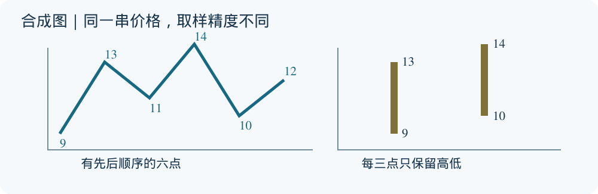

# m03 · 级别：先认部件，再认递归

来源：PDF 物理第 5 页「第三节 级别」起，至第 6 页「第四节」标题之前。

## 自组、独立与关联（第 5 页）

时间负责给成交排序。结构级别由同类结构依定义逐级组合而来，计时单位不决定它何时完成。所谓自组，是符合规则的结构生长出新的层；所谓独立，是每层有自己的构造系统，不能把甲层与乙层的一段直接并成「两段同级部件」；所谓关联，是当前层可由次级部件组成，也为上一级提供部件。这两句话可以同时成立：同一次组装用同级部件，组装产物可用于下一次组装。作者再次用基因比喻自同构规则，把递归看作级别依次增大的构造。

## 严格递归与实用图表口径（第 5–6 页）

在第 5 页的实用分层里，每笔成交是最细的原始系统，为一分钟取样上的笔提供资料；一分钟笔是所举最小笔系统，为一分钟线段提供部件；由线段构造第一级走势类型，由完成的第一级走势类型构造第二级，再递推到第三级和任意后续层。书中用分子、细胞、个体、家庭、家族帮助记忆层次，这些是比喻，不是市场中必须出现固定层数的断言。「原始成交的笔数」和「形态学的笔」所指数列不同。

第 6 页给严格口径：从逐笔成交这一最低精度输入出发，按走势中枢的延伸、扩展等结构定义向上递归；不必指定 5 分钟、30 分钟或日线才成立。实用口径常以图表取样作近似观察，例如 1、5、30 分钟及日、周、月、季、年；也可换掉 30 分钟，改看 15、60 分钟。时间标签使查图方便，不保证对应关系。把已给 1 分钟图缩小只是多看一段历史；把 1 分钟数据聚成 30 分钟数据才更换输入精度，可能吞掉重要细节。结构完成仍须按规则核准。作者以显微镜比观察图、被观察物比走势和中枢，并以读诗从语法到整体的体验说明多尺度熟悉后的直观；这种直观不替代验证。

## 例：同一段行情，三种处理（第 5–6 页）

合成路径先依次出现 9→13→11→14→10→12。若训练题已独立核准末三段 11→14、14→10、10→12 为连续、已完成的同层构件，它们的范围 [11,14]、[10,14]、[10,12] 相交为 [11,12]，可以作为下一层共同区间的候选；能否称中枢还要查课程对当前构件的资格定义。只缩小显示仍是原六个点；若把前后各三点分别压成一根只保留高低的柱，则只剩 [9,13] 与 [10,14]，三段的端点次序已不可恢复。即便两根粗柱互有重叠，也不能用来代替三段的资格证据。

[查看矢量图](../../../assets/chan-book/full/m03.svg)

## 练习

1. 连续六个价格点为 20、25、22、26、21、24。如果把前三点、后三点各压成一根只保留最高最低的柱，写出两柱范围。若原路径中末三段 22→26、26→21、21→24 是独立核准的同层构件，求它们的共同范围。哪一种数据能复核这三段划分？
2. 甲、乙是同层已完成走势，丙是比甲低一层的已完成走势，丁是和甲同层但未完成的候选走势。课堂要求连续三个同层、已完成且合格的构件才能组合。能否用甲、乙、丙，或用甲、乙、丁立即组合？如果只把三段改画在 30 分钟图，是否解决问题？
