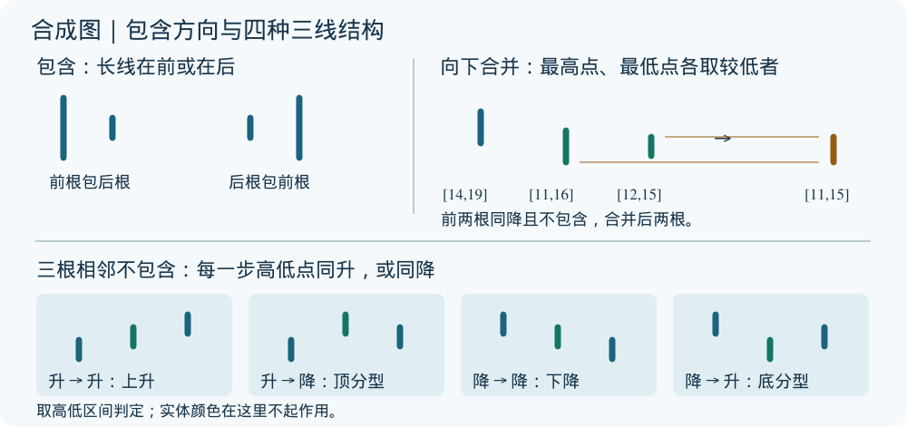
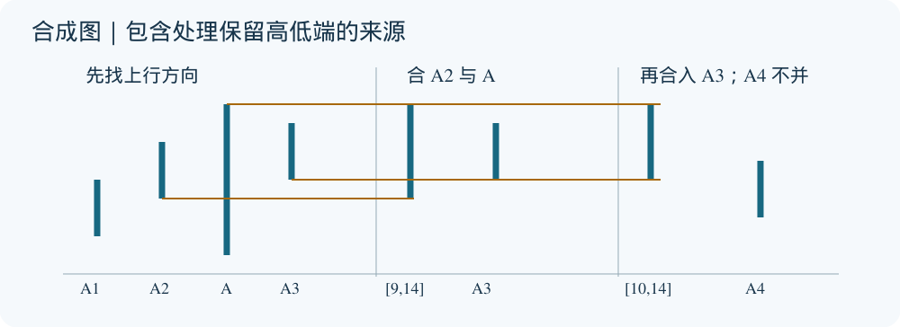

# m04 · K 线包含：按时间折叠区间

来源：PDF 物理第 6 页「第四节 K线的包含关系」起，至第 7 页「第五节」标题之前。

## 包含与局部方向（第 6–7 页）

用 [d,g] 记一根 K 线的最低、最高价；两根的实体颜色不参与这一步。若一根的低点不高于另一根且高点不低于另一根，则一个区间包含另一个，谁包谁都要处理；只有交叠、两端又分别同升或同降，就不是包含。原图①（P06I01）把一根缩在另一根高低之间，交换先后仍是包含。

若 n 与 n+1 包含，而 n−1 与 n 不包含，先看 n 相对 n−1：n 的高点更高则向上，n 的低点更低则向下。因为这两个区间非包含，更高的高点与更高的低点同时出现，反向也一样。若图从一对包含开始且缺少可认证方向，不能用本对哪一根更长或收盘涨跌来决定；补左侧区间，或先声明课堂初始化约定。

## 合并、继续和停止（第 6–7 页）

- 向上：新范围为 [max(d₁,d₂), max(g₁,g₂)]，低点、高点各取较高者。
- 向下：新范围为 [min(d₁,d₂), min(g₁,g₂)]，两端各取较低者。
- 按先后滚动：只比较刚得到的处理区间与下一根；仍包含就沿已建立的方向处理，若不包含则留下两个区间，新的非包含比较可作为其后方向的依据。在同方向且每一步均可合法合并的 n 根组上，就是 [maxᵢ dᵢ,maxᵢ gᵢ] 或 [minᵢ dᵢ,minᵢ gᵢ]。

原文称「遵守结合律、不遵守传递律」。在固定方向和可合并组内，两端求 max 或 min 的算式确实能逐步结合；它不授权改顺序，也不表示原始包含链自动构成同一组。例：[1,5] 与 [2,3] 包含，[2,3] 与 [2,6] 也包含，但 [1,5] 与 [2,6] 只是相交、互不包含。一根处理区间可能由两根不同原线提供高低点，不应当作实际成交生成的单根原 K 线。

## 原图顺序与数值复做（第 6–7 页）

图②（P06I02 上排）按两次相邻端点变化列出四类非包含三线：升升、升降、降降、降升，依次是上升、顶分型、下降、底分型；每一步只有两种方向，所以共有四种。图③（同图下排）左边随升势取高端中的高端、低端中的高端；右边随降势取两低。红框是界定高低的示意，非成交区间。图④（P07I01）中央 A 最长；先由 A1→A2 建立向上，合并 A2 与 A，再用第一次的结果与 A3 比，仍包含才继续。原图给定相对关系，未提供价格刻度。

补图区分「谁包含谁」和「该向哪边合并」。右上先由前两根同降建立方向，再把后两根合成 [11,15]；下排四格各自独立。

合成复做：设 A1=[7,10]、A2=[9,12]、A=[6,14]、A3=[10,13]、A4=[8,11]。A1→A2 两端升且非包含；A2 与 A 向上并为 [9,14]；[9,14] 包含 A3，再并为 [10,14]；[10,14] 和 A4 两端都下移，互不包含，到此停并。保存结果 A1、[10,14]、A4，三者读作升后降，故有一个顶分型。若武断地向下合并 A2 与 A，就会得到 [6,12]，它不包含 A3，构造链随之变了。

[查看矢量图](../../../assets/chan-book/full/m04.svg)

## 练习

1. 依时给 [12,16]、[10,14]、[11,13]、[9,15]、[10,16]。从第一处非包含建立方向，列每一次合法合并、保留下来的区间，以及最后一次比较为何停止。
2. 一段图只有 [4,10]、[5,8]、[6,11]，没有任何左邻、初始方向或初始化约定。判定两对原始相邻区间的包含性，并分别假设已知向上和向下给出滚动结果。能否从画面唯一选取一个？
