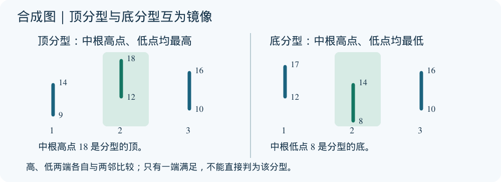
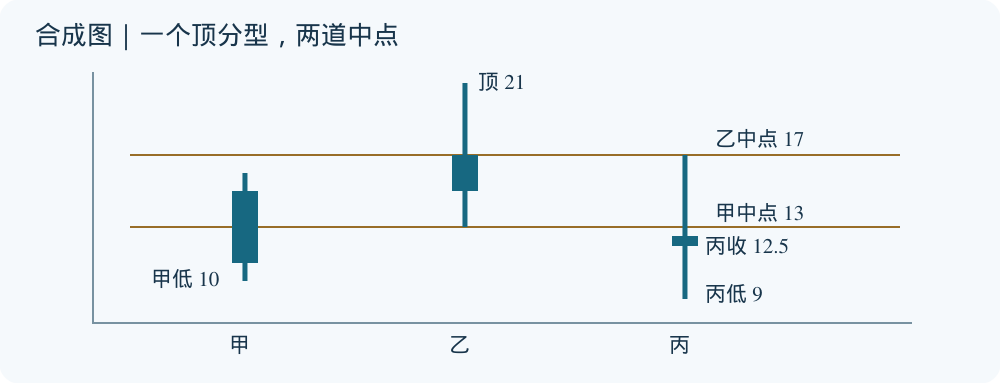

# m05 · 分型：几何成立、力量判读与后续成笔

来源：PDF 物理第 7 页「第五节 分型」起，至第 8 页「第六节」标题之前。

## 三根处理区间，两个端点都要比（第 7 页）

先按包含规则处理相邻 K 线，用 [低,高] 表示各处理区间。顶分型要求中间根的高点和低点各自严格大于两邻；分型的「顶」取中根最高价。底分型要求两个端点各自严格小于两邻；分型的「底」取中根最低价。原图 P07I02 左图①是两端一起上再一起下；右图②是一起下再一起上。书中说「无顶分型便无顶、无底分型便无底」，这里的顶、底是技术定义；原行情仍会有局部高低。中根单有最高价但低点并不高，只能回查包含，不能直接标顶。若右邻仍未稳定，在实时记录中先标候选，分清极值出现与分型可判两个时间。D08 的课堂例进一步把单见高点和已有独立右邻的构造候选分开记录。

补图只画高低区间。右图中根的高点 14 和低点 8 都低于各自两邻，故为底分型；其中 8 是分型的底。

## 三次攻防和三根的力度线索（第 7 页）

作者对标准顶分型的解释：第一根的冲高受阻，回落可表现在第一根的上影或第二根的下影；第二根创更高点，作者解释为更小级别的买方努力虽创新高却力度背驰，留下上影；第三次上攻没创新高，作者把它与较小级别第二类卖点作近似对应。底分型反向解读。作者把三次较量类比中枢的三次反复，但中枢的构件是三个合格次级别走势，仅有三根 K 线不能证明中枢或背驰。

- 无包含时上下关系清楚；包含可表示犹豫、小级别延伸或扩展。原书把长阴线直接吞没阳线的情形从这条犹豫解释里除开；被吞没的阳线无须是长阳。
- 第一根长阳、第二和第三根均小阴或小阳，原书常判为中继线索：小级别中枢上移后出现新中枢。若第二根长上影或长阴，第三根不能以阳线收在第二根全区间中点之上，则是顶分型较强、较易延续成笔的线索。
- 第三根低点低于第一根低点且无力收在第一根区间中点之上，是第三根特别弱、顶分型冲击较强的情形。两条中点规则参照的 K 线不同；「之上」严格比中点高。长短没有统一数值阈值，合并产生的处理区间也未必有原生开收盘；无可靠开收盘或影线资料时，只判几何，不套强弱信息。

## 后续要观察什么（第 7–8 页）

分型可能成笔，也可能只是原走势中的中继。原书以顶为例：一条辅助线索是有效跌破 5 周期均线（日线图即 5 日线）；它未定义「有效」时长。更细的核验是在分型覆盖的较小级别找**实际能确认**的最大中枢，看三类买卖点及中枢是否移动或扩展。原书举日顶下用 5 分钟或 1 分钟、常选 5 分钟，并以覆盖时间为理由排除示例中的 30 分钟。那是观察安排；如果换了数据或结构，仍须核定级别。第三类卖点先要求相对于这个中枢的直接次级下离已完成。回抽是否为同次下离后的首次、是否为直接次级，若未知先查，已知不符就不用该段。身份已核但未完，且暂见最高低于核心下沿，只记候选；已到下沿或更高，即使未完也立即排除本次严格三卖。只有回抽也已完成、全段最高严格低于核心下沿，才确认三卖；买点上下镜像。排除这次三卖后，延伸、再离开或扩展各自还要查构件和后续。

原书的分支主张：日顶对应小级别中枢出现三卖且没有造成扩展，则书中判成向下笔的可能性很高；不成笔并最终化解此顶，按作者所述须出现某级别三买，否则短暂新高仍可为假突破。若三卖后反而扩展，原书把它列为常见中继，留意盘整底背驰后的回补；若非盘整背驰而属趋势下行，原书要求等背驰再考虑回补。若前次已是中继顶而其后小级别发生背驰或盘整背驰，作者认为下一个顶继续中继的机会较低。这些是源文条件性判断；第 7–8 页没有统计、力度计算式、可复核历史分时输入或「几乎百分之百」的验证，不可改写成实测胜率。

操作段落另给边界：操作级别尚未成顶时，不把小级别中枢震荡当成该级别终结，做短差也要控制数量；已成顶而依书中办法卖出后，要再辨中继与成笔，前者考虑回补，后者等待笔完成。作者要求配合小级别第二买卖点，并分清盘整背驰和一般背驰。按作者的主张，已经成立的大级别分型有相应的较小级别一、二类点，逆推却不成立：有小级别点不代表大级别分型已成立。这里没有逐根行情来独立验证这条对应关系。不能只因为今天没破昨天高低点就宣告确认。30 分钟乃至年线图可能长期找不到符合定义的分型；可换到更细图找证据，观察周期并不锁定操作级别。

## 例：区间中点与完成资格（第 7–8 页）

合成三根相邻原线均无包含，如下；额外给出开、收，故可谈实体和影线：

| K 线 | 低—高 | 开→收 |
| --- | --- | --- |
| 甲 | 10—16 | 11→15 |
| 乙 | 13—21 | 17→15 |
| 丙 | 9—17 | 12→12.5 |

乙的高、低均最高，判顶，顶价 21。乙上影为 4（21−17）；丙收 12.5，虽为阳线却低于乙中点 17，且低点 9 跌破甲低点 10，收盘也未越甲中点 13。对第一条线索，只能确认丙收未过乙中点；本题没给判断乙的上影或阴实体是否够长的基准。第二条的破甲低且收不越甲中点，由给出的高低和收盘价确认；仍须等待合格底分型和连接证据，不能直接画出一笔。若丙改为 [14,20]，乙和丙一边高一边低，属包含，必须先处理，不能照搬原判。

[查看矢量图](../../../assets/chan-book/full/m05.svg)

## 练习

1. 三根相邻原线依时为 [19,25]、[22,30]、[18,26]，开→收依次 20→24、26→23、20→21。查包含、定分型和极值；计算首两根的区间中点，并按第三根的低、收说明两条强弱条件是否满足。右边没有后续数据，能否判成笔？
2. 已确认一个日线顶分型。其覆盖区间内，小级别已确认三卖但随后扩展；另一份小级别图只有一次跌破 5 周期均线，没有任何中枢资格、三类点或后续端点信息。分别说明哪份资料支持回看中继，哪些结论仍不能给出。
