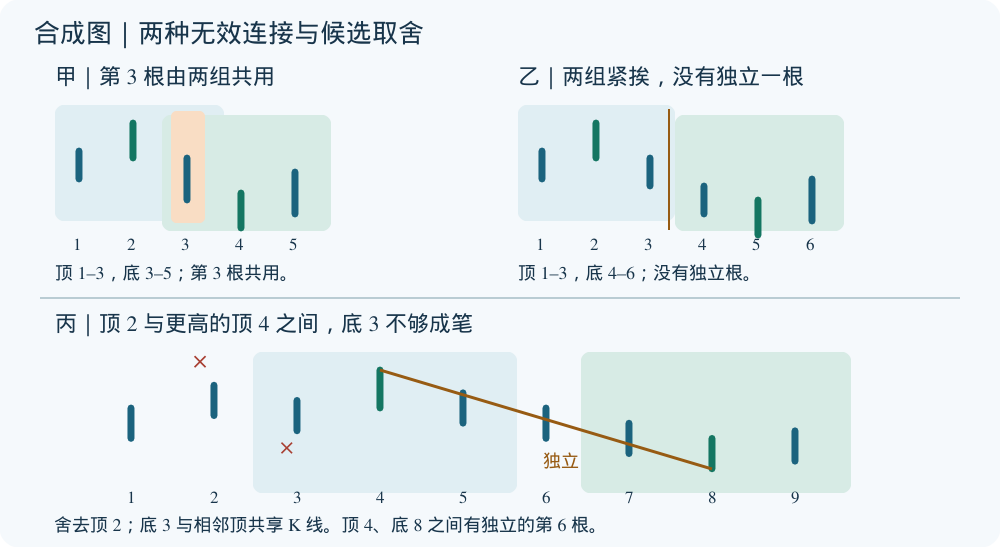
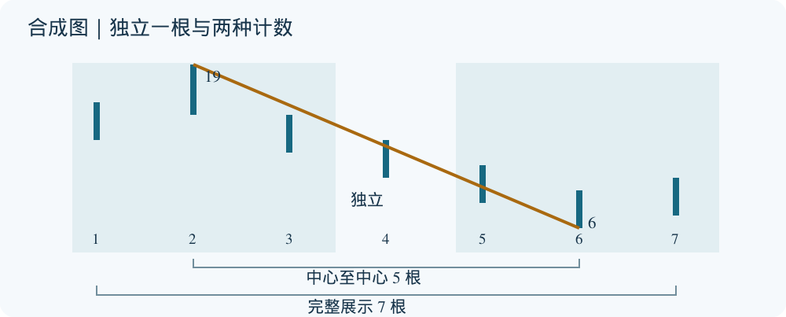

# m06 · 笔：怎样从两个分型得到一条合格连接

来源：PDF 物理第 8 页「第六节 笔」起，至第 9 页「第七节」标题之前。

## 三道资格，不只是一条连线（第 8 页）

先做 K 线包含处理并标记合格分型，每个分型在这个序列里占相邻三根。笔压缩顶、底之间的其他波动。先底后顶是向上笔，可读作底分型、上行部分、顶分型；先顶后底反过来，称向下笔。合格笔须同时满足：

1. 端点一顶一底，不把两个顶或两个底直接相连。
2. 顶底两组三根之间至少有一根处理后 K 线不属于任一分型。分型共享一根不行；不共享但首尾紧挨、中间无空档也不行。
3. 看顶分型中心最高 K 线的**区间**，至少一部分在底分型中心最低 K 线的区间之上；顶完全落在底的范围内或顶还低，都不合格。例如中心分别 [8,11]（顶）和 [7,12]（底）时，虽有低点 7 对高点 11 的上升净差，但 11 并未越过底中心区间的上端 12；不能据净差判笔。

## 「至少五根」从哪数（第 8 页）

原文同页同时说顶和底分型之间须有独立 K 线，又说由顶、底在内「至少五根」。本课把前者作为判据、把后者分开计数：若底分型占第 1–3 根、独立第 4 根、顶分型占第 5–7 根，则标明两中心是第 2、6 根；中心到中心（含两中心）正好五根，画出两组完整分型则需七根。这是两句可相容的读法；原书没在数字旁明写计数起止，不能拿任意五根原 K 线省掉分型外邻、独立组或去包含。

原图 P08I01 左侧图①先画完整下笔再拆成顶分型、下行中间线、底分型，说明独立线怎样留出；图②顶底共用一根；图③虽有两组分型，但没有中间独立线。后两图都不合格。原图的线条没有价格刻度，本课用明确的组号给数值算例。

## 同类候选、替换与待定（第 8–9 页）

若两个候选顶（或底）之间另有顶和底，先看中间能否组成合格笔：能成笔就不能简单删除；若不能，原书说忽略无资格的中间波动，继续按一顶一底组织。若中间没有其他合格顶底，原书把这解释为回折太小，并在操作步骤细化为：前顶低于后顶，留下后顶；前底高于后底，留下后底。不满足替换条件的（包括同价），书写「先保留」；不能从该段直接推出同价一定删前或删后。图④ P09I03 展示下降线穿过局部折返，红叉标出忽略的候选，提供的是取舍逻辑，并不证明任意等价输入都能唯一落点。

形成每一笔后，已确定的内部端点同时连接一下一上或一上一下；左边未给足或右边尚缺反向合格端点，只记待定。原书主张按规则可唯一分解；源节未交代所有等价与边界落点的决胜规则。本课程其他单元若采用同价保留早者，那是为复做规定的约定；不能当成本文原书的原话。

补图甲、乙分别演示共用一根和没有独立根；丙为另一个合成例，红叉标出舍去的顶 2 和不能接成笔的底 3。橙线连接顶 4 与底 8，独立的是第 6 根。

## 例：逐根核对一个向下笔（第 8–9 页）

七根已处理的合成区间：

| 编号 | 1 | 2 | 3 | 4 | 5 | 6 | 7 |
| --- | --- | --- | --- | --- | --- | --- | --- |
| [低,高] | [13,16] | [15,19] | [12,15] | [10,13] | [8,11] | [6,9] | [7,10] |

2 两端最高于 1、3，顶 19；6 两端最低于 5、7，底 6；4 独立；19 大于底中心上端 9。故画 2→6 的向下笔；中心至中心五根，完整展示七根。若去掉第 4 根，剩余序列中的两个分型仍成立，但两组三根相邻无空档，便不能这样成笔。

[查看矢量图](../../../assets/chan-book/full/m06.svg)

## 练习

1. 七根已处理区间依时为 [10,13]、[8,11]、[9,12]、[11,14]、[13,17]、[15,20]、[14,19]。指出底、顶各自三根、连接方向、端点价、独立根，并分别计中心间和总展示根数。
2. 同层候选的时间和价为顶甲 19（组 4）、顶乙 21（组 9）、顶丙 21（组 14）、底丁 10（组 18）；已核定它们是分型，没有其他可成笔的中间端点，丁中心区间 [10,12]。顶乙、丙中心区间分别为 [17,21]、[18,21]。按原书步骤指出谁可直接去掉，谁仍待裁决；若使用「同价优先早者」的明确课堂约定，哪两个中心能连？
