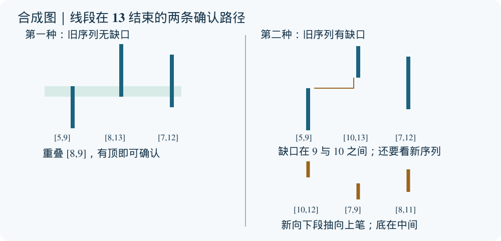
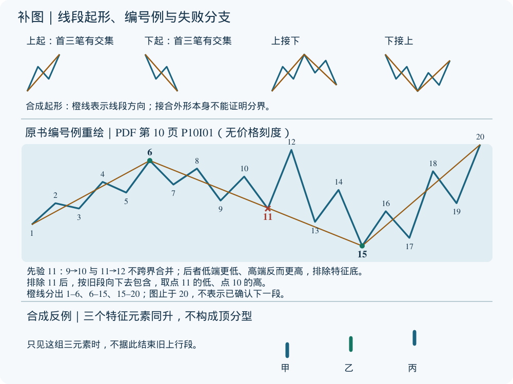

# m07 · 线段：用特征序列确认分界

来源：PDF 物理第 9 页「第七节 线段」起，至第 10 页「第八节」标题之前。

## 先验起段，再找终点（第 9 页）

输入是已按笔口径核定的、首尾连续且方向交替的笔。线段至少三笔，**前三笔须有共同价格区间**：取三笔低点的最大值、三笔高点的最小值，前者不能高于后者。三笔能接成一条折线仍不够。向上线段以向上笔开始、也由向上笔结束，终点顶须高于第一笔的起底；向下线段以向下笔开始也以向下笔结束，终点底低于第一笔的起顶。顶起底收、底起顶收，因而完整线段的笔数为奇数。

线段划分定理：原线段终结，当且仅当有连续三笔（有重叠）构成的新线段来终结它，原书表述为被这样的连续三笔的其中一笔终结。定理提供确认条件；不能在候选极值刚出现时就事后回填「已知终点」。原图 P09I01 图①②用三笔的向上和向下镜像说明起段；P09I02 图③④是向下接向上、向上接向下，只表示组合外形，原书明确说这些外形不充分。

## 抽逆向笔，造标准序列（第 9 页）

以 S 表示向上笔，以 X 表示向下笔。上行线段抽出时间顺序中的 X₁、X₂……；下行线段抽出 S₁、S₂……。每一元素只用该笔的 [低,高]。书用上行中的 S₁X₁S₂X₂……解释为什么抽 X：在保持该上行段的论证设定下，同向 S 被其间的折返所约束，原书说相邻 S 有重合，逆向 X 却可有缺口。缺口是相邻特征元素范围没有公共价位，和市场 K 线隔日跳空不是一个概念。定义也不要求每一向上笔创新高。

把同类元素当作区间 K 线，用已定方向去包含，所得为标准特征序列；只在上行段找特征顶，下行段找特征底。原页本节中间还有两幅未编号的矢量小图：上图在下降折线旁标出 S 与 X；逆向的红 S 是应抽取的序列。下图把候选序列投影成竖区间，并示意同类的包含先处理再辨端点；蓝线只画线段大方向。平面图片无价格刻度，也不能拿图中所有笔都当同一序列的元素。

## 两种情况的分岔在第一、二元素（第 9–10 页）

先假设一个转折点 P。分型第一元素是 P 前旧段最后一个特征元素；第二元素是从 P 起走的第一笔，方向与第一元素相同。P 两侧的这两元素在这个假设下可能分属不同性质，**不可跨界用包含把它们并掉**；P 后同类元素才可用包含（若仍属旧段是旧段的特征元素，若已经换段则同为新段的非特征元素）。若左侧资格、去包含方向、边界两元素资格或右侧数据不足，应说明哪项待核，不能用合并制造确认。经过允许的处理后，还须得到标准序列的合格顶或底。

| 分支 | 第一、二元素关系 | 上行原段的确认条件 | 下行原段的镜像 |
| --- | --- | --- | --- |
| 第一种 | 有重叠，无特征缺口 | 标准序列出现顶分型，段结束在顶分型高点 | 出现底分型，结束在其低点 |
| 第二种 | 严格分离，有特征缺口 | 除原特征顶外，从候选高点向下开始的新段，其反向特征序列（抽向上笔）还须出现底分型 | 除原特征底外，从候选低点向上开始的新段，其反向特征序列（抽向下笔）还须出现顶分型 |

第二种的新序列无需封闭旧序列的缺口；新序列上所需的分型也不再区分自己的第一、二种情况。该规则不是让你无限递归等分型的分型。若不能满足相应分支，暂不承认 P 为分界，旧段继续。P10I04 的上左「情况1」有旧序列顶、第一二元素可交；上右「情况2」在旧序列之外另画「顶分型后的新特征序列」；下图明确标「不构成顶分型」，表示原段可以延续。这些图示提供条件类别，未给逐笔成交输入或刻度。

## 合成复做：同一个顶，确认快慢不同（第 9–10 页）

以下箭头相邻端点间均给为已核准的笔，且左边界已核准。两组先走 0→6→2→9→5→13。前三笔共同范围 [2,6]，可起向上段。13 前最后一条逆向笔是 9→5，作候选分型第一元素 [5,9]。

- **无缺口组**再接 13→8→12→7。三个逆向元素依序 [5,9]、[8,13]、[7,12]，相邻无包含，中间两端都高，为标准序列顶；前两有 [8,9] 重叠，所以按第一种把线段终点确认在 13。13 出现当时尚没有完整特征顶，不能说那时就确认。
- **有缺口组**再接 13→10→12→7→9→8→11。前三个相关逆向元素是 [5,9]、[10,13]、[7,12]，仍构成顶，但头两者没有重合。若只看到 7，缺反向证据。从 13 试建向下段，前三笔交于 [10,12]；抽它的向上笔得 [10,12]、[7,9]、[8,11]，中间两端最低、相邻无包含，构成底分型。到此可回标 13 是旧段终点。新序列首两也有缺口，按原书无须再等待另一层确认；确认所用条件中没有「先补旧缺口」。

[查看矢量图](../../../assets/chan-book/full/m07.svg)

## 原书编号例（第 10 页）

P10I01 图⑤：作者判 6、15 均是第一种，标得 1–6、6–15、15–20 三段。看 6 时抽向下笔 4→5、6→7、8→9，中间的高低两端都在两邻之上，而 7 低于 4，前两范围仍交；看 15 时抽向上笔 13→14、15→16、17→18，中间的高低两端都在两邻之下，而 16 高于 13，前两也交。检验 P=11 时，左末元素 9→10 与右首元素 11→12 先分开看，不能跨候选分界合并。11 低于 9，12 却高于 10：第二元素包住第一，低端虽降、高端反升，不能作两端都低的特征底。下一元素 13→14 比 11→12 两端都低，两者无包含，右侧去包含也不会改掉这个证据。排除 11 后，两笔才同属旧向下段：7→8 到 9→10 两端同降，按向下去包含，取较低的低端 11 和较低的高端 10，等效为区间 [点 11 的低, 点 10 的高]。这组编号是示意图上的拐点号，不能拿 6−1 或 20−15 代替实际核验。图未给价格轴和逐笔输入，能复核相对位置与作者合并判读，不能恢复绝对价格或把右端 20 当成已经有下一段确认的实时时点。

补图中部按第 10 页 P10I01 的编号和相对位置重绘，未使用原图像素，也没有价格刻度。其余小图为合成示意；底部三元素同升，不满足旧上行段所需的特征顶。

## 练习

1. 某组已核准的连续笔端点依次为 20→14→18→11→15→7→12→8→13，左界合格。求起段前三笔交集、旧段 7 附近用于判定的三个特征元素；判顶还是底，哪一种分支，端点是什么？如果只收到最后的 8，能否确认？
2. 某组同层连续合格笔为 0→6→2→9→5→13→10→12→7→9。左界合格。保留候选 13，求旧段三元素和当前能得到的反向元素，说明缺哪一项。再分别追加两个端点 a) 8→11，b) 6→8，比较能否确认 13。
