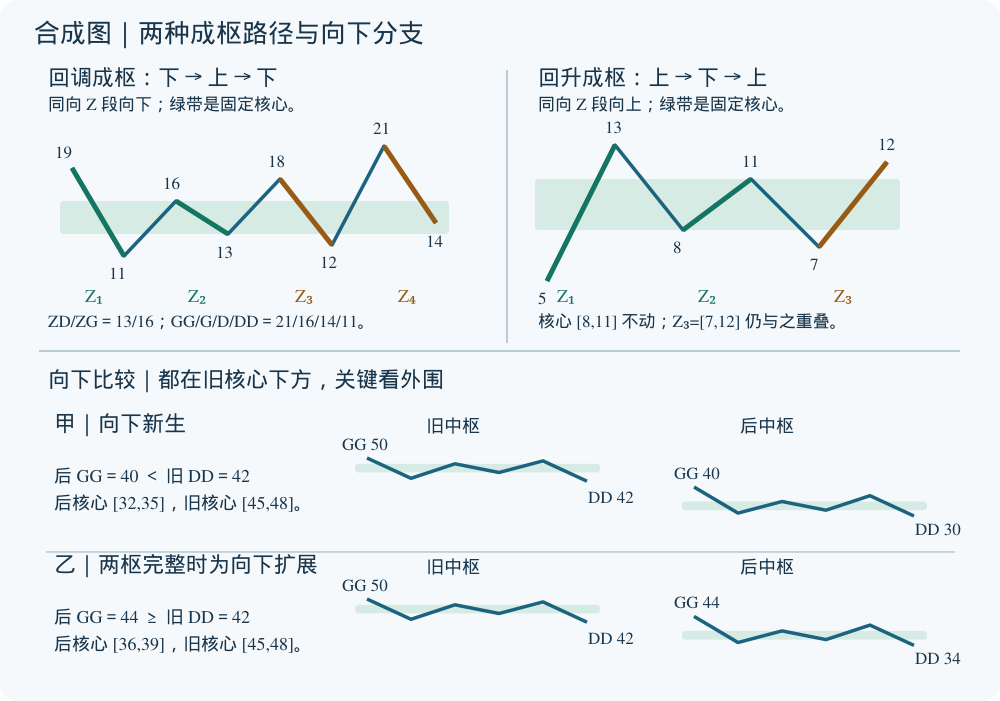
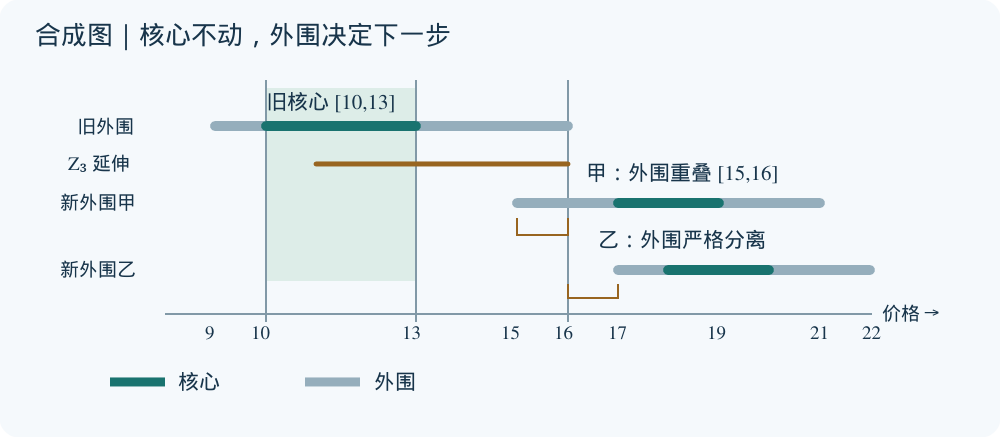

# m08 · 走势中枢：核心、外围与变轨

来源：PDF 物理第 10 页「第八节 走势中枢」起、第 11 页全页及第 12 页页首续句，至第九节标题之前。

## 形成资格：先证明三段，再取共同区间（第 10–11 页）

走势中枢是某级别走势类型中至少三个**连续、已完成的次级别走势类型**的共同价格区间。次级别是递归结构的直接下一层；三根 K 线或随手圈的三笔不自动具备这个资格。给出三段范围时，先核对同层、连续、完成，再取最大低点和最小高点；最大低点大于最小高点便没有共同区间。若两者相等、本课只记零宽边界待核；这沿用本课程的初次成枢口径，与后文原书用等号计外围接触是不同问题。书说可在次级别图上认出已完成构件；这里的重点是可复核的完成证据，不能用分钟标签替代。

在上行中回调形成的中枢常按**下—上—下**表示（第 10 页原图 1），在下行中回升形成的中枢常按**上—下—上**表示（原图 2）。蓝区是三段的共同部分，红线表示周围路径；ZG 是共同区间上边界，ZD 是下边界。两个蓝色小嵌图 P10I02、P10I03 是同一对组合图内的蓝色区域，不是额外的历史行情。

## Zₙ、ZD、ZG、GG、G、D、DD（第 11 页）

Zₙ 是同一中枢形成或延伸检验中，按时间编号的、与中枢**形成方向一致**的完整直接次级段；回调型取向下段，回升型取向上段。先核段的层次、起止、完成和结构归属，再比价；待核的下一条同向段不能因为在核心外就预先剔除。反向段可按 D05 记中点；内部更低层的小波动不单列为 Zₙ。dₙ、gₙ 是 Zₙ 的低、高。初成核心固定为 ZD=max(d₁,d₂)、ZG=min(g₁,g₂)，范围 [ZD,ZG]；后面的合格 Zₙ 用来核对延伸与外围，不能把 G、D 代入不断重算核心。原书对所计入的全部 Zₙ 定义：

| 符号 | 从哪些量取值 | 表示什么 |
| --- | --- | --- |
| GG | maxₙ gₙ | Z 段最高高点 |
| G | minₙ gₙ | Z 段最低高点 |
| D | maxₙ dₙ | Z 段最高低点 |
| DD | minₙ dₙ | Z 段最低低点 |

四个量中 [DD,GG] 是 Z 段覆盖的外围边界。若要比较两整个中枢的外围，须核定所纳入的波动；不能挑有利的两段、漏掉书中要求纳入的延伸波动。

为什么不是少算一段？在相邻端点已经代表各段全范围（没有超出端点的内部极值）的前提下，若合格三段首尾相接、方向下—上—下，写作 a→b→c→d，首末段是 [b,a]、[d,c]，它们的非空交集 [max(b,d),min(a,c)] 本身已位于中间段 [b,c] 内。上—下—上时镜像：首末 [a,b]、[c,d] 的交集若非空，本身位于中段 [c,b] 内。因此在这种已对齐的输入上，三段交集等于前两条 Z 段交集；这不适用于三条随意取出的区间。实图若尚未确认端点就是各段全范围，要回到每段实际最高、最低价，直接对原始范围求交。图③ P11I01 标出 ZG/ZD、外围 GG/DD 和 d₁、g₃，说明固定核心与可越出核心的波动是两层量。

## 延伸、新生、扩展：先核核心，再核外围（第 10–12 页）

1. **延伸**（中心定理一）：每条被核验的 Zₙ 都与旧核心有重叠，即 dₙ≤ZG 且 gₙ≥ZD。这是最低到最高的区间与核心相交；遇到跳空，要见到边界价或核心内部的价格，才能说实际触边或入内，可成交还须另核。书中也用相邻两个围绕旧中枢的次级波动至少有一个触及核心解释延伸；若两个都落在外面，就须复核是否已能形成脱离旧核心的新三段共同区。若某个 Zₙ 有 dₙ>ZG 或 gₙ<ZD，原书排除旧枢继续延伸这条解释，转查新生趋势及其延续、或更高层扩展；实时时一段刚脱离尚不能直接填上未来的第二个中枢。图④ P11I04 左右各画一种绕旧枢继续来回的镜像，后段的高或低可以越界，关键是区间仍触及核心。
2. **新生而成同级趋势**（中心定理二）：前后两同级中枢的外围严格分离时，上行是后 DD>前 GG；下行是后 GG<前 DD。图⑤ P11I02 左边把新枢的最低外围画得比旧枢最高外围还高；右边把新最高外围画得比旧最低外围还低。仅有核心分离不够；相邻中枢及趋势的其他资格仍须核验。
3. **扩展到更高层**（中心定理二与第 12 页续句）：若核心互离，但后 ZG<前 ZD 且后 GG≥前 DD（下方触回），或后 ZD>前 ZG 且后 DD≤前 GG（上方触回），说明围绕前后同级中枢的波动在原书口径下有触及；这是扩展的空间条件，不是同级趋势。正式认定还要按第 18 页先确认前后同级中枢都完整走出，并以完整波动核外围；未完成时保留候选。等号是外围的接触边界。图⑥ P11I03 左右展示新枢虽在上/下方、外围却伸到旧外围。若两候选核心本来就相交，不能直接套用上述两条「核心严格分离」的扩展公式；应先查是否同一旧枢延伸、是否真的有两个独立中枢及如何归属。不能因同一个枢拖得久或多个同级枢一路严格分离，就判成更高级别。

源文把开盘即封涨停作为边界例：同一平价阶段只当原有很小尺度的中枢延伸，翌日继续开盘封涨停可表现为小级别趋势；无论多少天，当始终只有小级别中枢且相邻外围不相接，就不能靠持续时间升级。开板也只提供重新检查相邻波动的机会，仍须满足结构条件。第 11 页用 1 分钟与 5 分钟称呼这一例，不是时间到点的升级规则，也没有提供标的、日期或报价。

补图上排各用前三段确定绿带，再用橙色 Z 段检验延伸；下排两例的新核心都在旧核心下方，但只有甲的后 GG 严格低于旧 DD。补图下排假定前后中枢均完整走出，外围由完整波动给出。乙的外围交于 [42,44]，所以在给定前提下是向下扩展。

## 离开、回抽与盘整极值（第 10–11 页）

原书列出中枢定理一、二、三，回答三个不同问题：

- 趋势中连接两个同级中枢的走势属于次级别或更低；未必是趋势，也未必恰是次级别。原书用跳空后在另一处形成新枢作最低尺度的极端例，并认为连接的级别越低常表示力度越大；这里无力度计量，不能把跳空本身当作成枢或已成趋势。
- 盘整里离开、回到中枢的走势也属于次级别或更低。为追找它的极值，原书假定 1 分钟图是最细观察层：离开转向返回的连接处，若有至少三根低层线的来回重叠，取该震荡中最极端一根的极端价；若没有这种重叠而形成 V 形或倒 V，尖点 K 线的极端价就是盘整高低点。原书说后者常见并可在盘中一闪而过，没有给统计样本。
- 本课用已完成的**直接次级**离开及其后首次**直接次级**回抽核中枢终结。回抽是否为同次离开后的首次、是否为直接次级，若未知就先核，已知不符就不用该段。身份已核、未完且暂在严格界外时，只记候选；上离后的回抽最低已到 ZG 或更低，或下离后的回抽最高已到 ZD 或更高，即使未完也排除本次严格三类点。只有回抽也完成、全段极值严格留在界外，才按本课口径确认旧枢终结。原书列趋势＋盘整、趋势＋反趋势、盘整＋反趋势三种组合，视趋势突破后以盘整回抽而不回核心为力度较大的情形，尤其提到底部区域。这是源文判断，未给可复算的力度模型。若这次返回未通过严格界外条件，只排除本次严格三类点；如确有触边或带内价格，还可记下该次接触。是否延伸、再离开或扩展，要分别查参与的构件及后续。

## 合成复做：同一个核心，三种后续（第 10–12 页）

设合格次级别路径 14→9→13→10，已逐段证实连续与完成，且以下路径各段的最高、最低都由相邻端点给出。下—上—下的三段范围 [9,14]、[9,13]、[10,13] 共同为 [10,13]，Z₁=[9,14]、Z₂=[10,13] 也给出同一核心。后又见 10→16→11，向下 Z₃=[11,16] 与旧核心重叠 [11,13]，仍可能延伸；此时 GG=16、G=13、D=11、DD=9，ZD=10、ZG=13 仍保留。若再晚些出现合格 Z=[14,18]，其低点 14>13，不能归为触及旧核心。

另给两个互相独立的后续方案（各层、连续性已核，前后两个同级中枢都已完整走出，外围包含完整波动）：新核心 [17,19]、外围 [15,21]，核心分离而外围交 [15,16]，属上侧扩展；或新核心 [18,20]、外围 [17,22]，17>16，两外围分离，具备上涨的空间条件。若只见从 13 向上越到 18，还没见已完成回抽，就不能把旧枢判为已按定理三终结。若另确认 13→18 是相对旧核已完成的直接次级上离，并且随后首次合格的直接次级回抽也已完成、全段最低 14，则按严格界外口径补足两段条件，确认旧枢终结。

[查看矢量图](../../../assets/chan-book/full/m08.svg)

## 练习

1. 同一层五段已按次级别、连续、完成资格核准，端点依次为 22→15→20→17→24→18；每段全范围就是相邻两端点之间，无额外内部极值。求起始三段交集、各 Zₙ、初成 ZD/ZG 与后四指标，说明 Z₃ 与旧核心的关系。再假设最后一段尚未完成，指出哪些量可落定，哪些暂不能纳入。
2. 旧前枢核心 [10,13]、外围 [8,16]；以下各后枢分别与前枢同级。每条路径上前后枢都已完整走出，给出的外围已计入完整波动。甲核心 [18,20] 外围 [17,22]；乙核心 [17,19] 外围 [16,21]；丙核心 [4,6] 外围 [3,7]。逐一列不等式，辨同级上行、下行或扩展。另有一个次级别上离 [13,19]，回抽先看到 14、但未完成；能否确认旧枢终结？
