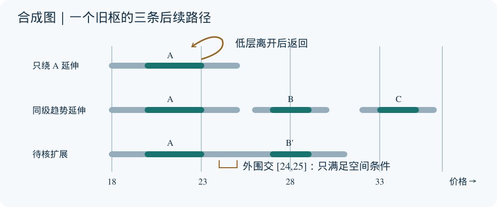

# m09 · 走势类型：盘整、上涨、下跌和完成资格

来源：PDF 物理第 12 页「第九节 走势及走势类型」起，至第 13 页「第二章 动力学」标题之前。「走势终完美」在第二章另述；本课只取第九节的资格和边界。

## 固定观察层，按已完成类型分类（第 12 页）

「走势」泛指图上价格的先后变化。「走势类型」是在指定结构级别上依中枢给一段走势归类。中枢须由连续、已完成且合格的次级别构件证实；只说「图上上涨」不等于已确认该级别是上涨类型。原书先按盘整、趋势分；趋势再分上涨和下跌。

| 类别 | 对已完成走势的检验 |
| --- | --- |
| 盘整 | 该级别恰有一个中枢，可以在结束前围绕同一中枢反复 |
| 上涨趋势 | 至少两个同级中枢依次向上，前后外围严格分离；每次后 DD>前 GG |
| 下跌趋势 | 至少两个同级中枢依次向下，前后外围严格分离；每次后 GG<前 DD |

GG、DD 是围绕各中枢的最高、最低外围边界。两核心分离、外围却重叠，应按前一节核查更高级别中枢；只见若干高低点抬升或下降，也不能证明有两个合格中枢。原书形容高低点大体逐步抬高的笔展开成向上线段，次级或更低层可能有上涨类型；降低的镜像为下跌。高低交错而不能形成两个同向中枢，是盘整的形态线索；不能仅用目测替代对中枢数、方向与外围的判定。

技术分析基本原理二被写成「一个以上」：连同本节「盘整只含一个中枢」读，意思是**至少一个**，包括恰好一个。不含中枢的未完成片段仍能出现在图上，本原理约束的是已完成的类型。原书的反证思路是：连续、合格的上—下—上或下—上—下会使某级别出现中枢；若整张图都不能出现这种构造，在作者的设想中只剩一次反转后永久单向（或从未反转的极端退化情形），不是他讨论的实际市场。读此论证要保留「某一级别」和重叠资格；三次方向交替本身不证明指定高层已经成枢。

## 延伸定理说的是级别，完成仍要证据（第 12–13 页）

走势级别延续定理一：在更大级别中枢产生前，仍在该级别观察盘整或趋势及其延续。它不规定当下单向走法永不改变。定理二：更大级别中枢产生，当且仅当围绕连续两个同级中枢的波动区间重叠；须核对前后两枢的成员，并区分旧枢内的重复交集和相邻独立枢的外围接触。

盘整的延伸：一个中枢成形后，次级别或更低的暂时离开由另一走势送回原枢，没有长出一个满足条件的新枢。三个合格构件有共同区间，该走势已经**可以**完结为盘整；也可以在同一枢上下反复，理论上并不限定次数。趋势的延伸：已有两个依次同向的同级中枢后，既可以结束，也可以在同方向接连生出更多互离中枢。第 13 页用上涨中第一次震荡过早退出、下跌延伸中过早猜底说明：一次震荡和「终于跌了很多」都不是结束证据。成熟形式和实际确认时间分开记录；若另约定延迟封口，即等后续结构提供可知结束证据，只能称为该口径下封口，不能作为原书所有走势的通用完成证明。

## 两层可以同时成立（第 12 页）

较大中枢的震荡内部可以含较小级别的趋势。书举 30 分钟中枢震荡与 5 分钟上涨并存，以及日线盘整在 30 分钟图可呈上涨或下跌。这里是多层观察的例子，不保证取样周期等于递归级别。把两个已核准级别的结构合看，像给同一段路径两组约束，能排除一些解释；两级的对象不必同向，也不能把一大一小的枢接成同级趋势。原书认为观察层选择与资金、性格、操作风格及交易系统有关，并用反复看图培养鉴赏力的比喻强调练习。可复做的练习是先固定图、结构层和观察截止，再对照事后全图量出当时能知道什么。

## 合成复做：同一旧枢的三种后续（第 12–13 页）

观察层 L 的旧核心 A=[20,23]、外围 [18,25]，已定。其内一次较小级别向上走势可有两个递升核心 [20,20.5]、[21.5,22]，外围 [19.8,20.8]、[21.2,22.4]；21.2>20.8，说明较小层具有上行空间条件，同时价格仍在 A 周围。这组小枢不能算 L 的第二、第三个枢。

在 L 上另给三个互相独立的后续：

- 低层暂离 A 后又回到 [20,23]，没有新 L 枢：还是围绕 A 延伸；若 L 走势随后证实已完成，才定为 L 盘整。
- 新 L 核心 B=[27,29]、外围 [26,30]，已核证：26>25，上行结构达到至少两个同向枢，具备趋势类型的构造条件。若随后连续合格的 L 核心 C=[33,35]、外围 [32,36]，32>30，则上行趋势可延伸。仅凭第二枢成立不能定完成时点。
- 新 L 核心 B'=[27,29]、外围 [24,31]，已核证：核心高移，但外围交 [24,25]；按扩展条件转查较大级别中枢，不能把 A 与 B' 计成 L 上涨趋势的两个互离枢。

[查看矢量图](../../../assets/chan-book/full/m09.svg)

## 练习

1. 观察层 L 有合格连续枢 A 核心 [32,34]、外围 [30,36]；随后 B 核心 [25,27]、外围 [24,29]；再有 C 核心 [19,21]、外围 [18,23]。比较各外围，给结构分类；能否仅凭三个枢判结束？若 B 的外围实为 [24,31]，请重判 A→B。
2. A 层只有一个已证中枢 [50,54]，其内部 B 层（比 A 低一层）有两个已证核心 [50,51]、[52,53]，外围分别为 [49.8,51.4]、[51.7,53.3]。目前只见 A 内的一次 B 层向上推进；A 与 B 的结束证据均未给。分别记录两个层的结构状态，并列出把它们写成「已完成类型」还缺的证据。
