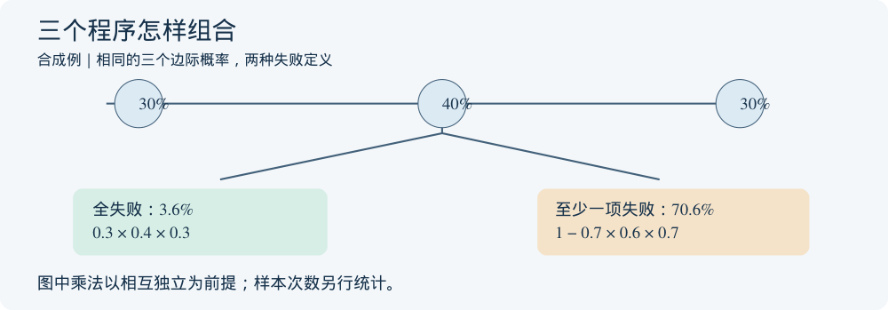

# O01 · 三个程序怎样组合

来源：《缠中说禅-股市技术理论》第三章第1节，PDF 物理第32页。

## 三种视角先分清

程序是把输入、判定和动作写成可复做的规则。书建议从三类资料设计交易程序：价量技术、股票在全市场的比价或资金流向、广义基本面。第一类用同一组价量数据，书主张从中选一个程序；均线配成交量的 K 线图也是一种读法。第二类观察标的相对同行或市场的变化，作者认为各种资金流向系统与它相关，人气和资金面也可能是同一现象。第三类除经营结果外，还包括参与者及其行为。原书以国航管理者的经历推断其护发行价意愿，以认沽权证推断兑现结果；这里保留为作者举的行为假说，单凭身份、面子或叙述不能证实动机、条款或价格后果。（物理第32页，第1节）

## 3.6% 取决于失败的定义

令 A、B、C 分别表示三个程序在同一次试验中失败。相互独立要求任意子集的联合概率等于各自概率之积；三个程序用了不同栏目，只说明观察角度不同。给定三个边际失败率 30%、40%、30%，并假定相互独立，三项**全失败**是 0.3×0.4×0.3＝3.6%。例如流程只在三个程序都判错时才算失败，才能用这个事件定义。若程序是三道都须通过的门，至少一项失败就停，失败概率是 1−0.7×0.6×0.7＝70.6%。100 次的 3.6 是前一假设下的期望次数；实际次数可以是 0、4 或更多。作者将其表述为百次不到四次，例子没有给出实测次数或独立性证据。（物理第32页，第1节）

## 把规则变成可检验记录

模拟时先冻结样本时点、标的池、三项输入和失败含义，再记录三项各自结果及组合结果。比如 A 看标的自身价量，B 看相对行业的排名，C 核对已发布的经营资料；分别记缺失，缺失时不补写成失败或通过。若 A、B 共用收盘价，C 也受同一市场冲击，必须用联合结果检验；仅有三个边际比率时，三项同败可以从 0 到 30%。例如 A、C 总在同一 30% 样本失败，B 在这 30% 及另 10% 失败，同败是 30%。即使信号分类正确，亏损还取决于订单能否执行和成本，须另记。

## 练习

1. 假设 A、B、C 相互独立，失败率分别为 20%、25%、40%。求三项全失败与至少一项失败的概率，并说明各适用哪一类组合定义。
2. 100 个同步样本中，A、C 都仅在第 1–30 个失败，B 仅在第 1–40 个失败。求三项全失败的频率。只听到「技术、人气、资金三种输入」，还需澄清什么才能评价组合？
