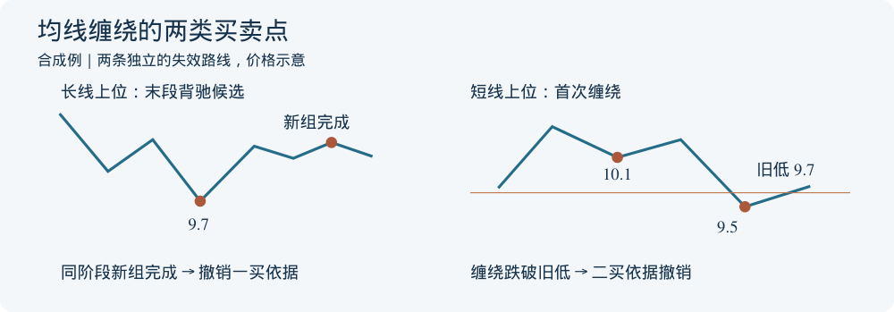

# O02 · 均线缠绕的两类买卖点

来源：《缠中说禅-股市技术理论》第三章第2节，PDF 物理第32–33页。

## 先排均线的位置

均线是在每一时点用指定窗口的收盘价算出的均值；短线窗小，长线窗大。长线上位是短线低于长线，短线上位相反。书以缠绕的先后和均线排列区分买卖点，第2节没有规定一次换侧即可算作一次缠绕。本课把短线值减长线值，用已收差值记录可见事件：+1→0→+1 是相触后拉开，+1→−1 记一次由上到下的穿越；途中只见等值时先不填穿越。两线接近或相触只作预警；已收换侧也只是一次观测，是否完成课堂整组或确认新排列按下节判定。书重视缠绕后均线处在哪一侧，称缠绕后有一段明显运动；它没有给接近阈值，也没有验证每次都会出现明显运动。参数可随交易尺度和资金规模调整，书提议资金大用较长参数，短线可改用分钟线。用固定周期与参数比较，不按已发生的结果重选。（物理第32–33页，第2节）

## 练习怎样数缠绕

书没有给机械分组办法。本课的合成练习约定：先有连续两个同侧的已收差值作为上位基准。第一根反侧的已收值开启候选，并算作连续反侧的第 1 根；累计到两根连续反侧值时，当根确认新排列，旧排列不加组。若确认新排列前先回到原侧，则给原排列加一组。零值既不换侧，也不结束候选，只把连续反侧计数清零；零值后再到反侧，从第 1 根重数，若先回到原侧则按上述规则结组。未收值不参与。此约定只用于课程复做，实图若没有预先声明分组法，保留次数待核。

例：差值 −2、−1、0、+1、0、−1、−2，负值建立长线上位；+1 才登记向上换侧，回到 −1 才完成该阶段第一组。还不能叫末次：若之后同阶段又完成一组，就撤销末次候选。例如 −2、−1、+1、+2、−1：到 +2 时已有两根连续正值，改记短线上位，旧阶段不加组；随后单根 −1 只开启新阶段的反侧候选。相触而始终未换侧没有开组。

## 买点与卖点各查一遍

| 点位 | 均线系统的前提 | 下一步 |
| --- | --- | --- |
| 一买 | 长线上位，最后一次缠绕后下跌背驰；即价格续弱，而可比的同向走势力度减弱 | 当作转折候选；首次缠绕后不能直接套用长期空头末段的判断 |
| 二买 | 变为短线上位，第一次缠绕形成低位 | 核对次一级别相应下跌走势的一买；可用作初次介入或加码候选 |
| 一卖 | 短线上位，末次缠绕后上涨背驰 | 持有者进入减仓或卖出检查；不能只凭一次接近均线就卖 |
| 二卖 | 变为长线上位，第一次缠绕形成高位 | 按镜像核对次一级别相应上涨走势的一卖；作为退出候选 |

书正文的买点定律明确说的是大级别二买由次一级别一买构成；二卖的次级判断来自对称用法。书偏好等二买，卖则尽量在一卖。大级别买入后，具备操作条件的持仓者可在次级一卖先减，在次级一买再核回补；不能在未卖出时把后一动作记成已回补。在这套规则内只接受表中的两种入场点；已有仓位默认持至其中一种卖点，若下面的失效路线或独立风险退出条件先触发，则按对应条件处理。原文第32页定义，第33页说明参数、持有、退出和短差。

## 中继判据与两条失败路线

短线上位后，首次缠绕较倾向延续原升势，第三、四次较可能转折；再看缠绕前 5 日线是否有力、成交量是否提前过度放大。巨量骤缩时，作者提示有假线风险；即使不是假线，缠绕可能延长，并有两次量能收缩。没有确定性阈值或原始频率。这些线索只供区分中继和转折，不能替代次级证据。

- **一买误把中继当转折，或误判背驰。** 书按长线上位反弹时的再次缠绕推翻「最后一次」，已有仓位者退出；书未规定如何计整组。按本课计组时，同一长线上位阶段须再完成一组，才判前一组不是末次。只见一根反侧值时，先记候选。以后若转为短线上位并符合二买，可重新评估；若之后加速跌，也不因为期待另一种路径而延期。
- **二买误把转折当中继。** 缠绕中若跌破前一长线上位期最低价，依据失效；原书给持有者的路线是在反弹时清出。无持仓者撤销计划。反弹若未出现或不能成交，模拟账须标记敞口仍在；独立写明最大风险和何时暂停。
- 对持空或卖出判断可做结构镜像核查：若一卖后又短线上位缠绕，末次之说被推翻；二卖回升若越过原短线上位期高点，原判断失效。镜像识别本身不提供卖空权限或成交能力。

## 走一遍合成路径

标记三次事件：长线上位的旧低 10；随后在 9.7 出现可比下跌力度由 8 降至 4 的候选一买；反弹后，已收差值由原侧 −1 到 +1，再回原侧 −0.5。+1 只开启候选，−0.5 才完成同一长线上位阶段的新组；此时撤销 9.7 的标签。若后来短线上位，第一次缠绕的低点 10.1，且其中的次级一买确认，才重开二买检查。若已模拟执行二买后，该次缠绕进一步破当时已记录的长线上位最低 9.7，到 9.5，就进入二买失效分支；不能因 9.5 后可能上涨而恢复旧标签。盘后才能确认的结构，不记入更早的决定。

## 练习

1. 长线上位已有四组完成的缠绕；第四组后跌段的全段最低 11.5，低于旧低 12。该跌段与同级、同向且结构可比的参照段都已完成，同口径参照力度为 9、末段为 5。假设已按候选模拟买入，其后反弹，并在同一长线上位阶段按本课计数办法完成第五组缠绕。分别写第一次判断、后续动作和允许重新检查哪类点。
2. 已由长线上位转短线上位，旧段低点为 8.0。首次缠绕出现合格次级一买并模拟成交；缠绕继而到 7.8，随后只见 7.9 的报价，没有成交回报。如何区分结构、书面动作与已成交？若只给「跌了两角」而未给旧低和次级资料，先问什么？
3. 三组分别观测短线减长线的差值：甲 +1→0→+1；乙 +1→0→−0.2，三步都已收；丙 +1→0，末根未收。何时能登记换侧？三组起始正值都已处在上位基准，能否登记整组缠绕或二买？
