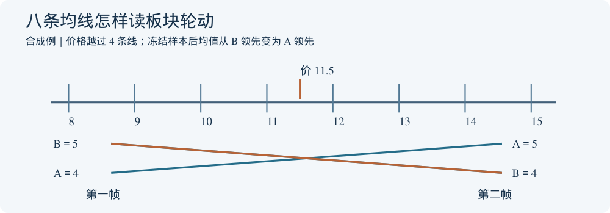

# O03 · 八条均线怎样读板块轮动

来源：《缠中说禅-股市技术理论》第三章第3节，PDF 物理第33–34页。

## 把价格放进八条线

股票强弱指标是价格相对整束均线的位置；板块指标是成员指标的平均，两个时点的此消彼长叫轮动。原书用指数从 6124 点回落后的行情举例，选 5、13、21、34、55、89、144、233 日均线，认为与该段行情相符；只有后续结构无明显变化才沿用。八条互不相等的线按当期价格从低到高摆放，切为九个位置；均线的周期次序不等于价格高低次序。书把全在下方视为最弱，但提醒全在上方未必是最有利的操作形态。（物理第33–34页，第3节）

## 级别与压力只是经验对应

原书按本节笔的口径，顶、底分型约束使一笔至少跨 5 个基础 K 线单位，并用「反弹连 5 日线也碰不到」筛弱反弹；它把思路延伸到线段、1 分钟、5 分钟、30 分钟、日、周等层次。均线是价的平均，周期不能直接证明走势级别；例如本趋势第一个中枢被 89 日线压制，后面同趋势同级中枢可能仍受 89 日线约束，若在同一比较窗中 34 日线始终低于 89 日线，本次从 89 日线下方反弹且只触及 34 日线、未到 89 日线，则较不支持同级判断，仍须核定结构。原文没有给每个层次固定的换算表。（物理第34页，第3节）

## 个股横向比较再合成板块

合成一帧：八条线按价格为 8、9、10、11、12、13、14、15；三股价 8.5、11.5、14.5，分别越过 1、4、7 条。此处用「严格低于现价的线数」作课堂分数，价格相等另记边界，缺线者暂不参与比较。等权 A 三股 1、4、7，均值 4；B 为 3、5、7，均值 5。后一帧 A 为 3、5、7，B 为 2、4、6，变为 A 5、B 4。成员池和计分口径固定时，这是领先互换；若成员增删、停牌或收盘时点不同，先分清变动是数据口径还是轮动。

## 书里的轮动用途与失效边界

在单一品种上看各线先后受挑战；横截面可统计最常受哪条线压制。书举若被 34 日线压制的股票最多，则将其视为指数也遇压力的提示——指数权重不同，家数不直接等于指数必受阻。N 类在升到 N+1 类前往往有调整时间，书建议在同级趋势出现顶背驰时，转而观察已调整待启动或补涨的对象。几个板块同画时间序列，可查领先板块和次序，再到个股查结构。上述是观察和选样规则，未证明能抢到补涨或盈利。（物理第34页，第3节）

## 练习

1. 八条日线为 5 日 11、13 日 8、21 日 14、34 日 13、55 日 10、89 日 15、144 日 9、233 日 12。两股在同一时点的价格分别是 12.5、9；按课堂口径给分，指出相等事件。
2. 两个冻结板块各有三股：本帧 A＝2、5、8，B＝3、6、6；后一帧 A＝3、6、8，B＝2、5、6。比较均值并解释可说什么。若某股旧中枢曾受 89 日线压制，本次比较窗内 34 日线始终低于 89 日线，反弹从 89 日线下方开始，只触及 34 日线、未到 89 日线，单凭此能否赋级？
