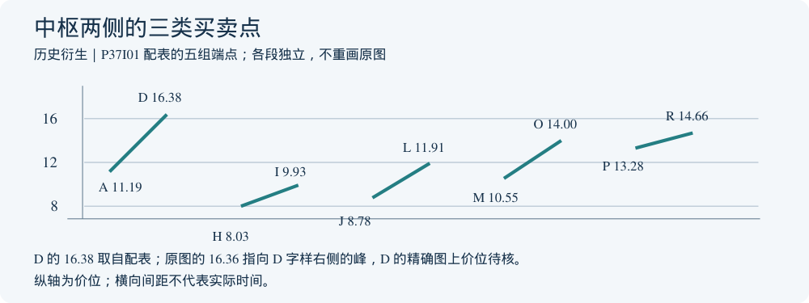
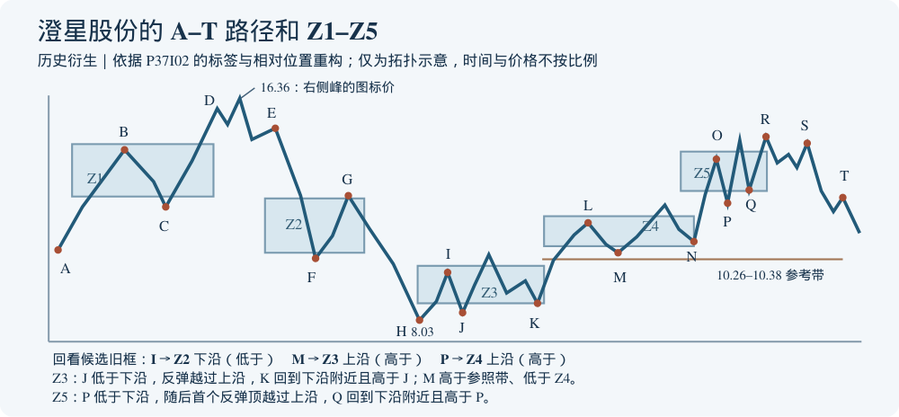

# O04 · 中枢两侧的三类买卖点

来源：《缠中说禅-股市技术理论》第三章第4节，PDF 物理第34–38页。

## 同一级别下的六个定义

初始中枢取前三个连续、合格且已完成的次级别走势的公共价区，记核心 [ZD,ZG]，ZD 为下边缘，ZG 为上边缘。趋势先要按同级结构识别；一处重叠、价格创新高低或一根柱线变短均不足以认定趋势与背驰。背驰要比较结构中可比的同向段，力度减弱且有完成证据。先固定观察级别，并锁定该级最近的合格中枢。回试须对应同一次完成的离开。例：较远核心 [20,22]、最近核心 [23,25]，向上离开最近核心后首次回试最低 24。虽然 24 没有触及较远核心，却回到最近核心，本次不能判三买。固定级别和参照后再分类；同一时点在不同级别可有不同标记，也可能同现一类点。（物理第34–35页，第4节）

| 类别 | 买点 | 卖点 |
| --- | --- | --- |
| 一类 | 已确立下跌趋势，次级走势向下穿出末中枢后背驰 | 已确立上涨趋势，次级走势向上穿出末中枢后背驰 |
| 二类 | 一买后的次级上涨结束，首次次级下跌走完 | 一卖后的次级下跌结束，首次次级上涨走完 |
| 三类 | 次级走势向上离开，首次完成的次级返回低点不跌破 ZG | 次级走势向下离开，首次完成的次级返回高点不升破 ZD |

第 34 页定义表述以三买处于上涨、三卖处于下跌为背景；第 35 页又在反转和二、三类合一例中使用同一离开与回试结构。读到反转例要保留这个应用背景，不能倒填原趋势已确认。第34页三卖将 ZD 写成「上边缘」，按本书区间记号及向下镜像，应读作**下边缘**。定义句「不跌破／不升破」可按字面容许等值；第35页谈二三合一写「不触及」。课堂用严格大于 ZG／小于 ZD 的例子，等值列边界，判题先声明口径。第35–36页强调首次返回；后一次站在中枢外不能冒充第一次。三买后可能新生同级中枢并上移，也可能扩张为较大级别盘整；卖点反向同理。

## 为什么分三类，何时补用二类

原书从两类变化推导：向上的延续，或由下跌、盘整转为向上；都要参照前一中枢。已确认上涨中的中枢下探、盘整延伸或扩张向下，均不能单凭在中枢下方就标一买。下跌完成后只能转向上涨或盘整，是作者用来定位一买的结构前提。作者用完整走势所需的次级构件解释二买：从一买后首升、首回，再至少有一次向上次级运动，并用前后重叠说明更大级别中枢的形成。此处应逐段核对重叠与完成，标签不能先于资料。二类点可以在旧中枢下、内、上；书分别倾向较弱扩张、扩张与新生皆可、较强新生，这些是书中判断，未给统计样本。（物理第35–36页）

原书第 4 节「买卖点定律一」（物理第 34 页）的末词写的是次级「第一类买点」；同节讨论二卖时，本课依镜像读取为次级一卖，保留原文用词。大转折也可由更小层触发，并非必为直接次级。假如按 30 分钟层操作，只有 1 分钟背驰，不足以标 30 分钟一卖；高点后有一个次级下跌再上涨，若不创新高，或即使创新高但有可比盘整背驰，可转查二卖；二买镜像是回调不创新低，或创新低而有合格的盘整背驰。书偏好大级别一类点；小转大情形没有该层一类点，二类点补位。（物理第 35–36 页）

相对同一下跌和末中枢：一二有先后，一三在中枢两侧；二三才可合一。最强是首升直接穿越旧中枢、首次回抽留在其上，常写成 V 型，但仍可能扩为盘整。最弱是二买低于一买，需要盘整背驰等完成依据，后续可走顺势或扩张平台。一般是一、二、三买依次提高；二三之间可有多次震荡，书可笼统视为二类性质，不能重标每一个为首次二买。原书还从另一个尺度理解这三类点：作者把每类点都视为某个级别的一类点；在本级别定为二、三类的点，可借较小级别的一类点定位。两种标记可以指向同一处，但级别不同。练习可先只用自己能判定的级别，从识别一类点和相应背驰入手，熟练后再做高低级别配合。转折后的过渡称「中阴」，过渡完成后，在同一已运行结构只查三类和震荡点；新趋势结束可以开启新分类。卖出对称。

## 按持仓和成本选分支

核心 [10,12]；一买 8.5 已确认。其后的首个合格直接次级上涨已完成，高至 13.3，并完成离开该核心；同次离开的首次直接次级下行返回于全段最低 12.4 结束，且其结束由该处合格的次级一买证成，可兼作二买和三买。若另一条路径的首次完整返回于全段最低 11.6 结束，同样有该处次级一买证据，则有二买；因已入核心，不标三买；若已有持仓回到 11.6 后仅见尚未结束的下跌，则连二买也不确认。原书的震荡路线：向下离开出现底背驰，核介入；回拉至顶背驰时，若未超过前一上离顶背驰高点就出，超过也可出。其后首次次级向下回抽不回核心，查三买和回补；反过来，向下离开后的次级反弹回不到核心，查三卖并退出，等待下方新中枢。若三类之后转盘整，书主张在相应盘整边缘出场，不能预填边缘价。（物理第36–37页）

固定级别只做三类点可以少参与中间震荡；大资金或有时间与技能者可在容量允许时做震荡或趋势内小级别短差，以减少成本或增加筹码。分笔能看到更细波动，反应、费用和容量会限制执行。原书的完备性声称任一升跌起止归于某级别三类点，且符合者结构必转、获利；这里把结构判定、确认后的报价、可提交、成交、净盈亏分别核对。例：12.4 事后确认为低点，只在 13.0 买到，之后盘整最高 13.03，单来回成本 0.08 即可能净亏。书的纪律包括按证据买持卖、买错即纠、错过二类再查三类、复盘失误、按能力做；害怕、追高及机会成本都另记。卖出亦可锁定已发生的亏损。

## 澄星股份：表与图分别核读

物理第 37 页的 600078 澄星股份 30 分钟图（P37I02）及配表（P37I01；第 38 页图源注称由「同心结」提供）。沿横轴顺读：A 后围绕 Z1（B、C）；D 字样靠近前一个峰，回落后右侧更高的峰有独立引线标 16.36，不能据此确定 D 的精确图上位置和价位。此后经 E、F、G 一带的 Z2 下行，H＝8.03。读到表中的三类点，先沿价格线找该次离开的候选旧框，再用紧接的回试与旧框边缘比：

| 回看对应 | 图上可核价位 | 原书定类 |
| --- | --- | --- |
| I → Z2 | 从 Z2 向下到 H，紧接着回拉到 I，顶仍低于 Z2 下沿；I 靠近后来画出的 Z3 上沿。 | I 三卖 |
| M → Z3 | K 后向上越过 Z3，上冲至 L 后回试到 M。M 仍高于 Z3 上沿及图标 10.26–10.38 的参照带，低于后一个 Z4 框。 | M 三买 |
| P → Z4 | N 后向上越过 Z4，冲到 O 后回试到 P。P 高于 Z4 上沿；若错拿后一个 Z5 框作参照，P 反而在该框下沿之下。 | P 三买 |

每行取该次离开所对应的候选旧框；后来在附近画出的 Z3、Z4、Z5 分别不替代 I、M、P 所回看的 Z2、Z3、Z4。J 低于 Z3 下沿，随后反弹越过上沿，K 回到下沿附近且高于 J；P 后第一个反弹顶越过 Z5 上沿，Q 回到下沿附近且高于 P，随后经 R、S、T 转弱。这些是图上可核的相对位置。图和表不足以独立确认各次离开与首返是否合格、结构级别及何时可确认。图下是动量辅助曲线及柱，也不能据此逐根复算或定确认时点。

| 书表买点 | 书表卖点 | 表列价差收益 | 同表其他提示 |
| --- | --- | --- | --- |
| A 一买 11.19 | D 一卖 16.38 | 46.38% | E 二卖；图上右侧峰标 16.36，不能据此替换 D 的表列价 |
| H 一买 8.03 | I 三卖 9.93 | 23.66% | 图随后还在 Z3 附近震荡 |
| J 二买 8.78 | L 一卖 11.91 | 35.65% | 一买 H 后首回的表内示范 |
| M 三买 10.55 | O 一卖 14.00 | 32.70% | 独立读价，不从截图补逐根数据 |
| P 三买 13.28 | R 一卖 14.66 | 10.39% | S 二卖；末行另列 T 三卖，无配对价 |

书表称 A 至 R 为 2008-02-13 至 2008-05-28，约 3.5 个月；将 325.14% 标成「最后纯复利」，并提到分步扣除手续费及操作误差合计 2%。按表中买卖原价，五笔毛乘数约 3.59705，期末资本为本金的 359.70%，毛增益 259.70%。若每笔乘数再乘 0.98，则期末约 325.14%、净增益约 225.14%。这是可复算的一种扣法，表未披露足够执行条件来证实扣法或实际成交。不能把五组端点价记为账户业绩。

## 练习

1. 旧中枢 [20,23]，已确认的下跌在 18 出现一买；其后的首个合格直接次级上涨已经完成并离开核心，最高 25。该次上离后的首次合格直接次级回调于全段最低 23.4 结束，且其结束由该处已确认的次级一买证成。标出 23.4 的类别。另一路的首次合格直接次级返回于全段最低 22.9 结束，同样有该处次级一买证据；同次上离后的第二次返回才到 23.4，分别能记什么？
2. 固定 30 分钟操作层；只有 1 分钟顶背驰，高点为 32，随后首个直接次级下跌已完成、全段最低 28，第一次直接次级回升也已完成、全段最高 31，回升内部有一卖确认。说明大层应检查哪类点。另用起始资本 100 和表中五笔毛乘数之积 3.59704798，求每笔再乘 0.98 后的期末值与净增益，并列出历史图表还须澄清的资料。
3. 同一级别有较早的核心 [28,30] 和最近的已确认核心 [25,27]。价格有效跌离最近核心，首次合格次级反抽最高 26。用哪个核心？若只看较早核心，会错判成什么？
