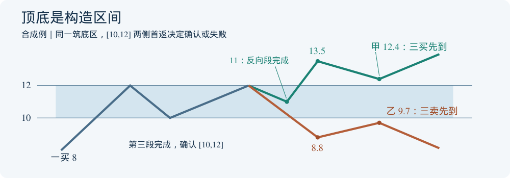

# O05 · 顶底是构造区间

来源：《缠中说禅-股市技术理论》第三章第5节，PDF 物理第38页。

## 精细口径：从一类到先来的三类

先确定同一观察级别。第一类买点标记已确立下跌的末段背驰，随后看它引发的中枢与第一次走出；从一买起到最先出现有效三类点前，可看成筑底区间。初始中枢是前三个连续、合格且已完成的直接次级走势的共同价格带，用 [ZD,ZG] 标边缘。先完成相对该核心的合格直接次级离开。其后首次合格的直接次级返回也完成时，向上离开后的回抽最低仍严格高于上边缘，是三买；向下离开后的反弹最高仍严格低于下边缘，是三卖。先出现三卖，筑底失败；先出现三买，按书确认筑底完成并进入新行情观察，仍须区分新趋势与扩张整理。（物理第38页，第5节）

筑顶从一卖起，先出现三卖则完成，先出现三买则失败。原书顶部定义行写「第三类卖卖点」，上下文又说顶部情况反之；本课把重复字列为疑误，用正文明确的镜像过程保留成功和失败两路。筑底、筑顶都一样：只有同次离开后的首次合格直接次级返回完成，才按全段极值确认三类点。若首返已完成却触及离开一侧的边界或回到核心，本次离开不产生对应的严格三类点，构造仍待定。继续核查中枢演变；出现新的合格离开，才核该次离开的首次返回。

## 粗口径：分型的区间与破界

把已按同一口径处理的三根 K 线并排；底分型中间根的高、低都比两侧低，顶分型相反。书把形成分型的区间视为简化顶底，不必先完成精细的走势递归。课内先约定用组成三根的最低、最高构成区间，并把两次连续收盘站在边界外作为模拟的「有效」判据之一；原书未定死根数。底分型跌破最低点就失效，有效立于上缘才确认并观察至少向上一笔的书中路径。顶分型突破最高点失效，有效落在下缘确认并观察向下一笔。日线上的合格底分型只给日线分型意义上的底，不能推出周线底。（物理第38页，第5节）

## 合成两路与三阶段操作

一买出在 8。给定前三个连续、合格且完成的直接次级走势是 8→12、12→10、10→12，端点就是各段极值；三段全幅交于 [10,12]。第三段完成时确认核心 [10,12]，随后分两路。图中各路的离开和同次首返均为合格且已完成的直接次级走势。甲先走完一段合格的直接次级反向走势 12→11，仍在核心；下一段从 11 上离至 13.5，首返全段最低 12.4＞12，三买先到，筑底完成。乙从 12 下离至 8.8，首返全段最高 9.7＜10，三卖先到，筑底失败。若仅见离开、还缺完整首返，构造待定。精细口径的例子不拿粗分型信号代替三类点。

反例：沿甲的上离，若首返走完时全段最低是 12（触边）或 11.8（入核心），本次都不成三买，也不能据此判筑底失败。同次上离的第二次回抽即使最低 12.4，也不能补成首返。

书把同级过程分为底、中间连接、顶：底部震荡观察下探失败，已有计划时先买后卖；顶部震荡先卖后买；中间段按所选方向持有。空头中，留在场外也可视作持有现金，等底部构造完成；有经验者才按级别处理各阶段。底部不是把所有区间内报价都当作买点。作者将亏损归因于错误操作，这在仅有结构标签时不能成立；跳空、费用、不可成交也会造成亏损，任何阶段都可选不参与。（物理第38页，第5节）

## 练习

1. 一买后形成 [15,18]，首条合格向下离开已完成，随后首个完整次级反弹最高 14.7；此前无合格三买。判断筑底。若只看见向下离开、没有反弹数据，记录什么？
2. 三根已去包含的日 K 高低区间依次为 [9,12]、[8,10]、[8.8,11]。按课内约定给底分型区间。路径甲随后连续两天收 12.1、12.3，确认前的全段最低为 8.2；路径乙在确认前日内跌到 7.9。分别判定，说明不能迁移到哪个尺度。
