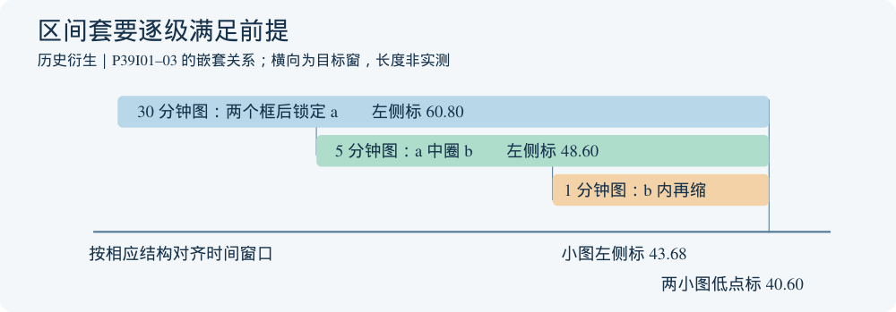
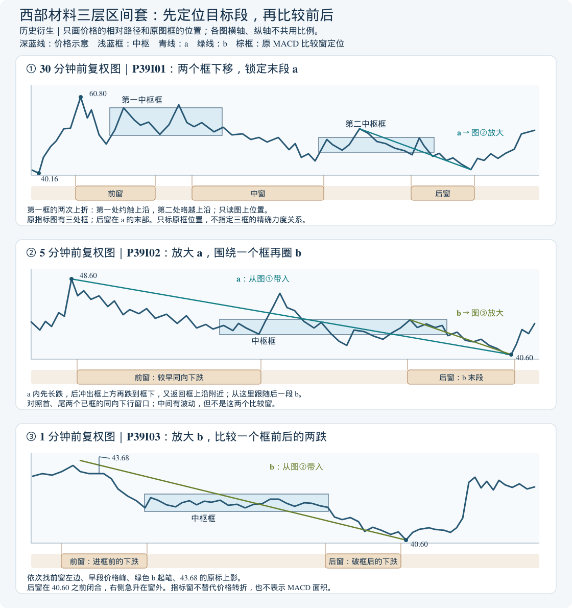

# O06 · 区间套要逐级满足前提

来源：《缠中说禅-股市技术理论》第三章第6节，PDF 物理第38–39页。

## 先有大层候选，才向内缩小

「区间套」是在大级别末段已进入背驰候选区间时，到其内部的次级走势中找对应末段，逐层缩到能辨认的最小层。背驰不是单根指标变短：先要识别同向可比段、末中枢附近的位置、力度变化和走势完成。小级别背驰是原书用于确认本级背驰的必要条件，单有小级别信号并不足以宣布大级别背驰；原文还要求其下各层的转折证据配合。区间是走势的时间范围兼价格结构，不是随便圈出几个图上最低点；K 线采样周期也不自动等于递归走势层级。（物理第38页，第6节）

实际演练先在决定时冻结大层的背驰候选窗及失效边界，然后在同一标的、同价口径下逐层记「被上一层包含的末段、比较对象、可知时点、失效节点」。大层候选仅在原结构失效，或同口径力度达到预先规定的否决条件时撤销。普通增力要重查；例如同口径参照是 10，当前累计从 5 升到 7，仅凭增长不能排除相对减弱。小层记录仍可保留为小层事实。逐层齐备时也只把当时可确认的转折列为候选动作，另核反应、滑点和成交。

## 三条分支要留出口

1. **各层时点契合。** 大层进入背驰段；逐级定位末段，所有相关层都进入背驰段，最低层出现证据且各层完成条件满足，再收缩到最终可识别点。不能只查看自己最熟悉的一层。
2. **小转大。** 大层还未进入合格背驰段，小层骤变引发大层反转；书举多头／空头陷阱中的猛烈冲顶／砸低再逆转。预设的大层一类点抓法不可用，等次级回抽确认后才开大层操作检查；没有回抽证据就等待。
3. **反复背离。** 大层虽已进入候选段，小层力量仍大，背离反复出现却未成走势背驰。未打破原段就继续观察，打破则撤销。书把这种情况连到筑顶／筑底时可能反复诱多或诱空，分别提到快出和战略建仓；本课须另查结构、持仓及风险权限，不能从动量图判断交易者动机。（物理第38页末至第39页开头）

## 西部材料三图怎样接

物理第39页三幅图均写西部材料、前复权；横轴时段逐幅放大，按图中「目标段」找对应，不能把三幅图的左侧高点当成同一点。

| 图 | 先读主图 | 再读辅助图与限制 |
| --- | --- | --- |
| P39I01，30 分钟 | 左段标 40.16、60.80；两个依次向下的框按图注作为两个中枢；后框末段向下圈为 a | 动量副图框出若干区段；作者据趋势背驰讨论至少末中枢扩展或同级或更高级反趋势，并用 DD 作为扩展触及提示；图片不能逐根重算 |
| P39I02，5 分钟 | 标 48.60；用放大的 a 看一个核心框，框后末跌标 b，低点标 40.60 | 图注按一个中枢比较前后下段，称为盘整背驰；不是另判一个已有两个同级中枢的下跌趋势 |
| P39I03，1 分钟 | 标 43.68；b 内再见一个核心框及其后末跌，右下低点标 40.60，后续有回升 | 副图两个框供比较盘整背驰；两幅图同标 40.60 不提供当时信号时刻、每根走势数据或成交价 |

这里的 DD 是归属图示末中枢的合格外围波动中，所有低点的最小值，不是中枢核心下沿 ZD，也不从两条背驰比较段随意取最低。未辨清全部构件，就不报 DD 数值。这里保留作者的扩展观察参照，不能单凭触及 DD 确认形成了更大级别中枢。图上可读 MACD(12,26,9)，参数不等于完整价格序列。大图提出向下趋势的末段问题，中图、小图各按自己的结构做局部比较；已知低点反弹是图上的结果。不要用结果倒推当时一定找得到精确最低点。

[打开三层价格形态的矢量图](../../../assets/chan-book/full/o06-western-materials.svg)

这张重绘保留物理第 39 页三幅图可辨的折返、框、目标段与指标比较窗口。每幅只在本图内看相对先后、上下及相交关系；不同采样图不共用横纵坐标。棕色窗按原图副图所框的位置标注，不表示 MACD 柱高、面积或精确时刻。本图不重建真实开、高、低、收（OHLC）或指标序列。

## 用重绘做一次分层读图

1. 在①先找由高到低的两个中枢框。第一框处的第一次上折约触上沿，第二次略越上沿；这只是图上的位置关系。再从第二框上沿之上的局部高点沿青线读到末跌低处，记为 a。下方原图共有前、中、后三窗；后窗对应 a 的末部，不把三个指标窗都当成 a 内的比较段。
2. 进入②，沿青色 a 从 48.60 看下跌及中枢框附近的几次折返，再从价格返回框上沿附近的局部高处沿绿色 b 读到 40.60。用棕窗标出围绕这个框的前、后同向跌段；后窗主要对应 b 的末段下行。
3. 进入③，沿同一横轴依次找前窗左边、早段价格峰、与价格线分开的绿色 b 起笔，再找原图另用引线标出的 43.68 上影。随价格线看早段下跌入框、框内横摆及破框后再跌至 40.60。作者用进框前和破框后的两段同向跌势作比较；前窗约在进框处结束，后窗在框右边附近开启、在 40.60 低点之前结束，右侧急升在窗外。①、②的后窗则都在各自末低之后才结束。价格转折要在价格线上辨认；指标窗、柱组和绿色导线各有自己的起止。窗宽不能用来复算 MACD 面积或两段力度，图也不能证明有人买在 40.60。

## 用时间戳做一次嵌套

合成例：大层认定可比下跌段 A、C，C 的候选窗为第 10–20 帧；中层在该窗中确认末段在 15–20；小层把末段窄到 18–20。18 帧只见柱短，19 帧同向力度再放大，撤回凭一根短柱得出的减弱提示；如果累计力度和否决边界尚未核清，保留小层候选待核。若大层原段未破，继续观察。20 帧即使各层走完，也须重新核对可比段、力度衰减、嵌套和转折证据，全部成立才确认；只有完段仍不足。若 19 帧已打破大层失效边界，则三个嵌套标签不能在 20 帧自动一起恢复。窗尾是合成数据何时可知的记录，不能回填更早成交。

## 练习

1. 大层候选 [30,41]，中层末段 [35,41]，小层候选 [38,41]。第 38 帧小层指标先缩，第 39 帧增力、未破大层失效边界；第 41 帧各层才获完成证据。此时再分甲乙：甲也复核了各层同向可比段、衰减、嵌套和转折条件，最小层重新确认背驰；乙只有完成信息，背驰仍缺证据。分别记录三帧及甲乙判断。若第 39 帧已破大层边界，判断如何改？
2. 观察层仍未进入背驰候选段，小层突然翻转；之后只有跳价两笔，没有完整次级回抽。属于哪条路线，何时再检查大层？对西部材料三图，只给 60.80、48.60、43.68 与 40.60，能否复算 MACD 或确认精准买到 40.60？
