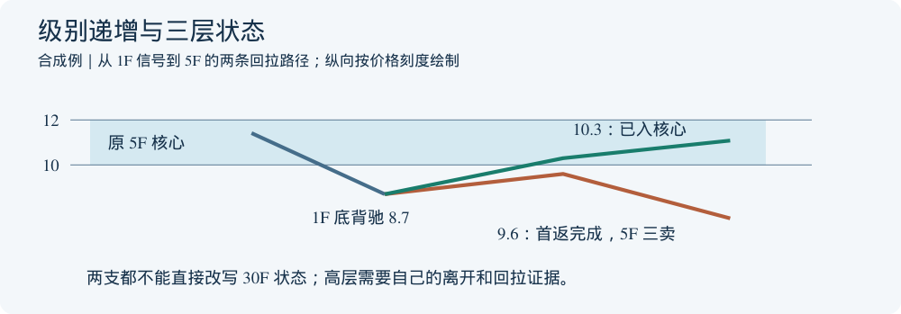

# O07 · 级别递增与三层状态

来源：《缠中说禅-股市技术理论》第三章第7节，PDF 物理第40页。

## 级别由结构形成

同一种重叠、离开、返回关系可以在不同层次重复出现；原书称它以自同构、自组织的方式由低级长向高级。操作上先在每层分类状态，再把同一时点的三项并列记录。书上用 30F、5F、1F 指三个观察层；课内用 30、5、1 分钟图辅助，仍以走势构成为准。初始同级中枢由前三个连续、合格且已完成的次级走势取重叠。确认下跌趋势还须见两个同级中枢依次下移并外围严格分离，即后中枢的外围最高 GG 低于前中枢的外围最低 DD。GG 与 DD 取分属该中枢、围绕其核心的合格波动中的最高与最低，不从任意窗口取极值。例：前后核心 [10,12]、[7,8] 已分开，外围若分别为 [8.5,14]、[6,8.5]，仍恰好在 8.5 相触，须查扩展。末段底背驰候选是在可比两段下跌间，后段价格走低而力度减弱，并需获得结束证据。时间延长不自动成更高级。（物理第40页，第7节）

## 原书的下跌状态树

起点是 30F 下跌，原 5F 有待观察的中枢。书把 1F 底背驰当作先出现的变化，再看随后回拉；若小层尚未给出前提，不根据大图猜大层转折。回拉有两支：

- 从 5F 中枢完成合格直接次级下离后，只在同次首次合格直接次级回拉已完成、全段最高严格低于下沿 ZD 时确认 5F 三卖。原书把该支接到第二个 5F 中枢的确认及 5F 下跌；实作中三卖先记，仍须分别确认第二个同级中枢形成，以及后 GG 严格低于前 DD，才能在记录中确认 5F 下跌。
- 若已识别出同次合格首返，且目前最高已触到 ZD 或进入核心，最终最高必不低于 ZD；即使回拉未完，也可排除本次严格三卖。完段时点、最终高点和后续中枢仍须另核；回到核心后观察走势是否继续围绕原中枢震荡。若首返已识别但未完且暂未触边，三卖仍待定；若连首返的归属或级别都未证实，先核它是否为该次下离后的首个合格直接次级回拉。
- 上述两个 5F 状态本身都不改变 30F 状态；若后续 5F 下跌结束，其后的回拉对原 30F 中枢也构成三卖，才记录 30F 层对应的新选择。三卖是向下离开后的回拉失败，不能称为大层见底。（物理第40页，第7节）

## 合成演练：结构与仓位两本账

设已固定 30F 下跌，原 5F 核心 [10,12]，作为直接次级的 1F 下离已完成，末端在 8.7 获得合格底背驰证据。若同次离开后的首个合格直接次级回拉已完成且最高 9.6，可记 5F 三卖；若 9.6 只是未完首返目前的最高，三卖仍待定。另一路中，已识别的首返只要摸到 10 就排除严格三卖；图中已到 10.3，记为进入核心，继续观察是否震荡。两路都要另核后续中枢与 30F 状态；不能用同一条 1F 信号量化 30F 收益。

书让操作者先判断所有可能分支能否处理：不能处理三卖、资金超限或不能退出，就不参与；能承担且会处理各支时，才按相应比例作模拟。原书也建议以特别小的仓位练习。本课先用纸面模拟；小仓减小损失规模，不能消除跳空或未成交。上行镜像可作演练，但不改变适用交易权限。（物理第40页，第7节）

## 练习

1. 原 5F 核心 [18,20]，1F 作为直接次级已完成下离，末端给出合格底背驰；该次离开后的首次直接次级回拉已完成且最高 17.8。第二个 5F 中枢尚无完整构件；30F 当时仍是下跌。逐层填写能确认与待定的项。
2. 同样的起点，完整回拉最高 18.5；模拟仓位原拟 10%，但交易者无法处理随后再度向下和不能退出的情况。给出 5F 判断与参与决策。若只给最高价而不知回拉是否首次且完成，应先澄清什么？
