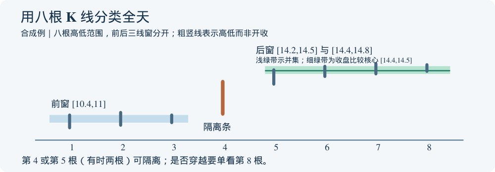
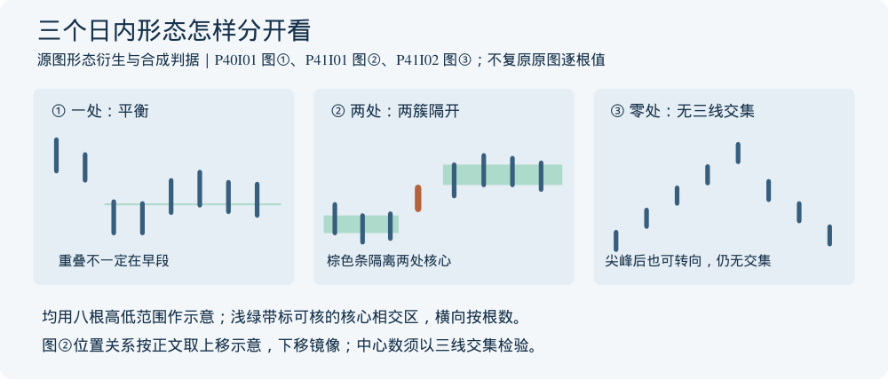

# O08 · 用八根 K 线分类全天

来源：《缠中说禅-股市技术理论》第三章第8节，PDF 物理第40–41页。

## 切八根，求三根的交集

原书以完整四小时交易日为例：八根 30 分钟 K 线，按先后列高低价区间。连续三根的公共区间是 [三低之最大值，三高之最小值]；下界大于上界为空。此处「当日中枢」是辅助分类的三线区间，不是递归次级走势中枢。若多个窗有正宽的共同核心，记为同一候选片段。只有一窗时，它的交集就是核心；多窗时，再取这些窗的共同交集。课内一律用核心比较收盘：等于核心边界仍在核心内。窗的并集只显示片段覆盖过的价域，不用它划分收盘强弱。这是课堂口径，原文没有说明多窗合并时怎样定这条边界。遇到只有触点、各窗连锁相交却无共同核心，或早段高低极值同现而规则未定，先记已知条件和待定类别。（物理第 40–41 页，第 8 节）

零、一、两处是本节三种图形模板，并未证明任意八条输入都只出现至多两个三线重叠价区。例如 [0,1]、[0,1]、[0,9]、[5,6]、[5,6]、[4,12]、[10,11]、[10,11] 的非空窗为 1–3 的 [0,1]、3–5 与 4–6 的 [5,6]，以及 6–8 的 [10,11]。长范围被相邻窗共用，价区虽有三个，却没有书中双中心要求的隔离关系。分别登记交集，不把三处直接命名为三中枢，也不硬套三型。

## 一处是平衡市，再查早段和收盘

原书图①（P40I01）画早段下落、回升后再震荡，示意一处重叠，不提供逐根价。据下表细分，中心不必是前三根构成，早段极值是分类线索；用全日已知数据后才能给终局标签。

| 前三根对全天极值的位置 | 收盘的强弱细分 |
| --- | --- |
| 有全天高、无全天低：弱平衡 | 收在全日低点最弱；中心之下次弱；中心内一般；靠全日高点最强 |
| 有全天低、无全天高：强平衡 | 收在当天高点最强；中心上方次强；中心内一般；靠全日低点最弱 |
| 高、低都不在前三根：转折平衡 | 再看收在区间何处，不强行给涨跌结论 |

「红盘」是与前收比，和该分类不等价；高开后盘中走弱，也能以全日最低价红盘收。若收盘落在表中未细说的位置，如弱平衡收在中心上但离全日高较远，报告实际位置，不编造分界；「靠近」须先定容差。（物理第40页）

## 两处要找到单边隔离

原书图②（P41I01）示意先升后降的分簇；实际先按两个**不重叠**中心的相对位置分上移或下移。中间至少有一根含两个核心以外的单边区间，不计入任一处；按八根的限制，可在第 4 根、第 5 根，也可两根各有一部分，时段在午休前后各半小时内。只有第 4 根带单边区间时，第 8 根还可能穿过该区。上移中，收在第二中心上方最强，第 8 根穿越单边区且收在第一中心下方最弱，之间按收盘相对两中心的位置排序；下移镜像。图的 K 线仅示意，不能用像素推演每种分支。（物理第41页）

合成例按第 1 至 8 根列范围：[10,11]、[10.2,11.2]、[10.4,11]、[11.1,13.6]、[13.4,14.5]、[14,14.8]、[14.2,15]、[14.4,14.9]。前三根交 [10.4,11]；5–7 与 6–8 分别交 [14.2,14.5]、[14.4,14.8]，记为后一片段。后一片段的并集是 [14.2,14.8]，用来比较收盘的核心是 [14.4,14.5]。第 4 根含两核心之间价格、又不参与任一非空三线窗；第 5 根参与后一片段，不能因为其单根低点在后核心下方就把它划为隔离条。第 8 根是否另行穿越，要查它自己的高低与收盘；不能把第 8 根事后并入先前的 5–7 窗。

再比较三条合成变体。把低位区间简写为 L＝[10,11]、高位区间为 H＝[14,15]，同一字母重复代表不同时间的 K 线；隔离用 M＝[11.2,13.8]，N＝[11.4,13.7]。甲：L、L、L、L、M、H、H、H，只有第 5 根隔离。乙：L、L、L、M、N、H、H、H，第 4、5 根均处隔离。丙：L、L、L、M、H、H、H、[9,14.6]，收 9.5；第 4 根是两核心之间的隔离条，第 8 根穿过隔离价带收在第一核心下方，符合书中上移型里较弱的收盘；第 6–8 窗 [14,14.6] 仍并入后一片段，不因第 8 根下探制造新中心。

## 零处代表形态单边，延续仍待检验

图③（P41I02）画升到尖峰又回落的 K 线排列；要直接归零处，本课要求六个连续三线窗的交集均为空；最后一根的涨跌不能替代它。合成八根按序 [1,2]、[2,3]、[3,4]、[4,5]、[5,6]、[6,7]、[7,8]、[8,9]，六个三线窗均为空。符合零中心。反例：把第二根改为 [1.5,2.5]、第三根改为 [2,3]，首窗只交在 [2,2]，其余窗为空；登记触点，中心类别暂待核。零中心也不能外推次日必续；书提示大日线中心内可能是假动作，三类买卖点后则可能是更大趋势的延续。两者是情境线索，需再核父层结构及后续数据。（物理第41页）

## 练习

1. 八根范围依次为 [10,11]、[10.2,11.2]、[10.4,11]、[11.4,13.7]、[13.6,14.6]、[14,14.8]、[14.2,15]、[14.3,15.2]；收 15.0。列出非空三线窗、合并后的片段及隔离条；判断方向与收盘相对位置。若高低范围不变，只改成收 14.7，它相对后一片段的核心和并集各在何处？按哪一个区间判收盘强弱？
2. 另一日八根为 [9,11]、[9.5,12]、[9.4,13]、[8,11]、[9.2,11]、[9.1,11]、[8.8,11]、[8.1,11]，收 8.1，前收 7.9。按课内法给主类别及早段极值分类，解释红盘与强弱为何不同。若前三根同时出现全日高低，如何报告？
