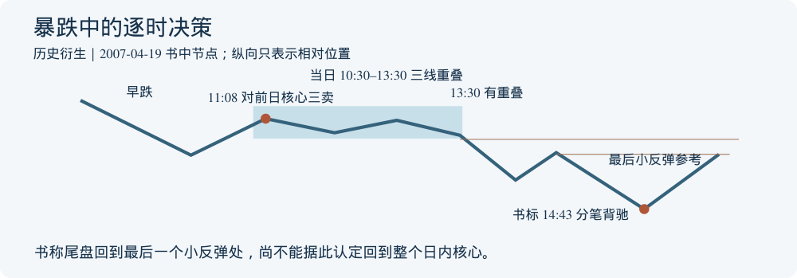
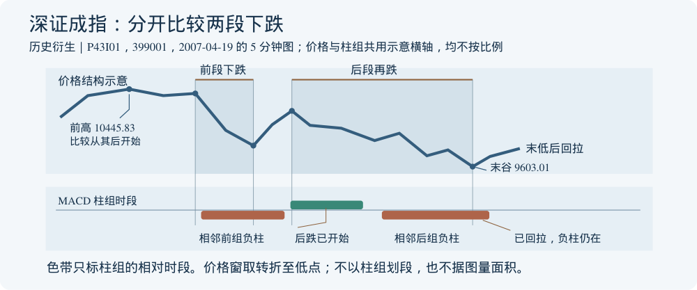

# O09 · 暴跌中的逐时决策

来源：《缠中说禅-股市技术理论》第三章第9节，PDF 物理第41–43页。

## 暴跌的级别和历史叙述

暴跌是某一观察尺度上的急降；日跌幅不等于周、月甚至年结构已转折。书拿熊市大反弹和牛市急跌对照：停国债期货时据称三天由不足 550 升至 920 以上而后仍跌；1996 年 12 月政策冲击时据称由 1250 以上跌至约 850 后又继续涨。这两段是书的例举，资料没有提供指数序列供独立复算。作者认为大顶常多次冲击，V 形大顶不常见，牛市暴跌后长期续跌几率近零，并作长期牛市假设。例举不能验证概率或确认当时市场仍是牛市。（物理第41页，第9节）

书以 2 月 27 日、4 月 19 日为日尺度急跌，称 2005 年中至 6000 点一段中两次周调约 7%，月尺度尚无显著下跌。其操作启示是先定观察级别、再决定是否处理日内短差；不熟练超短线可观察更大层或不参与。更大尺度虽不必应对每个小波动，仍要管理持仓和流动性。

## 4 月 19 日：把排除、待定、已发生分开

原书案例为 2007-04-19。本课按严格口径：相对同一核心的合格直接次级下离已完成，同次离开后的首次合格直接次级回拉也已完成，且全段最高严格低于下沿，才可判三卖。若已识别该次合格首返，即使未完，只要已触下沿或进入核心，就排除本次严格三卖；若未完且尚未触边，三卖仍待定。各层须分别核对对应的离开、首返归属和完成情况。历史标注按作者判断登记。每日分类另用八根 30 分钟 K 线和连续三线交集；两处互斥中心需完整三根、隔离条与另三根。分笔背驰指更细的可比跌段末端减力；可用 1 分钟 MACD 柱长辅助，不能仅凭柱色。按当时可知顺序读：

| 时点 | 当时证据 | 书的后续观察 |
| --- | --- | --- |
| 10:30 前 | 第一段下跌，把它保留作后段比较 | 不以未来低点回填当前判断 |
| 11:08 | 跌破 5 日线后反抽，书标相对前一日核心的三卖；前三根 30 分钟 K 无交集 | 书排除双中心，只保留一处或零处；一处时，作者判断最好也只是中心落在 11 点后那根 K 线的价格范围内；零处时，作者预计更大下行。此为本日推演，排除双中心还须另核当日图形。书称三卖后至少应走完一个 1 分钟以下的下跌走势，再安排可能的回补；若急拉回则仍等合格买点 |
| 13:30 | 扣除午休，10:30–13:30 对应第 3–5 根；原书记三根重叠，尚未真正破下界 | 若三根均已收且核实正宽交集，可排除零处；第 4、5 根均参与此窗，按 O08 的隔离规则也排除标准双中心。若交集尚未核实，两项排除均保留为条件。弱平衡和最终收盘标签仍待检验；若后续破界，就按中枢震荡比较 10:30 前和 13:30 后两段 |
| 下破后 | 书先找更小的三卖 | 可能扩成较该小级别更大的盘整，等它成形；也可能成为下跌，三卖后按书的路径观察至少再走两段向下，仍须核实际结构 |
| 14:43 左右与收盘 | 实际走了后支；书标第二波分笔背驰与「早晨之星」，之后出现回拉至最后一个小反弹处 | 对较小尺度可查回补或本轮退出；不能据此断言回到整个 10:30–13:30 核心。次后可直接涨，也可续跌到更大级别背驰再回拉；继续看当日和 4 月 20 日的中心位置 |

第 41–43 页将双中心排除、一级别以下至少有完美下跌、末段回拉等说成逻辑必然。课内把能从明确分类前提排除的分支与依赖经验或走势读法的判断分开。若第 1–3 根无交集，下一处最早可查第 2–4 根，但 11:08 尚无第 4 根终值，要等该根走完再求实际交集。前三根无交集也不能一般性排除双中心：若第 2–4 根有交集，第 5 根隔离且第 6–8 根成后中心，仍可两处。只有到 13:30 核实第 3–5 根的交集之后，才可按上表排除标准双中心；原图可核走势经过，不能独立复算逐根高低价和这条交集。

## 原图读法、比较口径和执行边界

- **P42I01，上证指数 1A0001。** 主盘中曲线先跌、早段反抽、午间附近整理，后段再下出现更深低点，尾盘回升；下栏是量能，右栏最低可读约 3358.93，书文写 3358 点。书还标日布林通道中轨、20 日线约 3351，并说 1 分钟下降通道下轨在近处，作为支撑参照；这些是并列线索，非同一个证据。
- **P43I01，深证成指 399001，5 分钟。** 原图左侧前高标 10445.83，当日前跌的比较起点在它之后；当日末谷标 9603.01。副图有成交量与 MACD，右侧日期 2007-04-19。书以深圳图辅助对比两整段负柱面积，后段不比前段大。下图用同一横轴对照两段价格下跌和邻近的负柱组：先跌到前谷，反弹到低于前跌起点的局部顶，再跌至更低的末谷。后跌从反弹顶开始，早于后一组负柱；末低后价格已回拉，负柱仍有残留。价格转折划定价格窗，负柱组另标；柱色、柱长和柱组边界不能划分价格段或判定级别。原文未给逐柱取舍，不能从重绘重算面积。对上证，10:30–13:30 在 1 分钟图已有绿柱，不便把两跌段分开；5 分钟图中间有红柱但黄白线没有明显回零，故书把本次力度衰减定位于 5 分钟以下，最小可至分笔。分笔末端又可回到 1 分钟柱长辅助。图中范围支持定性读法，不能复算完整面积、13:30 中枢边界、14:43 那一根的精确数据或 3351 的指标值。
- 超短线案例以小资金、已卖出才讨论回补；买回太早须记录，日线操作者可不处理。书比较 T+0 与 T+1 的当日退出风险；即便可当日卖，也有跳空、报价、容量和未成交。原书还谈日内对冲和个股内因：指数跌时有股形成二／三买，有股仍中枢上移，有股本已有卖点而指数跌放大波幅。需逐股独立核查，指数走势不能直接给个股赋点。（物理第42–43页）

## 合成例：下破不等于立刻回补

日内核心 [100,102] 已确认。下破后首次反弹高点 99.4。若只有日内三线重叠，先查是否另有结构已确认的较小层核心、直接次级完成的离开与回试；不能据此叫严格三卖。后面若构成盘整，则在盘整确认后重新评估；若两次向下推进后新低 94、可比 5 分钟负柱面积从 14 降至 9，且细级结构给出完成，才核回补候选。假设上一次小反弹是 97，回到 97 只说明这次未达到日内核心下沿 100。要判日内层三卖，仍须单独核实相对该核心的合格直接次级下离已完成、同次首个合格直接次级回拉已完成，且全段最高低于 100。若计划为 96 回补，实际只报 97.5 且未成交，这笔单不改变持仓：此前全部卖出且成交才是空仓，若只卖了一部分，仍有余仓。先前股数未给，须先核成交记录。

## 练习

1. 按第 1–8 根给范围：[9,10]、[10.5,12]、[11,12.1]、[11.1,12.2]、[12.5,14.2]、[14.5,16]、[15,16.5]、[15.2,17]。前三根无交集是否足以排除双中心？列出两处和隔离条。
2. 较小层的递归核心 [100,103] 已确认；已有直接次级下离完成，随后首次直接次级回拉已完整结束，最高 99.5。另有较大层已确认的核心 [100,106]。后续走两波下跌，段内出现细级背驰，回拉至前小反弹 97，却未到 100。按小尺度和较大尺度各记一条结论。若没有负柱序列或未获成交回报，分别不能填什么？
