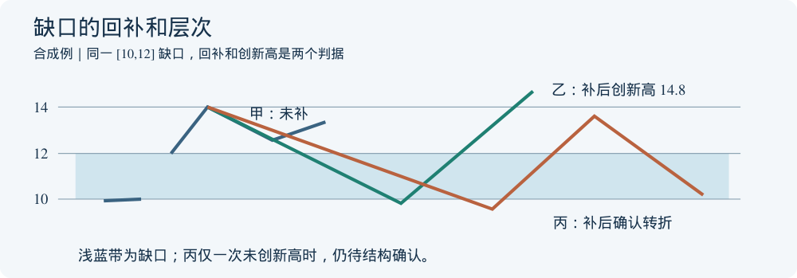

# O10 · 缺口的回补和层次

来源：《缠中说禅-股市技术理论》第三章第10节，PDF 物理第43–44页。

## 找到哪两根之间没有成交

先选同一标的、同一复权与采样口径的相邻两根 K 线。上涨缺口看前根最高与后根最低；后低高于前高，中间有空区。下跌缺口看前根最低与后根最高；后高低于前低，中间有空区。书用闭区间标缺口边缘；已成交的端点是边界，未成交指两端之间。后来价格区间逐步覆盖该带，并有相应成交证据，才讨论全补；只进带一半是部分回补。一根后续 K 线的高低包住带，在课程可作聚合覆盖代理；若要按原定义逐价证明成交，须用更细成交记录。停牌、缺数据或除权台阶先排查，不能从图形外观认作交易缺口。（物理第43–44页，第10节）

## 上海指数的原书例示

原文列日图 1994 年 7 月 29 日到 8 月 1 日跳过 [339,377]，并说下一根就补或很久不补都可能；该例是长期未回的观察及作者对未来的猜测。此处无原始行情或配图，保留日期、指数与带宽 38 点，不断言之后永不回补。（物理第43–44页）

## 先记走势位置，再记事后结果

| 同一方向趋势中的结果 | 原书力度分类 | 与常见位置类型的关系 |
| --- | --- | --- |
| 未回补 | 强势 | 突破性缺口通常少回补；截至某时不补不能事先保证 |
| 回补后仍创新高或新低 | 平势 | 中继性缺口位于趋势延续途中，书说约一半回补、方向仍创新极值；没有统计样本 |
| 回补后未创新极值，原趋势确已转折 | 弱势 | 属书中的衰竭性特征；尚不创新但仍在运行时保留候选 |

书进一步推断衰竭缺口至少引出大于原趋势一级的调整，举日线层到周线层、5 分钟走势层到 30 分钟层；这里把它当作书中结构主张，实际须分别核验时间口径和走势构件。盘整中的普通缺口一般会被作者作回拉目标，不因补了就标趋势转折。K 线粒度相当于观察倍率，走势级别是看到的结构；日图的跳空在日内交界较细图也有对应空段，但补上日图带未必同时补齐细图上的所有缺口。（物理第44页）

## 合成例：同一个缺口的三条未来

日图前高 10、后一根低 12，带 [10,12]，此前上涨的新高为 14。甲之后最低 12.6，当前未补；乙区间返回 9.8–12.6，按课堂的聚合覆盖口径全补，后来涨至 14.8，归为回补续高；丙先完整覆盖，再反弹到 13.6，随后证实原趋势结束，归回补转折。若丙只有 13.6 的一次反弹且结构未完，只列待定。细图另外有 [8,9] 的早段缺口，触及 9.8 不会补掉这一段。

## 练习

1. 前一根 [18,21]，后一根 [15,17]，是下跌趋势，上段最低 14。后来价格区间 [16.5,17.6]，再到 [16.8,18.4]，最后下探 13.5。写缺口边缘、先后回补状态和最后力度分类。采用聚合覆盖口径。
2. 某人只给两张价格高低截图：一张未复权，边界 10 与 12；另一张跨分红日已换复权口径，显示覆盖。能否认定将缺口补完？若同价口径日图确已全补，是否说明细图所有缺口已补齐？
