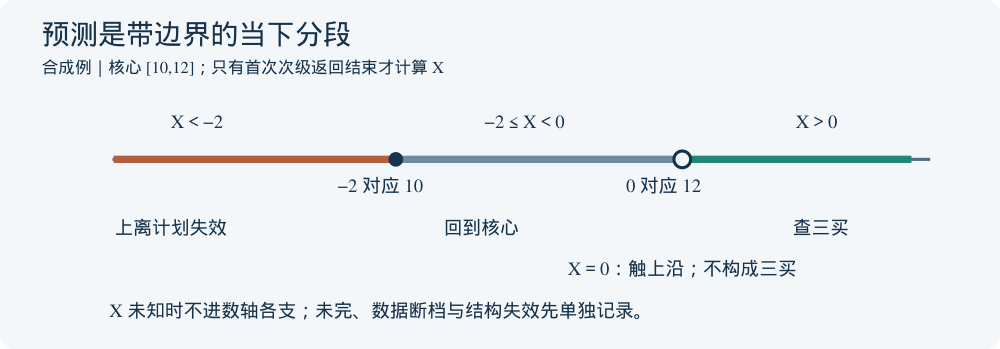

# O11 · 预测是带边界的当下分段

来源：《缠中说禅-股市技术理论》第三章第11节，PDF 物理第44–49页。

## 从猜测结果改成预先划界

「预测」的常义是估计未来走势；书给操作上的另一个定义：先固定级别，列出定义域内的结构选择及边界，并为每段写动作；市场给出证据后才决定。书不许把尚可能发生的支路凭印象排除，因为这样又押注一个结果；已经观测的事实和严格定义可以使某个条件不成立，仍应留记录。书用符号函数说明完整分段：x＜0 输出 −1，x＝0 输出 0，x＞0 输出 1。边界点另有归属；书取所讨论的价格域 [0,∞)，课程的「差值」才可能为负。概率乘法的比喻不是依赖事件下可随意相乘的公式。（物理第44–45页，第11节）

原文举前期两个高点及 10 日均线为当时划界，事先写跌破和未破两路；那次未破，所以继续持有。旧前高失去分段用途后才换均线系统，不能为了挽救已失效的仓位临场换级。它又给通用分段：买点买，卖点卖，二者之间持有；上一次是买点则持股，上一次是卖点则持现金。动作前还要查有无持仓和最初状态；书中无最初信号时，课堂默认空仓等待。观察应细到足以执行本级，不能把小级别晃动当大级别失效。

## 合力、成交与理论的适用假设

每笔交易是当时众多作用叠加的结果。原书把政策、规则等写成可能分段恒定的 F(t)：一段看似不变，却会在新公告等断点跳变；研究宏观、基本面可减少盲区，不能清除。观察者发布预测、跟随或下单自己也成为分力；资金再大也只是其中一项。原书借量子测不准类比参与会改变对象，这个类比不能证明金融价格服从某个物理定律。（物理第44页）

书把成交按不可逆的时间排成价格轨迹，量是对应小时间内成交数量；参与者的理性、信息是否全反映于价格与「买卖在当时报什么价、成交多少」是两个问题。本节所谓「价格充分有效」是它自己的术语：按时间记录的**实际交易**由成交价格轨迹表示，不是「价格包含所有可知信息」的命题。课堂保留价、量、时间和笔序，不能从相同价格推出同样动机。作者拒绝把走势永远归结为某个固定决定因子或固定随机机制；此论证没有排除统计或因果检验的用途。（物理第45–46页）

第二个前提叫「非完全绝对趋同」：人有反应时差、资金与层级不同，同一消息或同一规则也不会让所有人同一刻以同样方式交易。作者称该延异使走势可分析，并用不动点唯一性作类比，提出两项前提下理论永远有效、公开也不会消失。课内把这记作原书的适用条件与有效性主张，不能仅从前提推出获利或唯一正确的分解。政策、资金、选股、性格与容量造成的执行差异可以并存；书称较大级别更难被单一资金控制，同一规则拥挤时可能造成延伸，均须另核，不据此推定身份或操纵。（物理第46–47页）

## 分段模拟：相等、待确认与失效分别走

合成例先固定 30 分钟观察层，旧核心 [10,12] 已记录，已有持仓。先定义 X 为完整次级返回的最低价减去 12；先确认直接次级上离已完成，再核同一次离开后的首次直接次级返回。返回未完时，完整 X 尚未知，但已见低点能给 X 的上限；以下四个 X 数值分支按完段计算。

| 本次可知状态 | 结构记录 | 模拟动作 |
| --- | --- | --- |
| 已确认本次返回，尚未完成，且已知最低至 12 或更低 | 完整 X 未知，但已知 X≤0。本次严格三买排除，等结构和完段时点 | 暂停新增，核当前敞口；不用暂见价冒充完整段结果 |
| 返回未完且暂未触边、返回资格待核、数据断档或口径有变 | X 尚未知；若突发事件已破原层级结构，旧表作废 | 先暂停新增；必要时重建结构，查已有敞口与委托，不填未来信号 |
| X＞0 | 查三买；其后待辨新生趋势或扩张盘整 | 仅合权限和风险限制才提交；已持仓按预设上限处理，不自动加满 |
| X＝0 | 恰触 ZG；课堂采用严格口径，先记边界 | 不把等值晋升为三买；若课程换用允许等值的口径，须在演练前写明 |
| −2≤X＜0 | 回到 [10,12]，三买失败 | 延续震荡的可能仍在，等待新证据；如触发独立风险阈值，执行检查 |
| X＜−2 | 跌破 10，原上离计划失效；尚不能直接命名三卖 | 须确认相对仍适用的同级最近核心有一次合格且已完成的直接次级下离，且该次下离的首次合格直接次级回升已完成、全段最高严格低于该核心 ZD，才可判三卖；已持仓进入风控检查 |

若首回最低分别为 12.4、12、11.7、9.8，则 X 分别为 0.4、0、−0.3、−2.2；当时只能运行对应的那一行。若时间改设日级，须重新建立边界而不能按这份 X 表操作。若某次 30 分钟顶背驰确立，书用「背驰级别不小于转折级别」讨论随后走出同级下跌或扩展成同级以上盘整，并以二者都不愿参与为退出理由；本课按作者给的两个结果教学，仍须查背驰完成及后续实际结构，不凭小层柱短证明这个命题。原话的级别不等式与例示层次之间不据此推导通式。（物理第48页）

## 信号之后还要观察什么

买卖之后最要紧的动作是等待走势生长；确认点给分类新边界，反过来分类才给点的含义。书要求信号一到按层级反应：若持仓与选定的走势相反，尽快退出，并将这种反应解释为结构失效，而非单看浮亏多少；风险阈值仍可独立存在。盘口异动仅在事前已圈定而且大到小条件俱备的区间套内当证据，别见到任一异动就标转折。突发事件先破小结构，再改变大结构时重作分类；订单的时间不可倒流，故不要把失效时不存在的成交填进去。（物理第46–48页）

原书还举 T+1 下背驰买入后若回探，当日可能不能卖；它偏好略先于大盘而非完全逆向的股票，理由是后者仍可能补跌或只是逆向整理。这是相对强弱筛选，不会解除可卖限制。练习中须独立记录确认、动作、委托、成交和未成交，且留拒绝交易这一支。

## 形态、点位与修习类比的界线

作者用「不患」称事前先定的操作层和所认为可分类的基本形态（以中枢、趋势和盘整为核心）；具体点位是结构演化到当下才可知的结果。作者又把参与者行为比作向量，总和比作走势，把个人先化为「零向量」用来说明暂放自己的偏好、观察合力；真实下单就不再是零影响。它以贪、嗔、痴、疑、慢解释为何同构，以「闻、见、学、行」比喻训练执行，以同一方法仍有业绩差别来强调实作。恐惧与贪婪是市场存续基础、学会理论可绝对把握等，是书的哲学或效力主张，不能从历史轶事推出。

第 48 页先说亏损按百分比计，又主张不论资金如何积累、处在什么位置，全部归零的概率都一样。书未给出支持这项概率判断的统计依据。两个账户都亏 10%，表示损失比例相同；不能据此判断不同资产、持仓、负债和时点的归零风险相同。（物理第 47–49 页，第 11 节末）

## 练习

1. 沿用表中 [10,12]、严格口径、已有持仓。各情景均已完成相对本核心的合格直接次级上离。a＝12.1、b＝12.0、c＝10.0、d＝9.9 是四条独立路径上已完成的首次合格直接次级回调的全段最低；e 的同次首返只知暂见低点 12.3，尚未完。逐项给 X、分类和动作。d 之后，已确认 [10,12] 仍是本级最近的适用核心，且后来有一次相对该核心的合格且已完成的直接次级下离；该次下离的首次合格直接次级反弹已完成，全段最高 9.6。再判什么？
2. 按 30 分钟层模拟，日内 10:05 有小层顶背驰，10:20 才有突发消息破坏原大层结构；本日刚买且题设同批份额不可当日卖，无成交回报。如何分别记两个时点、仓位和下一步？若别人说「同一消息使所有人同一时刻成交，因此书的两个前提都证明了」，需澄清什么？
