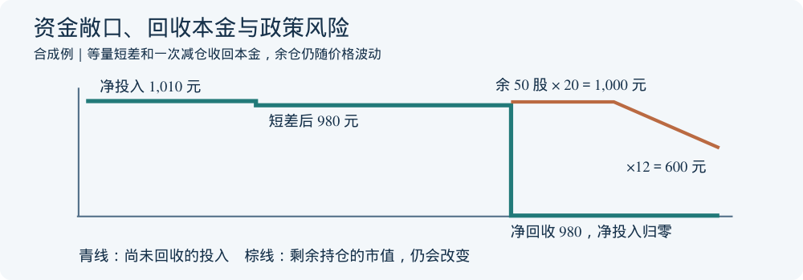

# O12 · 资金敞口、回收本金与政策风险

来源：《缠中说禅-股市技术理论》第三章第12节，PDF 物理第49–51页。

## 从价格风险到账户敞口

政策、全市场、交易、流动性和经营是风险来源。书从纯技术角度把它们最后落实为价格波动，用高市盈率股票仍上涨说明估值不能单独定短期价格；又认为坏消息经知情交易通常先在价格上留痕。课内保留「看已知价量」的用途，但消息、停牌、流动性变化也可能突然进入，价格不能证明市场已反映全部风险。书把持有的凭证看作「此刻的钱换未来的钱」，不因喜欢标的而忽略退出；这是一种交易视角。对实际账户还要分别看可卖数量、持仓市值、未成交订单、杠杆、可承受金额及时间。原书早段说不必看市盈率，后段又用价值和企业成长作为不同目的的防线，不能把其中一处隐去。（物理第49、51页，第12节）

## 回到零成本以前，固定初始敞口目标

原书主张先准备好技术面、基本面和资金，一次定初始股数及占账户比例，买前没准备就不做。有效投入尚未收回时，卖点可卖一部分、买点恢复初始股数，**上限不增**。书一处说宁愿跌时买，亦戒上涨加码；结合本节的固定数量规则，课堂只许恢复已减的份额，不能用下跌当作净增仓许可。另留小笔机动资金，例如该标的预算的 1/10，用于先买后卖或先卖后买的短差。回本前，下新买单须满足 **当前已成交持仓＋仍有效买单的未成交股数＋拟新增买量≤初始股数**，并另查可用资金。初始 100 股、现持 80 股，若无其他待买单，数量上还能买 20 股；若仍有 10 股的有效买单未成交，则最多新增 10 股。待买数量没查清，20 股只是不计在途时的理论上限。未成交卖单不释放股数空间。原书说买后下跌而理由仍在不随意抛，若理由消失或技术形态严重才进入退出；课内独立风险阈值仍适用。（物理第49–50页）

例：大资金书举 1 分钟层卖 5 万股后买回，差 0.10，毛差价 5,000 元；若费用等共 1,000 元，净约 4,000 元。小层买卖量应与容量相配，日线层可有更大交易量。书同时允许小资金全进全出切换高波动品种，又主张大资金更重管理、资金长期无压力、自负责、不借背水一战。全仓说法是原书情境，不能覆盖账户限额；波动大不等于能做出净差价。稳定管理还包括持有、达到较大层的持有依据时升级管理、到退出时回收现金。等比亏损与金额无关，仓位和杠杆会改变账户后果。

## 回收是现金流口径，剩余持仓仍会亏

设有效投入为买入及费用的累计现金流出减卖出后的实际净回收。合成例：100 股以 10 买入，含费共 1,010 元。后来做不改变股数的短差净收 30 元；还需收回 980。若价到 20 附近、有条件在大层卖点卖出 50 股，扣费实收 980，累计回收 1,010，余额 0；持 50 股市值约 1,000，若后跌至 12，市值少 400。未实现浮动、后续交易费用和余仓可卖性都还存在；过去已回本金并不等于当前风险为零。若实际只成交 40 股、净收 780，有效剩余投入仍为 200。比零更低的净投入表示已多回现金，同样不消除剩余市值风险。

书把涨至约一倍、遇较大级别卖点时减一部分作为加速回本的路线。恰好回到零时，两页的口径不同：第 49 页说变成负数前不加仓，第 50 页说成本归零后开始挣股数。本课采用第 50 页作为演练门槛。有效剩余投入按实际成交和费用核到 0 后，仍须检查已实现的差价、含费买价、账户限额和风险条件。只有本轮卖出净得的钱确实够买回更多股，才核增股分支，不另追加本金。例如先卖 10 股净得 200，回落时买 11 股含费 193，还剩 7，股数增 1。资金不足不记增股；零成本也不等于没有风险。书主张把这类仓位持到月线以上大级别卖点，资金转投其他标的并扩展零成本组合，称可迎来长盘整与大趋势收益；没有保证每次短差、复购、历史大顶或最大收益。（物理第 49–50 页）

## 政策分力与九项防范

书分硬调控（如社论、讲话、严查）与相对连续的软调控，认为两者会随阶段切换，不能精确猜公布时点。它以 1994 年约 325 点时的「三大政策」与缺口作为调控过度下跌的例子；描述政策是有边界的分力，5000 点与 1000 点处效果不同，称不会单独改变长期方向。它把政策风险归为非系统风险，这是书中用法；实际一次政策可同时影响全市场。没有原始公告或序列可从本节核验政策时点、作用归因和持久性。（物理第50–51页）

| 原文九项的次序 | 书中思路及课内检验 |
| --- | --- |
| 1 | 结合价格与价值位置：低估时较留意向多政策，泡沫时较留意向空调控。先写估值比较基准，没有基准保留未知。 |
| 2 | 个股长线价值、经营和成长性是底线；中短波动可能提供买点，须先看企业底线是否破坏。 |
| 3 | 管仓、不借钱炒股；泡沫阶段只战略持有，不新增战略仓。再核整体敞口及能否应对波动。 |
| 4 | 把回收成本作为操作纪律；按实际回款核算，不把它当成资本零风险。 |
| 5 | 贪婪与恐惧皆会妨碍决策；同时保留仓位、资金、成本约束和政策警觉。 |
| 6 | 不假定人人能提前一天跑；原书讨论公告保密、即便先获知者也受时间和大资金流动性约束。不要从走势倒推谁提前知情。 |
| 7 | 备对冲路径；书举当时的权证与认沽热销，只是时代例示，执行需验证产品权限、成本、标的匹配和剩余风险。 |
| 8 | 硬调控出现后，书要求抓可用机会出；即使跌幅小，作者认为调整可能耗时。先查公告、现金和可成交约束，不把计划记成执行。 |
| 9 | 上行期间收回和累积资金，为不可预估冲击留余量；书举大幅获利后容纳约 10%–20% 波动，强调反应而非抢前一日。这个比例不是通用止损或仓位上限。 |

## 练习

1. 起初 200 股含费共付 2,020 元，做等量短差净收 80 元；后部分卖出 100 股实际净收 1,940 元。计算有效剩余投入、余仓和现价由 20 变为 16 时的市值损失。若后一次净回款仅为 1,600 元，分别考虑仍成交 100 股，以及卖出股数减少但实际成交股数未知，哪些结果能确定？
2. 初始 100 股，有效剩余投入仍为正；先在小级别卖出 20 股并已成交，后遇合格买点，只准恢复初始仓，按可用资金可买 30 股。无其他待买单、仍有有效买单待成交 10 股、在途股数未知，这三种情形分别能给出什么新增回补上限？若当晚出硬调控公告、次日退出未成交，怎样记政策和持仓？要用对冲时，还缺哪些输入？
