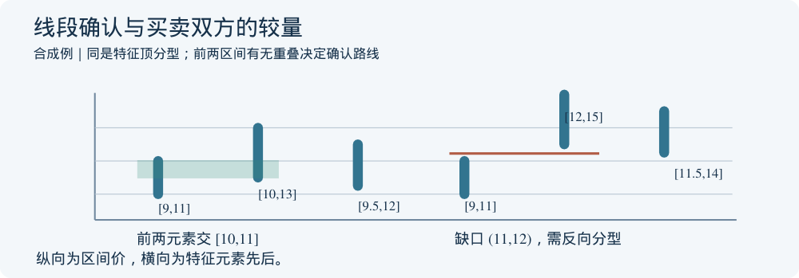

# O13 · 线段确认与买卖双方的较量

来源：《缠中说禅-股市技术理论》第三章第13节，PDF 物理第51–52页。

## 为什么最小中枢用线段

笔连接合资格的顶底分型；三个相邻、经过约定处理的 K 线高低关系可组成一个分型。线段至少三笔，起始三笔需有重叠，终点还须结构确认。最小走势中枢的初始核心用前三个连续、合格且已完成的线段取公共价带。原书认为也可设计「笔中枢」，但单笔直接受局部极值影响，一笔错单或异常打印可能改分型和笔，笔中枢会更敏感；线段要求反向结构进一步确认，所以不因任一逐笔异常就自动换段。这是抗局部扰动的理由，不等于线段不受数据错误影响，也不是已量化的稳定性比较。（物理第51–52页，第13节）

对于向上线段，抽它的向下笔区间作为特征元素；向下段抽向上笔。按适用的包含规则整理，向上段看特征顶分型，向下段看特征底分型。如同 K 线分型，比较三个相邻合格元素才能判断中间元素；第52页把多次特征确认作心理解释，具体判段按特征分型程序，不把「三次确认」当成三个各自完整的分型条件。特征缺口指相邻特征元素区间无重叠，不是 K 线无成交跳空。确认时点晚于候选端点出现，必须分记。

## 两种终结机制与未确认路径

| 路线 | 可从图形检查的事 | 本节给出的心理解释 |
| --- | --- | --- |
| 第一种：原序列特征分型前两元素无缺口 | 第一笔反击触及或穿过上一次反向元素的价域；随后原方向再试、反向再次推进，待完整合格分型成立才确认 | 原书把它解释为反攻有力、原方打击未奏效；即使不换大趋势，也可能先停歇，形成最小中枢的条件 |
| 第二种：原序列特征分型前两元素有缺口 | 候选顶／底先记；由该端点起，向下起始序列查底分型、向上起始序列查顶分型。反向序列未完整则继续观察；原方向若重创更远极值，撤销旧端点候选 | 原书认为初次回击弱、原方向仍有力，反攻需要积累；若原方向分力高度同向，弱回击也可能迅速扩大 |

表的操作侧是按本课程的特征序列口径展开。本节正文主要解释心理上的不同。两条分支都需先确认有效笔、特征序列及观察级别。处理包含时，旧段和反向候选段的两侧元素不能跨边界直接合并，否则会抹掉待检缺口。第二种情形在反向段的特征序列取得合格分型即可核终点，不要求补旧缺口，也不再对这个分型重分第一、二种；不因为盘中一笔或听到市场传闻就越步。下行镜像同样适用。（物理第52页）

## 一个不猜动机的数值检查

合成甲：上升线段中的三根向下特征元素已按同一口径核实，依次 [9,11]、[10,13]、[9.5,12]。中间高低均高，前两元素交 [10,11]，走第一种，候选端点 13 在第三元素完成时才能确认。合成乙：换为 [9,11]、[12,15]、[11.5,14]，中间高低仍较高，前两元素间空 (11,12)。先记 15 候选；从 15 启动下行，给反向序列向上元素 [12,14]、[11.5,13.5]、[12,13.8]，中间高低均最低，得到所需底分型后才确认。如果第三个反向特征元素未完成并先创新高 15.6，应重建，不能说 15 已确认。即使确认了，不说明是哪类参与者在卖或能按 15 成交。

## 中枢复杂、提前量与骨牌效应

作者认为，简单中枢可能一方占优，复杂中枢反映多次相互试探，结束后还可能反复。同一趋势中的相邻中枢也会不同，因为交易者盯前一模板抢跑，改变形成中的合力。第二种线段终结中，作者认为初次反攻虽弱，若原方向的分力高度同向，也可能迅速集体转向。他用投机性品种的小 M 顶引发急跌作例；对一般性品种，他又把分力趋同与较高的控盘程度相联系。这是作者的归因，不能用来确认实际控盘。书还以小层分型后急跌或急升说明：若第二种终结已引发骨牌，作者预计至少回到前一高低范围，典型是冲顶或赶底的 V 形。先核后续有没有实际到达，不把说法当目标价保证。（物理第 52 页）

作者把这种连锁转向归为「多杀多」或「空杀空」，特别提到大趋势后一边倒、加速又逆转的情形。前者可指多头同向退出放大下跌，后者可指空头同向回补放大上涨；能否做空须另查。按作者的解释，原方向有力与分力趋同可以同时出现。对两条相反方向且已确认的线段，可以逐段记录幅度、持续时间及能否越过对方的关键边界。例如后段反弹历时更长却不到前段起点，只能说明反弹未收复该段跌幅。报价断层、流动性不足或消息变化也可能留下相似走势。不能单从形态证实控盘、错单、同步下单、持仓方身份、心理或因果。线段终结仍按合格特征分型确认；操作另看风险敞口，复盘把可观察与猜测分开。

## 练习

1. 三根已整理的向下特征元素为 [20,24]、[22,27]、[21,25]，原向上线段起始条件已满足且三元素均完成。是否有顶关系及缺口？候选端点和能确认的时点分别是什么？
2. 换成 [20,23]、[24,28]、[23.5,27]，从 28 起的反向序列只完成 [24,27]、[23.5,26] 两个向上元素；随后价格先达 28.5。该怎样记？若同一日另见小 M 顶后急跌，能否证明是庄家或所有多头同步卖出？
