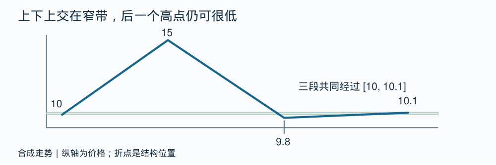

# O14 · 分段操作：反弹的第一个上

来源：《缠中说禅—股市技术理论》第三章第14节，PDF 物理第 52–53 页。

## 30 分钟反弹能推出什么

级别是由走势构件决定的层次。按本节的例子，30 分钟级别反弹至少要构成一个该级别中枢；中枢是至少三个连续的次级别走势的重叠区。这里把 5 分钟级别作为次级别，观察反弹中依次出现的上、下、上。这个前提只约束重叠，并不要求第二个上的高点超过第一个上的高点。先约定哪一段已完成、在哪一层确认，才可以画中枢；仅看到图表上的三条线或三根 K 线，不足以判定。

## 先按次级别处理，满足条件再改为持有

原书优先在第一个 5 分钟上行结束时检查卖出，再面对同级下行；不为等第二个上行而预设一个更高价格。回调的结构分析可反向展开，执行仍需另查持仓与可交易条件。此处是 30 分钟反弹按 **5 分钟** 分段，不是把 30 分钟的段拿来分解成多个同级 30 分钟段。

第一上一下出现以后，可缩小观察范围，仍要等实际证据。第一个 30 分钟中枢形成后，向上离开和首次回试都须是它的直接次级走势（本例为 5 分钟），且均已完成；首次回试的全段最低点高于核心上界，才按本课严格口径核三买。再从可比结构确认后续向上没有背驰，书中才从次级分段转为按整个 30 分钟反弹持有。此后观察第二乃至第三、第四、第五中枢，背驰后若出现所持级别的第三类卖点，再检查退出。这里的背驰指有效可比的同向段，后段按预定比较依据显示力度衰减；未能判定，则不能填「无背驰」。缺任一持有条件，就仍按次级别处理或等待资料。反弹后来延续成更大结构，届时再分类，无须预判「反转」。原书把「部分仓位持有、余额换股轮动」排在单纯分段之前，称其平均效率更高；还说小资金可全额轮动、所需技术更高。排序并非由中枢定义推出，需要在同样成本、可成交性和风险约束下另测。

## 算例：交集成立，高点仍下降

三个连续、已完成的 5 分钟直接次级段依次为 10→15、15→9.8、9.8→10.1；全段范围分别是 [10,15]、[9.8,15]、[9.8,10.1]。区间交集为 [10,10.1]，第三段高点 10.1 只略过第一段低点 10。若假设实际买卖恰能以 10 和 10.1 成交，往返每单位费用 0.15，则净额为 −0.05；若只能在第三段完成后提交，还可能根本没有 10.1 的成交机会。对照首段检查：若端点 15 后确认并实际成交在 14.7，买价仍为 10，扣同样费用净额为 4.55。这是两种模拟输入，不能倒填 15 为成交价。原书的结构「绝对性」不能消除延迟、跳空、停牌或交易成本。

## 练习

1. 三个连续、已完成的 5 分钟直接次级段依次为 20→27、27→19、19→20.3，完整价幅分别为 [20,27]、[19,27]、[19,20.3]。写交集和第二个上行的高点；买价 20、实际卖价 20.2、单位往返费用 0.25，求净损益。
2. 某 30 分钟核心 [10,12] 已确认，其直接次级的 5 分钟向上离开已完成。眼下首次回试暂见最低 12.4，但该段尚未完成，级别与后续向上力度也未核。此时能否切到持有？以后要核什么？
