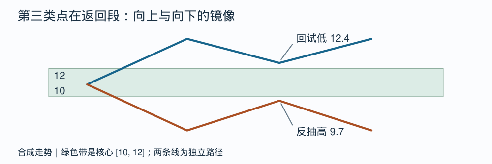

# O15 · 踏准节奏：信号、级别和行动

来源：《缠中说禅—股市技术理论》第三章第15节，PDF 物理第 53 页。

## 回调与反弹里的信号

「当下」只用已经出现、当时能够知道的资料。「买点买、卖点卖」是原书的动作顺序：先判定该级别结构，再决定是否执行。买点来自下跌或回试结构，卖点来自上涨或反抽结构。以中枢 [10,12] 为例，以下两条路径的离开和首次返回均为该中枢的直接次级走势，且都已完成。向上离开后，首次回试最低 12.4，可核三买；向下离开后，首次反抽最高 9.7，可核三卖。向上刚冲到 13 尚未回试，不是三买；当日下跌到 9 本身也不是三卖。错过一次，等下一类合格点；第一类核趋势末段与衰竭，第二类核转折后首次相应的回试，第三类核完成的次级离开和首次完整次级返回。三类是不同结构机会，未必都会如愿出现或可成交。

## 逆大级别的小点怎样审查

按所选层先核品种结构及各层中枢，再把大盘和板块资料列入同一观察时点。如果大级别的同向运动没有衰竭，小级别顺大方向信号可作为延续线索；逆向小买卖点只先说明局部，不能凭此给大级别改判。原书把准确率置于频率之前，也把守住操作节奏置于追求更细精度之前。前者比较信号质量与交易次数，后者要求提高分辨精度时仍按既定级别和条件行动。原书建议初学者以 30 分钟练习、最低不小于 5 分钟，并在 5 分钟尚未进入背驰段时不操作；这是书中训练约束，不是一般市场规则。级别越小，确认时间、反应和费用越容易吃掉可用价差。

## 从错过到重新检查

假定大级别仍下移，短层下跌中在 9.0 出现一买候选；初学者按计划等待。到 9.8 时，题设的同向力度衰减和末段结束证据齐备，才确认 9.0 是短层一买。9.8 是反弹中的报价，没有新买点依据。首次直接次级上行结束后，首次直接次级回试也已完成，全段最低 9.3，未破已确认的一买点 9.0，这时才检查小层二买；若一买或回试级别未确认，就只记候选。大级别仍未衰竭，不能改视为大级别反转。若最后连计划所允许的第三个纠错机会也错过，原书建议休息。害怕让人避开已核买点，贪心让人拒绝已核卖点；复盘时分别记触发、否决和心理念头。遵守节奏不能保证成交，系统或承受能力要求退出时，不把「不杀跌」解释为不得执行既定风险处置。

## 练习

1. 核心 [20,23]。甲刚涨到 25，尚未回试。乙向上离开后首次回试低点 23.6；丙向下离开后首次反抽高点 19.5。乙、丙的离开和首次返回均为该中枢的直接次级走势，均已完成。逐项判断。
2. 给定 30 分钟下移未见衰竭、5 分钟局部买点确认、板块数据缺、计划禁止逆向短差。写当前记录及下一次复查条件。
