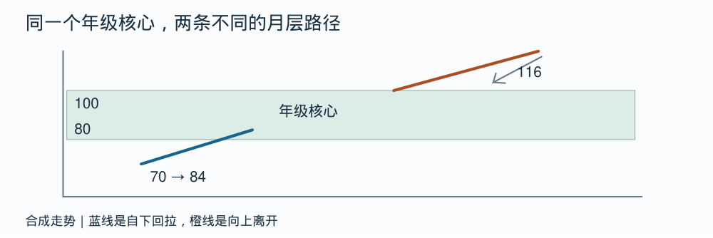

# O16 · 两类机会与跨级别配置

来源：《缠中说禅—股市技术理论》第三章第16节，PDF 物理第 54 页。

## 先固定操作级别

初始中枢核心是前三个连续、合格且已完成的直接次级走势的公共价格区间。上移要有新的同级结构并核两个中枢关系；震荡是围绕原中枢反复。原书把做多获利机会分为上移和震荡：选定同一层，上移尚未转入新中枢形成或震荡阶段时，原书不在该层做来回短差。震荡中先核向上离开段的卖点，再检查首次返回。按本课严格口径，须有相对同一个核心的合格直接次级上离已完成，且同次上离后的首次合格直接次级返回也已完成、全段最低严格高于核心上沿，才确认三买。已确认同一次合格返回时，已知最低触及或低于上沿，即排除严格三买，即使尚未完段。若身份未知，或未完且暂未见触边反证，先待核。原书把确认的三买列为旧仓回补候选。三买也可能走向更大中枢；已确认的大级别重叠才支持后一判断。书说震荡可回补，指结构路径；成交还受滑点、数量和时点限制。

## 把横切面叠起来

月线级别上涨可能只是年级别震荡的一段。合成年级核心 [80,100]：月层走势从 70 拉回 84，先经过年核心下沿 80，可把旧区域标为待消化的阻力；若从核心上缘附近向上走至 116，旧核心是反向回拉时的参照。区间给观察位置，不能凭 84 或 116 两个价位证明以后必回、必被挡或已形成新年级别中枢。原书认为季度中枢上移可能对应十年或更长的月层上涨，因而要看企业成长约束和行业容量，也称中国几乎每行业可能有企业冲击全球上限，容量有限的行业除转型外难有月季以上的上移。这是书中的产业推断，没有行业数据或上限估计，不能当已验证的筛选定律。

## 从候选龙头到现金流

原书假设最终领先企业市值会达到例如 10 万亿元。它可能是现龙头，也可能是取代者。若市值从起点连续地走到 10 万亿元，才可说必经过起点与终点之间的每一个数值（含端点）；例如从 6 万亿元到 10 万亿元，必经过 8 万亿元，不能据此说必经过 12 万亿元。离散报价、跳跃或已经高于该值时，不能从设定终值推出每个中间报价都实际成交，更不能由假设推出终值一定到达。

原书给大资金的样例是：约 70% 配一两家领先企业、30% 给两三家成长候选；若龙头基本面显示败落，选替代者；行业顺序不变保留原比例，明显更替可按等市值换股，或分别等被替换者的大级别卖点与新标的买点。比价是把市值和行业地位对照找疑似低估；基本面、比价和形态三种视角可互查，不据此假定统计独立。原书还设想利用日周级震荡回收全部投入并增加筹码（也可转向成长或低估企业）；小资金可只跟踪一家龙头或成长者，书称初期可用小级别积累，规模增大后不实用。这些属于配置设想，需另核容量、费用与风险。

原书把降至零成本作为投资是否有意义的标准。这是作者的评价，不是风险定律，也不能据此否定其他配置目标。

算例：投入 10,000 元，之后累计收到扣费净现金 8,000 元且仍持有若干股，未收回现金为 2,000 元。若净回款增到 10,000 元，历史现金口径为零；剩余持仓的市值仍会变动，且还有资金机会成本和集中风险。

## 练习

1. 年级核心 [80,100]。月层甲从 73 到 88，乙从 100 到 115，均假设为已确认月层上涨。分别说明年核心对分析的意义；可否据此确认年级上移？另给两条独立路径：相对该核心的直接次级上离和随后的首次直接次级返回均合格且已完成，返回全段最低分别为 100 和 102。按本课严格口径，哪条具备列入旧仓回补候选的三买条件？
2. 按原书示例用 100 万元划分 70%/30%。已从原 20 万元持仓回收扣费后 20 万元，现仍有市值 7 万元。写现金回收口径及若现市值跌到 4 万元的变动，并说明行业顺序变化时另外需要什么证据。
