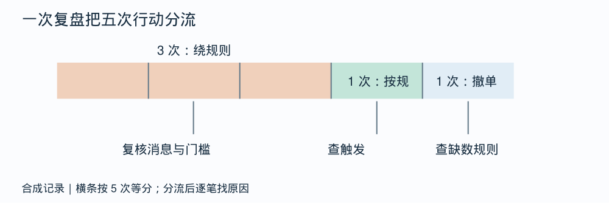

# O17 · 何时先退出观察场

来源：《缠中说禅—股市技术理论》第三章第17节，PDF 物理第 55 页。

## 从行为识别问题

原书区分「当前不适合」和「永远不适合」：知道规则却控制不住时，继续用真钱尝试未必能改善。明显反复失控时先退出或暂停，把复盘与练习移到市场之外；若后来能稳定执行，可再从记录和模拟检查。这些是行为描述，不宜给本人作医疗或人格诊断。预先写下可买范围、触发证据、上限和退出规则，才有基准判断有没有偏离。

## 十种表现，不凭标签定性

| 原书类别 | 看得见的偏差 | 复盘要核什么 |
|---|---|---|
| 耳朵控制大脑 | 一听消息便下单 | 下单前有无来源、时间和自身结构判断 |
| 疯狂购物 | 买许多只，只为不漏任何上涨 | 标的是否有各自计划，合计风险是否可读 |
| 不受控制 | 明知不合条件还照做 | 是否多次绕过门槛、记录和停手机制 |
| 永远认错 | 道歉后下次仍重犯 | 有无改规则、模拟验证和观察期限 |
| 祥林嫂 | 反复沉浸在受损叙述 | 能否指出可更改的具体行为 |
| 赌徒 | 用下一笔决定能否回本 | 加码是否和市场条件、承受范围脱节 |
| 股评 | 强调预言与面子，隐去亏损 | 能否以全部记录对照说法 |
| 入戏太深 | 每次涨跌或横盘都使情绪失控 | 是否还能遵守计划并中止盯盘 |
| 偏执 | 反证来了仍不撤销 | 是否写下可证伪条件并照办 |
| 赵括 | 会背理论，却无当下验证能力 | 能否独立做盲回放、写时间及成交约束 |

## 算例：记录一日，而非评判一人

原书建议每天收盘后约十分钟重看操作与心理过程。合成记录：日内 5 次动作，3 次因传闻绕过计划，1 次符合事前规则，1 次因数据缺失撤单。已确认违规占全部动作 3/5＝60%，这是总违规比例的下界；四次已判定动作中则为 3/4＝75%。撤单是否合规要看方案对缺数的规定。正确结论是优先暂停相关动作，复查三笔消息触发和停止条件；一日记录既不能证明永不适合，也不能证明某行为等同于亏损。反过来，持有十几只也可能来自严格配置；数量本身不足以认定「疯狂购物」。

## 练习

1. 事前规则禁止在未核实传闻时下单，证据不足须取消。四笔行动中，一笔未核实传闻便下单且已成交，一笔按规则成交，一笔按规则取消，一笔缺订单时间、暂不能分类。按已核三笔统计确定违规比例，同时写第四笔的处置。
2. 甲连续三天承认同一错却未改计划且每次重犯；乙能背术语，但两次盲回放都把未来低点填成当时可知。分别对应什么复盘问题？提出各一个恢复真钱练习前的可核条件。
