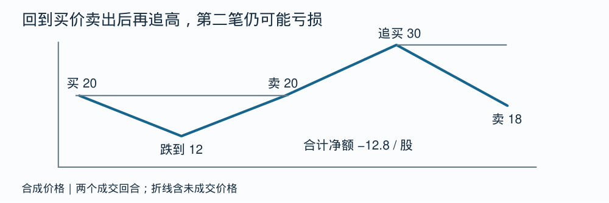

# O18 · 赌徒心理与可承受资金

来源：《缠中说禅—股市技术理论》第三章第18节，PDF 物理第 55–56 页。

## 从欲望到可见行为

本节所称「赌徒心理」，是输了想靠下一把全赢回来，赢了又用同一冲动继续押注。原书列四个迹象：没理解市场就不断加投入；设与证据无关的虚拟目标；亏损后以「涨回某价再离开」代替规则；怕错过上涨，因「卖后还涨」而取消判断。四种外在行为是反复杀跌追涨、真到条件又怕而事后追高（书举 5 元不敢买、50 元反而敢买）、把消息当捷径、把房车装修款交给市场去补。都要问：当时有什么证据，作决定的是价格结构还是回本焦虑？

## 把规则和目标隔开

原书给四项纠正：把参与当可选；不把一次暴富当长期生存依据；有规则便承认错过并复盘偏差；只考虑不影响生活、无后援的有限资本（「0 成本」是书的更严格措辞）。规则能帮人一致记录，原书对长期成功的保证没有统计证明。当前资金不可承受就暂停，不能用潜在奖金、借款或未来市场利润补齐可用额。

第 56 页把恐惧对应为跌时不肯按信号买、反而急卖，贪婪对应为涨时不肯按信号卖、反而追买。还举套牢后久等、回到成本就卖、再涨又追、反被套得更高的循环。这是偏离规则的例子，纪律性减仓不因价格正在跌就成了赌徒行为。该页末句在「涨出卖点」后写了「买」，与同句的「跌买涨卖」相反；本课按出现合格卖点检查卖出，不据该字逆转方向。

## 算例：回本锚与预算

合成一股路径：以 20 买入，跌到 12 时没有退出计划，回到 20 全卖；涨到 30 又追入，跌至 18 后以 18 卖出。第一笔毛损益 0，第二笔每股 −12，若两笔往返各扣 0.4，总净额 −12.8。每次动作都问有没有事前证据；未来再涨不保证，现在能做的是冻结追加和核支出。假定另有现金 12,000 元，其中学费及生活必需 9,000 元，应急款 3,000 元，题设可承担资金为 0；不能为了把 −12.8 赢回而动用两类保留款。

## 练习

1. 合成路径 10 买、10 卖、16 再买、13 卖；两笔各扣 0.2。算总净额，逐笔写出仅凭成交价不能知道的一项证据。
2. 某人准备从 8,000 元存款投入 3,000 元，其中 5,000 元是房租、另有 3,000 元应急保留；他说亏了会再借钱回本。按题设核可承担额和当前动作。
