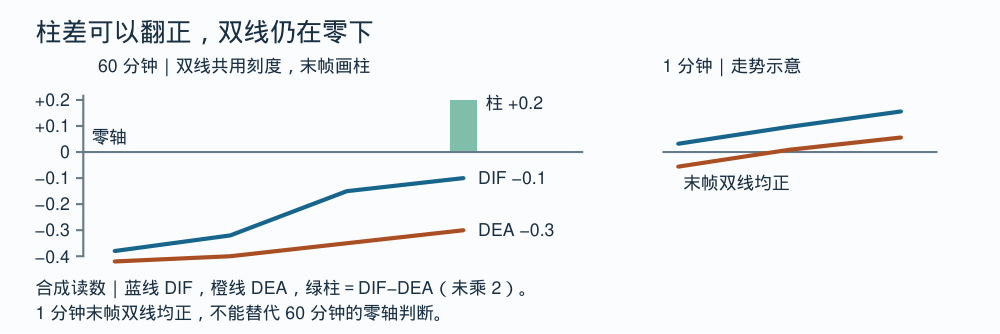

# O19 · MACD 零轴过滤：先定周期，再读双线

来源：《缠中说禅—股市技术理论》第三章第19节，PDF 物理第 56 页。

## 两条线、柱与零轴

MACD 由价格序列计算。DIF 是快、慢指数移动平均线之差，DEA 是 DIF 自身的指数移动平均；柱通常为 DIF−DEA 或其倍数，配色、倍数和参数应看软件图例。「黄白线」是原书对这两条曲线的叫法，不能据颜色认线。柱为正只意味着 DIF 大于 DEA，两者仍可能都在零下。左图是 60 分钟算例：DIF＝−0.1、DEA＝−0.3，柱按 DIF−DEA 绘制，为 +0.2。双线与柱共用同一零轴和刻度。示意四帧的 DIF 依次为 −0.38、−0.32、−0.15、−0.10；DEA 首帧取 −0.42，之后每帧用上帧 DEA 的 80% 加本帧 DIF 的 20%，依次得 −0.40、−0.35、−0.30。右图只示意 1 分钟末帧双线均在零上。

## 零轴规则与无法判定的边界

第 56 页把所选周期零轴上下称为多空主导，用的是过滤器：先按能力约定最低观察周期，例如 30 或 60 分钟；1 分钟过轴可更频繁，不能拿它覆盖预设周期。该周期双线都在零轴下时，书中要求回避该市场或股票；要等重新站住零轴再重启检查。站上也只是通过此过滤，需要另有结构买点与执行条件。原文未量化「站住」等几根收盘，也未明确一上一下、恰等于零如何归类。教学记录把混合、触零、未完成柱列为待核，事前定义稳定要求，不能见到结果才调整。原书另给熟练者一项介入例外：在零轴下若有背驰依据，可以介入。本课只分析这项例外的结构证据。背驰须有同级可比同向段及衰减、结束证据，不能直接用 DIF 上穿 DEA 的「金叉」代替。

## 书中的 5200 点到 3000 多点

本页让读者自己看大盘 60 分钟图：按作者回忆，约 5200 点时 MACD 跌破零轴并反抽确认，后来到 3000 多点一带仍在零轴下运行。这是文本指认的历史观察；该区没有配这张图，也不载日期、指数代码、参数、逐根双线或反抽精确转折。可读出的证据链是「指定周期—双线破零—反抽仍未恢复—后续还在零下」，不能复造出精确交易日、点位间单调走势或保证过滤过的全部风险。要核实，需补指数标识、时期、量价数据与计算口径，先冻结参数再重算。

## 练习

1. 预先选 60 分钟，闭合帧依次是 (DIF,DEA)：(−0.5,−0.3)、(−0.1,−0.2)、(+0.1,−0.1)、(+0.2,+0.1)。逐帧分类；约定两次连续双线正才叫站稳。
2. 同一时点，60 分钟 DIF=−0.4、DEA=−0.2，1 分钟双线为 +0.3、+0.1。按 60 分钟过滤写动作；要审查书称 5200 点至 3000 多点，还需哪些输入？
