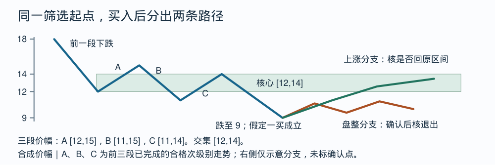

# O20 · 中小资金法：十类连接与筛选

来源：《缠中说禅—股市技术理论》第三章第20节，PDF 物理第 56–57 页。

## 不先定级别，十类就用错了

盘整是只含一个该级别中枢的走势类型；上涨与下跌是按同级中枢移动识别的趋势。在 30 分钟层上涨，放到日层可能只是下跌中的反弹或盘整的一段。第 56 页表格描述的是同层已识别走势的连接模板，先读类型与先后。下列「有／无」是原表栏名，不是当前参与结论，也不是成交或收益标签。

| 原表类型 | 原表有买入价值 | 原表无买入价值 |
|---|---|---|
| 陷阱式 | ① 盘整＋下跌＋上涨；③ 上涨＋下跌＋上涨 | ② 盘整＋上涨＋下跌；④ 下跌＋上涨＋下跌 |
| 反转式 | ⑤ 下跌＋上涨；⑦ 下跌＋盘整＋上涨 | ⑥ 上涨＋下跌；⑧ 上涨＋盘整＋下跌 |
| 中继式 | ⑨ 上涨＋盘整＋上涨 | ⑩ 下跌＋盘整＋下跌 |

## 数类别为何不是胜率

第 57 页给的上涨侧风险是 ②④ 反弹陷阱、⑥ 涨已结束、⑧ 上涨后经盘整转跌；下跌侧警戒是 ⑩ 跌势一停，经盘整还会下跌。原书把 ⑨ 的一类写成 10%、把 ①③⑤⑦ 四类写成 40%。这只是按十个编号数格子。若十类在 100 个等口径观察中依次出现 25、5、10、5、20、5、5、5、2、18 次，则 ⑨ 频率是 2%，①③⑤⑦合计 60%，还都不是「上涨或下跌时买入实际盈利」的概率。要估计后者需入场条件、对应方向的样本分母、成本、拒单及实际收益；原书关于盘整后有一半下跌的说法同样不能用方向数目证成。

原书进一步淘汰③⑤（上涨可随时顶背、书认为空间小）及⑦⑨（盘整耗时，到期可能再跌），仅优先研究①。即使研究①，也不能先用已知道的「上涨」给入场加分；当下只能做下面的前置筛选。

## 两步倒推与接续分支

先从目标「下跌＋上涨」往前找。依本书的连接解释，前面若为上涨，形成上涨＋下跌＋上涨，按更高一级盘整处理；若为盘整，保留盘整＋下跌＋上涨。再要求这段下跌真正离开并跌破前盘整，否则仍属原盘整；向前再补一段，若是上涨，书也归更高一级盘整，因而只选「下跌＋盘整＋下跌」。这是原文的筛选推理；实际判级仍需满足连续完段及高一级重叠等条件，不能仅凭三字标签改级别。

在第二段下跌出现一买（趋势末段衰减与转折条件）才检查介入。若之后确认同级盘整，原文要求退出，提议用低一级一卖定位；若不盘整而走向上涨，书预期至少回到原盘整区，认为日、周级可能演成大幅上行。段未封口就记待定，不先宣告盘整已被排除。镜像是上涨＋盘整＋上涨，第二上涨一卖时检查退出，不把镜像当成可卖空许可。

## 算例：结构成立，退出仍可能亏损

合成例：先有合格下跌 18→12。随后三段合格次级别走势依次完成：A 为 12→15，B 为 15→11，C 为 11→14。三段价幅 [12,15]、[11,15]、[11,14] 相交：下界取最高的低点 12，上界取最低的高点 14，得到盘整核心 [12,14]。假定第二段合格下跌从 14 跌破下界至 9，且一买条件在 9 成立；图中两条接续线只示意分支，未标确认点。另算盘整分支的模拟成交：实买 9.5，随后同级盘整确认并出现低一级一卖，实卖 9.6，单位往返费用 0.2，净额 −0.1。满足退出流程仍亏损，故书中「能保证利润」「退出不亏」均非实盘结论。若 9.6 只是段高而无成交，净额更不能填成已实现。

## 练习

1. 十类编号依次出现 8、8、6、6、4、8、2、8、30、20 次。用全部 100 次求 ⑨、①③⑤⑦表中事件频率，再写为何不能给出交易胜率。
2. 已确认下跌、盘整核心 [20,22]、第二下跌破到 17 且有一买条件，实买 17.5。甲后来同级盘整，低一级一卖后实卖 17.6，往返费用 0.2；乙接续未完成，只见报价 19，未卖出。各写状态、动作；若已退出，算本回合的单位已实现净损益。
