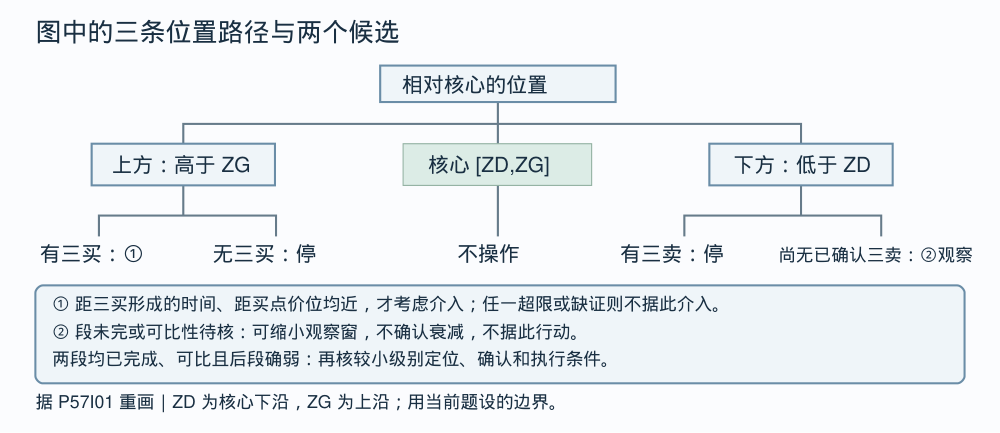

# O21 · “最大利润”图：位置、三类点与两条路径

来源：《缠中说禅—股市技术理论》第三章第21节，PDF 物理第 57 页。

## 先将位置分流

中枢核心 [ZD,ZG] 取前三个连续、合格且已完成的直接次级走势的共同价格区间。ZD 是下界，ZG 是上界。三买要有已完成的直接次级向上离开，且首次直接次级返回已完成、全段低点高于 ZG；三卖方向相反，首次完整返回的全段高点低于 ZD。这是课堂的严格口径，恰等于边界不符合严格三类点；后续另观察。盘整背驰比较围绕同一核心的可比同向波动力度，不能只比较两个价格。第 57 页图从「当下状态」分三路：

| 位置 | 是否有已确认第三类点 | 原图的观察分支 |
|---|---|---|
| 核心上方 | 出现三买 | ① 先核三买确已形成；距形成时点和买点价位都近，才可考虑。任一项超限或缺证，不据此介入；原图偏向刚形成时，未定时距、价差数值。 |
| 核心上方 | 未出现三买 | 不操作 |
| 核心中 | 不适用 | 不操作 |
| 核心下方 | 出现三卖 | 图归到不操作 |
| 核心下方 | 未出现三卖 | ② 找向下离开的当前走势，判断背驰段；按较小级别逐层缩小定位窗，核可确认买点 |

## 两种候选的接续管理

① 先分开记录时距（从这个三买形成到当前）与价距（当前报价相对买点价位的绝对偏差）。演练要用阈值，就在观察前定好两项，不看结果后再选。两项均合格也只表示可以再核交易条件。接下来，原书期待向上走出新中枢。原书说不顺利可出现更大级别中枢，以其后走势是否盘整背驰作卖出判断；若没有盘整背驰，则继续观察向上形成新中枢。三买已确认不等于新中枢已形成。② 在旧核心下方、尚无已确认三卖时就可开始观察当前向下段，并逐层缩小观察窗。要确认衰减，须先核对两段是否同级、同向、围绕同一核心、按同一口径比较，且相关段已经走完。段未走完或可比性未明时，保留观察，不能确认衰减或据此行动；若确认三卖，转入图中的不操作分支。即使确认衰减，利用回升做短差也须核对委托、实际成交和费用。两条路径没有同一目标，也没有可证明已达到最大利润的目标函数、全路径和对照策略。

## 算例：同一中枢的两个观察点

核心 [10,12]。甲的向上离开和首次回试都是该中枢的直接次级走势，且均已完成；回试低点 12.4，可归①。若以 13.1 实买，后来确认盘整背驰并以 13.2 卖出，扣 0.2 后净额 −0.1。乙在核心下方尚无三卖，两个题设可比的向下波动用同口径代理得到 8 和 4，后段做出较低低点才结束；8 到 4 提供衰减线索，可在②按区间套逐层定位。若最低价已过但确认未到，不用旧最低价算差价。

## 练习

1. 核心 [30,34]。甲上破到 37 仍未返回；乙向上离开后首次回试的最低点为 35；丙向下离开后首次反抽的最高点为 29。乙、丙的离开和首次返回都是该中枢的直接次级走势，且均已完成。观察截面：甲的当前价是 37；乙、丙在各自首次返回刚完成时，当前价分别为 36 和 28；丁当前价 32。用当前价定方位，用完整返回的极值验三类点，按本课流程图分流。对乙再作一轮假设演练：三买在首次返回刚完成时形成，买点参考价为 35；演练事先规定时距不超过 2 个观察周期、价差不超过 1。比较刚形成时与 3 个周期后同报 36 的结果。
2. 核心 [10,12]。在核心下方，尚无已确认三卖。快照甲：前一下落段已完成，力度指标为 9；当前下落段未完成，指标暂为 5。快照乙：当前段完成，最终指标为 5，全段最低 8.2，但两段是否可比仍未核实。分别写可观察的分支和能否确认衰减。另给一份模拟成交记录：买 8.8、卖 9.1、总费 0.35，求单位净额。
