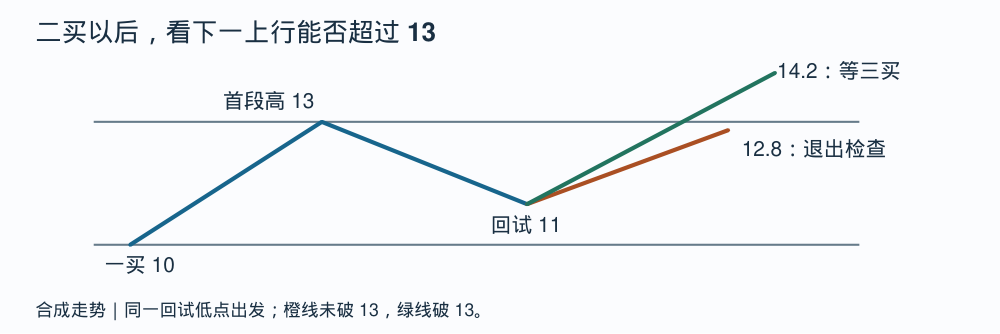

# O22 · 避免一根筋：同一小信号的不同大背景

来源：《缠中说禅—股市技术理论》第三章第22节，PDF 物理第 57–59 页。

## 一个标签没有唯一后果

「一根筋」指认为同一起点和一个固定公式必给同一结果。原书把走势视作参与者合力留下的痕迹：环境、各方心理与力量都在变，精确复刻的前提不成立。实际做法是先写清大小级别和中枢，再分别写延续、扩展、失效等可观察条件，不把一分钟图上信号当万能开关。第三类卖点要先有直接次级走势完成向下离开，再有首次完成的直接次级返回；本课严格口径要求返回最高点低于核心下界。它说明所标层的结构，操作意义还取决于上层。

## 小三卖放进三种背景

| 大层 | 小三卖后检查 | 条件与处理 |
|---|---|---|
| 中枢上移 | 小层发展是否触及大层上移的失效边界 | 未破坏则主要是警戒；独立短差属于小层震荡。若波及大层，重新核大层结构 |
| 中枢下移 | 小走势是否延续大层下移 | 若延续，原书认为对普通做多没有新介入意义；先核原大层退出。书单列做空情形，权限和成交不能由图推出 |
| 中枢震荡 | 小走势是否发展成大三卖 | 未满足时只属短层机会；也可能反向形成大买点。满足大层条件时才按大层退出检查 |

原书用「多空通杀」描述震荡中买卖点交替、止蚀与突破位置先后触及又反向的情形。可以学习辨认「触线以后结构是否确认」；仅见波动不证明有人故意制造。书主张依三类卖点不用额外止蚀，本课把这视为书的偏好；事先约定的账户、承受力和可执行风险边界仍须遵守。

## 五种先后关系

1. **大买后小买。** 小买可能只是大结构内部的再次介入候选，未必位于大买区间套内，也可能被小波动跌破。原书在大买所形成的大结构没有终结的条件下，断言随后一定有小级别波动重新回到该小买点之上。这是书中模型的结论；实际复盘须另核大结构是否维持、价格是否已回到点位之上以及能否成交。该段标题写「小买点」，正文却写「小卖点」作再次介入机会；本课按标题与后文讨论小买。正文也可能指小卖引出的回落之后再找机会；两种读法都不能把小卖点本身改成买入条件。
2. **大卖后小卖。** 按上一关系镜像：小卖未必符合区间套，也可能被小级别回升越过。若大卖所形成的下行结构没有终结，按原书的镜像结论，随后一定有小级别波动重新回到该小卖点之下。实际仍须检查大结构和价格各自的证据。
3. **大买后小卖。** 中间若已有大卖，按第 2 类；若没有，后续小跌检验大买形成的结构。未终结而后起小买，原书看作大结构的延伸；若已终结，撤销这项依据。未确认时保留两支。
4. **大卖后小买。** 镜像：中间有大买时按第 1 类；无大买时小涨检验原大卖后结构，未终结时其后小卖可能延伸该结构。
5. **大中枢内小买卖。** 仍在大中枢内的一般小级别点通常只反映震荡，按书通常没有独立的小级别操作意义。直接次级别的点另看两路，例如 5 分钟中枢震荡中的 1 分钟点：一是继续原中枢震荡，二是从该点走出合格离开、首次返回后确认为大三买或大三卖，再查原中枢终结。书把走出这第二条路径的起点和三类点分别比作一类和二类点；比喻不改变实际分类。

## 趋势末段与二买程序

1 分钟趋势下跌的例子：原书把首个中枢的三卖称为该趋势中最后一个合适的操作机会；这是作者对时机的判断。到了第二个中枢及以后，书认为类三卖的操作意义下降，重点转向末段是否底背驰。转折后第一上行线段结束恰可能仍像末中枢的类三卖；等第二买点，不能因外观立即否定反转候选。按原书例，最低限度先考虑一个 1 分钟盘整的三个线段是否已形成，不能将尚不足三个构件判成完成盘整。类三卖是局部类比，需另查真正的级别条件。

原书给不擅长判断大背驰者的替代程序：先有已确认的一买和完整的首次直接次级上升，再看首次完整直接次级回跌的全段最低点是否跌破一买。未破且满足二买其余条件时检查介入；这套程序不把二买形成中的背驰列为必选项。下一段直接次级上行完成后，若全段最高点不超过第一次上行的全段最高点则核卖出；若超过则持有等待三买，出现则续持，确认没有则卖。只给段末价不能代替全段极值，返回未完且暂见最低仍高于上界，可保留候选；最低或返回资格未知，先补证。若已确认是同次合格返回，且已知低点触及核心上界或更低，本次严格三买已经排除；是否退出仍按计划和可交易条件单独核查。

算例：已确认一买位置 10，随后完整的首次直接次级上升全段最高 13，首次完整直接次级回跌全段最低 11。11 未破 10，可按二买程序检查介入。下一段直接次级上行也已完成：若全段最高 12.8，未破 13，登记退出条件；若全段最高 14.2，等待是否形成完整合格的三买。段内极值不是委托价。

## 练习

1. 一买已确认为 20；首次完整直接次级上行的全段最高点为 26，首次完整直接次级回跌的全段最低点为 21。其后的两条独立路径中，下一段直接次级上行均已完成：甲的全段最高点为 25.8，乙为 28，乙后续可能形成三买的回试尚未完成。写二买程序下的分支。
2. 大级别核心 [40,45] 尚在震荡；小级核心 [41,42] 下离后完整反抽最高 40.6，已核小三卖。后续甲未出现大级下离及完整反抽。乙先下离，随后首次反抽最高 39.6；乙的下离和首次反抽都是相对大级核心的直接次级走势，且均已完成。分别写大级判据和局限。
