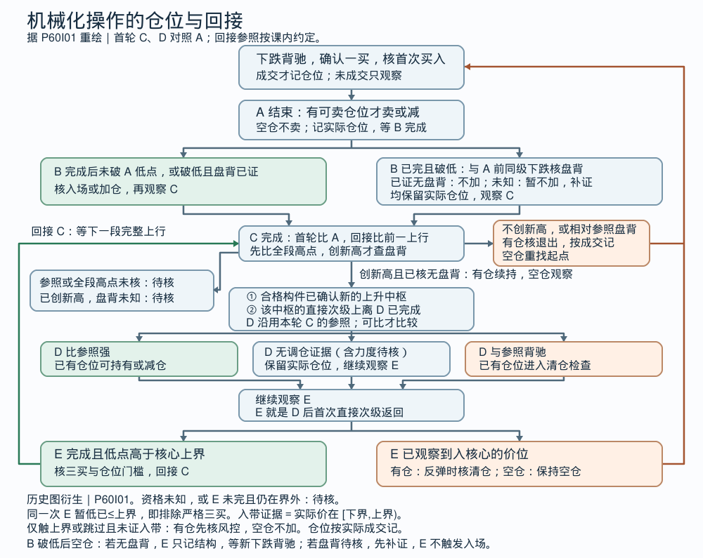
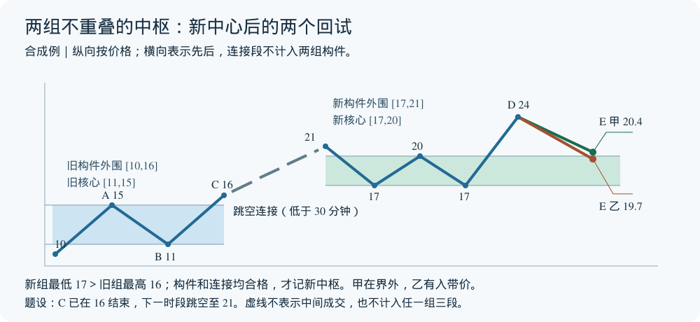

# O23 · 机械化操作：同级往返和 A–E 图

来源：《缠中说禅—股市技术理论》第三章第23节，PDF 物理第 59–60 页。

## 同级规则与结束信号

机械化是先定程序并按可知条件执行。例用 30 分钟级别同级分解，A、B、C 是该级别的走势类型；盘整背驰是在中枢背景下可比的同向段力度衰减。区间套用更小层定位同一个待证端点，不能临时换成按小层独立交易。原图从下跌背驰、确认一买开始，随后检查首次买入：符合执行条件才提交，只按实际成交数量登记持仓。若当次完全未成交，仍可观察 A，但空仓不执行 A 的卖出或减仓。端点、信号确认、委托和成交分别记时。选层要看资金量、熟练度与标的活跃度：规模大不易在 1 分钟量能里成交，反应慢或波幅小加上费用可能吃完价差。

## 正文给出的三段与循环

| 条件（已完成的 30 分钟同级走势段；高低点取全段极值） | 处理 |
|---|---|
| A 上行，由内部结构核背驰或盘整背驰结束 | 有实际可卖仓位时，正文先卖，图允许卖出或减仓；首次买入未成交则只观察。事先定好数量口径 |
| B 低点未破 A 低点 | 核重新买入；尚有底仓时图称可加仓 |
| B 低点破 A 低点，且 B 与 A 前下跌可比较并有盘整背驰 | 核重新买入或加仓，不以新低直接定继续下跌 |
| B 破低且已证无盘整背驰 | 图为不加仓；正文若已空仓，继续观望直到新下跌背驰；图的箭头仍接到 C：若 A 只减仓，保留的底仓继续随 C 检查；空仓仅观察，不把未加仓记成已重入；依正文，本轮即使后来观察到 E 三买，也须等新的下跌背驰重启，不能用 E 绕过这个限制 |
| B 已完成、破 A 低点，但与 A 前下跌的盘背尚未知 | 暂不加仓或重入，补同级可比结构和力度；有底仓按实记录，空仓继续观察 C，不给 B 填「无盘背」 |
| C 上行不创新高 | 卖出检查；图把低于 A 高点归入盘整退出，正文末段总则覆盖等高的「不创新高」 |
| C 超 A 高点，但相对 A 有盘整背驰 | 卖出检查；图同归盘整、全卖并回到起点 |
| C 超 A 高点，也无盘整背驰 | 继续持有；图另给降级做短差的独立变体，需另立规则，不覆盖 30 分钟程序 |

首轮 C 对照 A。经 E 回接时，C 表示下一段已完成的 30 分钟上行；用它之前最近一段已完成的同级上行作参照。先核该参照和两段全段高点；不创新高即可进入原书的退出检查，不用强行比较力度。只有创新高才继续核中枢背景与力度口径是否可比，才能判断盘整背驰有无。参照或高点缺证、或创新高但所需的力度结论缺证，都先观察，不回用最早的 A。持续按同一办法更新参照，直到不创新高或盘整背驰，结束先买后卖的向上段运作。正文的向下镜像从向上段结束的背驰点出发，先卖后买，遇不创新低或向下衰减再查转段。若向上段仅因不创新高而退出、没有背驰，退出本身不会产生背驰点，原书未交代此时如何选镜像起点；本课先观察。卖须有可卖数量或另经核实的交易权限。资料不全时不能把「未知」当作无背驰。

## 第 60 页流程图补充的 D、E

读图同时记结构和仓位。图从寻找下跌背驰、确认一买并首次买入，到 A、B、C。若首次买入未成交，之后 B 即使符合入场条件，也须另查执行，不能记为重入。用区间套定位各段结束；图在 B 破低的背驰买入支路也并到其标注的「第二类买点买入或加仓」框。本课据正文保留「破低有盘整背驰才入场」的独立依据，不把破低重新定义为普通不破低的二买。

C 走强后，原图接到新上升中枢及 D 段，但没有标出它们的确切级别。本课设 D、E 与 A、B、C 同为 30 分钟级别，新中枢比这些段高一级，由三个连续、已完成的直接次级走势相交而成。C 走强时，有仓继续持有，空仓继续观察。先确认新上升中枢已形成，再确认 D 是相对该中枢已完成的直接次级上离；任一项未确认，都继续记录实际仓位和观察，不进入 D、E 调仓。原图用 D 对照 A。课堂循环沿用本轮 C 的参照（首轮是 A）；D 与参照同级同向，还须核中枢背景和力度口径，才可比较。回接后 D 会不会更换参照，原书没有规定；本课在本轮 C 比较前先登记参照，D 继续用该段，不临时改用刚完成的 C。D 比参照强则持仓或减仓；与参照形成背驰则核清掉已有仓位。若 D 不比参照强、也未构成背驰，例如等强且无背驰，原图未给调仓规则；继续记录仓位并观察 E，不套用前两项动作。若强弱或背驰仍未知，也不调仓；已确认 D 的上离结构时，可另继续观察 E。

E 本身就是 D 上离后首次向下的直接次级返回。若 E 已完成且最低严格高于新核心上界，才核三买；图示为全仓买入并回接 C。假如在 B 破低且已证无盘背之后已空仓，本课依正文只记录 E 的结构，不据此入场；须等新的下跌背驰再从起点核一买与成交。若 B 已破低、盘背仍未知且空仓，同样先只记录 E，暂不重入。补齐 B 的证据后按对应分支重新核当下入场资格，或等新的下跌背驰再从起点评估，不回填旧信号的成交。已有入场资格也须核仓位上限和成交条件，成交后才记持仓。本课把「入带」用于观察到实际价位落在核心下界至上界之间，含下界、不含上界；满足时按原图在反弹高点核有仓者的清仓，已空仓者继续空仓，然后重找下跌背驰。E 的级别或首次身份不明，先核身份；已确认是同一次合格 E，则观察中已知最低不高于上界，就排除本次严格三买，即使尚未完段。未完但低点暂高于上界，保留候选；完段或全段低点缺证，先待核。若只观察到恰触上界，或跳过整带且中间没有入带证据，均排除本次严格三买，但不套入带处置。有仓先核独立风控，再等后续；空仓暂不加仓。

## 算例：同一中心后的两个 E

合成例：一买后首次买入有成交。A 为 10→15，A 结束时卖出有成交；B 为 15→11，随后实际以 11.3 重入；C 为 11→16，给定相对 A 无盘背。A、B、C 都是连续、完成且合格的 30 分钟走势，全幅依次为 [10,15]、[11,15]、[11,16]，旧核心是 [11,15]，这组构件的外围是 [10,16]。

合成例另给一项可核的分界：C 已按下层结构确认结束，最后一笔成交价为 16；下一个交易时段的第一笔成交价为 21，两笔之间没有其他成交。图的虚线只标这次跳空。按原书物理第 10–11 页的例子，已核实的跳空可作比 30 分钟更低级别的连接；此处不另划一段与 C 相邻的 30 分钟上涨。两组各自仍用三个合格的 30 分钟成员，缺口不计入任一组三段。第 15、62 页可对读连接与成枢成员的区别。只知道两个端价，若 C 是否结束或跳空本身仍未核实，只记两组计算所得的价区，暂不采用本例新中枢的 D、E 分支。缺口中间的价位也不是已成交价。

随后三个连续、合格且完成的 30 分钟构件是 21→17、17→20、20→17，全幅交集为 [17,20]，这组构件的外围是 [17,21]。其最低 17 高于前组最高 16，成员不重复，且连接已单独核实，所以按本例分法记为独立的新中枢。不能只凭回到旧核心里的三个折返另换一个较窄核心。

D 是相对新中心已完成的 30 分钟上离，最高 24；给定与 A 可比且比 A 强，仍持有。E 的两条独立路径都是该次上离后的首次完整直接次级返回：甲的最低 20.4 在新核心上方，核三买；乙的最低 19.7 已有入带价格，等反弹核退出。若乙在 20 清仓成交，从 11.3 重入至退出的单位总费 0.4，净额为 20−11.3−0.4＝8.3；没有卖出成交只记持仓和待执行。

在甲之后另给两条未画在下图中的回接路径：下一段已完成的 30 分钟上行全段最高 22 或 25，上一已完成的同级上行 D 高 24。22 未创新高，即使力度未知，也核有仓退出；25 创新高，力度未知先观察。若后来证实 25 这路没有盘背，并另形成新中心和新的已完直接次级上离 D′，D′ 沿用本轮 C 登记的上行参照（前一个 D），在可比前提下用力度判断，不把 24 或 25 当作力度。若连上一同级参照或全段高点都未确认，也先观察，不回用首轮 A。

## 练习

1. A 前的下跌、A 及各条路径的 B、C，都按 30 分钟同级分解，且均已完成。A 全段低 20、高 26；A 结束卖出已成交，现为空仓。四个独立 B 分支的全段最低点分别是：21；19 且与 A 前的下跌形成盘整背驰；19 且已知无该背驰；19 但缺 A 前下跌的可比力度资料。分别写空仓动作。若第 3、4 路后来都见合格 E 三买，仍空仓且未见新的下跌背驰，第 4 路的 B 也一直待核，各能否重入？若已重入，再看两种独立 C：全段最高 26 且相对 A 无盘整背驰；全段最高 27 且相对 A 有盘整背驰。各如何处理？
2. 已形成比 30 分钟高一级的上升中枢 [22,26]。D 是已完成的 30 分钟向上离开段，与 30 分钟 A 段同向可比并形成背驰，D 结束后已有的仓位全部卖出且成交。题中未给 B 阶段能否入场的证据；再比较「B 资格已核实」和「B 破低而盘背待核」两种补充情形。三条独立路径的 E 均是 D 后首次向下的 30 分钟返回：甲完成、最低 26.5；乙完成、最低 25；丙暂见最低 26.5、尚未完成。若改为同一次未完成首回已到 26，或从上沿上方跳到 22 以下且无入带证据，分别判断。注明 D 的动作与实际仓位，再判 E 三支，列出仍须核对的成交细节。
3. 空仓者确认一买，按计划提交买入 100 股；到 A 段结束、出现卖出检查信号时，甲有 40 股买入成交，余单已撤，且 40 股均可卖；乙委托已撤，成交 0 股。分别写 A 段结束、执行卖出检查前的实际仓位和允许动作。若只收到委托受理回报，能否假定全部买入？
