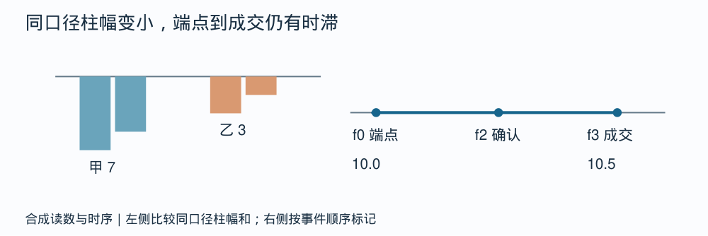

# O24 · 操作细节：比较先于指标，确认先于成交

来源：《缠中说禅—股市技术理论》第三章第24节，PDF 物理第 61 页。

## 先选结构段，再选计算周期

走势类型的级别来自构件，图表周期只是计算的输入时间间隔。原文把 1 分钟和 30 分钟 MACD 看成同类线性计算，强调灵敏与迟钝；同一采样序列上，用固定参数计算的 EMA 及其差、再平滑是线性递推，但改采样会换掉输入，1 分钟柱汇总不等于 30 分钟柱，不能把面积跨周期混算。DIF 是两条价格 EMA 之差，DEA 是对 DIF 再平滑；柱差是力度代理。最低能看到分笔、1 分钟或缺少 5 分钟图不改变判断顺序，但若缺少用来确认结构的资料，就记录证据不足。

作业顺序：一，按中枢与走势运动固定两个同级、同向候选段的区间和完成证据。二，用同时覆盖这两段的图比较分辨率、可见性、参数和相同柱口径；若 1 分钟柱和双线复杂、30 分钟刚好清晰呈现两块柱与相应双线，可采用后者。若 30 分钟把两段压在同一根未闭合柱或丢掉边界，就不能用它；两个周期都不能给出可比证据时保留待核。三，才读柱面积与双线、回到实际结构判定；不为得到想要的结论反选时间窗。30 分钟级走势常对应 30 分钟图上的变化，是可检验的经验对应。

## 算例：可比柱、端点与实际执行有先后

设两个已经确认可比较的下行段，30 分钟图上各有两个完整负柱，等长、同参数。甲段柱值 −4、−3，乙段 −2、−1。按柱幅和作面积代理，7 大于 3。若乙价格新低且比较背景、结束证据仍成立，这是衰减线索。如果乙的第二柱 −1 尚未闭合，不能用它算出乙的最终柱幅和。换成 1 分钟后要从同两段窗口重新取样。

合成时序：一买端点 f0 为 10.0，右侧证据到 f2 才满足，f3 获得 10.5 成交；一卖端点 g0 为 13.0，g1 确认，g2 获得 12.6 成交。扣单位往返费用 0.2，净收益 1.9；若倒填两个端点会算成 2.8。原书谈到买后还跌、卖后仍涨及习惯性的多头买早卖晚、空头买晚卖早。课内逐笔区分候选误判、确认滞后、提交与实际执行延时；价格后续逆动不单凭一个结果判定哪项出错。

## 从看懂到动态记录

原书把信心建立在对逻辑的理解上，用平面三角形内角和类比证明与实测；结构定义可按逻辑查，交易收益仍需实证。先复盘已有走势并能说清每个构件，再做不看未来的实时模拟，逐笔记给定时点、信号、委托与若有的成交；事后对照后续走势修正记录习惯，模拟可重复再考虑真实操作。作者强调熟练与多练，用前锋的射门类比，认为严格掌握可保证利润；训练有助于减少可识别偏差，文中没有可证明账户收益的对照数据。「每周 5 天」是源文环境描述，回放使用实际样本时段。消息与概念是书允许的辅助，不能覆盖预定买卖点；书以反着在一买卖、一卖买作负面思想实验，无比较统计，不能当可执行收益结论。

## 练习

1. 甲、乙是已确认可比的同级下行段，采用同参数。30 分钟图上甲的完整负柱为 (−5,−2)，乙为 (−2,−2)，1 分钟图的比较窗口则混入另一下行段。选可用口径并算差异；如果乙的第二柱尚未闭合，重写结论。
2. 买端点 7.0，确认后实际买 7.4；卖端点 9.5，确认后实际卖 9.0；往返费用 0.3。算正确净额和倒填净额，并写两种需面对延时的复盘问题。
