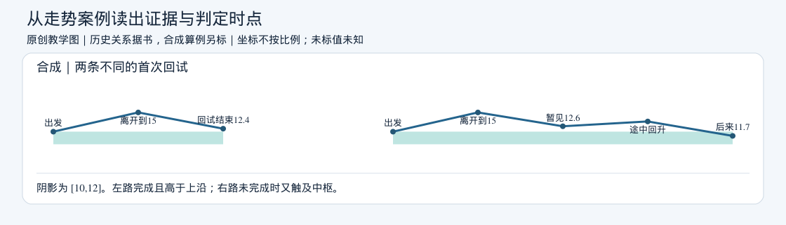

# o25 · 从走势案例读出证据与判定时点

来源：《缠中说禅-股市技术理论》PDF 物理页 62–80，第三章第 25 节。

本节是十二例的总引。学完本节并保存原答后，按[H01](h01.md)→H02→…→[H12](h12.md)读图、练习，再进[O26](o26.md)。完整案例入口见[逐节课程](../full-course.md)，不要跳到O26后再折回案例。

## 先画结构，再写判断

本节汇集十二例：例 1 比较合法分解，例 2–3 读 5 月 30 日及其次日的细段，例 4–6 练划线与中枢演变，例 7 练区间套，例 8–9 练等待和分支，例 10 从月线读大结构，例 11 检验同向力度，例 12 练统一精度。附录是另一个时点的文字复盘，要在各案中单列。学习目标是把书中的结论还原成要检查的条件，并写清何时才有证据。

这里的「级别」是按走势结构递归建立的层次；书中用「1 分钟、5 分钟、30 分钟」命名，图表的采样周期并不能单独证明走势级别。先在统一口径下处理包含和分型，再确认笔、线段及端点。把下一级已完成的走势当作区间 `[最低,最高]`：前三个合格、连续成员的重叠下沿 ZD 为三段低点的最大值，上沿 ZG 为三段高点的最小值。若 ZD < ZG，所得核心区间为 [ZD,ZG]；若 ZD = ZG，首次成核只有一点接触，按本课程先记「边界待核」。例 1 把 [d1,g2]（d1 = g2）当作一价核心，是该历史分解的特例。若 ZD > ZG，则没有公共区间。还要另记各成员实际走到的全范围；这个范围不能替代核心边界。不要把相邻的两组三段只凭算术重叠就称为两个同级中枢；还须核两者之间是否有独立、合格的连接，级别可为次级别或更低。讨论升级时则明确把三个合格次级走势作为新层的成员。

## 从触发到确认

第一类买卖点在相应趋势末端按背驰及其结构条件定位。常规二卖从本级一卖查起：先核其后合格的次级下跌，再查首次合格且已完成的次级反抽。反抽未创新高，或与此前可比上涨构成盘整顶背驰，才按相应分支判定。常规二买从本级一买查起：先查其后合格的次级上涨，再查首次合格且已完成的次级回调。回调未创新低，或与此前可比下跌构成盘整底背驰，才按相应分支判定。

还有两种情形要分开：小级别背驰确实触发本级转折而本级没有一类点时，仍可按后续两段次级走势查二类点，见 [O04](o04.md)；若前段背驰直到后来才确认、已无法按一卖操作，则查后来可观察的二卖或三卖，见 [H02](h02.md)。

第三类要先确认已有核心，再确认相对于该核心的直接次级离开，以及同次离开之后的首次直接次级回试均合格且已完成。本案例组采用严格界外口径：向上离开后回试最低严格高于 ZG，向下离开后反抽最高严格低于 ZD。这里检验的是已成立的核心：回试恰触旧核心边界，不记严格三类点。例 1 中 g2 触及旧核心下沿 d1，作者将这次回试归为震荡。回试未结束时，只能记录已见极值和候选；回到核心后，原候选不能继续当作已经确认。力度比较先选同方向、同级别且可比的两段，再看完整 MACD 柱组、线和零轴回拉；柱组变小可以辅助识别衰减，不能独自造出一段或确认转折。高层进入待定位区间之后，才逐层下钻。

## 一次不回填的回放

合成：三个连续、合格的次级成员区间依次是 [9,13]、[10,14]、[8,12]，核心为 [10,12]。随后一个合格次级上行完成了离开，最高到 15。第一次回试进行中，暂见低点 12.6：记「可能三买，回试未完」。接下来同一回试下探 11.7：已进核心，撤销原候选，保留先前的记录与时点。如果回试随后去到 12.4，抬高的最新价不改写本次回试的最低点。另一条独立的合成路径上，同样已完成合格的次级向上离开，首次回试也已确认为合格且完成的次级走势，最低为 12.4。只有在这两个次级条件均有证据、且 12.4 高于 12 时，才按上述严格口径登记三买。

历史图可证明编者展示了怎样的标点、周期和图形，文字可证明作者做过怎样的叙述；用它们练读图，不把最后成图当成每一根当时可用的数据。要实证复算，另需证券、时钟、采样与复权、逐根开高低收和观察截止。5 月 18 日航天机电图与 5 月 30 日指数图是不同例，不能接成一条行情。

[打开矢量图](../../../assets/chan-book/full/o25.svg)

## 自测

1. 两条独立合成路径的核心均为 [20,22]，都已完成合格的次级上行离开，最高到 25。甲的首次回试是合格且已完成的次级走势，最低 22.3；乙的首次回试仍在进行，暂见低点同为 22.3，随后同一回试到 21.8。按时点分别记录甲、乙的判断。
2. 回放材料只有图题、时间轴、最后成图与事后文字，文字称某分钟是三卖。列出可直接登记的一项、复算还需的两项输入，以及把后来低点写回先前记录的错误。
