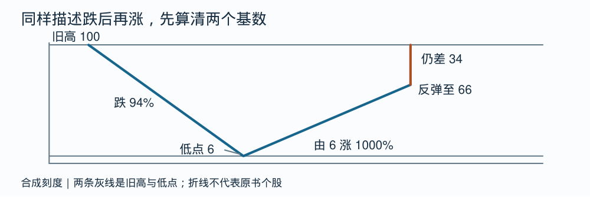

# O26 · 读“逗庄家”杂史：合力、成本与证据

来源：《缠中说禅—股市技术理论》第三章第26节，PDF 物理第 80–85 页。

## 证据先分层：图上可见、账上可核、当事人声称

这里的「庄家」是原叙事对可能左右个股走势的参与者的称呼，不能仅凭涨跌给人定性。「分力」是参与者或群体的买卖影响，「合力」是这些影响叠加后在价量上留下的结果。从公开行情可以核对某价位、缺口、成交量、区间与后来路径；同一走势可能有多个参与者解释，图不能告诉我们是谁造成的。身份和跨账户关联需独立资料；融资期限、仓位、成本、真实资金流要靠原始账证；动机或违规须有额外证据与合适的认定依据。

第 80 页下半至第 85 页是作者自称「梦话」的四段故事，没有配对应历史图。本课把可验证和目前无法验证的内容分开，用故事练观察和反证。原书说普通小资金对合力影响可忽略，可以只分析结果；较大资金可能影响个股，但影响不与本金简单成比例，市场整体又比单只股票有更多分力、常牵涉团队与积累的信任。这是观察视角；本节的资金倍率和成败比例没有统计出处。

## 一、四个长跌后反弹的匿名故事（第 80–82 页）

作者按叙事角色区分操盘一方和试图制衡操盘的一方。两方都可能持股，不能用是否持股划分，也不能仅凭价量识别。作者描述制衡的一方可能有旧有资本、信息渠道与资源组合，也声称许多操盘者曾失败。

作者自称早先曾挫败一些操盘者。他说，在写作前近两年，他发现其中几位坚持到了牛市，涉及的股票属于他所称的同期最强一批；他打听后称，操盘者仍是原来那几位。有的案例距当初已近十年。下列四例是作者挑出的匿名例，日期和身份未获独立核实。书也未给出持仓、成本和卖出记录，不能判断这些人是否回本或获利。

他还提到参与者经验、资金来路、持续能力与先前成功后的判断偏差：资金脆弱是一种可能解释；他也描写资金未显弱点但经验不足、以前成功而自信的情形，以及老手的对抗可能拖很久。要判断任何一例，须分别核资金可用期、授信或持有和时间窗；既不能从跌幅倒推身份，也不能把多年坚持理解为必能回本。

| 原书案例 | 书说的可查线索 | 仍缺的证据 |
|---|---|---|
| 一：夏后转熊 | 多个向下缺口，部分叙事归为除权；作者称最艰难时仍离原峰不远，谷底位置待核，后来越过旧高 | 代码、夏天是哪年、公司行为和前后复权序列；不能把除权缺口当成恐慌盘 |
| 二：山顶到山谷 | 跌逾 90%；作者称从谷底回到「山脚」后，约半年又涨约 1000%，登上比旧峰更高的新峰 | 峰谷、山脚和「半年」的日期，涨幅的起点及口径；核是否越过旧峰，须比同一口径的前后峰价 |
| 三：大跌后上行 | 跌逾 80%，之后称升 2000% 以上 | 标的、区间、成本及复权方式；上涨不能证明当事人仍在场 |
| 四：一字涨停台阶 | 此前称最大跌幅约 94%，后来一字涨停并越过旧峰 | 涨停日、当时涨跌限制、参与者可成交量；看到价格不等于买得到 |

同一段落另提 **000338**、作者看到的「100 元」和他联想到的「唐家兄弟」。作者给出《偶见湘火炬广告牌，口占五绝》的发帖时间 **2007-05-15 15:14:19**，并称 **2007-05-15** 是该股当时的低点日。这个日期是待核线索；15:14:19 是发帖时刻，并非行情触底时刻。书未给出盘中触底时刻、可复算的低点价和复权口径，也未交代「100 元」的报价日。应按历史日核证券标识和沿革；这些线索不能证明市场绝对低点、账户身份或资金因果，也不能给四个匿名案例定年。

## 二、拖延与急跌是两种观察尺度（第 82–83 页）

原书按时间和空间分两类。时间路线的图上线索是长时间反复、较复杂的大级别中枢；叙事把它解释为各方反复应对、筹码和资金占用，受制于期限、成本或退出流动性。作者区分继续拖延、开始退出或资金忽然不能延续，也认为其他参与者的分力可能放大影响。第 82 页的 5% 对 50%，是假定所称参与者技术熟练的匿名设想；「100 个至少 99 个」指所称标的已失去公众信任、散户普遍知晓且已经形成多方对垒；此时多方长期相持，一方仓位和资金占用较大，且资金可能有期限。两则都缺少独立样本，不能估计成功率。第 82 页设想，持有不足流通量 10% 的一方也可能产生所述影响。作者尤其谈所称对方正准备发动行情的情景。他假定该方有能力在出手当天形成约 10%–20% 的换手，且当天波动区间足够宽；价位须在底部或相对底部，最好接近所称对手的成本。原书还设想涨跌停之间反复波动，并指出全天成交并非全由一方形成。书中未给足账户和行情资料，不能据此认定持仓比例单独足够，或当天确有该换手与波幅。单日换手用当天累计成交股数除以采用的流通股数，同一股可反复计入成交；持仓占比用某一方在特定时点持有的股数除以该时点的流通股数。两者分子和时间口径不同，换手高不能证明某一方持股多，也不能证明有几家对垒、筹码归并或借款被切断。作者比较 5% 和 50% 等持有规模，也给过「99/100」的成败估计；这些仅是书中叙述，不能据此设交易阈值或推算经验概率。

空间路线（第 82–83 页）设想先有一段急跌，且出手位置和时机合适；太低则冲击不足，太高则太迟。作者区分两种卖盘：原书把散户恐慌卖盘与所称对手的抛盘分开。前一支谈承接之后仍须留有应对资金，并受节奏和力度约束；后一支只在所称对手跟随第一段急跌抛售时采用，原书排除承接这类卖盘，设想冲击加深后形成 V 形，又在同一分支推测股价此后可能走弱至少一年半载。原书未给 V 形发生在哪一天。急跌后的反抽未必形成 V 形；即使盘中出现 V 形，其后仍可能走弱。单靠公开 K 线不能识别卖方、认定两段表现出自同一案例，或断定后续走弱由当日冲击造成；这些均待查证。长震荡还是急跌只作可观察分类；消息、市场联动、公司风险或被动减仓也可形成相似价量。书中账户、交易和对手博弈细节只说明作者用了哪些因果假设，不能代替独立证明。

## 三、匿名派发和顶部不能从放量倒推（第 83–84 页）

第三段讲一个匿名做顶故事。作者称相关持股已超过三成，股价先前已涨数倍，另有他所称的「老鼠仓」，最高是一成左右。叙事中出现证券营业部资金、筹码转移、手续费和透支洽谈、抢筹传闻与另一处卖出，声称在约 +20%、+40% 的阶段已有卖出，三周多涨逾 70% 后，故事的最后一天放巨量并跌停；此后自最高处跌 90% 以上，到后来大盘 2001 年的 2245 点也未回到个股旧高附近。作者称己方在做顶过程中没有拉抬，从故事的最后一天之后也未再买卖该股；他把后续归于其他跟随者多杀多（原持有者竞相卖出），还自判行为合规。这些主张来自同一叙述，不能相互印证。案中未给可辨认标的、时间序列、成交对手、资金凭证或适用规则。价量可以核涨幅、跌停与放量、是否回旧高；要核己方做过什么，须另有账户证据。

原书还分顶部的大小：大盘分力较多，大顶部常复杂、破位前有犹豫，板块轮转可与顶部共存；个股分力通常较少，顶部或更简单，广泛参与的大型股票例外。中期顶部在同级调整后可能失去顶部意义，仍由后续走势决定。在复盘中先给指数或个股、级别和当时条件；多个板块一时走强不推翻大级别顶部候选，一次下跌也不证明所有级别顶部完成。对普通观察者，按可见结构核买卖点已能开展工作，无须先选一个「庄家」故事。

## 四、吸货故事及“零成本”的会计含义（第 84–85 页）

原书声称吸货不必等图上的最低价，关键是筹码、资本和时间是否够，并强调账上现金成本比账面市值更能说明已回收多少资金。作者说零成本或负成本降低其风险，作者还推测，需要花钱拉抬时，可能是价格偏高且外来资金流入跟不上。这些仅是说法，需要账户、订单和资金流证据；也举过从 8 元至 20 多元、平台、再上行的匿名旧事，另把不同派发外观列作可能变体。价格和市值本身不能算出买方成本、资金是否需要持续投入或哪天先退才更好，零成本概念也不意味着持仓没有风险。

第四段的核心匿名故事，书列四项约束：取得足量、成本不过高、应对先买者、耗时不能太长。可分开核四组公开现象与各自说法：

| 作者叙述中的公开现象 | 作者附带解释 | 需要的额外证据或竞争解释 |
|---|---|---|
| 压力平台、反复假突破；后来日内上冲又破平台 | 作者称在压力位承接早前被套者等价格回到成本附近时的卖盘（解套盘），又称主动选择须当日平仓的融资，并在约束下把当天早上买入的仓位全部亏损卖出 | 先冻结平台与突破口径。约束查协议，当天买入与亏损平仓查成交和成本；单次亏损不能当成整个吸货过程的累计损益。是否预作安排及有无传闻分别待证 |
| 以破平台当天为第 1 日；第 2、3 日集中卖压，第 4 日低开后急拉，第 5 日开盘续强 | 传闻有套牢和追债，作者称卖盘被别处匿名资金承接 | 从开盘与成交序列可核转折；查原始消息、分账户流水和一致控制，不能以交易量等同于谁收集 |
| 反弹第三天接近原平台，买盘退；后卖压重现但未回反弹第二天的位置 | 书列 V 型反转受平台压力、超跌反弹空间将尽两种当时解释；又称狭窄区筹码持续被接收 | 比较当时的高低、成交与旧平台；买方撤回、筹码换手或事件暂缓均可能，与归属不同 |
| 最后快速穿越旧压力区，书称不足 15 分钟 | 作者将突破归于吸货，又称他所说的「老鼠仓」一方后来在此前卖出价的 N 倍处重新买入；书没有给出 N 的数值 | 用带时间戳的成交核突破；须另有账户关联和交易记录，才能核是否同一方再次进入，以及再次买入价与此前卖出价的比值。突破本身不能证明这些说法 |

## 算例：跌幅基数与累计现金

合成 A 从 100 跌至 6，跌 94%。若从 6 涨 **1000%**，即增加 10 倍、终值 66，仍比原高低 34%；回到 100 需涨约 1566.67%。比较时要核每步的起点；案例二的半年上涨据称从「山脚」算，作者称后来越过旧峰，这是待核的说法。合成算例的 66 不能用来验证或否定它，书中四例的百分比也不能拆来拼成一只股票的连续轨迹。

匿名派发例则是先涨后跌。若两段以同一峰值为连接点，终价与初价之比＝（1＋涨幅）×（1−跌幅），跌幅按正数记。举例：若恰涨 70%、再从同一峰值恰跌 90%，终价为初价的 17%，初末跌幅为 83%。原书只说三周多涨逾 70%、自最高处跌 90% 以上；须先核两段是否共用同一峰值，并取得确切价格或两段精确幅度，才能算原案的初末跌幅。

合成 B：100 股每股 10 元买入，加 5 元费用，流出 1005；以后卖 70 股每股 15 元，扣 5 元，流入 1045。累计净回收超过投入 40 元，剩 30 股；账面市值若从每股 12 跌到 8，仍少 120 元。历史净现金、剩余仓位市值与它们变动的原因是三件事。本例只解释口径，无需假定有人主导了价格。

## 练习

1. 某匿名档只有三个同口径成交价：100、6、66，另有档案所谓「一日巨量」和一条转述的追债消息；没有账户记录。算两段涨跌幅，判断是否回到 100；分列能支持与不能支持的说法，并写一项需核日期的证据。
2. 模拟现金流：100 股每股 20 元买入，另付 10 元；卖 80 股每股 26 元，另付 10 元。剩余股票从每股 22 跌至 16。算累计交易净现金、剩余市值变动；两周中枢震荡且末日急跌反抽，能否判定是融资被切断或恐慌盘？
3. 匿名派发故事称，某股三周多涨逾 70%，故事最后一天放量跌停，后来从最高处跌 90% 以上，大盘到 2245 点时该股也未回旧高。作者另称，己方做顶时未拉抬，从故事最后一天之后也未再买卖该股。分别写出复核公开行情和己方自述所需的独立证据、只有截图时的结论，以及为什么这两个幅度门槛不能给出精确初末跌幅。
