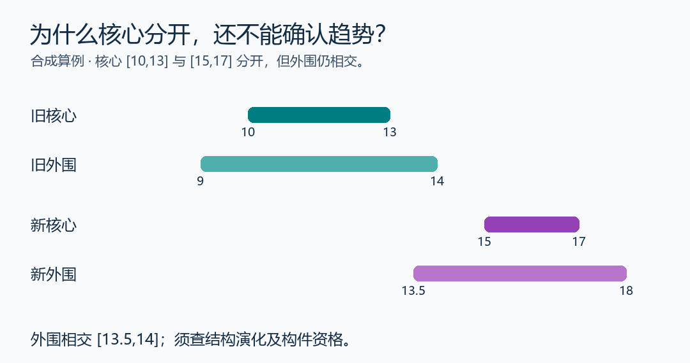

# CB01 · 形态学

先学 [M11](../modules/module-11.md) 的包含、分型、笔和线段，再读 [M12](../modules/module-12.md) 的中枢。这里补足定义为何这样安排、哪些相似结构不能互换，以及如何复核整条构造链。

## 前提、自同构与级别

来源：前言、第一章第1、3节（PDF 3–5）。汇编先讨论价格信息和交易不完全趋同等理论前提，再用不同层级上重复出现的结构讲「自同构」。可取的学习动作，是在不同层用各自合格的构件重复同一个分类问题：有没有共同区间、是否仍围绕旧区间、是否出现同向分离的新中枢。不能从图形相似推出价格按固定比例复制、同样的后续走势，或历史概率不变。

一幅30分钟图是一批按30分钟取样的 K 线。在这批资料上可以画笔和线段；能否建立更高一级走势，要看是否有合格、连续且已完成的较低层构件。两幅图的周期换了，不代表级别自动换了。练习：把已有日线图缩放一倍，再把数据重新聚合成周线，分别说清哪一次只改变显示、哪一次改变样本，哪两次都没有证明递归级别改变。

## 均线位置形态

来源：第一章第2节（PDF 5）。设短均线 S，长均线 L。解释前先固定取样周期、价格基准、均线窗口与「接触」阈值；本文用相等作为演示阈值。观察 S−L：由正变小后放大，是靠近后远离；从正降到零又回正，是本例接触后远离；正负反复改变，是交叉缠绕。多空排列说的是多根均线的相对次序，区别于价格涨跌及结构确认。

示范三组差值：+2、+1、+2；+2、0、+2；+2、−1、+1、−1。分别标出最小间距与过零次数。补做：+2、+0.02、+0.01、+1 在零阈值与 0.05 阈值下各怎样记？改变阈值应重跑整组，不能看完结果再换定义。均线图不因一次交叉就给出有效的买卖点。

## 包含与分型

来源：第一章第4、5节（PDF 6–8）。两区间包含时向上取较高高点及较高低点，向下取较低高点及较低低点；要先有方向依据，并按时间处理。比如已知向上，区间 A=[9,12]、B=[10,11]，处理后为 [10,12]：低点来自 B，高点来自 A。若方向向下则是 [9,11]。保留原始高低来源和所有成员，不能将合并结果写成某根真实 K 线。

接下来看三个处理区间：[9,11]、[11,13]、[10,12]。中间的高和低都更高，满足顶分型的几何关系。若末组未完成仍会吸收后续 K 线，只能先记候选。不能用中心极值出现时间记为确认时间。完整对照用 [M11-U02](../modules/module-11.md#u02-p02)；给定确认组后再去 [真实图谱](../chan-2026-atlas.md) 复核原始记录。

## 笔与线段

来源：第一章第6、7节（PDF 8–10）。附件第8页写「至少五根」，也要求顶底之间另有独立 K 线。M11 的严口径把两组三根分型及中间独立组都画在图上；用第1—3组和第5—7组时，中心是第2与第6组，中心到中心计5，整段画出7。计数是否对应要实际标出；不能另拿五根原始 K 线直接判成笔。不同版本若采用别的间隔规则，先登记版本和输入，再分开算。相等极值保留早者是本课程复现约定。

线段起始要有前三笔重叠，结束不能只数三笔。对向上线段抽向下笔，对向下线段抽向上笔，检查标准特征序列。候选分界处先分清两元素是否属于同一待核序列，不能拿相邻区间直接跨界合并。按所示特征序列分型，前两元素没有缺口时走第一种条件；有缺口时看从候选端点开始的反向序列是否出现所需分型。缺少第二套分型，或左边界资格未明，就写待核。与日线跳空分开记。完整数值例和向下镜像任务见 [M11-U04](../modules/module-11.md#u04-p01)。来源线索见作者[第67课](https://blog.sina.com.cn/s/blog_486e105c01000c16.html)、[第78课](https://blog.sina.com.cn/s/blog_486e105c01000cio.html)和[第81课](https://blog.sina.com.cn/s/blog_486e105c01000cmz.html)。

## 中枢、外围与走势类型

来源：第一章第8、9节（PDF 10–13）。中枢核心是合格构件的共同区间，不是整次波动的最高至最低。初次形成后保留原 ZD、ZG；另记书中符号：各合格波动的高低为 gn、dn，GG 为最高高点，G 为最低高点，D 为最高低点，DD 为最低低点。使用书中同向波动组计算时，先说明哪些段属于该组；不要把「取三段范围交集」和附件用 Z₁、Z₂ 写出的表达式在未对齐成员时直接互换。

例：三个连续且已独立核准的 B0 范围依次为 [9,13]、[10,13]、[10,14]。本课 L1 核心为 [10,13]；全范围 [9,14]。若输入改成了三笔，算法仍能算出同一个区间，却没有 L1 中枢资格。若再出现同级核心 [15,17]，新外围 [13.5,18] 与旧外围 [9,14] 有交集，不能只凭两核心分离确认同向趋势。先检查外围重叠是否支持级别扩展，并等到相关结构条件齐备。

走势类型在已完成的同一观察级别上分类：单一中枢对应盘整；至少两个依次同向并满足分离条件的中枢才有趋势资格。更高层要用合格已完成的次级别走势，B0 只代表本课构件，不叫「B0 中枢」。C12-F 是声明过的课堂封口规则，不能拿它来证明作者理论中的普遍完成。

补做：若新外围改为 [14.5,18]，两组现在满足什么空间关系？还缺哪一项资格，才能把「可能是上升类型」改成「已完成该类型」？独立题另见 [CB05](../exercises/chan-book.md)。
