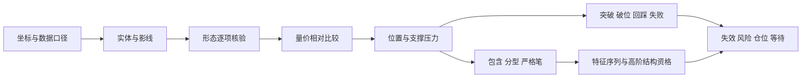

# 补充图谱：2024年真实A股读图

学习者最新偏好为2026年案例，请优先进入[2026科技股与高波动主图谱](tech-2026-atlas.md)。本页全部旧案例固定作有辅助示范，模块内的直接链接也依此处理；题名、题干或旧观察包可能提示结论，不计独立识别能力。另用[H01连续测评](holdout-replay.md)进行未提示迁移检查，先核对暴露历史。

先读[数据口径](chart-data.md)。图谱分普通看盘与[缠论逐层标注](chan-real-charts.md)两部分。三只真实股票用于读图训练，青禾制造仍用于第一次解释概念，二者不能混成同一家公司。纸上讲清一个概念后，应回到真实图验证它究竟满足了哪些条件。

## 每次怎样学一张图

1. 读证券代码、周期、日期、复权、价格和成交量单位；先把坐标读对。
2. 打开一个当前观察图，先看未标结构的K线和量柱。把“可见事实、可能解释、失效条件”各写一句；必要时允许只练第一句。
3. 学员原答保存后，才开放对应后续图。教师逐项标注，解释为何画这条线、当时何时知道、哪些条件尚未满足。
4. 看随后几根如何变化。分别记录事实是否延续、假设是否被削弱和计划应如何处理；不把后果倒填进原答。
5. 迁移检查另走H01入口。本页窗口即使换题号或重做，仍只记示范或有提示练习。

Tutor routing: First, open only the selected `rNN-decision.html` or its JSON packet in `assets/real-charts/`. Before you keep the raw response, do not load these materials:

- `teacher-history.json`
- `teacher-manifest.json`
- An outcome file
- Generator sources.

After the raw response for this attempt, open only `rNN-outcome.html` or `rNN-outcome.json` for the same ID. Do not load all outcomes. For Chan, obey its different routing instructions. Record a hint that gives part of the answer as aid with a hint.

Page links give a lesson sequence. They do not prevent access.

This full supplementary route is a demonstration with aid, with module shortcuts. The source builder uses learner titles and prompts without hints. Assets that the package keeps can be from before the regeneration. This route is a demonstration with aid before and after regeneration.

Do not use a filename without hints as evidence of no previous access to price data or other material. In [progress](progress.md), record each case's instrument ID. For each case, record the date ranges that the learner saw or that you showed.

每个普通看盘专题有一张观察图、一张随后图及逐日数字核对表。32个专题会复用部分交易窗口，64张图不是64个独立市场事件。历史窗口为解释概念事后挑选，不能证明预测能力；也不预设每一张都适合交易。完整浏览入口见[离线图谱](../assets/real-charts/index.html)。

## 看盘能力图

## 专题目录

| 专题 | 焦点 | 观察入口 |
| --- | --- | --- |
| R01 | 阴阳线与相对昨收涨跌 | [截至2024-10-08 · sh600519](../assets/real-charts/r01-decision.html) |
| R02 | 小实体不等于波动小 | [截至2024-10-08 · sz300750](../assets/real-charts/r02-decision.html) |
| R03 | 长上影线的语境 | [截至2024-08-19 · sh600519](../assets/real-charts/r03-decision.html) |
| R04 | 长下影与底部候选 | [截至2024-08-08 · sz300750](../assets/real-charts/r04-decision.html) |
| R05 | 阳包阴与继续下跌的可能 | [截至2024-07-31 · sh600519](../assets/real-charts/r05-decision.html) |
| R06 | 吞没反弹与趋势级别 | [截至2024-10-18 · sz300750](../assets/real-charts/r06-decision.html) |
| R07 | 放量上涨与比较基准 | [截至2024-09-24 · sh600519](../assets/real-charts/r07-decision.html) |
| R08 | 放量下跌与风险优先 | [截至2024-09-12 · sh600519](../assets/real-charts/r08-decision.html) |
| R09 | 缩量上涨不必然危险 | [截至2024-08-16 · sh600519](../assets/real-charts/r09-decision.html) |
| R10 | 缩量下跌与仍会破位 | [截至2024-10-24 · sz300750](../assets/real-charts/r10-decision.html) |
| R11 | 巨量与放量滞涨候选 | [截至2024-10-08 · sh600519](../assets/real-charts/r11-decision.html) |
| R12 | 连续放量与堆量 | [截至2024-09-30 · sz000001](../assets/real-charts/r12-decision.html) |
| R13 | 地量、量能萎缩与流动性 | [截至2024-10-24 · sh600519](../assets/real-charts/r13-decision.html) |
| R14 | 支撑区与探底候选 | [截至2024-09-20 · sh600519](../assets/real-charts/r14-decision.html) |
| R15 | 压力线与突破候选 | [截至2024-09-24 · sz000001](../assets/real-charts/r15-decision.html) |
| R16 | 破位的规则要先写 | [截至2024-10-15 · sh600519](../assets/real-charts/r16-decision.html) |
| R17 | 短期上沿与突破观察 | [截至2024-11-07 · sh600519](../assets/real-charts/r17-decision.html) |
| R18 | 反弹后的回踩观察 | [截至2024-10-21 · sz300750](../assets/real-charts/r18-decision.html) |
| R19 | 跳空与隔夜不可成交风险 | [截至2024-09-27 · sz300750](../assets/real-charts/r19-decision.html) |
| R20 | 横盘下沿与弱势不等于便宜 | [截至2024-09-06 · sh600519](../assets/real-charts/r20-decision.html) |
| R21 | 趋势线的两点与验证 | [截至2024-08-23 · sz300750](../assets/real-charts/r21-decision.html) |
| R22 | 箱体、上下沿和不交易 | [截至2024-10-18 · sz000001](../assets/real-charts/r22-decision.html) |
| R23 | 缩量反弹与压力前的计划 | [截至2024-10-22 · sh600519](../assets/real-charts/r23-decision.html) |
| R24 | 高开、阴线与相对昨收上涨 | [截至2024-11-12 · sz300750](../assets/real-charts/r24-decision.html) |
| R25 | 孕线比较实体，内包线比较全范围 | [截至2024-08-01 · sh600519](../assets/real-charts/r25-decision.html) |
| R26 | 内包整理与尚未选出的方向 | [截至2024-08-06 · sh600519](../assets/real-charts/r26-decision.html) |
| R27 | 乌云盖顶名称的边界反例 | [截至2024-10-11 · sz000001](../assets/real-charts/r27-decision.html) |
| R28 | 刺透形态与部分条件 | [截至2024-08-23 · sh600519](../assets/real-charts/r28-decision.html) |
| R29 | 连续上涨不等于红三兵 | [截至2024-09-26 · sz300750](../assets/real-charts/r29-decision.html) |
| R30 | 连续下跌与三只乌鸦的区别 | [截至2024-09-18 · sh600519](../assets/real-charts/r30-decision.html) |
| R31 | 阳线也可能相对昨收下跌 | [截至2024-08-12 · sh600519](../assets/real-charts/r31-decision.html) |
| R32 | 图形再强也要允许跳过 | [截至2024-11-12 · sz300750](../assets/real-charts/r32-decision.html) |

## 保存当时判断

使用[观察记录表](../assets/templates/chart-observation.md)分开保存原答与事后更新；不会的项目可以留空。先练事实，再逐步加入解释、失效与风险条件。

## 下一步

[看盘手册](chart-reading.md)负责解释术语和判断顺序；本图谱负责落实到真实形状、数字与反例。阶段考试仍按原[练习入口](exercises/index.md)进行，图谱中的示范不能顶替未见题。日线中计算得到的日量相对值不等于软件盘中量比。对出货、吸筹、洗盘、诱多等说法，先做解释假设，再找反证与缺失证据。
