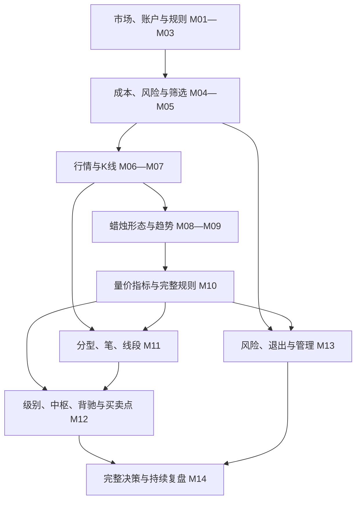
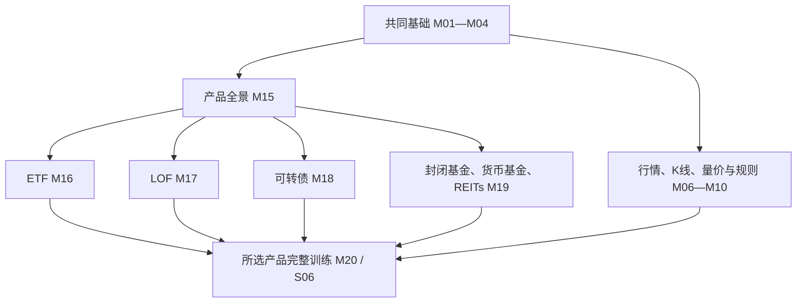

# 课程图谱与课节目录

本课从真正零基础起步，围绕一笔交易的完整过程学习。默认按系统路线前进，每次只学一个小段。目录中的术语无需提前记忆。

共有20个模块、80个单元，每单元设两个起始教学小段。遇到疑惑会继续拆讲，数量不是课时或掌握程度的保证。

## 知识关系图

图中箭头表示知识支持关系。风险贯穿全部课程，M04开始计算；完整规则在M10先走通，缠论随后深化。具体先学什么见[学习路线](roadmap.md)。

## 模块与单元

### M01 市场与股票

| 单元 | 主要学习成果 |
| --- | --- |
| [M01-U01 股份、价格与收益](modules/module-01.md#u01-p01) | 解释股票代表的权利及收益来源 |
| [M01-U02 公司与市场参与者](modules/module-01.md#u02-p01) | 分清公司、券商、交易所和投资者 |
| [M01-U03 发行与流通](modules/module-01.md#u03-p01) | 区分融资发行与持有人之间的交易 |
| [M01-U04 交易所、板块与指数](modules/module-01.md#u04-p01) | 把个股放回市场及指数背景 |

### M02 账户、品种与交易方式

| 单元 | 主要学习成果 |
| --- | --- |
| [M02-U01 账户与资金路径](modules/module-02.md#u01-p01) | 解释证券、资金与银行账户的作用 |
| [M02-U02 安全与适当性](modules/module-02.md#u02-p01) | 识别权限、风险与账户安全边界 |
| [M02-U03 证券品种比较](modules/module-02.md#u03-p01) | 分清股票、ETF、债券和可转债 |
| [M02-U04 目标、风格与时间安排](modules/module-02.md#u04-p01) | 比较期限、看盘条件与风险承担 |

### M03 委托、撮合与成交

| 单元 | 主要学习成果 |
| --- | --- |
| [M03-U01 价格、数量与委托](modules/module-03.md#u01-p01) | 填写一份假设委托并核对单位 |
| [M03-U02 竞价与匹配](modules/module-03.md#u02-p01) | 解释匹配优先序与竞价阶段 |
| [M03-U03 订单状态与撤单](modules/module-03.md#u03-p01) | 区分已报、部分成交、成交与撤单 |
| [M03-U04 价格限制及特殊交易日](modules/module-03.md#u04-p01) | 按证券及日期查找适用限制 |

### M04 结算、成本与早期风险

| 单元 | 主要学习成果 |
| --- | --- |
| [M04-U01 交收与可用可取](modules/module-04.md#u01-p01) | 区分可用现金、可取现金与可卖股份 |
| [M04-U02 费用与净收益](modules/module-04.md#u02-p01) | 核算含费用的交易结果 |
| [M04-U03 计划损失与仓位](modules/module-04.md#u03-p01) | 按假设损失及资金约束计算数量 |
| [M04-U04 组合风险与集中度](modules/module-04.md#u04-p01) | 识别相关持仓与组合暴露 |

### M05 信息、公司事件与筛选

| 单元 | 主要学习成果 |
| --- | --- |
| [M05-U01 财报、价值与价格](modules/module-05.md#u01-p01) | 用基础经营信息解释价格之外的风险 |
| [M05-U02 公告与信息时点](modules/module-05.md#u02-p01) | 判断一条信息何时可供决策 |
| [M05-U03 公司事件与生命周期](modules/module-05.md#u03-p01) | 辨析分红除权、申购、停牌与退市 |
| [M05-U04 股票池与观察名单](modules/module-05.md#u04-p01) | 写出候选与排除理由 |

### M06 行情界面与市场背景

| 单元 | 主要学习成果 |
| --- | --- |
| [M06-U01 报价字段与市值](modules/module-06.md#u01-p01) | 解释报价及不同市值口径 |
| [M06-U02 量、额、换手与量比](modules/module-06.md#u02-p01) | 计算并区分常见活跃度指标 |
| [M06-U03 盘口与分时](modules/module-06.md#u03-p01) | 把挂单、成交和分时记录分开 |
| [M06-U04 市场、行业与个股](modules/module-06.md#u04-p01) | 写出不同层次的观察事实 |

### M07 K线及价格表示

| 单元 | 主要学习成果 |
| --- | --- |
| [M07-U01 开高低收与实体影线](modules/module-07.md#u01-p01) | 从价格数据画出几何正确的K线 |
| [M07-U02 阴阳与日涨跌](modules/module-07.md#u02-p01) | 用不同比较基准解释阳线仍下跌 |
| [M07-U03 周期与未完成K线](modules/module-07.md#u03-p01) | 理解聚合及未收盘数值的变化 |
| [M07-U04 复权与除权](modules/module-07.md#u04-p01) | 选择并声明比较价格的复权口径 |

### M08 日本蜡烛图体系

| 单元 | 主要学习成果 |
| --- | --- |
| [M08-U01 单根形态](modules/module-08.md#u01-p01) | 按实体影线与背景辨认形态 |
| [M08-U02 双根形态](modules/module-08.md#u02-p01) | 比较吞没孕线等相邻结构 |
| [M08-U03 多根反转与持续](modules/module-08.md#u03-p01) | 解释多根形态形成的条件 |
| [M08-U04 背景、确认与失效](modules/module-08.md#u04-p01) | 指出同形异义及后续失效 |

### M09 趋势与价格结构

| 单元 | 主要学习成果 |
| --- | --- |
| [M09-U01 高低点及市场状态](modules/module-09.md#u01-p01) | 用高低点描述趋势及震荡 |
| [M09-U02 支撑与压力](modules/module-09.md#u02-p01) | 给出支撑压力的观察依据 |
| [M09-U03 趋势线、通道与缺口](modules/module-09.md#u03-p01) | 解释线条和缺口的画法与限制 |
| [M09-U04 突破、回踩与失败](modules/module-09.md#u04-p01) | 区分突破观察与可执行规则 |

### M10 量价、指标与完整规则

| 单元 | 主要学习成果 |
| --- | --- |
| [M10-U01 量价证据](modules/module-10.md#u01-p01) | 解释量价关系并保留竞争解释 |
| [M10-U02 均线与MACD](modules/module-10.md#u02-p01) | 从计算直觉理解滞后指标 |
| [M10-U03 一套完整教学规则](modules/module-10.md#u03-p01) | 写全筛选入场仓位退出与暂停条件 |
| [M10-U04 期望、基准与验证](modules/module-10.md#u04-p01) | 计算费用后期望并说明验证局限 |

### M11 缠论结构基础

| 单元 | 主要学习成果 |
| --- | --- |
| [M11-U01 包含处理](modules/module-11.md#u01-p01) | 按已声明口径处理包含关系 |
| [M11-U02 顶底分型](modules/module-11.md#u02-p01) | 区分分型位置与确认时刻 |
| [M11-U03 笔的形成](modules/module-11.md#u03-p01) | 检查成笔条件并标出候选状态 |
| [M11-U04 线段与特征序列](modules/module-11.md#u04-p01) | 解释特征序列及分段确认分支 |

### M12 缠论核心关系

| 单元 | 主要学习成果 |
| --- | --- |
| [M12-U01 走势类型与中枢](modules/module-12.md#u01-p01) | 按次级别走势区间解释中枢 |
| [M12-U02 级别、递归与中枢演变](modules/module-12.md#u02-p01) | 分清图表周期与分析级别 |
| [M12-U03 背驰与三类买卖点](modules/module-12.md#u03-p01) | 解释买卖点条件及背驰比较对象 |
| [M12-U04 区间套与多种划分](modules/module-12.md#u04-p01) | 展示当前可确认和待确认的结构 |

### M13 退出、管理与交易纪律

| 单元 | 主要学习成果 |
| --- | --- |
| [M13-U01 四类退出](modules/module-13.md#u01-p01) | 为亏损盈利时间和逻辑失效分别写退出 |
| [M13-U02 仓位管理与成交困难](modules/module-13.md#u02-p01) | 处理加减仓跳空及未成交 |
| [M13-U03 行为控制与暂停](modules/module-13.md#u03-p01) | 把常见行为偏差转为可检查约束 |
| [M13-U04 规则版本及风险回顾](modules/module-13.md#u04-p01) | 保留规则修改及风险复核记录 |

### M14 连续模拟与独立复盘

| 单元 | 主要学习成果 |
| --- | --- |
| [M14-U01 盘前与观察名单](modules/module-14.md#u01-p01) | 形成固定的盘前观察与排除记录 |
| [M14-U02 回放、决策与对账](modules/module-14.md#u02-p01) | 在有限信息下决策并核对实际成交 |
| [M14-U03 前向模拟与日志](modules/module-14.md#u03-p01) | 持续记录交易及未交易选择 |
| [M14-U04 过程结果与下一步](modules/module-14.md#u04-p01) | 分开评价执行质量与方法证据 |

## 学习与练习

每节先解释概念，再示范，再做一个轻量理解确认。阶段末使用[独立练习](exercises/index.md)。随时可查[概念](concepts.md)，再回到原课。

图例及历史回放默认使用明确标注的合成数据；[回放入口](../assets/replay/frame-00.html)从尚未揭示行情开始。真实市场规则与数据的核验边界见[来源](sources.md)。

## 图形实践线

M06读成交量单位与比较基准，M07回到真实OHLC与影线，M08核对形态及反例，M09画支撑压力并观察突破/破位，M10将量价判断接到风险计划，M11—M12再逐层画缠论。见[32专题真实图谱](chart-atlas.md)、[看盘手册](chart-reading.md)与[缠论实图](chan-real-charts.md)。每次先保留当前观察，再看后续；已看过答案的图不算未见测试。

## 2026主案例入口

真实图形实践优先用[2026科技股与高波动图谱](tech-2026-atlas.md)和[2026缠论图谱](chan-2026-atlas.md)；原茅台、平安等2024例为补充。先核[数据、权益事件及可知时间](data-2026.md)，再配合[看盘手册](chart-reading.md)按原图—原答—标注—验证推进。

## 多品种扩展图谱

ETF、LOF是基金结构，货币、债券、股票、商品、跨境描述不同维度；训练分支不代表互斥分类。可选择产品优先路线，缠论不是基金练习的前置门槛。已有学习者按实际掌握情况补基础，不重置旧进度。

### M15 产品全景与业务路径

| 单元 | 主要学习成果 |
| --- | --- |
| [M15-U01 权利、包装与资产](modules/module-15.md#u01-p01) | 区分持有权利、产品结构与资产暴露 |
| [M15-U02 价格、净值与可知时间](modules/module-15.md#u02-p01) | 核对估值分母与实际可获得时间 |
| [M15-U03 四条业务路径与规则卡](modules/module-15.md#u03-p01) | 按产品日期和具体操作核查适用条件 |
| [M15-U04 成本、风险与学习选择](modules/module-15.md#u04-p01) | 比较费用口径、风险和学习分支 |

### M16 ETF机制与交易

| 单元 | 主要学习成果 |
| --- | --- |
| [M16-U01 名字、目标和里面的资产](modules/module-16.md#u01-p01) | 区分指数ETF、主动ETF和联接基金 |
| [M16-U02 净值、市场价格和执行成本](modules/module-16.md#u02-p01) | 解释交易价差、折溢价和申赎机制 |
| [M16-U03 债券与黄金，不能套用股票的理解](modules/module-16.md#u03-p01) | 比较债券久期、信用与黄金标的风险 |
| [M16-U04 跨境时钟与完整操作核验](modules/module-16.md#u04-p01) | 核查跨境时差、估值、申赎和交易条件 |

### M17 LOF机制与交易

| 单元 | 主要学习成果 |
| --- | --- |
| [M17-U01 基金身份与三种操作](modules/module-17.md#u01-p01) | 区分场内买卖与场外申赎 |
| [M17-U02 确认、可用和跨系统转托管](modules/module-17.md#u02-p01) | 核对确认、转托管及可用时间 |
| [M17-U03 溢价、限制与跨境资料时点](modules/module-17.md#u03-p01) | 解释申购受限和价差消失风险 |
| [M17-U04 完整账户与生命周期](modules/module-17.md#u04-p01) | 记录候选、放弃、操作状态和净结果 |

### M18 可转债机制与交易

| 单元 | 主要学习成果 |
| --- | --- |
| [M18-U01 先读懂债、股和价格](modules/module-18.md#u01-p01) | 区分面额、张数、价格和转股价值 |
| [M18-U02 把交易与转股写成不同操作](modules/module-18.md#u02-p01) | 比较交易、转股及数量和可用规则 |
| [M18-U03 沿公告时间线处理赎回、回售和下修](modules/module-18.md#u03-p01) | 管理赎回、回售、修正和转股路径 |
| [M18-U04 持有到最后之前，先把损失路径算全](modules/module-18.md#u04-p01) | 核算信用、到期风险、事件分支和账户 |

### M19 其他场内基金

| 单元 | 主要学习成果 |
| --- | --- |
| [M19-U01 封闭的是申赎，不一定是交易](modules/module-19.md#u01-p01) | 解释折价、剩余期限、转型和终止 |
| [M19-U02 货币基金的收益与渠道要一起看](modules/module-19.md#u02-p01) | 区分收益展示、分配和真实净结果 |
| [M19-U03 公募REITs从募资走到项目现金流](modules/module-19.md#u03-p01) | 区分基础设施和商业不动产及其项目风险 |
| [M19-U04 把分配、扩募和清算接回总回报](modules/module-19.md#u04-p01) | 分析扩募、分配、清算及业务可执行性 |

### M20 多品种完整交易训练

| 单元 | 主要学习成果 |
| --- | --- |
| [M20-U01 从观察名单到可执行计划](modules/module-20.md#u01-p01) | 按产品身份、图形和规则筛选候选 |
| [M20-U02 风险、数量与多条分支](modules/module-20.md#u02-p01) | 用现金风险约束并保留等待或放弃选择 |
| [M20-U03 委托、持仓与事件管理](modules/module-20.md#u03-p01) | 区分计划成交、可卖冻结与期限事件 |
| [M20-U04 对账、比较与复盘](modules/module-20.md#u04-p01) | 核算净结果并评价过程与证据范围 |

每个单元有两个起始教学小段，共160个起始小段。按理解情况拆讲，不以课节数量证明掌握。图形见[多品种真实图谱](product-atlas.md)，机制算例见[工作表](product-worked-sheets.md)，训练见[六条纸面交易线](product-practice.md)。
