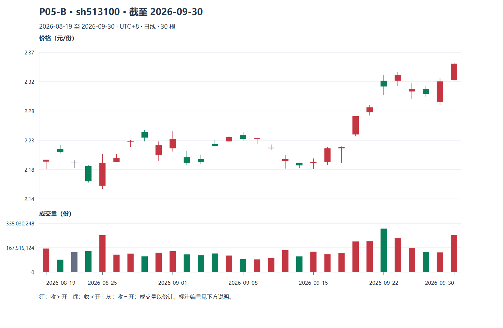
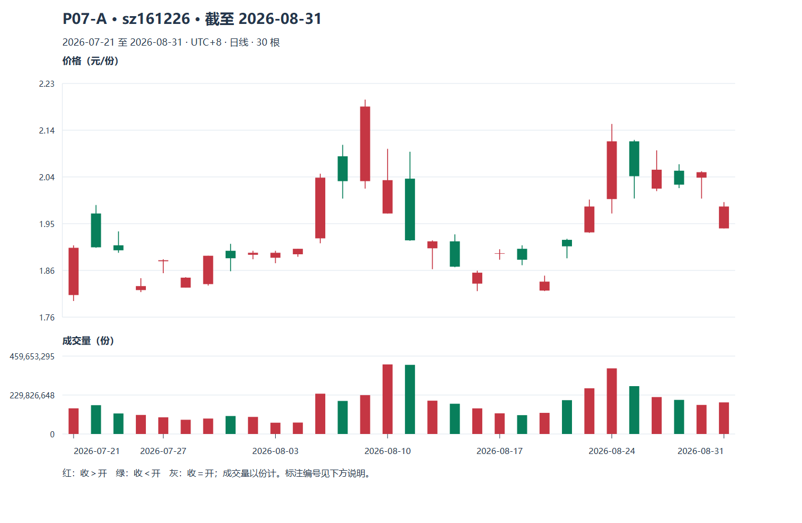
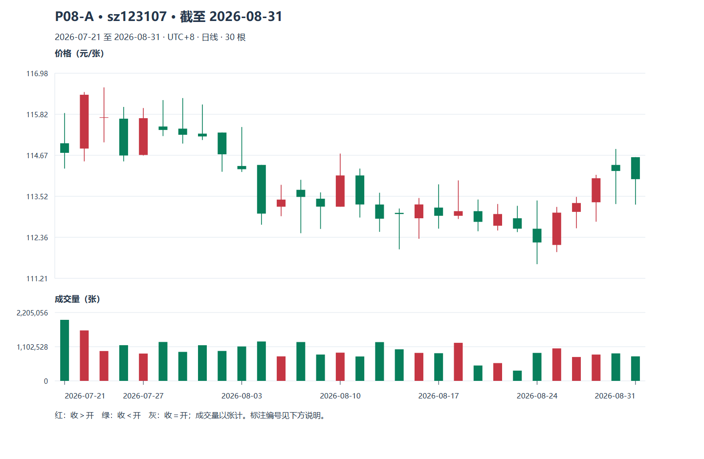
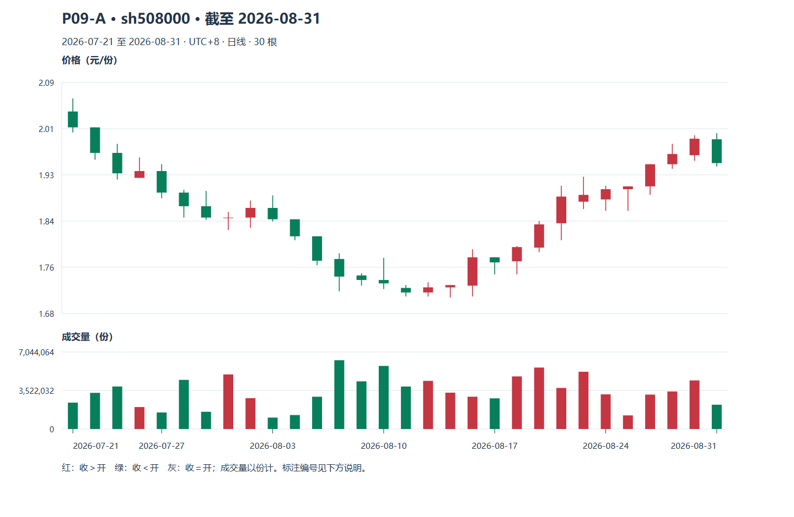
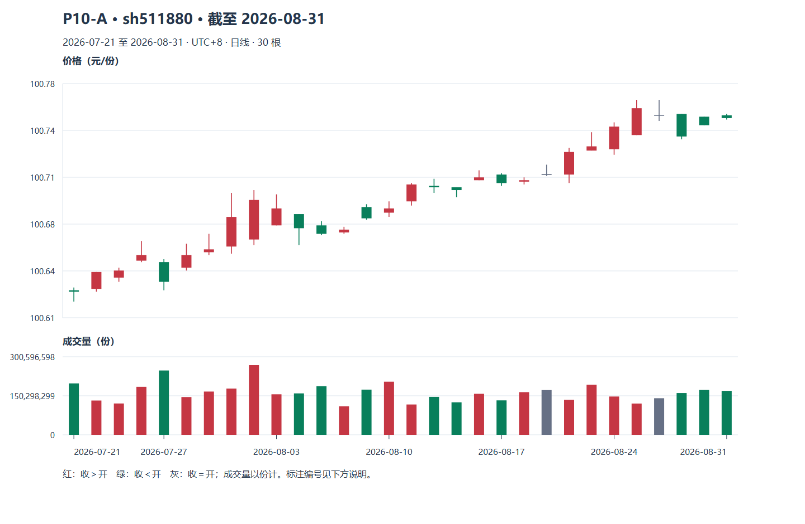

# 五类场内产品：先读量价，再查证据

每次做一题。把自己放在图上最后一个交易日的北京时间 15:00，只用该题给定的图和当时已公开的资料。图是后来采集的不复权历史日线，每张有 30 根；这是有资料辅助的回顾练习，不用后几天的走势判对错。

## 做题前先补哪一课

股票量价读图的方法，不足以解释转股、项目现金或基金收益。本页五题按所学品种选做；只学过股票或ETF时，不必立刻答完五题。先讲下面的机制，用另一组数据示范，再做对应题。没学的题先跳过，补课后再回来；不能把只看过术语记成已经学会。

| 题目 | 先讲过什么 | 讲解位置 |
| --- | --- | --- |
| 跨境ETF | 基金份额与净值、场内买卖与申赎、跨市场时钟与汇率 | [M15 权利与净值](../modules/module-15.md)、[M16 ETF及跨境时序](../modules/module-16.md) |
| LOF | 场内买卖与场外申赎、转托管、净值与可卖时点 | [M17 LOF](../modules/module-17.md) |
| 可转债 | 债权与转股价、申请转股、登记到账、零股与可卖条件 | [M18-U01](../modules/module-18.md#u01-p01)、[M18-U02-P02 转股申请、整股余款与到账](../modules/module-18.md#u02-p02) |
| REIT | 项目收支、债务与可分配现金；登记资格、除息、到账与持有期归属 | [M19-U03-P02 项目现金](../modules/module-19.md#u03-p02)、[M19-U04-P01 分配资格与到账](../modules/module-19.md#u04-p01) |
| 货币基金 | 收益计算口径、七日年化与一日价格变化为何不同 | [M19-U02 货币基金](../modules/module-19.md#u02-p01) |

这些链接用于找到讲解，不表示已经向你讲过。导师先核对实际讲授记录，缺哪项就补哪项；补课不提前打开本题的答案。

## 三步读图

1. **看价格。** 上半图每根蜡烛是一日。比较当天收盘和前一交易日收盘，才知道这次收盘是涨还是跌。图中红绿比较的是当天收盘和当天开盘。
2. **看成交量。** 下半图的柱表示实际成交数量：基金用「份」，可转债用「张」。用当日量分别除以前 5、20 个有记录交易日的日均量，两段均值都不含当日。比如，假设当日成交 120 份，前 5 日和前 20 日均值是 100、150 份，结果是 1.20 倍和 0.80 倍。同一天对两个基准可有不同结论，写清你在和谁比。不要横比不同图的柱高。成交额是成交金额，成交量是成交数量；两者都不能替代基金净申购或净赎回。
3. **查参照和成交条件。** 场内价格是买卖成交价；每份净值（NAV）是按规则算出来的每份基金资产净值。价格高于可比净值是溢价，低于它是折价。用市价除以可比净值再减 1，可算出折溢价率。动手前先核对份额类别、币种、估值时点和发布时间。遇到折算（重新换算份额数）或分红，先查公告，再比较前后价格。要估计自己的单能否成交，还要查交易状态、当时的买卖报价和各档数量，并核对委托条件和费用。

每题写三句：**图上看见什么 → 另有哪份证据、它是哪天的 → 还差什么，哪项判断或操作要等。** 先保留自己的第一份回答。下面的量价数值来自配套日线，方便核算；公告的日期按日记录，未核到首次发布的时分。

## 一、跨境 ETF：513100 国泰纳斯达克 100 ETF

[逐日表](../../assets/product-2026/p05-b.html)

前收 2.324 元/份，当日收 2.352 元/份，成交 254,828,283 份；前 5、20 日均量分别为 194,585,333.6、147,271,144.95 份。

**资料。** 国泰基金 2026-09-15 披露的[招募说明书（2026 年第一号）](https://st.gtfund.com/GSGG/2026/09/15/842733829339.PDF)第四节和第十一节：标的是纳斯达克 100 指数，业绩比较基准用经汇率调整的总收益指数（计入分红收益）。申赎开放日的净值在下一工作日计算，通常在再下一工作日内公告，具体以说明书口径为准。[纳斯达克市场时段表](https://www.nasdaqtrader.com/content/technicalsupport/nasdaq_sys_hours.pdf)和[美国国家标准与技术研究院夏令时日历](https://www.nist.gov/pml/time-and-frequency-division/popular-links/daylight-saving-time-dst)供核对时钟；9 月 30 日 15:00 北京时间对应同日 03:00 美国东部时间，当地常规收市为 16:00。

1. 报告收盘方向和前 5 日和前 20 日相对量。你买入的是别的投资者卖出的份额；这笔场内成交能说明基金收到了净申购吗？要查哪份数据？
2. 北京时间收盘时，能用美国当地 9 月 30 日的常规收盘指数解释这根日线吗？本题只有基准口径与时刻，无指数点位、汇率、同步净值或当时的参考净值快照。你能否判断折溢价？先补哪一项？

保存本题原答后，打开[本题核对页](../assessment/volume-price/p05-b.md)。

## 二、上市开放式基金（LOF）：161226 国投白银 LOF A 类

[逐日表](../../assets/product-2026/p07-a.html)

前收 2.053 元/份，当日开 1.940、收 1.984 元/份，成交 186,399,645 份；前一日量为 171,470,705 份，前 5、20 日均量分别为 251,990,882.6、211,344,192.7 份。

**资料。** 国投瑞银 2026-08-07 的[溢价风险提示及停复牌公告](https://disc.static.szse.cn/disc/disk03/finalpage/2026-08-07/43e6572f-15eb-4377-bcbb-c1d9efb73209.PDF)说明基金主要投资白银期货。公告列的是 8 月 6 日收盘价 2.035 元/份、8 月 5 日净值 1.6639 元/份；公告安排 8 月 7 日开市起停牌、10:30 起复牌，停牌期间赎回照常。

1. 最后一根是红色。收盘比前收高还是低？当日量比前一日如何，比前 5 日和前 20 日均值又如何？
2. 公告的两个数字能算 8 月 6 日同日溢价吗？能带到 8 月 31 日吗？如果溢价收窄，净值不变时场内价怎样变？若净值同时上涨，方向还能确定吗？
3. 场内停牌和暂停申购或赎回是一回事吗？本题没有 8 月 31 日申赎状态、转托管（把份额转入另一登记系统）的进度或盘口。若有人提议「申购后立刻场内卖出」，你要先查什么？

保存本题原答后，打开[本题核对页](../assessment/volume-price/p07-a.md)。

## 三、可转债：123107 温氏转债

[逐日表](../../assets/product-2026/p08-a.html)

前收 114.230 元/张，当日收 114.000 元/张，成交 790,902 张；前 5、20 日均量分别为 891,110.8、905,778.4 张。

**资料。** 温氏股份 2026-05-21 的[恢复转股提示公告](https://disc.static.szse.cn/disc/disk03/finalpage/2026-05-21/45f928a9-5ffd-42af-8eb8-ca552a9aac9c.PDF)载明每张面值 100 元。发行人于 2026-06-16 [公告调整转股价](https://static.cninfo.com.cn/finalpage/2026-06-16/1225373939.PDF)，6 月 24 日起从 16.29 调为 16.09 元/股；2026-07-01 的[二季度转股公告](https://disc.static.szse.cn/disc/disk03/finalpage/2026-07-01/c09e1f9d-335b-494a-8bea-a918bdcc6852.PDF)列出对应正股温氏股份（300498）。

1. 报告债券收盘方向和前 5 日和前 20 日相对量。这些数字也说明正股当日跌了吗？
2. 转股价值粗算：每张面值 ÷ 当时有效转股价 × 同时点正股价。16.09 元/股是哪一种价格？本题没有截止时点的正股报价，也没核齐此后的转股价变更。你能算当时的转股价值或转股溢价吗？
3. 若打算先转股再卖出股票，要核对哪些公告和账户条件？把这个操作与直接在场内卖债分开写。

保存本题原答后，打开[本题核对页](../assessment/volume-price/p08-a.md)。

## 四、基础设施 REIT：508000 华安张江产业园 REIT

[逐日表](../../assets/product-2026/p09-a.html)

前收 1.989 元/份，当日收 1.946 元/份，成交 2,220,642 份；前 5、20 日均量分别为 3,088,008.2、3,696,349 份。

**资料。** 华安基金 2026-06-26 披露的[招募说明书（2026 年第 1 号）](https://www.sse.com.cn/disclosure/fund/announcement/c/new/2026-06-26/508000_20260626_RB0A.pdf)说明该基金封闭运作。华安基金 2026-04-14 的[分红公告](https://www.sse.com.cn/disclosure/fund/announcement/c/new/2026-04-14/508000_20260414_41KN.pdf)列出基准日 2025-12-31 的净值 2.6374 元/份；本次每 10 份派 0.5486 元，是 2025 年度第二次分红。场内权益登记日为 2026-04-16，除息日为 4 月 17 日，公告列场内发放日为 4 月 22 日。

1. 报告收盘方向和前 5 日和前 20 日相对量。这根量柱能证明园区租金减少吗？要查什么资料才能评估项目能分出多少现金？
2. 能拿公告中的旧净值配 8 月 31 日收盘价，断定当天折价或能按净值退出吗？
3. 若从图的起点开始持有，能把上述 4 月分红加进这一段持有收益吗？怎样核对一笔分红是否该计入自己的收益、是否已到账？

保存本题原答后，打开[本题核对页](../assessment/volume-price/p09-a.md)。

## 五、交易型货币基金：511880 银华日利 A 类

[逐日表](../../assets/product-2026/p10-a.html)

前收 100.746 元/份，当日开 100.753、收 100.751 元/份，成交 169,351,181 份；前 5、20 日均量分别为 148,475,917、153,829,799.9 份。注意图的价格轴从约 100.61 到 100.78 元/份。

**资料。** 银华基金[产品资料概要](https://www.sse.com.cn/disclosure/fund/announcement/c/new/2026-04-30/511880_20260430_ZYCF.pdf)于 2026-03-30 编制、4 月 30 日送出，确认 511880 是上市的 A 类份额。[2025 年年度报告](https://www.sse.com.cn/disclosure/fund/announcement/c/new/2026-03-28/511880_20260328_ACKO.pdf)于 2026-03-28 披露，第三节注明该份额采用含累计收益的全价计价方式，收益不结转为新增份额。

1. 最后一根为绿色，收盘比前一日高还是低？算每份变动和前 5 日和前 20 日相对量。价格轴显示的变化能当成七日年化收益，或证明这天价格高于净值吗？
2. 假设你明早要把钱转回银行。本题没有账户可取时间、实际费用或当时盘口。应先核对哪个时间？为什么成交量较大也不足以把它当成已可取的现金？

保存本题原答后，打开[本题核对页](../assessment/volume-price/p10-a.md)。
