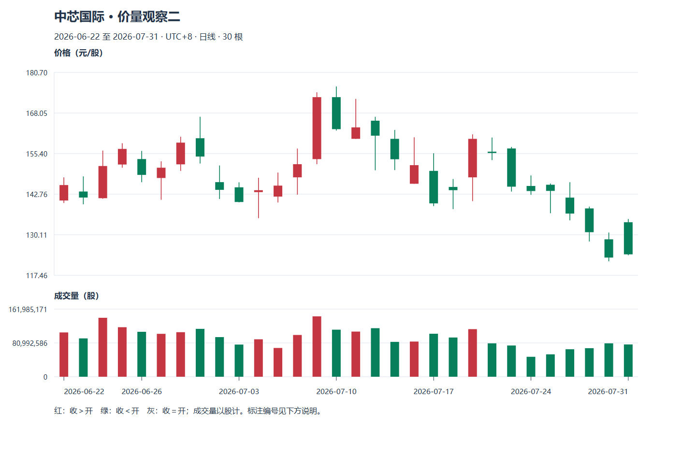
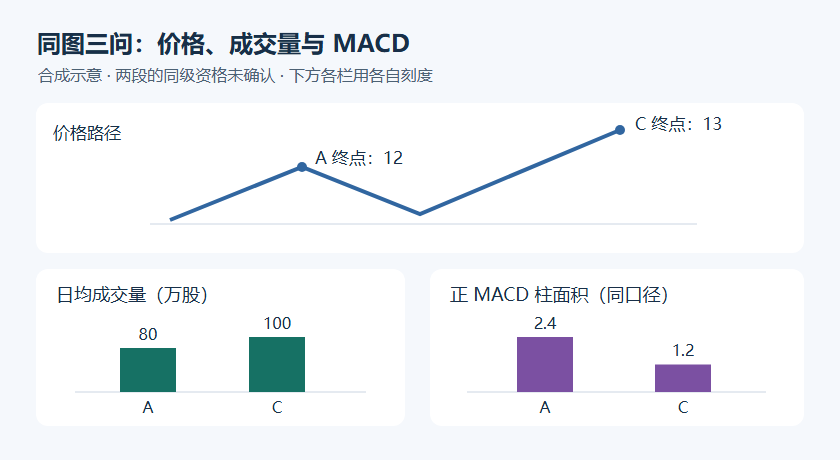

# 一张图，三把尺

## 同图双窗口：VP-W

看中芯国际 2026 年 7 月 31 日[原图与逐日表](../../assets/volume-price-2026/vp-window-decision.html)。红绿按当日开盘与收盘比较。日涨跌看今日收盘与昨收比较，两者可能方向相反。

今天的量是一笔新的观测。用它去除以过去的均量，别先把它放进均量的分母。举个小例：假设今天成交 120 万股，过去 5 日平均 80 万股，过去 20 日平均 150 万股，同一天可以同时是短期 1.50 倍、较长窗口 0.80 倍。本题不用这一组假数，自己从原图附表取数。计算保留原值，展示四舍五入。

1. 找昨收、今开、今高、今低、今收。写出阴阳及相对昨收涨跌。收盘靠近日内哪个端点？
2. 用此前 5 日、20 日各算一次日相对量。各写一句带分母的观察；两句冲突吗？
3. 若规则写的是「20 日相对量至少 1.20」，今天通过吗？这项判断能否在当天 10:30 用最终日量做？有办法只用这张图计算 10:30 的同刻量比吗？

第一题可先做；找到四价和基准后再做第二题。保存本题原答后，可打开[这一题的核对页](../assessment/volume-price/vp-w.md)，再做真图对照。课前还可重读[读图手册第 5.2 节](../chart-reading.md)。

## 量、MACD 与背驰：VP-C

这张图是虚构的结构草图。A、C 是两段向上运动，还没有确认它们是否属于同一级别的合格比较段。下方两组数分别来自成交股数和根据价格计算的 MACD。图为示意；柱高不跨栏比较。

1. 价格终点由 12 到 13。第二段日均成交量、同口径正 MACD 柱面积分别怎样变化？
2. 就这张图能否宣布「趋势背驰」？还缺哪些结构资格？若补齐结构，哪类数据仍只是力度辅助？
3. 如果有人说「正 MACD 柱面积变小，说明日均成交量也缩了」，指出图中哪两项数值可以反驳。

保存 VP-C 原答后，打开[这一题的核对页](../assessment/volume-price/vp-c.md)。
