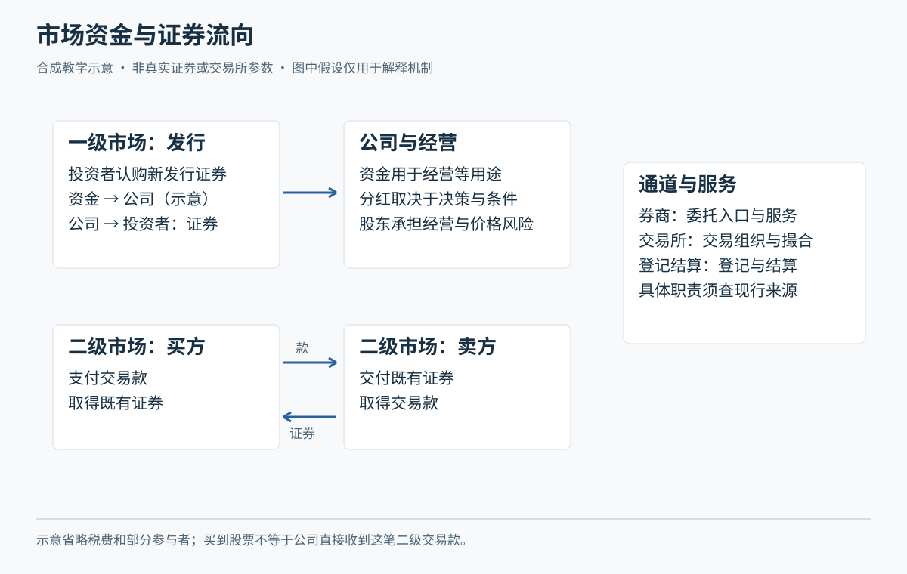

# M01 从一股股票认识市场

<!-- Tutor: Give the lesson for one part with its location identifier. Give the question for the part. Then, wait.

The examples are guided lessons. They are not stage assessments. -->

本模块从零开始。小林与青禾制造均为虚构人物、公司；全文价格、股数、分红和情境均为教学假设，没有对应的真实证券代码或历史。先用现金账户、无杠杆买入普通股学习：即只用自己的资金，不借钱或借券放大交易。这里的“买入做多”是先买入，期待未来价格或分配带来回报；期待可能落空。

## U01 所有权与回报

### P01 买股票，究竟买到了什么

**股票**是公司股份的凭证。普通股股东拥有的是公司的一部分权益，可以依法律和公司章程享有知情、表决、利润分配等权利；不是直接分走公司某台机器，也不能随时要求公司按买入价退钱。先理解这一点，才能分开“公司在经营”与“屏幕在报价”。股东权利的基本分类可参照[证监会北京监管局股东权益投教](https://www.csrc.gov.cn/beijing/c105536/c1257404/content.shtml)；该页为基础概念资料，不用于推定当前具体提案门槛或办理程序。

假设青禾制造把普通股份分成 100 万股，小林持有 100 股，持股比例为 100÷100 万＝0.01%。这并不表示他可以拿走公司现金的 0.01%。公司赚的钱先体现在公司经营与财务中，是否分配、何时实施，要看相应决策和公告。即使当年盈利，也不能据此在个人账户记一笔“已收到分红”。

普通股承担剩余风险：公司资产需要先满足债务等优先请求，留给股东的权益可能减少甚至归零。“有限责任”也不等于股价不会跌；本课无借款、无其他承诺的现金买股案例，投入股款可能全部损失。若借钱交易，还会有额外债务，已超出本例条件。

**随口确认：**青禾赚了 100 万元，小林能直接从公司取走 100 元吗？请用“公司财产”和“股东权利”说出理由；不必背法律条文。

### P02 价格方向、股东权利与个人收益是三件事

接着上一段的股东身份，**价格**是市场某次成交的每股金额，**收益**是小林这笔投入最后增加或减少了多少钱。价格上升可以带来账面盈利；尚未卖出时，通常称为**浮动盈亏**，金额随行情变化，不能当成确定到账的现金。卖出后还需算交易费用、分红及相关税费，才接近实际净回报。

虚构例：小林以每股 10 元买 100 股，后来以 11 元全部卖出，期间实际收到税后现金分红 20 元，买卖费用共 12 元。现金净增加为 1100＋20－1000－12＝108 元。若以“买入股款＋买入费用”为投入分母，且买入费用为 6 元，持有期净收益率为 108÷1006，约 10.74%。这是本课明确的计算口径；不能把股价涨幅 10%直接称为净收益率。费用是虚构定额，真实计费在 M04 学。

反例：昨天收盘 12 元，今天收盘 11 元，股票今日下跌；小林若早先以 10 元买入，仍可能有浮盈。另一人以 13 元买入，同一个 11 元报价对他是亏损。反过来，今天上涨，也可能还远低于个人成本。分红是权利兑现的一种方式，但除息会改变比较基准，M05 再把现金与价格合并计算。

**随口确认：**同一只股票今天涨了，小林仍然亏钱，矛盾吗？换一个买入价说明即可。

## U02 公司与市场参与者

### P01 公司经营与交易价格怎样相连

知道收益来自哪里后，再看公司为什么值得研究。青禾制造靠生产、交货、收款维持经营。**收入**是一定期间销售商品、提供服务等形成的经营成果项目；**利润**是收入扣除相应成本费用等后的结果；收到的钱还受客户付款时间影响。这三个概念不能互换，财务报表将在 M05 展开。

虚构例：青禾签下 300 万元订单，约定验收后确认销售，客户随后付款。今天只是签约，不能把 300 万元都叫作今天的利润或现金。市场可能因为预期未来业务增长而抬高报价，也可能因为担心原料涨价、客户拖款而降价。**预期**就是对未来尚未确定事情的判断，不是已经发生的事实。

所以“好公司”与“任何价格都值得买”不是同一结论。若人们早已按极高增长出价，随后公司虽增长、却低于原先期待，价格仍可能下跌。短期价格还受买卖意愿、可交易数量和整体风险偏好影响。本课不把一条经营新闻写成必涨规则，也不根据一根上涨线倒推公司必定变好。

这段适用于理解商业消息，而非给企业估出唯一正确价格。遇到“订单暴增，明天必涨”，先拆成“订单是否存在、能否形成收入、能否转成利润、价格是否已反映”四个待证问题。

**随口确认：**签了大单但没交货、没收款，为什么不能直接说“小林已经赚到了”？

### P02 一次交易中，各方负责什么

小林通常通过**证券公司**接受委托服务，由其向交易所申报；**交易所**提供交易场所、组织交易并实施自律管理；**登记结算机构**负责证券登记以及相应清算交收业务。清算是计算该付该收，交收是履行证券和资金交付。监管机构依法监管市场，但这些制度安排都不替小林保证交易获利。深市委托、申报与成交记录职责可查[深交所 2026 年交易规则第 3.1 节](https://docs.static.szse.cn/www/lawrules/rule/trade/current/W020260424690713155663.pdf)。

虚构例：小林提交买入青禾 100 股，券商显示已报，交易所还未匹配到愿意按条件卖出的申报。此时券商已经提供了申报服务，却没有证据说小林已成交，更不能要求公司补给他便宜股票。等成交回报确认数量和价格后，才据此更新交易记录，后续再核对交收和账户可用状态。

买方、卖方可能是个人、基金等机构，各有资金安排与期限。卖出可能因为需要现金，也可能因为调整组合；仅看成交不能读出对方全部想法。**流动性**描述按合理成本及时交易的便利程度，取决于可成交的对手数量和价格。交易所存在，不等于某时刻一定有人接单。

**随口确认：**“券商已经报单”能否证明“交易所已成交”？小林应再看哪一类回报？

## U03 一级市场与二级市场

### P01 发行融资与股东转手，钱流向不同

**一级市场**是证券发行融资的环节；**二级市场**是已发行证券转让的环节。两者相连，却不能把所有买股款都看成给上市公司的新资金。[中国投资者网投教教材](https://www.investor.org.cn/learning_center/gmjytx/bk/kj/202303/P020230327602965117252.pdf)解释了这两个市场的基本功能；本课只借其概念，不沿用旧版开户或交易数字。

虚构例：青禾新发行股份募集资金，认购新发行股份的资金按发行安排进入融资流程，发行费用等另计。上市后，小林在市场向原持有人买 100 股，支付 1000 元，这笔交易款主要对应卖方转让股份，通常不是青禾当天多收到 1000 元。公司以后若再发行新股募集资金，又涉及新的发行环节，不能与日常转手混在一起。

二级市场提供转让机会和价格发现，帮助投资者不必等公司结束经营才退出；“提供机会”仍不是“无条件退出保证”。若停牌或缺少对手，转手会受限。公司回购、股东售股等特殊交易需辨认交易主体，不能仅凭“在市场交易”就断言公司绝不参与。

**随口确认：**小林从另一位股东买入 100 股，青禾是否必然因此新增 1000 元可用经营资金？你会怎样画资金箭头？

### P02 新股、新钱与新增股份为什么都不等于稳赚

在一级、二级市场的区分上，再引入**IPO**：首次公开发行股票。发行价是发行环节确定的价格，上市后的市场成交价可以高于它，也可以低于它。低于发行价俗称“破发”。监管注册或交易所审核不是收益承诺，不能理解为替买方证明“买贵了也有人兜底”。

虚构例：青禾的假设发行价为 10 元，某次上市交易出现 9 元报价。持有者若有 100 股，以可执行的 9 元卖出，忽略费用已损失 100 元。“新”只说明发行时间，不能补回这 100 元。若总股数增加，小林原有股数未变，他的比例也可能下降，叫作**持股比例摊薄**；募集资金同时可能增加公司资源，不能只看分母增加就断定公司价值必跌。

参与申购还涉及资格、额度、缴款及上市交易安排。沪深与北交所发行机制有差异，不把某一市场的申购经验通用化；本模块不提供当前具体市值门槛、资金冻结或缴款天数，这些参数尚未逐产品核验，不能作为操作指令。M05 将教怎样从发行公告提取所需字段。

**随口确认：**“通过审核”和“买入后不亏”之间，缺了哪一步证据？用这次 10 元发行、9 元交易的假设例回答。

## U04 交易所、板块与指数背景

### P01 先认产品和板块，再套规则

本课的 **A 股**指境内上市、以人民币认购和交易的普通股票这一学习范围。沪市与深市都有主板，沪市有科创板，深市有创业板，北交所是另一交易场所。**板块**是市场制度与上市定位的分类，不是安全等级。不能因主板公司较熟悉，就把它看成保本产品；也不能因同属股票，就通用一套申报数量和涨跌幅限制。

虚构例：小林在模拟练习中想买 100 股。若案例设置为沪深主板普通股票，数量判断与设置为科创板股票就不同。青禾本身没有真实上市地；每个案例都会明示采用哪组教学条件，不能给它编造代码来猜规则。具体、带日期的数字比较见 [M03-U04-P01](module-03.md#u04-p01)，该表区分普通交易日、新股初期和风险警示，不应只抄其中一个百分数。

识别时按“证券名称与产品类别—交易场所—板块—当日状态—权限”逐项核对。ETF 是基金份额，可转债是带转股安排的债券，二者都可能在交易所交易，却不是普通股票。尤其不能把 A 股当日买入后的卖出限制，套给所有 ETF 或可转债；M02 会比较，M04 会讲账户可用。

**随口确认：**朋友说“都是交易所里的东西，规则一样”，你会先让他补哪两个身份字段？

### P02 指数是比较尺，不是每只股票的命运

**指数**按事先规定的样本与计算方法概括一组证券的变化；**权重**是各样本对指数的影响份量。它像一张有选样规则的成绩表，不能替代每个学生的成绩。指数本身是数值，买卖相关 ETF 等产品才涉及实际持仓。指数样本、权重和是否计入分红，会影响比较口径。[上交所等权重指数介绍](https://www.sse.com.cn/aboutus/mediacenter/hotandd/c/c_20150912_3988402.shtml)展示了改变权重会改变观察视角。

虚构简化例：两只股票在假设指数中各占一半，一只涨 4%，一只跌 2%，忽略再平衡等因素，组合约涨 1%。小林只持有下跌的青禾，不能要求自己的账户也涨 1%。若把上涨股票权重改成 80%，同样的两只股票得到的结果又不同。这说明“大盘涨了”还需问是哪一个指数、覆盖什么股票、如何加权。

此后观察青禾，会同时看市场、行业与公司背景。行业是业务相近企业的集合，用来理解共同需求或成本变化；它不是个股回报保证。拿单股与宽基指数比较，能描述相对表现，不能单凭一次跑赢认定方法有效，更不能推断明天继续领先。

**随口确认：**指数上涨而青禾下跌是否异常？再想一步：若你只选事后涨得最好的股票来证明方法好，比较尺还公平吗？后者先保留问题，后续验证课程会展开。
