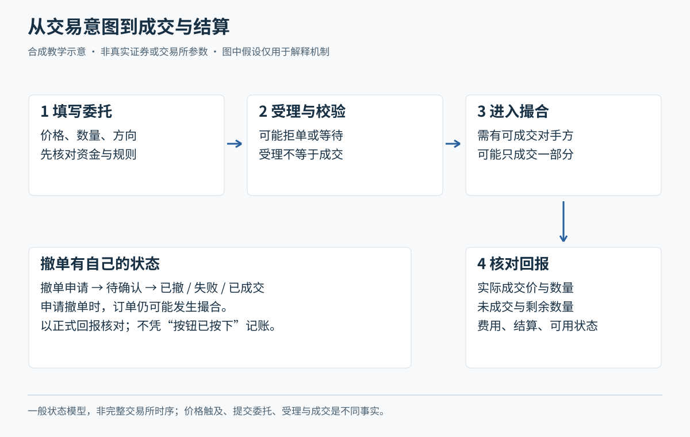

# M03 从委托到成交：价格、队列与状态

<!-- Tutor: Keep the order states as different items: submission, acceptance, matching, and fill. Give the lesson for one part with its location identifier. Then, wait. -->

先会看 M02 的账户记录，再学怎样描述一笔委托。小林、青禾制造与所有盘口、时间情境、成交数据均为虚构；除明确引源的规则数字外，均是教学设定。本模块默认沪深主板普通 A 股的竞价交易，用板块比较表说明不能通用的条件。核对资料日期：2026-10-20。

## U01 价格、数量与委托表单

### P01 把一句“我想买”写成完整指令

**委托**是投资者给券商的买卖指示；**申报**是交易参与人送到交易所主机的指令。买卖方向、证券身份、数量、价格、委托类型和账户都可能影响结果，不能只写一个金额。每股报价乘股数得到股款，费用另留；软件显示的“手”也要核对单位，不能把 100 股误填成 100 手。

虚构例：小林希望以每股不超过 10 元买青禾 200 股，股款上界是 2000 元，另需费用。表单应先核对产品和市场，再填“买入、200 股、限价 10.00 元”等字段，提交前再读一遍。若误选卖出，系统检查的是可卖证券；若误选另一只产品，即使价格相近也不能靠意图纠正成交。

**价格最小变动单位**是申报价格允许变化的最小刻度，不是未来最小亏损。以深市 A 股为例，[2026 交易规则第 3.3.8、3.3.11 条](https://docs.static.szse.cn/www/lawrules/rule/trade/current/W020260424690713155663.pdf)规定买入按 100 股或整数倍申报、报价刻度为 0.01 元；卖出不足 100 股的余额有一次性申报安排。该规则自 2026-07-06 施行，其他产品和科创板不能据此类推。

**随口确认：**200 股、每股 10 元，为什么准备 2000 元未必足够？如果把“股”错看成“手”，错误会发生在哪个字段？

### P02 限价决定边界，市价也不是成交保证

**限价买入**给出可接受的最高价格，限价卖出给出可接受的最低价格；不是要求必须正好以所填价格成交。**市价委托**依其具体类型处理当前可成交的对手申报，可能有价格保护、剩余撤销等条件。市价没有统一的“立即全部成交”含义；交易所、证券品种、交易阶段和券商支持范围必须一起核对。

虚构盘口：可卖数量为 10.00 元 100 股、10.02 元 100 股。小林限价 10.01 元买 200 股，若申报有效且进入时队列未变，可先成交 100 股于 10.00 元；不能为了凑齐 200 股再以 10.02 元买，因为超出了边界。若其实际选择的市价类型允许依次吃到这两档，成交均价可能为 10.01 元；但这取决于进入主机时的盘口、保护条件和具体类型，屏幕截图不保证未来还有这两档。

**买卖价差**是最优卖价与最优买价之差；**滑点**是实际成交价相对计划或参照价的偏离。滑点可好可坏，成本评估常需保守预留。深市市价类型及仅适用相应有涨跌幅证券连续竞价的范围，见同一规则第 3.3.4—3.3.6 条。沪市类型不能直接照搬深市名称。

**随口确认：**限价 10.01 元买入，成交于 10.00 元算不算错单？若当时只剩 10.02 元卖单，应该为了“必须成交”突破哪条边界吗？

## U02 集合竞价与撮合

### P01 连续竞价：有对手，还要看谁排在前面

**撮合**是按规则将相容买卖申报配对；**成交**是配对成立并形成成交记录。**连续竞价**是在连续接收申报的过程中逐笔撮合。价格优先意味着较高买价优于较低买价、较低卖价优于较高卖价；方向和价格相同时再比较主机接受时间，券商界面点击时间不能直接证明队列位置。[上交所 2026 交易规则第 3.5 节](https://www.sse.com.cn/lawandrules/sselawsrules2025/trade/universal/c/c_20260424_10816492.shtml)是沪市该原则的依据。

虚构例：甲先报 10.00 元买 100 股，小林后报同价买 100 股；此后有 100 股卖单可按 10.00 元成交，在其他条件相同、没有更高买价优先的简化队列中，先轮到甲。小林看到成交明细出现“10.00 元、100 股”，也不能把它认作自己的成交，必须查自己的成交回报。

再看另一种情境：如果有原先挂着的 10.00 元卖单，小林用有效的 10.02 元限价买单进入，连续竞价通常按相应成交定价规则与现有卖单成交，不能简单把买卖报价取平均。价格优先在这里是配对顺序，不是给每个人同一个均价。

**随口确认：**屏幕出现了与你限价相同的成交，为什么你仍可能一股没买到？除了价格，还缺什么证据？

### P02 集合竞价：先收集申报，再形成一个价格

**集合竞价**先汇集一段时间内的有效申报，再按最大可成交量等规则确定一个成交价格。不是按每次跳动的参考价即时成交。**参考价**和**匹配量**反映当时申报的虚拟撮合结果，申报变化后它们仍可能变化；最终要看正式成交回报。价格相同条件下的排队也不会因“大家一个价”而消失。

虚构演算：买方有 100 股愿出 10.10 元、100 股愿出 10.00 元；卖方有 100 股愿以 9.90 元卖、100 股愿以 10.00 元卖。在这个简化申报集合中，10.00 元能成交 200 股；9.90 元或 10.10 元都只能成交 100 股，因此最大成交量对应 10.00 元。现实中多个价格并列时，交易所还有剩余量及其他定价条件，不能拿本例替代完整算法。

对沪深股票通常竞价时段，[深交所规则第 2.3.2、3.3.1 条](https://docs.static.szse.cn/www/lawrules/rule/trade/current/W020260424690713155663.pdf)列有开盘 9:15—9:25、连续竞价 9:30—11:30 和 13:00—14:57、收盘集合竞价 14:57—15:00；9:20—9:25 及 14:57—15:00 不接受相应竞价撤销申报。本课以此说明阶段区别，不据此扩展所有产品时段或券商夜市委托时间。

**随口确认：**9:22 看见参考价 10 元，能否说已经以 10 元买到？如果此时想撤单，为什么更不能只凭点击按钮判断成功？

## U03 委托状态与撤单

### P01 用状态机理解一笔委托的去向

**已报**通常表示指令已向下一环节送出；**已受理**不等于已成交；**部分成交**是只完成一部分数量；**废单或拒单**表示该申报未被有效接受。券商用词可能不同，学习时关注事实：报了多少、成交多少、还在队列多少、已经撤掉多少。交易所原生委托和券商条件单也要区分，后者“已触发”可能只是准备生成申报。

虚构例：小林买 300 股，先成交 100 股，随后又成交 100 股。此时累计成交 200 股，还有 100 股未成交。若状态迟迟没有更新，不能把“没看见第三次回报”解释为一定没有第三次成交，也不能直接再买 100 股。先查相同委托编号下的成交回报与剩余量，必要时走官方服务核对。

拒单可能来自数量、可用资金、价格范围、权限或交易状态，不同原因需不同处理。“重新点一下”并不修复超范围报价；若只是回报延迟，重复提交反而可能形成两张有效订单。深市规则第 3.3.21 条规定竞价申报当日有效，不能把今天未成交的交易所竞价单当成明天仍会自动排队；券商预约或持续监控的条件单是否会再申报，要另查服务规则。进入纸面练习，也应保留这些状态区别，不能用一个“买入成功”按钮掩盖过程。

**随口确认：**报 300 股、累计成交 200 股，你的持仓变化和未成交量各是多少？“已触发”为什么还不能填成交价？

### P02 撤单只能处理仍未成交的部分

**撤单申请**是请求撤回未成交申报；**撤单确认**才说明相应剩余量已撤销。申请到达前可能又有成交，已经成交的部分不能靠普通撤单倒回。规则允许撤单的阶段，也仍须等待主机确认。把“撤单中”看成“全部取消”，最容易把实际持仓漏记。

虚构完整案例：小林委托 300 股，已成交 100 股，申请撤余下 200 股；申请被处理前又成交 100 股，最后只撤掉 100 股。核对等式为：委托 300＝累计成交 200＋已撤 100，未成交在队列数量为零。小林若原以为只买了 100 股，再补买 200 股，会把目标 300 股变成 400 股。冻结释放也应以最终事实核对，不能倒推成交数量。

这不是“所有撤单都很慢”的结论，而是两个指令到达、成交先后顺序可能不同。改变价格一般也不能假定保留原来队列优先级；若通过撤单再报，应承认新的接受时间。遇到停牌、异常状态或不可撤时段，按对应规则判断，本课不提供任何券商必定即时撤回的承诺。

**随口确认：**300 股委托最终成交 200 股、撤销 100 股。小林今天需要按多少股核算买入费用和持仓？你会保留哪两种回报来证明？

## U04 涨跌幅边界与特殊时段

### P01 一张有来源的板块规则比较表

**涨跌幅限制**是相对指定基准计算的报价或成交边界，不是账户损失上限。下面只比较股票竞价常见条件；规则文本以 2026-07-06 施行为基准，核对日为 2026-10-20。金额为人民币，数量为股，不能用于 ETF、可转债、大宗交易或港股。

| 场所、板块 | 通常交易日涨跌幅 | IPO 初期不设日涨跌幅的范围 | 常见买入数量要求 |
| --- | --- | --- | --- |
| 上交所主板 A 股 | 10%；2026 修订后主板风险警示股票亦为 10% | 上市后前 5 个交易日 | 100 股或整数倍 |
| 深交所主板 A 股 | 10%；不能再通用旧的风险警示 5%说法 | 上市后前 5 个交易日 | 100 股或整数倍 |
| 科创板 | 20% | 上市后前 5 个交易日 | 限价单不少于 200 股，可按 1 股递增；还受单笔上限约束 |
| 创业板 | 20% | 上市后前 5 个交易日 | 100 股或整数倍；单笔上限与主板有别 |
| 北交所股票 | 30% | 向不特定合格投资者公开发行股票上市首日 | 竞价单笔不少于 100 股，可按 1 股递增；还受单笔上限约束 |

来源：[沪市规则及附件第 3.3、6.6—6.7 条](https://www.sse.com.cn/lawandrules/sselawsrules2025/trade/universal/c/c_20260424_10816492.shtml)、[沪市修订说明新闻](https://star.sse.com.cn/aboutus/mediacenter/hotandd/c/c_20260424_10816474.shtml)、[深市规则第 3.3 节](https://docs.static.szse.cn/www/lawrules/rule/trade/current/W020260424690713155663.pdf)、[北交所规则第 3.3 节](https://www.bse.cn/jygl_list/200028217.html)。风险警示、退市整理、重新上市等还需按当日状态读例外，不能把“通常”理解为所有交易日。

虚构例：青禾若设为主板普通交易日，基准价 10 元，按 10%简算边界为 9—11 元。若换成假设北交所普通交易日条件，则是 7—13 元。不能从中选对自己有利的一套。即使最低价为 9 元，跌停卖出排队也可能没有成交对手，多日连续下跌更可能累计远超 10%。

**随口确认：**同是 10 元股票，为什么“最多只亏 1 元”不成立？若换成科创板，原来 100 股的买入计划又该先检查什么？

### P02 无日涨跌幅限制，也仍有交易边界

**有效申报价格范围**限制订单可报的价格，常被称作“价格笼子”；它与全天涨跌幅边界是不同约束。**临时停牌**是交易过程中的暂停，复牌还需按对应机制处理申报。无日涨跌幅限制不等于任何价格都能报、随时都能成交，也不能用普通交易日收盘范围倒推特殊日风险。

虚构决定：青禾若处在不设日涨跌幅的假设上市初期，午后出现临停。小林不能把上一笔 10 元成交作为现在仍可成交的证明，也不能预设复牌一定回到 10 元；他先核对停牌公告、恢复时间、申报是否受理及本单状态，信息不足则保留“暂不下单”。这把交易状态检查放在价格判断之前。

还要区分**盘后固定价格交易**与普通竞价。沪市 2026 修订将适用范围扩展至全部 A 股和 ETF；深市同年规则也有相应盘后章节。可按收盘价交易不代表必成交，仍需对手和队列。北交所发布通知则把第 3.7 节盘后固定价格等条款列为另行通知施行。沪市[通知附件 3](https://www.sse.com.cn/lawandrules/sselawsrules2025/trade/universal/c/10816492/files/7476908baade49b8b14881439d2f89b6.docx)继续暂缓的是部分大宗交易安排，包括 16:00—17:00 等内容，不能把它读成所有盘后交易均暂停。

**具体未核实项：**本课未穷尽截至核对日之后续实施通知，尤其北交所上述暂缓条文是否另有启动通知，以及每只证券临停时点、券商盘后功能和主板、创业板、科创板价格笼子的全部参数差异。故不提供通用临停阈值、通用笼子百分比或统一盘后时间。机制仍可练习，真实申报前应按实际产品补齐这些字段。

**随口确认：**“全天没有涨跌幅限制”能否推出“任何高价单都有效”？若一个规则章节写了功能、发布通知却说另行施行，你会怎样记录其可用性？
