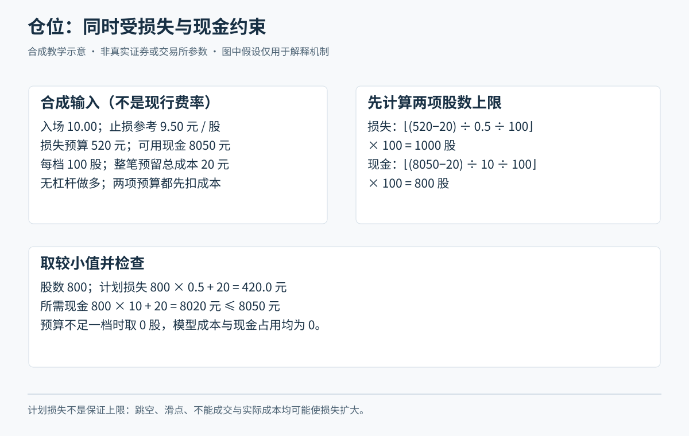

# M04 交收、费用与最早的风险预算

<!-- Tutor: Give all assumptions for position size. Do not give the planned loss as a maximum loss for all conditions. -->

先用 M03 确认实际成交，再计算持仓和风险。小林、青禾制造及全部价格、费用、风险额度均为虚构教学案例；本课的定额费用不是市场收费表，仓位比例也不是个人推荐。只计算无借款现金账户的买入持仓。

## U01 交收与可用状态

### P01 T 日是交易日，不是随便一个自然日

**交易日 T**指发生交易的那个市场交易日；T+1 是它之后的下一个交易日，节假日、公告休市日不按自然日顺推。**清算**核算应收应付，**交收**履行证券和资金交付，**可卖**与**可取**则是面向账户操作的状态。把这些都简称“T+1”，容易误以为股份、资金、银行到账同时完成。

对本课普通 A 股，今天新买入的股份通常不能今天再卖出。[深交所 2026 交易规则第 3.1.4—3.1.5 条](https://docs.static.szse.cn/www/lawrules/rule/trade/current/W020260424690713155663.pdf)规定交收前卖出的限制与当日回转品种范围；普通股票不能因“我只做很短的交易”获得豁免。此处教可卖限制，不据此断言所有交收步骤、所有产品都在同一时点完成。

虚构例：小林周五买青禾 100 股；假设下周一至周三都休市，下一交易日为周四。不能把周六写成可卖日，更不能因软件已显示持仓，就在周五卖出这批新买股份。若账户原先已有可卖的 100 股，今天再买 100 股，可能有原有份额可卖；这不是新买份额自动变成可回转。

限制影响风险：当日买入后价格转弱，即使小林想马上退出，也可能因可卖数量不足而不能执行。风险预算从买入前开始，不能把“到价就卖”作为万能保护。

**随口确认：**周五买入，周末与随后三个工作日均休市，T+1 指哪一天？看见持仓数量是否就能确认全部可卖？

### P02 可用资金不一定能转回银行

**可用资金**通常是当前允许用于相应交易的资金；**可取资金**是允许转出的资金。二者可能不同，且具体显示还受冻结、在途业务和券商处理影响。已经卖股，不等于全部款项立刻可银证转出。[河南证监局案例说明](https://www.csrc.gov.cn/henan/c104267/c2053710/content.shtml)介绍沪深 A 股卖出后 T+1 方可取款的通常资金交收安排；该资料是 2021 年案例解释，不能用于保证 2026 年每家券商的具体可取时点。

虚构时间线：小林 T 日卖出原有可卖青禾，净得 1990 元，模拟账户显示该款当日可用于合规买入，但不列入可取；下一交易日完成相关处理后才可能进入可取。若他当日又买股占用了这笔钱，次日也不会凭空多出 1990 元可取。他还应核对银行转账服务时段，而非只看证券市场是否开市。

这段适用于安排支出与对账，不是教精确交收后台时钟。ETF 二级市场买卖与申赎、可转债交易与转股、A 股卖出与银行转出是不同业务，不能把“可当日卖”简化成“可当日提现”。**具体未核实项：**当前券商银证转账时段、节假日服务、各类基金申赎款及可转债转股的可用日期，本课未逐一查证，不给统一时点。

**随口确认：**小林看到 1990 元可用，却需今晚付学费，为什么不能直接把它列为今晚确定能支付的现金？

## U02 费用与净回报

### P01 成本不只是一项佣金

**佣金**是经纪服务收费；交易还可能涉及经手费、监管费、过户费及适用税费等。有的费用已包含在券商所报佣金口径里，再加一遍会重复计算；有的有方向、最低收费或产品差异，不能只比较一个“万几”。**滑点**则来自计划价与执行价的偏差，不一定在交割单上单列，但会改变实际结果。

虚构账单：买入青禾股款 1000 元、买入费用合计 5 元；卖出股款 1020 元、卖出费用合计 7 元。先核实两项“合计”已覆盖本例所有交易税费，净盈利才是 1020－1000－5－7＝8 元。若再把已含在 7 元里的某项加一次，就会少算；若漏掉它，则多算。

真实收费不能从这个定额例推导。关于证券交易印花税，[财政部、税务总局 2023 年第 39 号公告](https://fgk.chinatax.gov.cn/zcfgk/c102416/c5211343/content.html)明确自 2023-08-28 起减半征收；本段只引用这一政策事实，不以它单独推导完整现行税率、征收方向、股息税或基金税务规则。**具体未核实项：**小林实际券商佣金是否含规费、有无最低收费、按委托还是成交计费、各产品税费与舍入方式，均须按当前协议和交割记录补齐。课程案例仍可用显式虚构费用学会核算。

**随口确认：**“我的佣金已含规费”，与“佣金外另收规费”，为何不能用同一张简单加法表？

### P02 一笔赚钱交易，要说清分子与分母

接着上一段账单，**毛收益**在这里指未扣交易成本的买卖价差；**净收益**扣除成本并计入实际分配等现金流。**收益率**还需明确用什么投入作分母、跨多长时间。对一笔没有中途加减仓的简单交易，本课用买入股款加买入费用作分母；不能把这种单笔口径直接套给有资金进出的整个账户。

虚构例：买入 100 股，每股 10 元，买费 5 元；以后卖出价为 10.20 元，卖费 7 元，没有分红。毛收益 20 元，净收益 8 元，投入 1005 元，净收益率约 0.796%。若以 10.10 元卖出，价差仍赚 10 元，净结果却是 1010－1000－12＝亏 2 元。股价方向正确不等于交易赚钱。

在本例“总费用恒为 12 元”的虚构假设下，卖出价需超过 10.12 元，净结果才转正；真实费用随金额和计费结构变化时，这个保本价也要重新算。频繁交易会多次发生成本，不能把几笔小幅毛利直接相加当成策略优势。

若交易期间收到分红，加入实际税后现金；若还持有股票，剩余市值是估值而非确定可变现现金。不同天数的收益率也不能直接称为相同效率，尤其不能把一天偶然盈利机械复利成全年保证。

**随口确认：**10 元买、10.10 元卖，为什么本例仍可能亏钱？换成更高收费时，保本价应往哪个方向变？

## U03 计划亏损与仓位

### P01 先定能承担的损失，再倒算股数

**仓位**是持仓投入或市值相对账户资产的比例；**计划亏损**是在明确退出价、成交和成本假设下预估的损失。**风险预算**是事前愿意用于这类损失的额度，须服从 M02 的资金用途与承受能力。它不是“跌这么多市场必须让我退出”的合同。

虚构算例：小林纸面账户资产 10000 元，自己设定单笔预算 200 元、该持仓最多动用 3500 元。计划 10 元买、9.50 元退出，预留整笔买卖及滑点合计 20 元，其中买入费用假设 10 元；采用主板 100 股递增。先只看损失预算：股数不超过 (200－20)÷0.50＝360 股，向下取合法数量为 300 股。计划损失为 300×0.50＋20＝170 元；400 股则为 220 元，超预算。再核现金：300×10＋10＝3010 元，小于 3500 元，现金约束也通过。

这里向下取整是为了不超边界，不能四舍五入到 400 股。若合法最小数量也超预算，结论是减少风险暴露或放弃这笔，不能为凑数量扩大预算。退出价格必须来自事前规则与失效条件，不能单为买更多股把退出价挤近。价格距离越小算出的数量越大，也意味着更依赖退出执行，不能忽略跳空。

**随口确认：**360 股向上凑成 400 股会违反哪项约束？若预算只有 40 元，本例一组 100 股已需 70 元计划损失，你会怎样决定？

### P02 计划亏 170 元，不代表最多亏 170 元

**实现亏损**是实际执行和现金流最终形成的亏损。退出触发是“应当采取什么行动”的条件，成交则需要满足市场规则和对手条件。普通 A 股当日新买不可当日卖、隔夜跳空、停牌、跌停排队、部分成交，都可能让实际退出价偏离计划。止损意愿不能消除这些机制。

延续虚构案例：小林持 300 股，10 元买，计划 9.50 元退出，预留成本 20 元。若隔夜只能在 9 元成交，实际按本例固定成本算亏损 300×1＋20＝320 元，已超过 200 元预算。若 9 元也无法卖出，320 元只是一个压力情景，并不是新的保证上限。**压力情景**是预先假设不利变化，看看能否承受；它不等于预测一定会发生。

小林应在入场前问：若暂时完全卖不掉，持仓和现金需求还能承受吗？若答案是否，就该减少数量或不做，而不是在风险表上写一个更漂亮的止损百分比。若 300 股只卖出 100 股，已实现部分损失和余下 200 股的市场风险仍须分别记录，不能宣布“止损完成”。

本段说明的是执行失效风险，不声称任何固定缓冲足以覆盖所有极端情形。本课无杠杆假设下，最坏还应考虑投入股款损失殆尽；若加入借款，债务风险需另行分析。

**随口确认：**小林按规则及时报了卖单却没成交，能否把计划亏损记成最终亏损？还需要记录什么未知项？

## U04 总暴露与集中风险

### P01 两笔各自合格，组合仍可能过重

**总暴露**在本课无杠杆多头情境中，先用各持仓当前市值合计表示；**集中度**看资金是否聚集在单一股票、行业或共同风险上。**相关性**描述不同资产变化相互联系的程度，不保证历史关系在压力下保持。个股名字不同，并不意味着风险原因不同。

虚构例：账户当前资产 10000 元，青禾持仓市值 3000 元，另一家虚构制造企业市值 3000 元，现金 4000 元。总股票暴露为 60%，其中两笔都受同一原料价格冲击。若假设两笔同时下跌 20%，持仓合计减少 1200 元，忽略费用账户损失 12%。不能说“每只都只配 30%，所以账户最多跌 6%”。这里的 20%是跨一段压力情景的假设，不是某板块日涨跌幅规则。

再看预算：两笔各预留 170 元计划亏损，合计 340 元；这已超过“整组交易最多愿意计划损失 300 元”的虚构组合预算。单笔通过并不能替代组合检查，更不能用不同退出价证明两笔不会同时失败。

**随口确认：**两只股票属于同一行业，为什么不一定比一只股票分散得多？把其中一只换成同业 ETF，会自动消除共同风险吗？

### P02 用一张风险账决定买、减或不做

把前三个单元连起来，风险账至少区分现金、持仓市值、可卖数量、单笔计划亏损、组合计划亏损和压力情景。**未成交委托**还不是持仓，但一旦成交就会占用资金、增加暴露，所以不能在组合预算中假装不存在。**挂单风险**是这些指令可能同时成交带来的未来占用。

虚构完整决定：小林已有上述两笔合计 6000 元股票，又挂着青禾 200 股、限价 10 元的新增买单。若再成交，忽略短时价格变动，暴露将由 60%升到约 80%。他先前设定组合股票投入不超 60%，因此应处理新增委托，而不能说“当前持仓还没超”。若申请撤单，要等 M03 的撤单确认；若已成交，就按实际持仓重新计算，并选择符合退出与可卖条件的调整动作。

反例是看账户当天涨了便临时提高预算，让所有冲动买入都显得合规。预算调整可以研究，但要记录时间、依据和新版本，不能反向覆盖当时违规。风险账的作用是约束行动和揭示未知，不是制造一张保证不亏的表。

**随口确认：**你只有在“挂单全成交”的情况下才超预算，是否可以等成交后再想？换成两笔通过不同入口提交的委托，小林还应检查哪些剩余有效指令？这些是课堂迁移问题，独立阶段练习另行进行。
