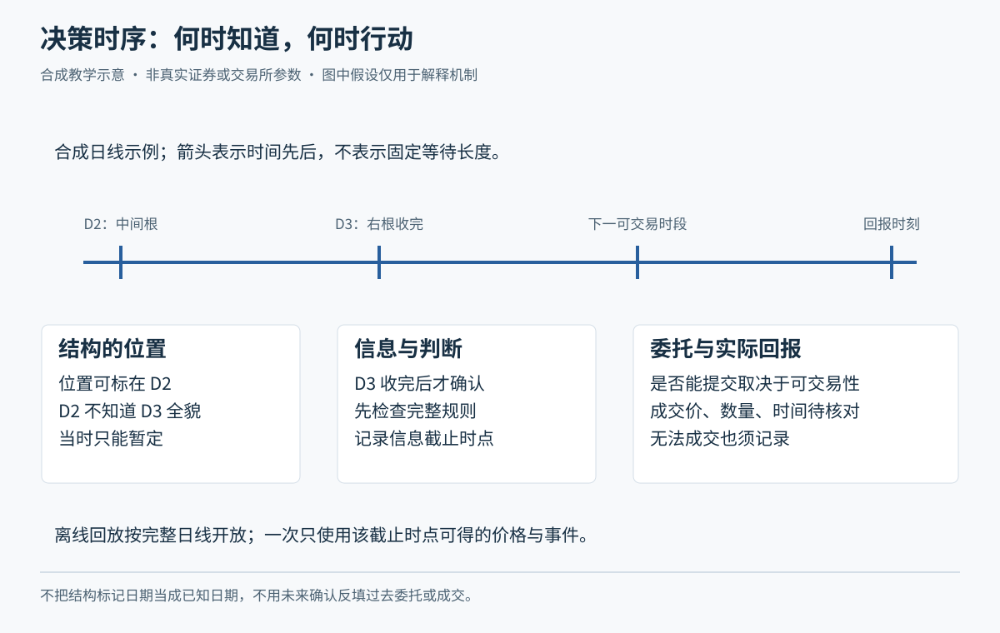

# M05 从公开信息走到候选观察表

<!-- Tutor: Keep disclosure facts, possible explanations of these facts, valuation assumptions, and trade triggers as different items. Do not give the watchlist as a list of purchase recommendations. -->

承接 M01 的公司与价格、M04 的费用与风险，本模块教小林选择“值得继续研究什么”。青禾制造、对照企业、报表、公告时间、价格、筛选阈值和政策情境全部虚构，不对应真实代码或历史。引源规则另行注明；资料核对日为 2026-10-20。这里的选股示范不是完整交易策略，入场触发及其效果仍需后续课程验证。

## U01 报表、价值与价格

### P01 用三个问题把财务报表串起来

**资产负债表**像某一天的照片，说明公司有哪些资源、承担哪些负债、剩下多少股东权益；**利润表**记录一段期间的收入、成本费用与利润；**现金流量表**记录同一期间的现金流入流出，并区分经营、投资、筹资活动。三者分别帮助回答“家底怎样、经营结果怎样、钱怎样流动”。财务含义可参照[江西证监局财务报表投教](https://www.csrc.gov.cn/jiangxi/c105770/c4812964/content.shtml?channelid=b853ca781c7149ee8d86c935087662f1)，其旧版发行披露门槛不作为本课当前规则。

虚构例：青禾期末资产 1000 万元、负债 600 万元，账面权益为 400 万元。本期收入 800 万元、净利润 60 万元，但经营现金流净额为负 20 万元，应收账款明显增加。**应收账款**是已形成、尚待客户支付的款项。这些数字并不矛盾：确认销售和收到现金可能不同步。小林应读附注中的回款、客户及减值信息，不能只看“利润为正”就认定现金充裕。

现金流暂负也不是自动判坏公司，可能来自增长期备货、回款季节性等；必须与业务、前期及同业可比情况核对。借款流入虽增加现金，却属于筹资，不能冒充卖产品挣来的钱。**附注**是解释报表口径和重要项目的文字；**审计意见**是审计机构按其工作范围对财务报表发表的专业意见，不保证企业未来盈利或股价不跌。应读具体意见与相关事项，不能只看“有审计”。

**随口确认：**青禾净利润 60 万元、经营现金净流出 20 万元，为什么不能简单判定其中一个数字必假？小林下一步应查什么？

### P02 价格是已成交事实，价值判断依赖假设

**估值**是根据盈利、资产、现金流与风险等，讨论合理支付价格的过程；**价值判断**通常是带假设的范围，不能当成交易所承诺。**每股收益**可帮助把利润分摊到股份，现实中要读基本、稀释等口径；**市盈率**是股价相对每股收益的倍数。先弄清分母，再比较倍数，不能把一个低数字直接译成“便宜”。

虚构简化例：青禾归属普通股的利润为 100 万元，假设期内普通股一直为 100 万股，忽略复杂权益安排，每股收益为 1 元。股价 10 元，对应市盈率 10 倍。小林若认为未来可持续每股收益只有 0.50 元，同一个 10 元价格相当于其假设盈利的 20 倍。若利润中有一笔不能持续的资产出售收益，也要分开看，不能把它年年重复。

反例：另一家公司股价只有 2 元，不一定比 10 元青禾便宜；两者股数、负债、业务和持续盈利都可能不同。亏损公司的市盈率也不宜按普通正盈利倍数排序。**扣除非经常性损益后的利润**帮助区分部分非日常、偶发项目，但并不是毫无判断空间的“真实利润”，仍需看构成与会计口径。

小林可以列“盈利维持、改善、恶化”三种假设，算不同承受价格和风险，再承认尚未验证。这样的价值分析能支持研究，却不能直接提供明天的成交价，也不能免除 M04 的仓位和退出检查。

**随口确认：**股价不变、可持续盈利估计减半，股票是否自动更便宜？如果仅知道股价 2 元，你还缺什么？

## U02 公告与信息时点

### P01 从消息标题回到可核对的原文

**信息披露**是上市公司等义务人依法向市场公开相关信息。**定期报告**按报告期间集中介绍经营、财务等情况；**临时公告**围绕重大事件、决策和进展等及时披露。“临时”不是不重要，“公告过”也不表示事件已经完成。当前基本制度参照[证监会第 226 号令《上市公司信息披露管理办法》](https://www.csrc.gov.cn/csrc/c101953/c7547359/content.shtml)，自 2025-07-01 施行；本课不使用旧版 182 号令替代当前文本。

虚构例：社交平台标题为“青禾拿下大客户”。小林找到公司正式公告，发现正文是“签署意向协议，金额待后续订单确定，履行存在不确定性”。**意向协议**表达合作意愿，其具体约束和执行条件仍需看文本；不能把标题里的大客户直接记成已确认收入。他在观察表写：已披露的事实是签署意向，解释是潜在需求改善，未知项是正式订单、金额、交付及收款。

阅读顺序可以是核对公司身份与发布时间，读全文及附件，再看生效条件、风险提示和后续进展。研究报告是分析者的判断；媒体报道可能压缩条件；未经核实的聊天是线索。这些不同来源不能平铺成同等证据。即使原文真实，也须检查是否更正、补充或已经过时；依法暂缓、豁免等也有专门条件，不能因没找到公告就断言绝无风险。

**随口确认：**“签署意向”与“已经收到全部货款”中间，至少还缺哪两步？你会把哪一句写进事实栏？

### P02 报告期末，不是你能够知道它的时间

**报告期间**是数据描述的经营时间；**公开时间**是市场能获取信息的时间；**决策截止时点**是本次判断允许使用信息的最后时刻。三者必须分开。回放时使用后来才披露的信息去作先前决定，称为**前视偏差**，会让一套本来做不到的选择显得轻松正确。

虚构时间线：青禾报告描述截至 6 月 30 日的经营，假设直到 8 月某个交易日 D 的 20:00 才公开。小林复盘 D 日 14:00 的决定时，不能因表格列着“6 月 30 日”，就使用报告中当时尚未公开的客户回款数据。到 D 日 20:30 阅读全文后，才可据此更新判断；若要用收盘确认条件下单，还需接上 M02 的下一可执行时点。

更正公告也要保留版本：原文当时说了什么，何时更正，小林何时看到，分别记录。事后更正可以改进今天的理解，却不能抹去过去决策面临的未知。如果公开资料不能精确定位发布时间，回放应标明可用时点未核实，采用明确保守截止或不作该次判断；不要伪造精确到分钟的可知性。

**随口确认：**报告写的是上半年，为什么 D 日下午仍不能用晚上公布的数字？如果翌日又有更正，原决策记录应重写成“早已知道”吗？

## U03 公司行动、发行与退出市场

### P01 分红、送转与配股：要把权利和财富一起算

**股权登记日**用于依公告与登记结果确定相应权益归属；**除息**调整现金分红后的价格比较基准，**除权**涉及送转、配股等股本权益变化后的基准调整。参考价不是下一笔保证成交价。拿除息前价格与除息后价格直接相减，容易把分配误认作额外赚钱，或把机械调整误认作市场崩跌。基本机制见[深交所 2026 交易规则第 4.4 节](https://docs.static.szse.cn/www/lawrules/rule/trade/current/W020260424690713155663.pdf)。

虚构演算：小林持有 100 股、每股 10 元，假设每股派现金 0.20 元且无其他权益变化，先忽略税费和市场波动。简化除息参考价为 9.80 元，股份参考市值 980 元，加应得现金 20 元仍是 1000 元；现金何时到账还要看公告。若实际市场价跌到 9.50 元，合计为 950＋20＝970 元，仍亏 30 元。股息不是脱离价格和税费的免费收益。

再假设每 10 股转增 10 股，100 股变 200 股，对应简化价格从 10 元变 5 元，不能因股数翻倍说财富翻倍。**配股**则通常需要符合条件的股东依安排另付认购款，不是无偿送股；是否参与、费用和未参与的影响都要读方案。回购、增发、并购、限售股解禁也各有不同机制：解禁是转让限制变化，不表示持有人已经卖出；回购方案不是已实施数量。

**随口确认：**100 股参考市值从 1000 元变成 980 元，却多了 20 元应得分红，能直接说赚了 20 元吗？若是配股，还要把哪笔现金加入计算？

### P02 IPO、风险警示与退市不是一条保本阶梯

IPO 申购、上市交易和解禁是不同事件。研究新股至少应从正式发行、上市公告提取所属市场、发行与上市日期、价格、申购资格、缴款条件、可交易数量及限售安排；不能把沪深申购条件套给北交所，更不能把中签或获配当成确定盈利。M01 未核实的具体申购门槛与缴款天数在这里仍未补齐，不提供操作日历。

**ST**通常标识其他风险警示，**\*ST**通常标识退市风险警示；它们不是低价买入标签，也不证明一定会或一定不会退市。**退市**是证券退出该交易所上市交易，和公司立即清算不是同一件事。退市整理只是特定情形的交易安排，不能假设所有退市都留有同样卖出窗口。概念与不同路径可参照[上交所风险警示板说明](https://www.sse.com.cn/disclosure/listedinfo/riskplate/)及[科创板退市与风险警示披露指南（2025 年 8 月修订）](https://www.sse.com.cn/lawandrules/guide/stock/kcbxxpljg/c/c_20250826_10789723.shtml)。后者适用于科创板，不能据此推导所有板块的具体期限与财务阈值。

虚构决定：青禾若公告被实施风险警示，小林先找具体原因和生效安排，核对本案例规则，不因“已经跌很多”自动补仓。即便以后撤销警示，价格也不保证回到原买价。若出现终止上市决定，他不能在表上写“等最后一天必能卖出”，而要核对是否有整理期、实际可卖及成交结果。

**具体未核实项：**各板块最新财务、交易、规范、重大违法退市触发阈值，以及本只证券风险警示和整理期起止；本课不提供一套通用数字。沪深主板风险警示股票涨跌幅旧知识还需按 [M03 规则表](module-03.md#u04-p01)更新，名称前缀不能替代完整规则核验。

**随口确认：**低价、ST、即将解禁，分别说明什么？其中哪一个足以证明“明天必反弹”或“明天必有人卖”？

## U04 候选池与观察名单

### P01 用能解释的筛选条件缩小研究范围

**候选池**是按事先边界留下的一组研究对象；**观察名单**是在候选池中进一步记录事实、未知项和观察条件的对象。筛选是减少不适用对象，不是证明剩下的都会涨。先确定产品和权限、信息能否获得、交易是否活跃、有无无法理解的重大事件，再讨论经营与价格；市场、行业和自身已有持仓也影响选择。

以下重置为一个独立虚构场景：小林现金账户资产 10000 元、暂无持仓，只在晚间观察；本次仅研究假设沪深主板普通股。教学筛选政策为：排除当前风险警示、停牌与未来三个交易日内已知重大未决事项；过去 20 个已完成交易日日成交金额中位数至少 1000 万元；最近一期公开报告及重要公告可取得。**中位数**是排序后居中的数，减少个别异常大成交日对典型水平的掩盖。以上阈值全是本次虚构政策，并非交易所要求或经验证的赚钱参数。

| 虚构对象 | 截止时点已知信息 | 处理与原因 |
| --- | --- | --- |
| 青禾制造 | 普通交易状态；成交金额中位数 2000 万元；报告可读；回款变慢需解释；未见符合本例排除条件的已知事件 | 留在候选池，继续读回款附注 |
| 对照企业甲 | 普通状态；成交金额中位数 300 万元；报告可读 | 按预设流动性门槛排除，不因图形漂亮临时放宽 |
| 对照企业乙 | 成交金额中位数 4000 万元；当前风险警示 | 按本例状态政策排除，不用低估值抵销硬条件 |

青禾拟交易 3000 元，仅占其假设典型日成交额的 0.015%，但这不能证明下单那一刻有足够对手；跌停、盘口薄弱或突发事件仍可妨碍退出。若三家都因同一制造业需求下滑受压，留下青禾也不能假装已经分散风险。

**随口确认：**甲随后大涨，是否足以证明该为它事后放宽门槛？如果所有对象都被排除，小林是否必须选一只？

### P02 把青禾写成可复查的观察决定

观察表的作用是保留当时依据，避免把“值得研究”悄悄改成“必须买”。至少写产品与板块、截止时点、原始来源、筛选结果、支持证据、反证、未知项、拟观察条件及下次复查时间。**反证**是可能削弱原判断的事实，不能只摘支持自己的句子。

完整虚构示范：截止 D 日 20:30，青禾暂设为沪市主板普通股，已读公告与最近报告；收入增长，经营现金净流出，应收账款增加。小林记录“需求可能改善，但回款恶化尚未解释”，下一步查客户账龄及后续进展，行业背景暂按假设需求走弱处理。未找到解释前，仅列观察，不提交委托。来源无法打开时保留“待核”，不凭记忆补成事实。

他同时预演 M04 的风险算术：假设将来有独立入场条件，按 10 元入、9.50 元计划退、总成本预留 20 元、预算 200 元和单笔现金上限 3500 元，可考虑的上界为 300 股，计划损失 170 元；若只能在 9 元退出，则亏 320 元。这里的价格只是条件演算，不是现在已有买点。若后续真实可成交入价变为 10.30 元而退出假设仍为 9.50 元，300 股计划损失变成 260 元，应重算，不能沿用旧数量。

小林的最后一行写“等待回款解释与完整触发规则，复查后再决定”。若新公告改变风险，就更新观察表并保留旧版本；若股票随后上涨，也不能倒填当时已经知道的信息。这才把财务、信息时点、交易与风险连成可复查的选择过程。

**随口确认：**观察表里有经营亮点、也算过股数，为什么仍可能决定不买？换成报价已变、报告已更正的情境，你会先更新哪两个字段？本模块这些问题是随堂理解检查，未辅助的阶段任务由独立练习材料提供。
