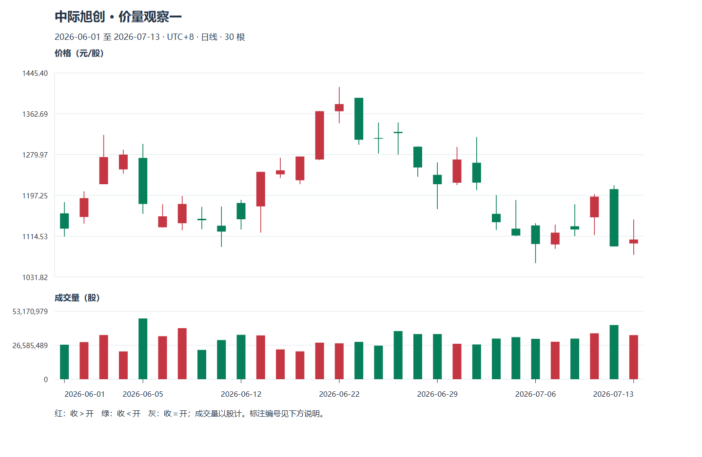

# M06 看懂行情：数字各自在回答什么

先备知识：[M03 委托与成交](module-03.md)、[M05 公司与候选名单](module-05.md)。本模块帮助你从行情中分清成交事实、待成交意愿和计算指标，再决定还缺什么信息。

**案例声明：**小林和普通股票“青禾制造”均为虚构，无真实代码或历史。本页所有价格、股本、成交、指数表现和观察时点都是合成教学数据。除明确注明的一手规则外，指标算法为本课声明的口径，不代表所有软件默认值。资料核查日：2026-10-20。

Tutor: Give the lesson for one part with its location identifier at a time. Show the quote units and observation cutoffs.

The learning checks that follow are guided discussions. They are not stage assessments.

After each learning check, wait for the raw response. Then, give feedback.

## U01 报价字段与市值

<a id="u01-p01"></a>
### P01 最新价、涨幅与振幅：先认清比较的起点

行情页像一张不断更新的记录单。“最新价”是最近一笔已成交的价格；它说明刚才有人在这里成交，不承诺你的下一笔也能在这里成交。“昨收”通常提供日涨跌的比较起点；开盘价是当日开盘价格，最高、最低记录截至观察时已经出现的成交边界。它们不是对剩余交易时间的预测。上交所连续竞价行情所列的最新价、前收盘价、累计量额等字段，可对照[交易规则第 5.2.2 条](https://www.sse.com.cn/lawandrules/sselawsrules2025/trade/universal/c/c_20260424_10816492.shtml)。

虚构的普通交易日里，青禾昨收 10.00 元，开盘 9.90 元，10:30 最新价 10.20 元，截至此时最高 10.30、最低 9.80。涨跌额为 0.20 元，涨幅是 `0.20÷10.00=2%`。本课用“最高减最低，再除以前收盘比较基准”表示行情振幅，此时为 `0.50÷10.00=5%`。涨幅回答“相对起点到了哪里”，振幅回答“已经覆盖多宽的价格范围”，两者不能互换。

小林看到“涨幅 2%”，还不能说自己赚了 2%：若他在 10.25 元买入，账面价格收益反而为负。除权除息日的比较基准还可能调整，见 [M07-U04](module-07.md#u04-p01)。迁移到另一只股票时，应先确认币种、时间戳、是否延迟及比较基准。

**随口检查：**若此后最新价回到 10.00，今天的振幅会自动回到零吗？

<a id="u01-p02"></a>
### P02 股价、市值与估值：一股便宜不等于整家公司便宜

股价是一股的成交价格；市值把价格乘上所对应的股份数量，表示市场按这个价格给这些股份标出的合计价值。青禾价格 10 元、总股本 2 亿股，则总市值为 20 亿元；若其中非限售股份为 1.2 亿股，按此口径的流通市值为 12 亿元。股本数量及其时点必须与价格配套，不能拿去年的股本配今天的价格。这些量与上交所[统计指标说明](https://www.sse.com.cn/aboutus/publication/monthly/explain/)中的价格、发行数量和流通数量概念相对应。

市值不是公司账户里的现金，也不是卖掉全部股份保证能收回的金额。最新价上涨 1%，不能推断恰好有市值的 1%“流入”；少量边际成交也可能改变报价。总市值较小也不自动意味着未来上涨空间较大，公司资产、负债、盈利与可交易性仍需分别看。

连接 M05 的财务知识，市盈率是价格与每股收益的比值；虚构每股年度收益 0.50 元，对应 `10÷0.50=20 倍`。它不是“保证二十年回本”，因为利润会变化，也不一定全部分给股东。市净率是价格除以每股净资产，若净资产 4 元，则为 2.5 倍。负盈利时把负市盈率排成“更便宜”通常没有可比意义。TTM 指最近滚动十二个月；静态、滚动、预测盈利的来源和时间不同，不能只比较屏幕上的倍数。

**随口检查：**另一家股票每股 5 元、股本 10 亿股，比 10 元的青禾整体便宜吗？

## U02 成交量、换手率与量比

<a id="u02-p01"></a>
### P01 量与额：成交有多活跃，先把单位对齐

成交量是一定期间内成交的股份数量；成交额是这些交易的价格乘数量后相加。同一笔交易有买方也有卖方，本课成交量按成交股份记一次，不把双方各加一遍。青禾两笔交易分别为 10 元成交 1,000 股、10.20 元成交 500 股，则总量 1,500 股，总额 `10×1,000+10.20×500=15,100 元`。这与“挂了多少买单”是不同的问题，未成交申报不计入成交量。

换手率把成交数量与一个股份基数比较。本课单股案例采用“期间成交股数÷当时流通股数”；若全天成交 600 万股、流通股 1.2 亿股，换手率为 5%。它不表示恰有 5% 的独立股东换人，股份可以在不同持有人之间连续转让，统计本身也不识别持有人意图。

**口径边界：**这不是所有“换手率”的统一公式。上交所[统计指标说明](https://www.sse.com.cn/aboutus/publication/monthly/explain/)另列总股本和总市值口径；统计报表与行情软件可能采用不同分母。比较之前记录“流通股、本课口径”比只抄一个百分数有用。

软件若显示“手”，先查它如何折算为股；本课若注明 1 手按 100 股显示，只是显示口径，不能顺势推出所有板块的申报数量规则。还要区分截至 10:30 的累计量与某一分钟的区间量，累计量不能逐栏再相加。

**随口检查：**两股同成交 600 万股，另一股流通股只有 3,000 万股，活跃程度相同吗？

<a id="u02-p02"></a>
### P02 量比与分时均价：和谁比，比到什么时刻

“放量”必须有比较对象。为便于理解，本课把量比定义为：截至当前的每分钟平均成交量，除以前五个完整交易日的每分钟平均成交量；只计交易分钟，午间不算。虚构青禾前五日平均每分钟 2 万股，今天已过 60 个交易分钟、成交 180 万股，则当前平均每分钟 3 万股，量比为 1.5。这只是活跃程度比值，不能推出上涨概率。真实软件的取样、停牌处理、竞价量是否计入可能不同，**这些供应商参数本课未核实**。

分时图横轴是日内时间，价格线按软件取样显示成交价格；它帮助小林观察“早盘涨过、后来退回”这样的顺序，但未必保留每一笔成交。均价线在本课采用截至该时点的成交额除以成交股数，也叫成交量加权均价。另取两笔虚构成交：10 元成交 1,000 股，10.20 元成交 500 股，总均价为 `15,100÷1,500≈10.067 元`，而两个价格简单平均是 10.10 元。成交更多的价格权重更大，均价不是两条报价的中点。

最新价 10.20 高于均价，只说明它高于这个成交加权参照，不证明多数持有人已盈利，更不证明后面必涨。开盘短时间的高量比也不能直接外推全天。不同日期比较分时成交，最好同时看“相同交易时刻的累计量”，避免拿半天和全天比。

**随口检查：**一张图在 10:00 截图，另一张在 14:00 截图，后者累计量更大就叫放量吗？

## U03 盘口与成交明细

<a id="u03-p01"></a>
### P01 买一卖一：看到的是排队快照

盘口列出尚待成交的申报。“买一”是当前最高买价，“卖一”是当前最低卖价；两者之差叫买卖价差。虚构快照中买一 10.00 元、2,000 股，卖一 10.02 元、300 股，卖二 10.03 元、500 股。小林想买 500 股，即使刚才最新成交价是 10.00，也不表示还能买到 500 股的 10.00 元筹码。若提交足以与卖方成交的申报，在快照完全未变的简化条件下，300 股和其余 200 股可能在不同价格成交。

档位后的数量称为该价位可见深度。深度大有时意味着小额交易不必走到远档位，但申报随时可能成交、撤销或新增；你看到、提交、交易主机处理之间也有时间差。限价 10.02 元只限制买入最高价格，不能保证足量成交。连接 M03，是否成交仍应读成交回报。[上交所规则第 5.2.2 条](https://www.sse.com.cn/lawandrules/sselawsrules2025/trade/universal/c/c_20260424_10816492.shtml)列明连续竞价基础行情包括最高五档买入和最低五档卖出申报；其他产品或付费行情的显示不可直接类推。

“委比”是软件用所选档位买卖申报数量作比较得到的指标。本课示意为 `(买量−卖量)÷(买量+卖量)`，不是成交概率。大买单也可以撤销，不能把挂单叫作“护盘承诺”。

**随口检查：**卖一仅 300 股，买入委托 500 股，屏幕曾出现 10.02 元，足以登记全部买成吗？

<a id="u03-p02"></a>
### P02 逐笔与“资金流”：成交事实之外还有分类假设

成交明细通常显示时间、价格和数量；具体是否逐笔、是否把多笔聚合，需要看数据说明。虚构记录为 10:00:01 成交 10.02 元 300 股，随后 10:00:02 成交 10.03 元 200 股。这能说明两条记录的先后及已成价格，不能仅凭这一屏证明小林的订单就是其中一笔。账户成交回报与公共行情承担不同用途。

“主动买入”通常是行情商对成交方向的分类：例如按成交是否打到卖方报价判断。它不是说买方有人、卖方无人；每笔成交依旧有交易双方。不同数据源可能按报价匹配或价格变化分类，红绿颜色也可能采用不同基准。**具体供应商对主动方向、大单阈值和“净流入”的算法，本课未核实。**因此看到“主力净流入”先问数据与分类规则，不能直接当作特定大投资者的身份记录。

反例是同样 10.02 元的成交：一位卖家可能为现金周转卖出，一位买家可能做长期配置，也可能另有对冲头寸。成交条带、分时线和 K 线都没有这些动机字段。即使单笔金额大，也不足以识别最终受益人或未来计划。小林更稳妥的记录是“此时成交增加、价格升到某处，原因未确认”。

**随口检查：**看到五笔连续红色成交，能写“某机构准备明天拉升”吗？

## U04 大盘、行业与个股

<a id="u04-p01"></a>
### P01 相对强弱：给同一个涨跌找到参照

指数把一组证券按既定方法合成参照；行业指数把观察范围缩到某类业务。它们帮助小林分清“青禾自己的变化”与“许多股票共同变化”，但指数不是市场所有股票的简单平均。加权方式不同，少数权重较大的成份证券可能影响整体读数；指数成份和行业分类也需要注明日期。

虚构同一交易日、同一价格收益口径下，大盘指数涨 1%，制造业参照涨 3%，青禾涨 2%。青禾跑赢大盘 1 个百分点，却落后行业 1 个百分点。百分点是两个百分数直接相减的单位；不能说青禾在所有参照下都强。若要算相对财富变化，则是 `1.02÷1.03−1≈−0.97%`，与相差 1 个百分点的问题稍有不同。

反例：大盘因某一大权重股上涨，指数收红，而多数股票收跌。仅凭“指数涨”推断每只股票环境相同，会漏掉分化。小林可记录观察名单内上涨家数和下跌家数，作为市场广度的局部描述，但自己的十只候选股也不能代表整个市场。若行业参照已到收盘、个股仍是盘中价，比较还会混入时点错误。

**随口检查：**青禾跌 1%、行业跌 4%，能说它“相对抗跌”吗？

<a id="u04-p02"></a>
### P02 把行情变成一张可核对的观察记录

现在将字段串起来。虚构 10:30 快照：青禾涨 2%，行业涨 3%；流通口径累计换手 1%；量比 1.5；最新价 10.20，均价 10.10，卖一只有 200 股。正确读法是：相对昨收上涨、暂落后行业、成交较本课量比基准活跃、最新价格位于当日加权均价之上、可见近档卖量有限。这些描述并不自动拼成“应买入”。

连接 M05，小林先查此前公告及候选名单限制；连接 M04，再核对现金、计划承受损失和订单规模。若策略尚未规定何时触发，他今天只观察并记录“未形成交易条件”；不能看见一组好看的数字才临时发明规则。若数据有延迟，或卖档很薄而计划订单很大，先把执行可行性列为缺口，也可以不交易。

可以按下面的次序口头复述，不需要编程：

```text
时点与数据口径 → 已发生的价格和量 → 市场/行业参照
                         ↓
                 事件、风险与执行限制 → 观察或按既定规则行动
```

反例是午后上涨后回看早盘截图，写“当时显然该买”。截图没有未来，合理的决策应当只依赖当时已知信息。M07 将把这些日内记录压缩成价格条，压缩会进一步丢失细节。

**随口检查：**换成“量比 0.7、股价上涨”的快照，你会先核对哪两件事？


## 补充旧图配套：行情数字与量价比较

正文青禾案例用于初次讲解；本节链接的三只真实股票是另一套历史材料，不能混作青禾制造。见[真实图谱](../chart-atlas.md)，建议本模块配合R07—R13、R23。先按日量、成交额和成交单位观察，再解释相对量与流动性；盘中量比必须使用可比时长。

教学顺序为原图观察、学员原答、逐层标注、后续验证和另一未见窗口。需要完整讲义时可连贯展开；日常教学仍只讲一个焦点。数据单位、复权、使用条件及尚未核验的公司行动，先读[数据口径](../chart-data.md)。横向行业和指数资料未包含在三只个股样本中，不伪造市场确认。


## 2026主案例实践

按最新学习偏好，优先使用中际旭创、寒武纪、中芯国际与天普股份的2026日线；先读[本期数据与公告](../data-2026.md)，再选[本模块对应主图](../tech-2026-atlas.md)。旧图只用于补充对照。已知权益事件跨日不直接当技术破位或下跌笔；

Tutor: Each time, load only the observation packet for this step. Only after you keep the raw response, open the annotation for the question. During the explanation, show the initial image for this question in the chat. Then, add markings one layer at a time. Do not give only text and links.


### 先看本期原图



本图是观察阶段的真实日线。

Tutor: For this step, select only one question for this stage. Keep the other questions for subsequent steps. After the learner sees an explanation or annotation, do not give the same window an `independent` assessment status. Do not record the window as material without previous access.

### 原答之后：把数字对应回图上

保留当前原图和自己的回答后，再用[专题细图](../topic-plates.md)打开同编号的一张教师图。实体与影线看局部放大，量价看此前20根比较窗口与均量，边界题看冻结锚点和当时收盘；

Tutor: Give only the relation for this step at a time.

看过的窗口记为有辅助学习，另到[未见回放](../holdout-replay.md)选择合格的新任务。

本节2024补充图统一作有辅助示范，不计独立识别；未见迁移另走[保留回放](../holdout-replay.md)并先核对暴露历史。
