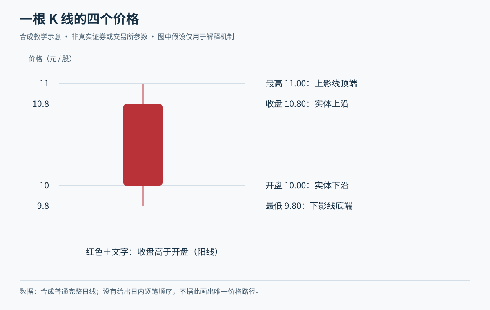
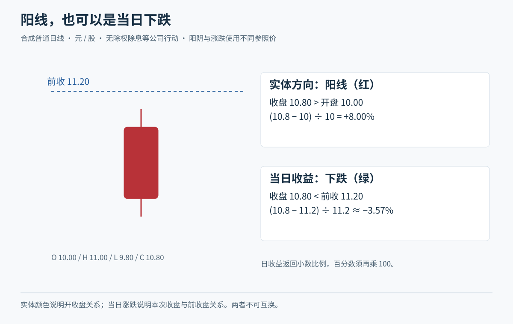
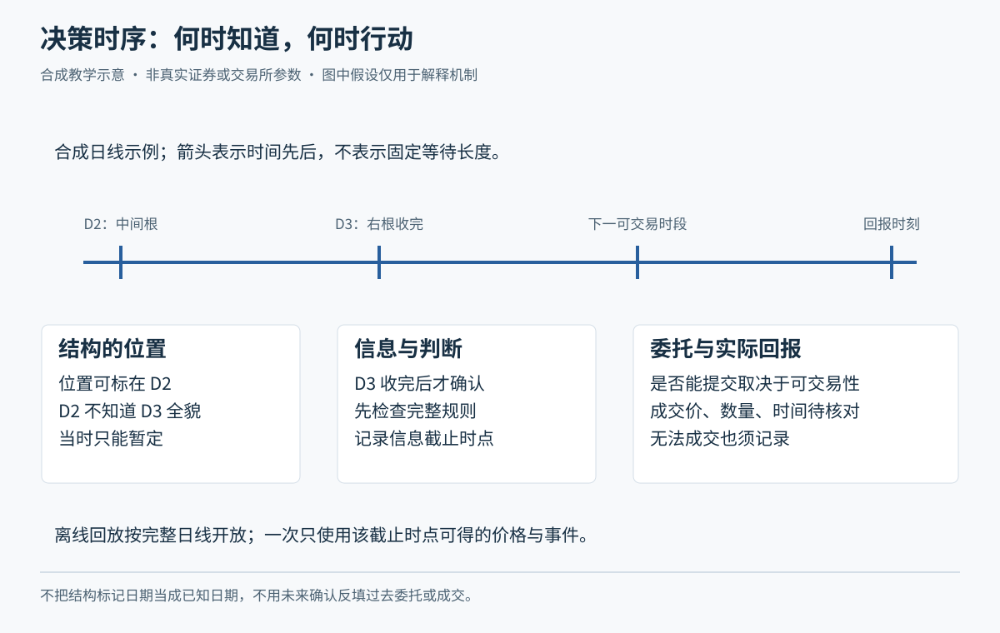
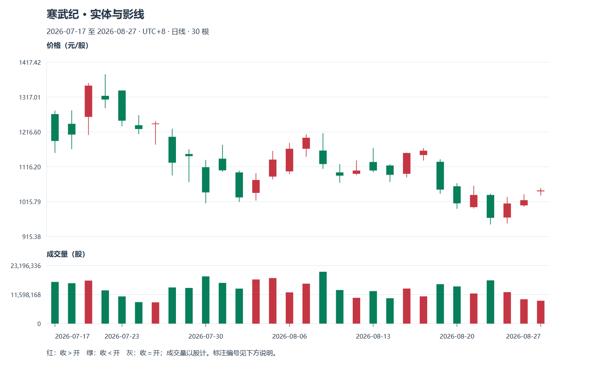

# M07 从四个价格读懂 K 线与收益

先备知识：[M06 行情字段](module-06.md)。目标是准确读出价格条，分清图形方向、账户收益与复权口径，避免把图上后来才知道的东西带回过去。

**案例声明：**小林和青禾制造均为虚构；本页所有价格、持仓、费用和分红安排都是合成算例，不是真实历史或现行税费。日内时刻均为示意的北京时间。资料核查日：2026-10-20。

Tutor: Use ordinary OHLC candles. Do not use a bar to get the intrabar sequence or investor intent.

Each learning check has aid. It is not a stage exercise.

After each learning check, wait for the raw response. Then, give feedback.

## U01 开高低收、实体与影线

<a id="u01-p01"></a>
### P01 四个价格怎样组成一根蜡烛

K 线也叫蜡烛图，是把某一期间的成交价格压缩为四个数：O 是开盘价，H 是最高价，L 是最低价，C 是收盘价，合称 OHLC。实体画在开盘与收盘之间；上影线从实体较高一端延伸到最高价，下影线从实体较低一端延伸到最低价。它适合快速比较许多期间的范围与首尾变化，而不是还原所有成交。可参照图表服务商的[蜡烛图定义说明](https://chartschool.stockcharts.com/table-of-contents/chart-analysis/candlestick-charts/introduction-to-candlesticks)，本课不采用其图形叙事作为盈利证据。

虚构青禾某日 O=10.00、H=10.50、L=9.80、C=10.30 元。实体长 `|10.30−10.00|=0.30` 元；上影线长 `10.50−10.30=0.20` 元，下影线长 `10.00−9.80=0.20` 元。全幅为 0.70 元，实体与两段影线相加恰好也是 0.70 元。小林先算这四个长度，再谈形状，就不容易被图的纵轴缩放误导。

下图另用第二组数值 O=10.00、H=11.00、L=9.80、C=10.80，展示同一种几何关系，并非上面算例的配图数值。图中实体为 0.80 元，上影线为 0.20 元，下影线为 0.20 元，全幅为 1.20 元。比较时应各用各的四价，不能混算。



数据必须满足 `L≤O、C≤H`，同时 O 与 C 都应落在 L、H 之间。例如 H=10.20、C=10.30 是不合法的同一期间普通 OHLC。O=C 时实体退化为一条线，不代表期间没有波动；H=L 时才表示记录中的全部成交价格相同。没有成交的区间如何显示，需要查行情软件，不能把补画的平线当作真实成交。

**随口检查：**回到第一组 O=10.00、H=10.50、L=9.80、C=10.30；若只把 C 改成 9.90，保持 O/H/L 不变，实体、上下影线及全幅各怎样变化？

<a id="u01-p02"></a>
### P02 同一根 K 线可以藏着不同的盘中经过

OHLC 记录首尾和极值，不记录最高、最低谁先发生，也不告诉你在某价停留多久。虚构同一根 O=10.00、H=10.50、L=9.80、C=10.30，下面两条可能的价格路径都与它一致：

```text
路径甲：10.00 → 10.50 → 9.80 → 10.30
路径乙：10.00 → 9.80 → 10.50 → 10.30
```

两条路径的 K 线完全相同，交易后果却可能不同。假设小林已有可卖出的旧持仓，计划先触及 10.40 时获利退出、先触及 9.90 时止损退出。甲先碰到上方触发价，乙先碰到下方触发价。仅用这根日 K，不能选择对自己更赚钱的顺序；即使知道触发顺序，成交是否可得还须看申报与流动性。这里的触发安排是虚构计划，不声称券商提供某种自动订单。

更细的分钟数据能缩小疑问，但同一分钟若同时覆盖两条线，内部路径仍可能未知。应保留“路径不明”，补充更细记录，或预先采用不利顺序做保守情景分析；保守假设也是模型假设，不能冒充真实成交。

同样，长下影只能说明最低价低于开收所在区域，不能识别“主力洗盘”或“散户恐慌”。身份与意图没有写在四个数里。这种限制在 M08 的形态阅读和 M10 的交易评价中始终存在。

**随口检查：**一根长上影线能证明股价“先一路上涨、最后一路下跌”吗？

## U02 阴阳方向与实际涨跌

<a id="u02-p01"></a>
### P01 阳线也会收跌，阴线也会收涨

本课按收盘价与开盘价比较定义阴阳：C>O 为阳线，C<O 为阴线，C=O 为平开收。颜色只是显示习惯，不同软件、地区或设置可能相反，学习时先看数值和图例。日涨跌幅则通常比较收盘与前一交易日的比较基准。因为起点不同，“阳线”和“今天上涨”不是同义词。

虚构青禾昨收 10.00，今天低开 9.20，收 9.60。它是一根阳线，开盘到收盘涨 `0.40÷9.20≈4.35%`，但相对昨收仍跌 4%。另一情形昨收仍为 10.00，今天高开 10.80，收 10.40，是阴线，却较昨收涨 4%。高开、低开分别指开盘高于、低于所用的前收盘比较基准。



小林若昨天按 10.00 买入，第一种情形的价格收益是负的；若今天按 9.30 买入，看到 9.60 时价格收益为正。二者都还没有扣成本，也没有证明此刻能卖出。图形描述、行情涨跌和个人交易收益各有起点，应分别写清。

反例是看到连续三根阳线便说“三天都赚钱”。每天低开再小幅回升，可以连出阳线而收盘价逐日降低。用于判断持仓收益时，应回到自己的数量、成本与可执行卖价。

**随口检查：**昨收 12、今开 12.60、今收 12.20，阴阳与日收益各是什么？

<a id="u02-p02"></a>
### P02 百分比收益要连乘，账户收益还要算成本

简单价格收益率是“末价减初价，再除以初价”。连续期间的收益需要连乘，因为下一段百分比作用于变化后的基数。虚构价格先从 10 涨到 11，涨 10%；再从 11 回到 9.90，跌 10%。合计是 `1.10×0.90−1=−1%`，不是零。跌 20% 后要回到原值，需要上涨 25%，这也解释了为什么 M04 先管损失规模。

虚构小林买 1,000 股，成交价 10 元，买入全部成本另计 8 元；以后全部按 10.30 元卖出，卖出成本另计 12 元。净利润为 `10,300−12−10,000−8=280 元`，按初始实际付出 10,008 元计算，净收益约 2.80%。价格涨 3%，不等于账户净赚 3%。这些 8 元和 12 元仅为综合费用假设，不能用于推断真实税费。

若分两次买入、发生分红或中途追加现金，收益口径更要说明。追加的现金不是投资赚来的钱；图上两点的价格比也未包含分红税费、现金到账时间与资金闲置。复杂账户先把每笔现金流列清，再选择评价方法，不需要靠背公式掩盖遗漏。

反例是“卖出金额大于最初存入金额就算盈利”：若期间又存入很多现金，这个判断可以完全错误。比较策略时也不能一边用含分红净值，一边用不含分红的价格指数。

**随口检查：**先跌 10% 再涨 10% 能否回本？

## U03 周期与尚未完成的价格条

<a id="u03-p01"></a>
### P01 日线与周线：同一段交易的不同压缩

周期是每根 K 线所覆盖的时间区间。分钟线把日内交易分段，日线覆盖一个交易日，周线按约定的交易周合并；不要把周期与持仓必须多久混为一谈。合并普通 OHLC 时，开盘取第一段开盘，收盘取最后一段收盘，最高取各段最高，最低取各段最低；区间成交量相加。

虚构一个仅有三个交易日的教学周：

| 日 | 开 O | 高 H | 低 L | 收 C | 成交量（万股） |
| --- | ---: | ---: | ---: | ---: | ---: |
| 甲 | 10.00 | 10.40 | 9.90 | 10.30 | 20 |
| 乙 | 10.20 | 10.60 | 10.00 | 10.10 | 30 |
| 丙 | 10.00 | 10.20 | 9.70 | 9.80 | 25 |

合并后为 O=10.00、H=10.60、L=9.70、C=9.80，量 75 万股。它是一根阴周线，但甲日确实上涨。大周期不会否认小周期发生过的变化，只是把这些变化压缩了。相反，从这根周 K 无法唯一拆回三根日 K；知道周最高、最低也不知道各在哪一天。

适用时先核对分段边界、时区和竞价是否计入，尤其不要把不同软件的分钟条直接拼接。五分钟线上的“突破”与周线上的突破观察窗口不同，结论必须带周期。

**随口检查：**周收盘能用三个日收盘的平均数代替吗？

<a id="u03-p02"></a>
### P02 未完成 K 线：当时看见什么，什么时候才知道

盘中显示的“日 K 收盘”实际上仍是最新成交价，直到收盘结果形成才固定。最高可能继续抬高，最低可能继续降低，实体方向也可能改变。虚构青禾 10:30 时 O=10.00、H=10.40、L=9.90、暂记 C=10.30，是暂时的阳线；到收盘若为 9.85，全天最低也降到 9.80，就会变成阴线。上午不能把下午的结果当成已经知道。

因此，若一条规则要求“日收盘高于 10.20”，小林应在收盘数据确认后才判定信号。信号是观察条件成立；委托是随后发出的申报；成交是另一个有时间和价格的事件。不能用最终收盘价确认信号，又无条件假设自己在同一收盘价买到了。提前进入收盘集合竞价的订单，只能使用当时已知条件，并承担最终收盘尚未知的风险。



历史图把整根线画得完整，容易让人忘记当时它正在变化。这种把未来信息带进过去决策的错误叫前视偏差。类似地，周中不能把最后一日才形成的周线特征放回周初使用。若策略确实允许盘中触发，就需要明确盘中数据和撤销条件，不能把收盘规则悄悄换掉。

**随口检查：**今天最终最高价 10.80，能在上午的策略记录中写“已知今天最高是 10.80”吗？

## U04 不复权与复权

<a id="u04-p01"></a>
### P01 分红送股会改变价格参照，断口未必是亏损

不复权图保留各日实际成交价格，但分红、送股等权益变化会使前后每股价格的经济含义不同。连接 M05：若公司把价值以现金或新增股份分给股东，原来一股所代表的权益组合变化，不能把除权除息造成的价差全解释成交易中的抛售。

虚构青禾某日收 10 元，随后按教学政策每股派现金 0.20 元，无其他权益变化。按一般公式的这个简化情形，除息参考价为 9.80 元。若除息日实际收 9.90，持有一股且享有该次分红的人，税费前的“股票加应收现金”为 10.10 元，相对 10 元增加 1%；只比较 9.90 与 10.00 会误算成跌 1%。应收现金未必当天到账，税费也未在这里计入。

上交所[2026 年交易规则第 4.3.2—4.3.3 条](https://www.sse.com.cn/lawandrules/sselawsrules2025/trade/universal/c/c_20260424_10816492.shtml)规定一般除权除息参考价计算及相应涨跌比较基准，另有调整和例外。该版自 2026-07-06 施行；本例只说明沪市股票现金分红的一般机制，不替代具体公司实施公告。页面“前收盘价”在除权除息日可能显示参考价，因此前后屏幕数值不必相同。

再看纯虚构送股：原有 100 股、每股 10 元，若每股送一股，忽略其他变化时变成 200 股、每股参考 5 元。股数翻倍没有让总权益凭空翻倍。市场实际成交价仍可偏离参考价。

**随口检查：**除息参考价降低 0.20 元，能据此断言持有人损失了 0.20 元吗？

<a id="u04-p02"></a>
### P02 前复权、后复权：连续图不是可直接下单的报价

复权是按权益变化调整一段价格序列，让跨事件比较更连贯。前复权通常以较近价格为锚，把较早价格调整到当前尺度；后复权通常以较早价格为锚，调整后来的尺度。它们是分析序列，复权后的历史价格未必曾真实成交，不能直接填写历史订单或据此计算现金收支。不同供应商的现金分红、配股、舍入和锚点算法可能不同，**本课未核实任何具体软件的完整复权因子**。

用前段 10 元除息至参考 9.80 的虚构事件，另造一个只为说明尺度的比例算法：前复权因子取 0.98，则事件前 10 元画为 9.80 元；事件后实际收 9.90 元不变。若以后复权、旧价格保持 10 元，则新 9.90 元画为 `9.90÷0.98≈10.102 元`。这里只演示乘除尺度，不能把这个算法概括成全市场统一软件公式。每根线的 O、H、L、C 应按同一套规则处理，不能只调整收盘。

本例复权比值收益约 1.02%，而按一股持有并单列 0.20 元现金的收益是 1%；差别提醒你：图表调整与具体现金流核算不是自动相等的。复杂权益事件更要独立对账。判断价格缺口、画支撑线、算均线时先统一价格口径；真实成交和账户收益仍回到未调整价格、股数和现金。

历史研究还要保存当时可得的权益事件、因子版本和截点。今天下载的前复权历史可能随后来分红改变，不能把其中依赖未来事件的信息直接送进过去的绝对价格筛选。

**随口检查：**图上后复权价格为 30 元，而当前盘口为 15 元，委托应填哪个？


## 补充旧图配套：真实K线的实体与影线

正文青禾案例用于初次讲解；本节链接的三只真实股票是另一套历史材料，不能混作青禾制造。见[真实图谱](../chart-atlas.md)，建议本模块配合R01—R04、R24、R31。先看原图，再逐项读开高低收；阴阳线、昨收涨跌和整日波动要分开。

教学顺序为原图观察、学员原答、逐层标注、后续验证和另一未见窗口。需要完整讲义时可连贯展开；日常教学仍只讲一个焦点。数据单位、复权、使用条件及尚未核验的公司行动，先读[数据口径](../chart-data.md)。横向行业和指数资料未包含在三只个股样本中，不伪造市场确认。


## 2026主案例实践

按最新学习偏好，优先使用中际旭创、寒武纪、中芯国际与天普股份的2026日线；先读[本期数据与公告](../data-2026.md)，再选[本模块对应主图](../tech-2026-atlas.md)。旧图只用于补充对照。已知权益事件跨日不直接当技术破位或下跌笔；

Tutor: Each time, load only the observation packet for this step. Only after you keep the raw response, open the annotation for the question. During the explanation, show the initial image for this question in the chat. Then, add markings one layer at a time. Do not give only text and links.


### 先看本期原图



本图是观察阶段的真实日线。

Tutor: For this step, select only one question for this stage. Keep the other questions for subsequent steps. After the learner sees an explanation or annotation, do not give the same window an `independent` assessment status. Do not record the window as material without previous access.

### 原答之后：把数字对应回图上

保留当前原图和自己的回答后，再用[专题细图](../topic-plates.md)打开同编号的一张教师图。实体与影线看局部放大，量价看此前20根比较窗口与均量，边界题看冻结锚点和当时收盘；

Tutor: Give only the relation for this step at a time.

看过的窗口记为有辅助学习，另到[未见回放](../holdout-replay.md)选择合格的新任务。

本节2024补充图统一作有辅助示范，不计独立识别；未见迁移另走[保留回放](../holdout-replay.md)并先核对暴露历史。
