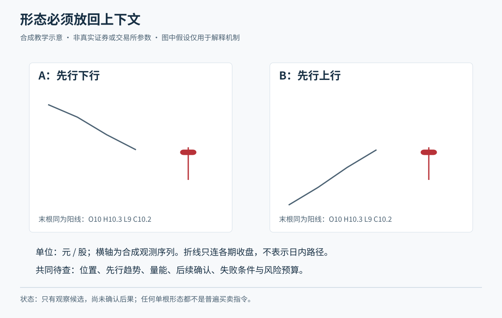
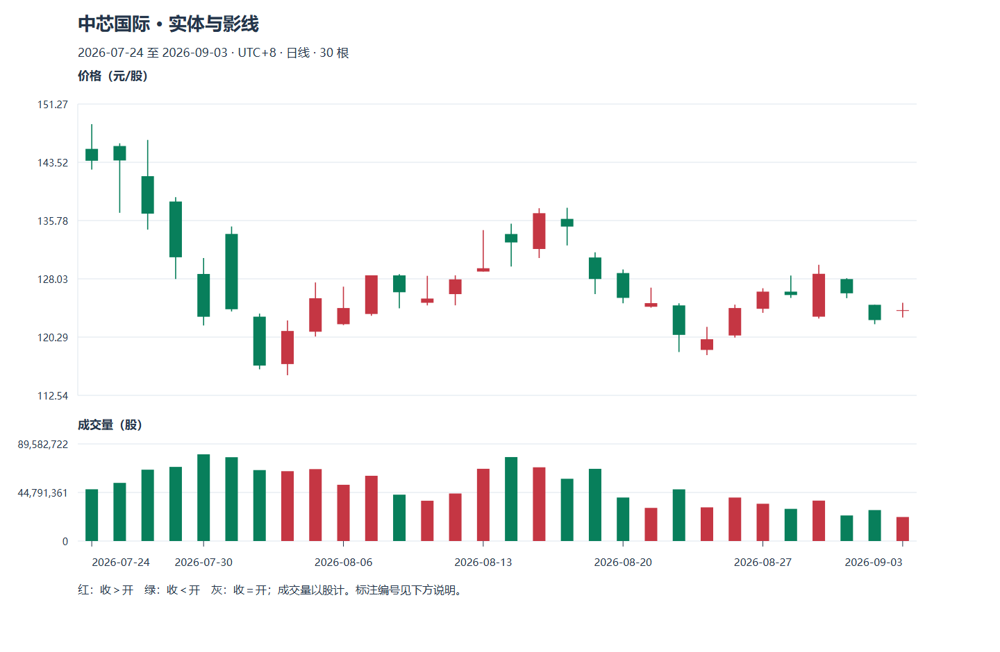

# M08 蜡烛形态：先描述，再提出可被推翻的假设

先备知识：[M07 普通 OHLC、周期与复权](module-07.md)。本模块用几种常见形态练习阅读价格关系，不把形态名称当作自动买卖指令。

**案例与定义声明：**青禾制造、小林及所有价格序列均为虚构。以下“长、短、近似”等采用本课教学约定：相对最近同周期价格条比较；十字示例用实体不超过全幅的 10%，锤形示例用下影至少为实体两倍、上影不长于实体。它们不是交易所规则，也不是已经验证有效的参数。全幅为零时不使用比例分类。资料核查日：2026-10-20。

Tutor: Keep these as different items:

- The shape
- Its previous context
- Subsequent confirmation
- Conditions in which the interpretation is incorrect.

Give the explanation for only this part.

Guided learning checks do not replace stage exercises without aid.

After each learning check, wait for the raw response. Then, give feedback.

## U01 单根蜡烛的家族

### P01 长实体、光头光脚、纺锤与十字

连接 M07，实体是开收到达的位置差，影线是超出实体的价格范围。先看几何，再给名字，能避免看到“阳线”就跳到“应该买”。长实体相对最近常见实体更长；光头光脚线指没有上下影线，开收恰在区间两端。纺锤线是小实体配两侧较长影线；十字线是开收几乎相同。它们压缩价格事实，不能识别交易者动机。术语可与 [StockCharts 形态词典](https://chartschool.stockcharts.com/table-of-contents/chart-analysis/candlestick-charts/candlestick-pattern-dictionary)对照；软件图解不是效果验证。

虚构青禾此前同周期实体多为 0.05—0.15 元，某日 O=L=10.00、C=H=10.60，实体 0.60 元，可描述为长阳、光头光脚。它只保证开收位于两端，不保证盘中始终单向上涨。若 O=H=10.60、C=L=10.00，便是对应的长阴。另一日 O=10.00、C=10.04、H=10.40、L=9.60，实体 0.04、全幅 0.80，比例 5%，按本课约定属于十字附近；若收 10.12，实体 0.12、全幅不变，更接近纺锤。

小实体并不等于低风险：全幅很大时，日内波动仍大。长阳若出现在一段快速上涨末端，下一日可能下跌；若只是除权口径混用，形状还可能是数据问题。先确认同周期与同口径，再谈后续假设。

**随口检查：**十字线能证明“买卖力量完全相等，所以明天反转”吗？

### P02 同一根长影线，为什么换个位置就换名字

锤子线是下影较长、实体靠上端的形状；出现在此前下跌后，常被列作潜在向上反转线索。相同几何出现在上涨后，常叫上吊线，提示需要检查下方波动，而不是已经证明见顶。倒锤子与流星线则是上影较长、实体靠下端的一组：前者放在此前下跌后讨论，后者放在此前上涨后讨论。这里的“反转”是先前方向可能改变，不代表反转已完成。

虚构青禾 O=10.00、C=10.10、H=10.15、L=9.60，实体 0.10、下影 0.40、上影 0.05，符合本课锤形约定。若此前收盘从 11 逐步跌到 10，小林可以问“下跌是否开始失去延续”；若此前从 9 涨到 10，则不能把同一形状照搬成底部证据。镜像例 O=10.00、C=9.90、H=10.40、L=9.85，上影 0.40、下影 0.05，换成上影家族。

本课示范的后续确认是下一完整日收盘高于锤形日最高 10.15；这让向上延续获得一条新证据，也意味着确认要更晚。若下一日反而收破 9.60，原先“可能止跌”的解释受到反证。确认条件是教学选择，不是通用胜率保证。不能只凭长下影编造“先被主力砸下再拉回”的唯一故事。

**随口检查：**一根漂亮锤形出现在横盘区域正中，是否必须贴上“底部反转”？

## U02 两根蜡烛的关系

### P01 吞没：看实体覆盖，不偷换成全部波动覆盖

向上吞没的基本关系是：此前下跌后，一根阳线实体覆盖前一根阴线实体；向下吞没则是此前上涨后，阴线实体覆盖前一根阳线实体。本课要求第二根实体严格跨过第一根实体两端，边界相等先标“临界”。吞没讨论开收构成的实体，并不要求把前一根最高、最低全部包住。可对照图表服务商的[向上反转](https://chartschool.stockcharts.com/table-of-contents/chart-analysis/candlestick-charts/candlestick-bullish-reversal-patterns)及[向下反转术语](https://chartschool.stockcharts.com/table-of-contents/chart-analysis/candlestick-charts/candlestick-bearish-reversal-patterns)。

虚构第一日 O=10.30、C=10.00、H=10.60、L=9.90；第二日 O=9.95、C=10.40、H=10.45、L=9.85。第二日实体 9.95—10.40 覆盖第一日 10.00—10.30，所以是本课的向上吞没候选；但第二日最高 10.45 仍低于第一日最高 10.60。若小林把它说成“第二天完全超过第一天”，就把两个不同条件混在一起。

向下的虚构镜像是第一日开 10.00、收 10.30，第二日开 10.35、收 9.90，阴实体包住前一阳实体。方向不同，读法相同：先识别关系，再问此前是在涨、跌还是来回震荡。震荡中反复出现吞没，可能只是范围内往返。

一个反例是向上吞没后次日直接低开并跌破组合最低点。形态存在这个事实没有消失，但“有利于向上延续”的交易解释失败。不能把失败的样本从统计中删掉。

**随口检查：**第二天最高超过前一天，实体却很小，自动算吞没吗？

### P02 孕线、刺透与乌云：收缩和收回是两种事情

孕线是第二根较小实体落在第一根较大实体内，表示开收变化收缩；它不必与前线颜色相反。本课先教实体严格落在内部的情形。虚构第一日从 10.40 收到 9.80，第二日开 9.95、收 10.10，便构成孕线候选。若连第二根的最高最低也落在第一根全幅内，还具有“内包线”的价格范围关系；孕线只要求实体，因此两者不能画等号。此前下跌后出现孕线可以提出止跌假设，上涨后出现则可提出转弱假设，均需后续证据。

刺透形态强调从下方收回前一阴实体的一半以上。虚构首日开 10.40、收 9.80，实体中点 10.10；次日低于前收开在 9.70，收 10.20，越过中点但未越过首日开盘。乌云盖顶反过来：首日开 9.80、收 10.40；次日高于前收开在 10.50，收 10.00，跌到中点以下、首日开盘以上。这里明确采用“相对前收开出、收回超过实体中点”的教学版本，其他资料可能要求更严格的开盘缺口，应注明差别。

前者是波幅收缩线索，后两者是收回前一段实体的线索，机制不同。若孕线次日继续向原方向扩展，它只是暂停；若刺透后再创新低，向上解释失败。条件越宽会识别更多样本，也可能带来更多噪声，不能先看结果再挑定义。

**随口检查：**首日实体中点 10.10、次日只收 10.05，能按本课条件叫刺透吗？

## U03 多根反转与持续组合

### P01 早晨之星、黄昏之星与连续推进

多根形态把“延续、停顿、反向推进”串成几天。早晨之星通常放在下跌后观察：先有较长阴实体，再有低位小实体，最后阳实体收回第一根的一部分。黄昏之星是上涨后的对应结构。本课以第三根收盘跨过第一根实体中点为条件，允许中间小实体与两侧有少量接触，称为**宽松星形教学版本**；要求明显实体缺口的严格定义需另行区分，不能混记为同一统计样本。

虚构早晨组合的开收分别为 `10.60→10.00；9.95→9.98；10.00→10.40`，小实体居低，第三根收盘超过首根中点 10.30。黄昏组合为 `10.00→10.60；10.65→10.62；10.60→10.20`，第三根收盘低于 10.30。看到第二根小线时，第三根还不存在，不能提前登记完整形态；第三根若继续原方向走，星形反转条件就未完成。

另一家族是红三兵与三只乌鸦，分别指多根实体同方向推进。本课示例红三兵开收为 `10.00→10.20；10.15→10.35；10.30→10.50`，每根在前一实体内开出、收得更高，且上影较短；乌鸦可用 `10.50→10.30；10.35→10.15；10.20→10.00`、下影较短来理解。在下跌后它们可作为潜在转向线索，在原方向已持续时也可能只是延续；追在第三根后仍可能遭遇回撤。

**随口检查：**三天收盘连续升高，但都高开低收、上影很长，能只凭“三次上涨”称作本课红三兵吗？

### P02 上升三法与下降三法：持续形态也会失败

持续形态提出的是“此前方向暂停后可能继续”，不是反转。上升三法的典型教学结构是：较长阳线，随后三根较小、略向下整理的线，最后较长阳线越过首根高点；中间整理没有破坏首根范围。下降三法把方向反过来。整理指价格暂在较小区域往返，并不自动意味着有人在“吸筹”。名称与常见关系可对照 [StockCharts 形态词典](https://chartschool.stockcharts.com/table-of-contents/chart-analysis/candlestick-charts/candlestick-pattern-dictionary)，本课采用下面明确的数值版本。

虚构上升案例，每行均为 O/H/L/C：

| 次序 | 开 | 高 | 低 | 收 |
| --- | ---: | ---: | ---: | ---: |
| 1 | 10.00 | 10.60 | 9.95 | 10.55 |
| 2 | 10.50 | 10.52 | 10.30 | 10.35 |
| 3 | 10.36 | 10.40 | 10.20 | 10.25 |
| 4 | 10.28 | 10.32 | 10.10 | 10.15 |
| 5 | 10.20 | 10.75 | 10.15 | 10.70 |

第二至四根全幅留在第一根范围，收盘温和下移，第五根才完成向上扩展。失败分支把第五根完整替换为 O=10.20、H=10.75、L=9.75、C=9.80；其余四根不变。此时收盘低于首根最低 9.95，持续假设就遭到反证，不能仍叫“健康整理”。下降示意为首根从 10.60 收至 10.00，其全幅 9.95—10.65；中间三根小线从 10.05、10.15、10.25 分别收至 10.15、10.25、10.35，全幅保持在首根内；末根从 10.30 收至 9.80、最低 9.75，构成向下继续。

本课现金做多路线下，向下持续首先用于回避新买或检查已有持仓退出计划，不要求卖空。成交量可另作比较，但“整理缩量、突破放量”不是名称自带的必然条件，更不保证成交。

**随口检查：**只有首根与三根整理线，能记录“上升三法已完成”吗？

## U04 背景、确认与失败

### P01 给形态补上位置、时间和反证条件

形状相同，先前走势与位置不同，问题也不同。“确认”是随后观察到预先约定的额外条件，不是未来收益的担保。小林应先记录周期、复权口径、此前方向、所在区域，以及什么新事实会让原解释失效，再去看后面的线。M09 会把区域与趋势写得更清楚。

虚构青禾从 11 跌至 10 附近，过去两次低点在 9.80—9.90，现在出现低点 9.75、最高 10.10 的锤形。小林事先写：“目前只是候选；未来两个完整交易日内，若某日收盘高于 10.10，且此前未出现日收盘低于 9.75，则记一次确认；若先收破 9.75，或两日结束仍无确认，候选取消。”两个阈值与期限是本课示范，未证明优越。

另一张图同样出现锤形，但此前一直在 9.70—10.30 内来回。它更像区域内一次波动，不能照抄“跌势反转”。即使确认，等得更久可能付出更高价格；不等确认则承担更早误判的风险，选择需要完整策略而非形态名字。

同一根后来价格条若同时跨过上下两界，按本课“日收盘”条件只比较收盘；若采用盘中触及规则而无更细顺序，就保留歧义，不能替换成最有利解释。也不能在确认后回填锤形日收盘价作成交价。

**随口检查：**确认后次日又下跌，是否证明当时没确认过？

### P02 完整阅读：把事实、假设、行动各写一句

事实是已经看到的数字；假设是对未来的可检验判断；行动则必须包含时间与风险限制。把这三件事分开，能防止“有形态，所以必须买”的跳跃。一个形态也不等于一套策略，后者还缺筛选、仓位、成交与退出。

虚构青禾两日实体构成向上吞没，组合最低 9.85、最高 10.60，日收盘已确认。小林可以写：事实是两根实体的覆盖关系；假设是低位回升有可能延续；行动是先按既定规则等待后续观察，若后续满足条件再计算计划数量。若他尚未写过交易规则，合理行动是记录候选而不交易。这不是错失“必涨机会”，因为图形没有提供必涨事实。

反例：次日跳到 10.90，价格高过原计划最高接受价。不能因形态漂亮而无限追价，也不能为画出盈利案例假设成交在昨日 10.40。另一反例：新闻后来才披露，却被补写为形态出现时的已知原因。四价和量不能辨认投资者意图；后来叙事也不能改变当时信息集。

迁移时可以换一种形态问同样三句话：下降三法告诉现金做多的小林什么事实？它提供向下延续候选，并不授权裸卖股票；若已有持仓，仍按预先写定的退出与可卖数量处理。统计效果需 M10 的样本、成本及基准比较，不能由这里的虚构算例推断。

**随口检查：**你会怎样把“这是主力洗盘，明天必涨”改成可以核对、也可以被后续数据推翻的话？

## 补充旧图配套：真实蜡烛形态与边界反例

正文青禾案例用于初次讲解；本节链接的三只真实股票是另一套历史材料，不能混作青禾制造。见[真实图谱](../chart-atlas.md)，建议本模块配合R05—R06、R25—R30。每个名称都列不等式，允许拒绝形似但条件不齐的名称；局部形态不自动等于反转。

教学顺序为原图观察、学员原答、逐层标注、后续验证和另一未见窗口。需要完整讲义时可连贯展开；日常教学仍只讲一个焦点。数据单位、复权、使用条件及尚未核验的公司行动，先读[数据口径](../chart-data.md)。横向行业和指数资料未包含在三只个股样本中，不伪造市场确认。

## 2026主案例实践

按最新学习偏好，优先使用中际旭创、寒武纪、中芯国际与天普股份的2026日线；先读[本期数据与公告](../data-2026.md)，再选[本模块对应主图](../tech-2026-atlas.md)。旧图只用于补充对照。已知权益事件跨日不直接当技术破位或下跌笔；

Tutor: Each time, load only the observation packet for this step. Only after you keep the raw response, open the annotation for the question. During the explanation, show the initial image for this question in the chat. Then, add markings one layer at a time. Do not give only text and links.

### 先看本期原图

本图是观察阶段的真实日线。

Tutor: For this step, select only one question for this stage. Keep the other questions for subsequent steps. After the learner sees an explanation or annotation, do not give the same window an `independent` assessment status. Do not record the window as material without previous access.

### 原答之后：把数字对应回图上

保留当前原图和自己的回答后，再用[专题细图](../topic-plates.md)打开同编号的一张教师图。实体与影线看局部放大，量价看此前20根比较窗口与均量，边界题看冻结锚点和当时收盘；

Tutor: Give only the relation for this step at a time.

看过的窗口记为有辅助学习，另到[未见回放](../holdout-replay.md)选择合格的新任务。

本节2024补充图统一作有辅助示范，不计独立识别；未见迁移另走[保留回放](../holdout-replay.md)并先核对暴露历史。
