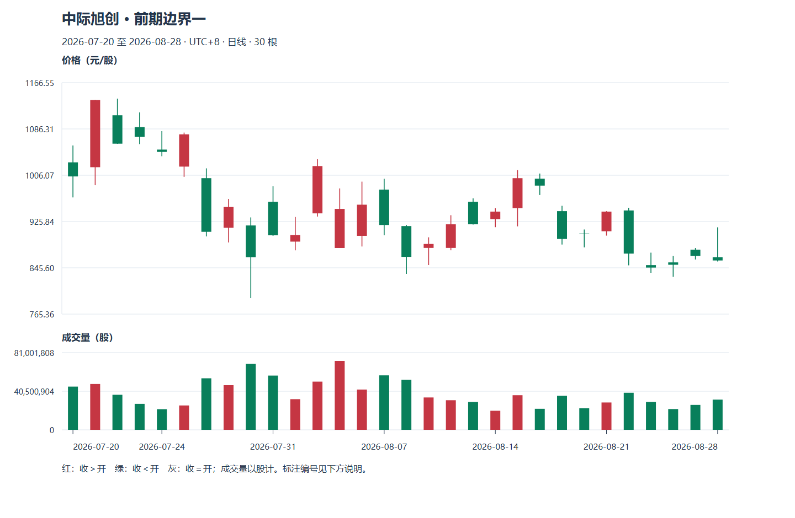

# M09 趋势、区域与突破：让判断带上边界

先备知识：[M07 周期与价格口径](module-07.md)、[M08 形态及反证](module-08.md)。本模块从一根线走向一段走势，练习把“看起来要涨”改成有观察窗口、确认时间和失效条件的描述。

**案例声明：**青禾制造、小林与以下全部价格、时序、阈值均为虚构。局部高低点、区域宽度及突破确认方法是教学约定，不是交易所规则，也未验证盈利能力。本模块的一般波段高低点不等同于后续缠论模块的分型、笔或线段。资料核查日：2026-10-20。

Tutor: The chart scale gives the applicable time interval, observation window, and price-axis convention for this part.

With only information available at the cutoff, set the price levels for support and resistance. Keep these price levels without change. Show the chart scale for this part, confirmation lag, and failed interpretations.

Guided learning checks are not stage exercises.

After each learning check, wait for the raw response. Then, give feedback.

## U01 局部高低点与市场状态

### P01 一个高点要等到什么时候才知道

局部高点是相对附近价格条较高的位置；局部低点反过来。它们帮助我们把波动分段，但“附近”需要先定义。本课先用最简单的左右各一根方法：中间一根最高价严格高于左右两根最高价，记作局部高点；最低价严格低于左右两根最低价，记作局部低点。相等时先不标，一根线若同时满足两类条件则保留歧义、不用来确定波段顺序。这是便于练习的粗方法，短噪声中会频繁标点。

虚构三天最高价为 10.20、10.50、10.30 元，第二天的 10.50 在第三天完整数据形成后才获得右侧比较，因此是第三天结束时确认的第二天高点。第二天收盘时只知道它高于左侧，不知道第三天会不会继续到 10.80。低点例为三天最低 9.80、9.50、9.70，中间 9.50 也要等右侧结束才确认。

用更多邻居可以减少小波动的标记，却要等更久，也可能错过较早价格。不存在既依赖后来数据又没有确认延迟的方法。小林应同时记录“高点属于哪一天”与“哪一天才确认”，历史图只标在高点那一天，容易隐藏等待。

若每天都创新高，最新一根还不能按此规则叫确认的局部顶；此时保持“候选”比凭感觉画顶更准确。更复杂方法可另学，但不能中途换定义以解释每个案例。

**随口检查：**第二天最高 10.50，第三天盘中一度为 10.30，能提前确认吗？

### P02 上升、下降、震荡与暂时说不清

趋势描述一段时间里波动向哪个方向展开，不表示每根线都同方向。本课用已确认、按时间交替的波段高低点作初步分类：高点逐步抬高、低点也逐步抬高，称上升状态；两者都降低，称下降状态；高低点主要在相近上下边界往返，称震荡。混合结构先记“过渡或不明”，不强迫所有图进入三个漂亮盒子。

虚构青禾先后形成低点 9.00、高点 10.00、低点 9.40、高点 10.50、低点 9.80。高点 10.00→10.50、低点 9.00→9.40→9.80 都抬高，构成这段样本的上升描述。它从 10.50 回落到 9.80 时并不需要立即叫下降趋势，因为回落仍保留更高低点。若以后高点仅到 10.20、低点降到 9.30，结构变弱，原上升解释需要重审。

反例是高点越来越高、低点却越来越低。这叫波幅扩张更贴切，不能只挑高点说“趋势向上”。另一个反例是周线仍上升、日线连续回落；两者窗口不同，可以同时成立。行动采用哪个周期，应在交易前规定。

这种分类适合组织观察和比较候选，不足以单独决定买入。因为局部点本身有延迟，今天真实可观察的结构可能比后来图上简单得多。现金做多的小林遇到下降状态，可以选择空仓观察；不必为了“每种行情都有操作”增加不熟悉的产品。

**随口检查：**连续三个收盘上涨，足以说明所有波段高低点都抬高吗？

## U02 支撑与阻力

### P01 支撑是观察区域，不是有人保证接盘

支撑是价格过去接近后曾停止下跌或回升、因而值得再次观察的区域。可能的解释包括不同投资者在附近改变报价与交易意愿，但图形本身不能确认是谁在买、以后还会不会买。把它画成区域，是承认价格记录与参与者反应都有误差。术语可对照 [StockCharts 支撑阻力说明](https://chartschool.stockcharts.com/table-of-contents/chart-analysis/support-and-resistance)；本课不采用其中的叙事作为投资者身份或收益证据。

虚构青禾过去两次已知回落低点为 9.82、9.88，小林在新一天到来前画 9.80—9.90 的教学观察区。今天最低 9.84、收盘 10.02，可以写“接近该区后收在上方”；若最低 9.65、收盘 9.70，则收在观察区下方，不是同一结果。先画区、后观察，才能避免每天按新低向下挪线，再声称“支撑一直有效”。

支撑区域可以帮助定义需要反证的位置，却不能直接当作保证的止损成交价。若持仓计划在收盘跌破 9.80 后退出，信号只有收盘才明确，之后可能跳空；若计划盘中触及就行动，则必须具备观察与执行条件。两套计划不能混算。

反例：一次坏消息后直接低开在 9.40，旧区域并没有提供 9.80 元的成交机会。历史上多次回升，也不能证明下一次更安全；同一区域持续承受交易后，未来可见订单还可能完全不同。

**随口检查：**最新价 9.86 落进支撑区，是否已经出现“止跌确认”？

### P02 阻力与角色转换：需要新证据，不能靠画线决定

阻力是价格过去接近后曾停止上涨或回落的观察区域。与支撑一样，它是从已有价格记录提取的参照，不是上方有一堵实际墙。所谓“阻力转支撑”，是突破后重新回到该区域时，后续反应符合新的支撑假设；不能只因跨过一次就宣布角色永久转换。

虚构青禾过去两次高点在 10.40、10.50，小林事先画 10.40—10.50 的阻力区。后来某日收 10.65，再下一日低 10.46、收 10.62，便有“回到旧区域后又收在上方”的新证据。它与“今天最高碰到 10.65、收回 10.30”不同，后者尚未站到区域上方。需要等待的数据变多，结论也会更晚。

市场参与者可能因成本、预期或新的消息改变行为，因此角色转换有解释上的合理性，但价线不提供他们的账户证据。也不能见到 10.46 回升就说所有人都把它当支撑。小林只需按自己的规则记录是否满足，不需要编造全市场一致心理。

反过来，原支撑跌破后，反弹到旧区域又回落，可以提出“旧支撑成为阻力”的假设；若重新收复，就必须保留这条反证。适用时始终使用同周期、同复权口径；跨分红事件的未调整旧价格可能失去直接可比性。

**随口检查：**旧阻力 10.40—10.50，后续回落直接收 10.10，还能只因“曾经突破过”继续说支撑成立吗？

## U03 趋势线、通道与缺口

### P01 趋势线是压缩参照，斜率会受坐标影响

趋势线把若干已知波动点连起来，简化方向与速度的观察。上升线通常连接逐步抬高的低点，下降线连接逐步降低的高点；通道是在此基础上画大致平行的另一边，表示一个观察带。两个点总能连线，出现后续接近的点才增加可讨论的证据，仍不构成自然规律。[图表服务商趋势线说明](https://chartschool.stockcharts.com/table-of-contents/chart-analysis/trend-lines)可作术语参照。

虚构以交易日序号作横轴：第 1 日低点 9.00、第 3 日低点 9.40，连接线每个交易日抬高 0.20 元，外推第 5 日参照为 9.80 元。若把上边界平行放在第 2 日高点 10.00 处，第 5 日上边界为 10.60。此时得到的是教学通道，不是第 5 日必在 9.80—10.60 成交的预报。

小林若第 5 日看到最低 9.70，最多先说价格越过这条拟合线；是否改变上升状态还要看既定结构、收盘和失效规则。不能为了保住结论临时改连另两个点。画线时应保存连点与当时截点，防止只展示事后最好看的线。

图的长宽、线性或对数纵轴会改变视觉斜率。线性轴同样一格代表相同金额；对数轴同样距离表示相同比例。例如 10→11 与 20→22 都是涨 10%，在比例尺度上更可比。不能把屏幕“45 度”当成稳定的市场力量。

**随口检查：**把窗口横向拉宽后线变平，趋势是否因此减弱？

### P02 缺口：先排除口径变化，再看交易范围

缺口常用来描述相邻价格条之间未重叠的区域。本课把向上完整日线缺口定义为“后一天最低价高于前一天最高价”，向下反过来；仅开盘高于前收称高开，不自动构成完整缺口。图表分类中的突破、持续、衰竭缺口涉及背景与后续，不能只凭空白大小当场定性。可参照 [StockCharts 缺口分析](https://chartschool.stockcharts.com/table-of-contents/chart-analysis/gaps-and-gap-analysis)。

虚构青禾昨日全幅 9.80—10.20，今日全幅 10.50—10.80，两个日线范围之间有 10.20—10.50 的缺口。若今日开 10.50、后来低到 10.10，则虽高开，完整缺口已经不存在。若随后某日跌到 10.30，原向上缺口只回补了一部分；完全回到 10.20 的另一端，本课才记为完全回补。

“缺口必补”不是交易保证。它可以长时间不补，价格也可能持续远离；即使将来补上，在那之前做逆向交易仍可能承受很大损失。小林要问的是缺口如何影响自己的入场接受价和退出风险。原计划损失触发 9.80，若下一日直接开到 9.40，即使随后卖出，也不能假设成交在 9.80。

除权除息造成的不复权断口、停牌复牌后的跨日变化、数据遗漏都需要另看。先用 M07 的权益与时间口径排查，再讨论交易结构，不能把技术缺口故事套在数据问题上。

**随口检查：**昨天最高 10.20，今天开 10.50、最低 10.15，属于本课向上完整缺口吗？

## U04 突破、回踩与假突破

### P01 突破必须说清越过什么、用什么价格确认

突破是价格跨过预先确定边界的事件。盘中触及、盘中越过、单日收盘越过、连续两日收在上方，是四种不同条件；确认越多往往越晚，也不保证更赚钱。边界若在看到今天最高价后才画出来，就无法公正比较成功与失败。

虚构小林在甲日开始前记录阻力上界 10.50，选择“两天连续日收盘严格高于上界”作为教学确认。甲日最高 10.70、收 10.45，不满足；乙日收 10.60，是第一天；丙日收 10.55，才在丙日结束时确认。若丙日收 10.48，则连续计数中断。此时不能把乙日收盘 10.60 自动登记成成交，因为完整信号还没成立。

这种定义适合有能力等待收盘、在后续时点执行的计划。若采用盘中规则，就要写观察频率、有效申报范围、价差与滑价处理。滑价是实际成交相对计划参照价的偏离；方向可能有利也可能不利，但评估时不能总假设有利偏离。成交量高于既定基准可作为另一条观察事实，M10 再讨论其作用。

反例是涨停附近出现突破而买方排队无法成交。图上的价格事件可以存在，个人交易仍未发生。另一个反例是突破后跳空高开，达到信号却超过计划最高买价，合理结果是取消入场。

**随口检查：**今天上午已经站上 10.50，而规则要日收盘确认，此时能说“信号已确认”吗？

### P02 回踩与假突破：把失败也写进计划

回踩是向上越过某区域后又回到附近观察，不必然是低风险买点；假突破是跨过边界后，按预先定义很快退回原范围的情形。“很快”和“退回”也要规定。本课示意为：突破确认后的两个交易日内，任一日收盘低于旧区域下界，就标记此次向上突破失败；它是便于训练的版本，不是统一市场定义。

虚构旧区域 10.40—10.50，突破日收 10.65。下一日低 10.46、收 10.62，可记录一次回踩并收回区域上方；若再下一日收 10.30，则满足本课失败条件。前一天看似顺利的回踩并没有消除失败可能。反过来，后续始终在 10.70 以上，也可能根本不给回踩；等待回踩的计划可以一直不成交。

小林需要预先选择“突破后直接等后续执行”还是“等待回踩再触发”，二者的样本、价格与漏掉的机会不同。不能涨了以后说采用第一种，跌了以后说自己本来在等第二种。若已有持仓，退出还受可卖股份、停牌、价差和流动性约束；区域失效是信号，实际回收多少现金取决于成交。

迁移到向下突破时，现金做多路线首先考虑回避新买或执行持仓退出，不把图上向下箭头变成卖空指令。M10 会把条件、仓位和退出串成一条完整教学策略；这里的画线只是输入之一。

**随口检查：**等回踩的计划始终没买到，后来价格大涨，是否必然是执行错误？

## 补充旧图配套：支撑压力与结构演变

正文青禾案例用于初次讲解；本节链接的三只真实股票是另一套历史材料，不能混作青禾制造。见[真实图谱](../chart-atlas.md)，建议本模块配合R14—R22。先写参照来源和确认规则，再看后续是否保持；线和区间不预测必然方向。

教学顺序为原图观察、学员原答、逐层标注、后续验证和另一未见窗口。需要完整讲义时可连贯展开；日常教学仍只讲一个焦点。数据单位、复权、使用条件及尚未核验的公司行动，先读[数据口径](../chart-data.md)。横向行业和指数资料未包含在三只个股样本中，不伪造市场确认。

## 2026主案例实践

按最新学习偏好，优先使用中际旭创、寒武纪、中芯国际与天普股份的2026日线；先读[本期数据与公告](../data-2026.md)，再选[本模块对应主图](../tech-2026-atlas.md)。旧图只用于补充对照。已知权益事件跨日不直接当技术破位或下跌笔；

Tutor: Each time, load only the observation packet for this step. Only after you keep the raw response, open the annotation for the question. During the explanation, show the initial image for this question in the chat. Then, add markings one layer at a time. Do not give only text and links.

### 先看本期原图

本图是观察阶段的真实日线。

Tutor: For this step, select only one question for this stage. Keep the other questions for subsequent steps. After the learner sees an explanation or annotation, do not give the same window an `independent` assessment status. Do not record the window as material without previous access.

### 原答之后：把数字对应回图上

保留当前原图和自己的回答后，再用[专题细图](../topic-plates.md)打开同编号的一张教师图。实体与影线看局部放大，量价看此前20根比较窗口与均量，边界题看冻结锚点和当时收盘；

Tutor: Give only the relation for this step at a time.

看过的窗口记为有辅助学习，另到[未见回放](../holdout-replay.md)选择合格的新任务。

本节2024补充图统一作有辅助示范，不计独立识别；未见迁移另走[保留回放](../holdout-replay.md)并先核对暴露历史。
