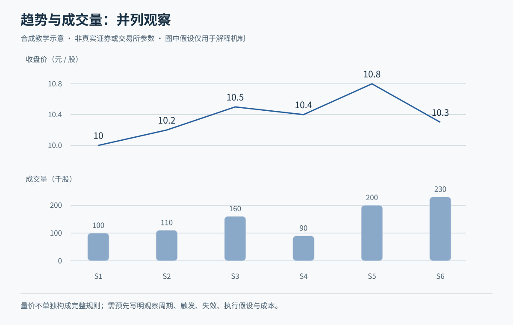
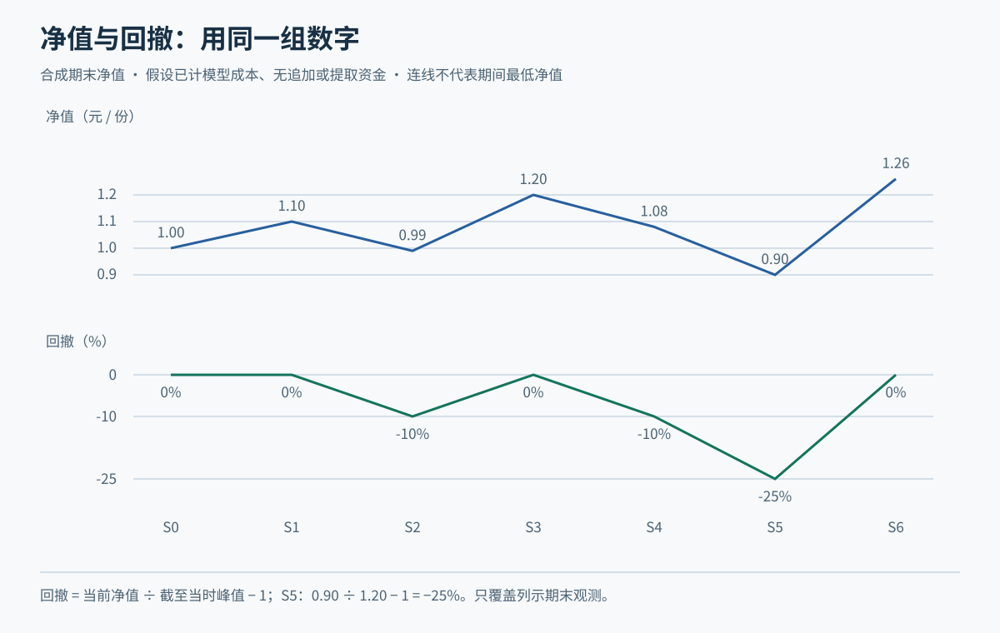
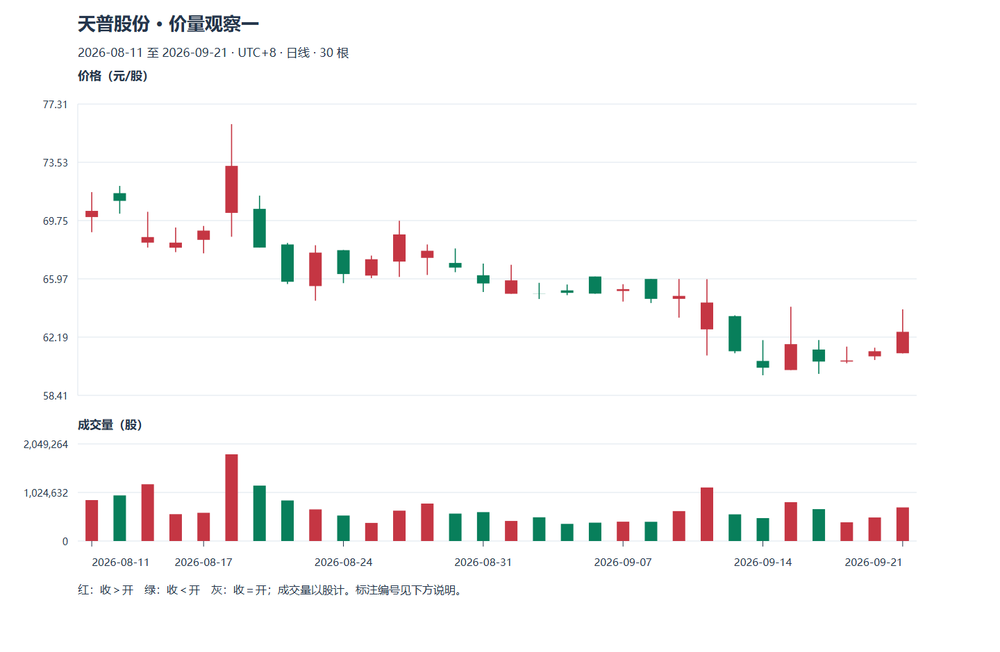

# M10 量价、指标与第一张完整策略卡

先备知识：[M04 成本与仓位](module-04.md)、[M06 行情口径](module-06.md)、[M07 时间与复权](module-07.md)、[M09 趋势与突破](module-09.md)。目标是把观察变成可核对的规则，并知道怎样评价它，而不是学会一个“必赚公式”。

**案例声明：**青禾制造、小林及本页全部行情、资产、费用和策略参数均为虚构。策略只供纸面教学；没有实盘、回测或样本外结果支持其盈利能力。资料核查日：2026-10-20。以下理解检查是有讲解的讨论，不是独立阶段测验。

Tutor: Give the explanation of the indicators before the strategy. Before you show subsequent prices, set the version and information cutoff. Keep a signal, an order, and a fill as different items.

After each learning check, wait for the raw response. Then, give feedback.

## U01 量价证据

### P01 放量上涨等组合，首先是两项观察

成交量回答发生了多少交易，价格回答交易达到了什么位置。两者一起看，可以提出“这次变化是否伴随更多成交”的问题，但不能直接推导买方是谁或想做什么。每笔交易都有买卖双方，“放量”不等于买入股数比卖出股数多。

虚构青禾过去五个完整交易日平均每天成交 100 万股。今天从昨收 10.00 收到 10.40、成交 180 万股，是相对这个基准的价涨量增；若仅 60 万股，则是价涨量减。若收 9.60、成交 180 万股，描述为价跌量增；若同样收 9.60、量 60 万股，则为价跌量减。先把“涨跌相对什么”“量和哪几天比”写清，再谈解释。

量增时价格向上扩展，可以提出“向上变化有较多成交参与”的假设；量减时上涨，可以提出“成交参与较少”的假设。但价格可能因卖方报价减少而上涨，也可能因少数交易跨过薄盘口而变化，所以不能把“缩量上涨”直接判死刑。价跌量减也不保证抛售结束：买方稀少时，少量交易就可能把价格打低。

这些组合适合筛选还要进一步观察的案例，不适合直接变成买卖按钮。若遇到交易状态、权益变化或数据单位改变，应先查原因。盘口和成交条带仍不能识别投资者意图，M06 的限制在这里没有消失。

**随口检查：**放量大跌是否一定是“大资金出逃”？

### P02 量能确认：比较要固定，执行要另外检查

“量能确认”只是把成交活跃程度作为价格信号的附加条件。本课示范把今日完整成交量与此前五日均量比较，明确不把今天放进自己的比较基准。虚构五日成交量为 80、90、100、110、120 万股，均值 100 万；今日 130 万，比例为 1.3。若规则预先要求至少 1.2，则这一项通过。它证明的是条件成立，不证明未来收益为正。

如果今天刚过半天就拿 70 万股与完整日均 100 万比较，会混入观察时长差异。盘中可以改用同一时刻的历史累计量，但那就换了定义，需要保存历史同刻数据，不能盘中用一种算法、收盘再挑另一种。近期只有四个可靠交易日，或股份变动导致数量含义变化，也不能悄悄补一个“平均日”。

反例：股票在价格上限附近只有很少成交，却排着大量买单。低成交不等于没有买入意愿，也不等于小林想买就买得到。另一个反例是突发事件造成量剧增、价差扩大，活动多不代表执行风险小。用成交量作流动性线索时，还应看订单规模、档位深度与真实回报。

连接 M08，一根长阳与成交量上升可以同时出现，但它们没有提供两份完全独立的投资者身份信息；都是同一批交易的不同摘要。重复加指标不能自动把不确定性消掉。

**随口检查：**量比阈值从 1.2 改成 1.5 后，历史盈利更好，能直接宣布新值更优吗？

## U02 MA 与 MACD 的计算直觉

### P01 移动平均：用平滑换取延迟

简单移动平均线，简称 SMA 或本课的 MA，是最近固定数量价格的算术平均；每天移入新值、移出最旧值，所以叫“移动”。本课都用完整日收盘计算，MA20 表示最近二十个完整交易日收盘均值，不是二十个自然日，也不是所有股东的真实成本线。计算定义可对照 [Fidelity 的 SMA 说明](https://www.fidelity.com/learning-center/trading-investing/technical-analysis/technical-indicator-guide/sma)。

虚构三个收盘 9.80、10.00、10.20，MA3 为 10.00；下一日收 10.30，移出 9.80 后，新 MA3 为 `(10.00+10.20+10.30)÷3≈10.167`。新价格已到 10.30，均线仍较低，说明平均会平滑、也会滞后。即使今天价格没涨，只要移出的旧值更低，均线也可能继续抬高。

短周期更贴近新变化，长期均值更平稳；二者相交叫均线交叉。短均线上穿长均线常称金叉，下穿称死叉，名字并不保证收益。趋势明显时平滑有助于减少逐笔噪声；震荡时可能频繁交叉，使交易成本累积。参数的好坏需要独立比较，不能由名称决定。

反例是“股价站上 MA20，因此所有人都赚钱”。MA20 只平均二十个收盘，没有按每位持有人的买入数量和成本计权，也不包含此前所有持仓。复权口径或缺失交易日处理变化，也会改变结果，必须与价格输入一致。

**随口检查：**今天收盘低于昨日收盘，均线就一定下降吗？

### P02 MACD：平均线的差，再平滑一次

指数移动平均 EMA 给较近数据更大权重。本课采用 `今日 EMA=昨日 EMA+α×(今日收盘−昨日 EMA)`，其中 `α=2÷(周期+1)`；首个可用收盘作为本课起始值，真实软件初始化与预热长度需另查。EMA 的递推和平滑含义可对照 [Fidelity 的 EMA 说明](https://www.fidelity.com/learning-center/trading-investing/technical-analysis/technical-indicator-guide/ema)。

MACD 观察快慢 EMA 的差及差值变化。本课明确采用常见的 12、26、9 参数：`DIF=EMA12−EMA26`，`DEA=DIF 的 9 期 EMA`，柱值定义为 `2×(DIF−DEA)`。这些是本课展示口径，不是交易所规则；有的软件柱值不乘 2，名称与颜色也会不同。[Fidelity 的 MACD 说明](https://www.fidelity.com/learning-center/trading-investing/technical-analysis/technical-indicator-guide/macd)可作快慢均值与信号线的计算参照，不能用其信号叙述证明 A 股效果。

虚构某日快 EMA 为 10.20、慢 EMA 为 10.00，DIF=0.20；若 DEA=0.15，柱值为 0.10。下一日假设 DIF=0.18，DEA 按 9 期系数更新为 `0.15+0.2×(0.18−0.15)=0.156`，柱值缩为 0.048。柱子缩短表示 DIF 与其平滑值的差缩小，不等于股价已经下跌，更不等于现金已从市场流出。

DIF 上穿 DEA 是一种交叉；DIF 为正则快均值高于慢均值，这两件事不同。差值有价格单位，不能直接拿不同价位股票的柱高比“强弱”。与 MA 一样，它由已有价格计算，可能滞后和反复。以下简单策略不用 MACD，避免多一个指标就多一套临时解释。

**随口检查：**DIF 仍在零下方，但高于 DEA，是否矛盾？

## U03 构造一套完整的简单教学策略

### P01 版本、准备、触发、入场与数量

策略必须让两个人拿到同一份截点数据时，能核对为何做或不做。下面冻结为 **QH-LONG-0.1 教学版**，只说明规则完整性，**效力未验证**。它用于小林的虚构普通现金账户：不融资、不卖空、不加仓，最多一笔持仓；未结清订单也占用这个名额。观察标的在试验开始前固定为青禾，不因后来涨跌换样本。产品假设为沪市主板普通 A 股，排除新股特殊阶段、风险警示、退市整理及其他特殊交易状态。

规则依据与教学参数必须分开。已核对的[上交所 2026 年规则](https://www.sse.com.cn/lawandrules/sselawsrules2025/trade/universal/c/c_20260424_10816492.shtml)自 2026-07-06 施行：第 3.1.4—3.1.5 条区分交收前卖出限制及回转例外，第 3.3.8 条规定一般竞价买入数量，第 3.3.11 条列 A 股报价最小变动单位。这里按普通主板股票买入当日不能卖出、买入 100 股整数倍、报价按 0.01 元处理；不能外推至科创板、ETF 等。公告附件 3 仍列部分大宗交易规定暂缓，本策略不使用其延后时段或全天均价申报，也不假设存在交易所自动止损单。

**准备与触发。**记信号日为 t。至少有 21 个连续、可靠的完整交易日，价格采用不复权 OHLC；期间无权益事件。若截至 t 收盘已公告未来十个交易日内有分红送配、停复牌或上述特殊状态变更，则不新开；尚未知的未来事件仍可能发生。收盘后才检查：`C_t>MA20_t` 且 `MA20_t>MA20_(t−1)` 为准备条件；`C_t>B` 且 `V_t≥1.2×此前五日均量` 为触发，其中 B 是 t 之前五日最高价的最大值，不含 t。MA 用完整收盘，量也不用盘中外推。任一缺数、对账异常或条件不符，记不交易。

**下一个可执行动作。**只在下一交易日 10:00 观察一次当时已到达的有效盘口。教学最高买价取 `1.01×C_t` 向下舍到分；固定损失参照 S 取信号日最低价。若卖一价 e 严格高于 B 和 S，且不超过最高买价，才用 e 提交一次合法限价买单；若停牌、无有效报价、超出有效申报范围或账户受限，取消这次入场机会。10:05 申请撤销未成部分，等回报确认后接受实际部分成交，不补单、不追价；无成交就作废，不能把“最低价到过 e”代替成交回报。

**数量。**教学假定账户权益 E、可用现金 K；单笔计划损失预算 0.5%E，含预留成本的投入上限 20%E。每股往返费用假定合计 0.02 元，再留不利偏离 0.03 元，共 0.05 元；这是虚构线性成本，不是真实收费。数量 N 取满足 `N×(e−S+0.05)≤0.005E`、`N×(e+0.05)≤min(K,0.20E)` 的最大 100 股整数倍。不足 100 股就不买。预留成本只控制计划，不能保证实际损失上限。

虚构 E=K=100,000 元、C_t=10.05、B=10.00、S=9.60，其他条件均通过；最高买价为 10.15，次日卖一 e=10.10。每股计划风险 0.55，风险预算 500 元，允许最大 900 股；投入连预留为 `900×10.15=9,135 元`，也在上限内。小林提交 900 股，但必须等待回报才知道持仓。若卖一改成 10.30，则本次不买。

**随口检查：**收盘后确认触发，能登记为 t 日按 10.05 买入吗？

### P02 持仓管理、退出、未成交与暂停

入场只是策略一半。QH-LONG-0.1 的管理部分沿用“现金做多、最多一笔、不加仓”，只管理真实回报中的数量。信号日最低价 S 固定不下移；实际买入均价记为 a，计划每股价格风险为 `a−S`，获利参照 T 定为 `a+2×(a−S)`。若异常成交使 a≤S，立即记入场失效并排队等待合法退出，不再计算一个反向目标。

**观察与退出顺序。**买入当日不卖新买股份；收盘若 C≤S，记“待退出”，不因次日反弹自行撤销。从买入后下一交易日起，每个交易日 10:00 取一次当时有效快照：已有待退出标记，或新公告显示权益事件、停牌安排、风险警示或退市相关状态变化，先标记退出；否则最新价≤S 时标记损失退出，最新价≥T 时标记获利退出；均未触发则持有。买入日算第 1 个交易日，第 10 个交易日 10:00 无论盈亏均标记时间退出，交易日计数不因个股停牌重置。公告失效先于价格条件，损失先于获利，再检查时间；标记一旦形成便持续至退出完成。

这套规则**只在规定时点观察**，不是盘中即时止损。每天盘中曾触到 S 或 T、10:00 却不满足，不能事后补记触发；若缺失快照，则记缺失，不用后来日 K 反推。既有待退出标记与时间退出仍保留，停牌时等恢复可交易。

有退出标记时，以当时合法买一价提交可卖持仓的限价卖单；无买档、无可卖数量、停牌或申报被拒，记录障碍并保留标记，不虚构成交。10:05 撤未成余量并等待确认；余量在后续每个交易日 10:00 按相同步骤重试。期间不再买入。实际费用逐笔记录，计划预留与实际费用不能重复扣除。

虚构实际买成 900 股、a=10.10、S=9.60，则 T=11.10。买入当天即使低到 9.40，也不能当日卖掉这批新股。若买入日收 9.50，退出标记成立；下一交易日 10:00 最新与买一为 9.30，且全部成交，价格损失是 `900×0.80=720 元`，按虚构往返费用 18 元计净亏 738 元，已超过计划预算 500 元。若仍无买档，损失还可能继续扩大。计划损失不是保证的最大损失。

**再入场与暂停。**全部平仓、撤单回报无误后，至少保持一个完整交易日空仓，只接受之后形成的新收盘信号，旧信号不能反复使用。数据或账实不符时暂停新开，直到核对修复；连续三笔已平仓净亏时，暂停其后五个交易日，第六日起仅在对账和规则核对完成后恢复。恢复时连续亏损计数从零开始，历史损益保留；任何条件改动另记版本，不回写旧记录。这些暂停阈值也是教学约定，未证明能改善收益。

**随口检查：**买一从 9.60 跳到 9.30，能把卖出损失按 S=9.60 记吗？

## U04 净期望、基准与验证

### P01 胜率之外，还要看盈亏大小与回撤

期望是大量类似机会下的平均结果概念，不是下一笔承诺。用独立的虚构金额算例：每笔毛盈利平均 300 元、毛亏损平均 200 元、胜率 40%，每笔另有平均综合成本 20 元，则净期望为 `0.4×300−0.6×200−20=−20 元`。这里的 20 元不是上面策略的每股费用；两个算例不能混用。若其他数保持不变，理论打平胜率为 `(200+20)÷(300+200)=44%`。实际均值和胜率都需要样本估计，可能随环境变化。

反例是高胜率、偶尔一次巨亏，或低胜率但盈利较大。只列“十次赢七次”会漏掉盈亏规模、成本和未平仓风险。也不能把毛盈利与已经扣成本的亏损混进同一公式，导致只在一侧计费。

账户净值是现金加按一致口径估值的持仓，再扣相关负债或应计成本。回撤是净值从此前高点下落的比例。虚构从 10,000 元高点跌至 9,200 元，回撤为 8%；再回到 10,000，需从低点涨约 8.70%。只按已平仓交易画曲线，会隐藏尚未卖出的亏损；停牌或无可成交买档时，账面估值也不等于可立即变现的金额。

短样本有偶然性，相关交易也未必是独立样本。应同时列交易次数、持仓时间、盈亏分布、成本和最大回撤，不能拿一次漂亮收益认证能力。

**随口检查：**平均赚钱次数更多，但平均亏损额远大于平均盈利额，净期望一定为正吗？

### P02 与什么比较，怎样避免把答案带进题目

评价 QH-LONG-0.1 时，先冻结观察期间、初始资金、费用、数据截点、标的资格与规则版本，再逐时点记录信号、放弃、申报、部分成交、退出及未完成持仓。还要记录同样信息下“不交易”的结果，不能只挑后来上涨的机会。遇到同一价格条内先后顺序不明，保留未知或事先声明不利情景，不挑有利顺序。

教学基准也在揭示未来前写定：在观察期第一个交易日 10:00，用初始资金最多 20% 预算，按当时有效卖一、同样的买入单位、成本预留和 10:05 撤余单规则买入青禾并持有；未成部分不补，剩余现金收益假定为零。两边都在每日收盘用同一未复权收盘价标记持仓价值、另计权益现金流，并在观察期最后一个交易日收盘比较总净值。账面价值不当作卖出回款；遇到停牌或陈旧价格，单列估值限制。若另作期末清算情景，两边须使用同样的后续可执行报价与卖出成本假设。它只是单标的教学基准，不代表真实市场指数或无风险收益。

虚构某段策略赚 1%，基准赚 2%，只能说明这段设定下策略少赚 1 个百分点；若策略回撤更小，还需连同风险目标讨论。反过来，一段跑赢不能证明未来有效。选样只保留存活公司、用后来公告改写过去资格、把收盘信号成交在同收盘价，都会抬高虚假的表现。

规则反复修改直至历史曲线最好，会增加过拟合风险：可能挑中了噪声。研究问题可参照作者原文 [The Probability of Backtest Overfitting](https://www.davidhbailey.com/dhbpapers/backtest-prob.pdf)，这里不要求掌握其高级方法。初学者先把改版留痕，保留未参与选择的数据，再做前瞻纸面观察，并检验费用提高、滑价恶化、漏单及不同市场状态；一次留出检验仍不证明稳健。本页未验证真实样本效果、真实税费和执行质量、任何券商条件单支持或个人适用性；后续可在 [M13](module-13.md)、[M14](module-14.md)继续练管理与记录。

**随口检查：**本页所有算例都能复算，是否等于策略已经通过盈利验证？

## 补充旧图配套：量价四种组合与风险过滤

正文青禾案例用于初次讲解；本节链接的三只真实股票是另一套历史材料，不能混作青禾制造。见[真实图谱](../chart-atlas.md)，建议本模块配合R07—R13、R23、R32。先定义比较基准，再按位置、结构和风险条件决定行动或等待；量柱不证明主力意图。

教学顺序为原图观察、学员原答、逐层标注、后续验证和另一未见窗口。需要完整讲义时可连贯展开；日常教学仍只讲一个焦点。数据单位、复权、使用条件及尚未核验的公司行动，先读[数据口径](../chart-data.md)。横向行业和指数资料未包含在三只个股样本中，不伪造市场确认。

## 2026主案例实践

按最新学习偏好，优先使用中际旭创、寒武纪、中芯国际与天普股份的2026日线；先读[本期数据与公告](../data-2026.md)，再选[本模块对应主图](../tech-2026-atlas.md)。旧图只用于补充对照。已知权益事件跨日不直接当技术破位或下跌笔；

Tutor: Each time, load only the observation packet for this step. Only after you keep the raw response, open the annotation for the question. During the explanation, show the initial image for this question in the chat. Then, add markings one layer at a time. Do not give only text and links.

### 先看本期原图

本图是观察阶段的真实日线。

Tutor: For this step, select only one question for this stage. Keep the other questions for subsequent steps. After the learner sees an explanation or annotation, do not give the same window an `independent` assessment status. Do not record the window as material without previous access.

### 原答之后：把数字对应回图上

保留当前原图和自己的回答后，再用[专题细图](../topic-plates.md)打开同编号的一张教师图。实体与影线看局部放大，量价看此前20根比较窗口与均量，边界题看冻结锚点和当时收盘；

Tutor: Give only the relation for this step at a time.

看过的窗口记为有辅助学习，另到[未见回放](../holdout-replay.md)选择合格的新任务。

本节2024补充图统一作有辅助示范，不计独立识别；未见迁移另走[保留回放](../holdout-replay.md)并先核对暴露历史。
