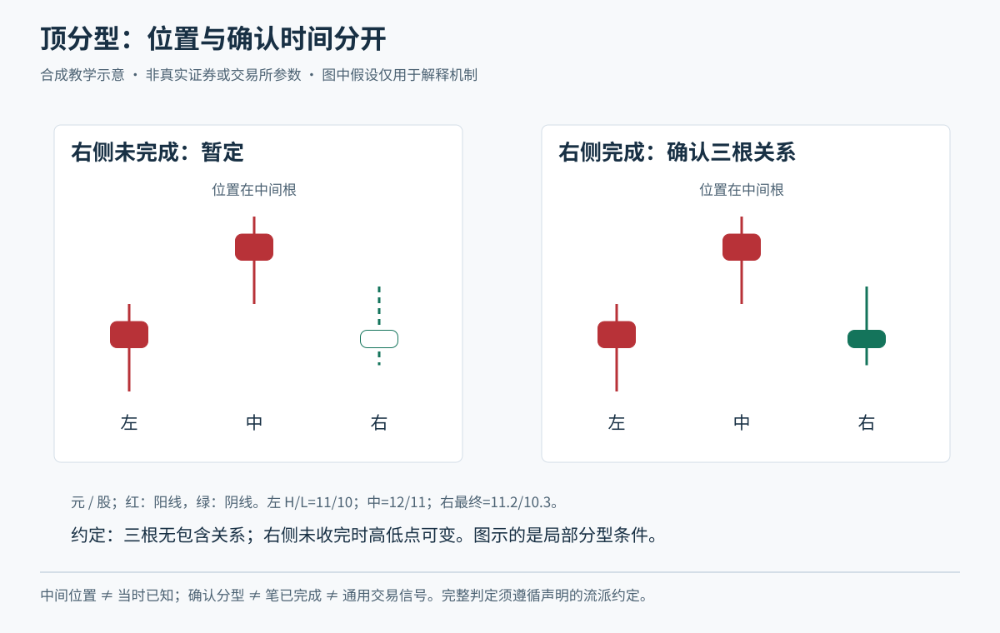
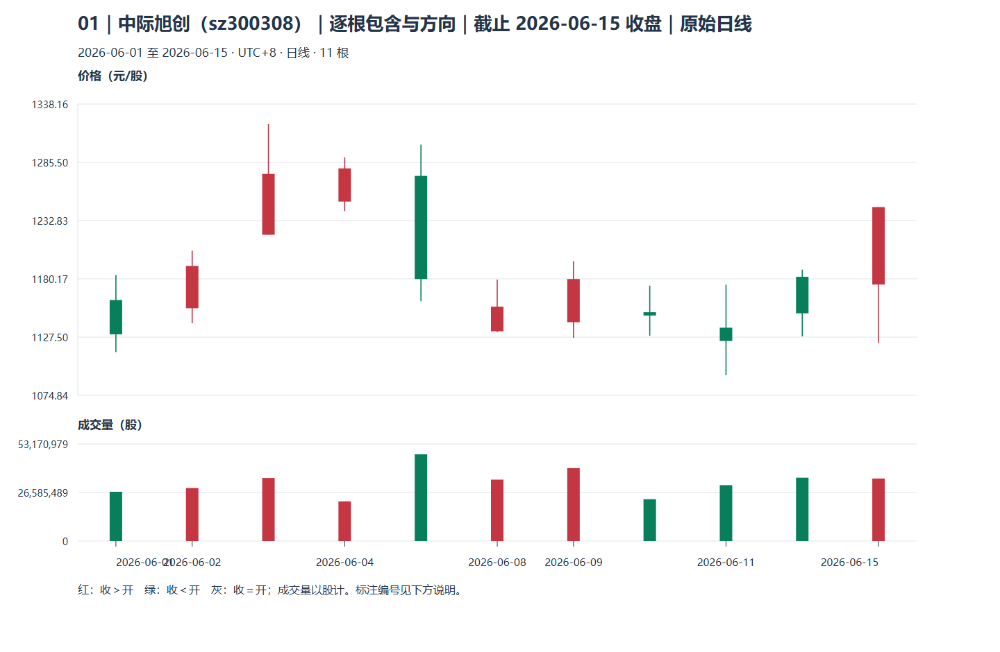

# 模块十一：从包含关系到线段

本模块接着第七模块的已收盘 K 线、第九模块的波峰波谷，以及第十模块已经讲过的完整规则与验证，学习怎样按公开约定整理结构。正式进入本模块前，先确认已理解完整交易过程中的风险、执行和验证问题；单独查一个术语仍可直接解释。青禾制造、小林及正文青禾案例的价格、时间、结构均为虚构教学材料，无真实证券代码或历史对应。线画得一致，只说明分类一致，不能证明交易有利。

教学口径：包含处理依原作者第 65 课的顺序原则；笔采用第 62、69 课所述、两端分型之间留有独立处理后 K 线的严格口径；线段依第 67 课两种特征序列情形，并结合第 71、78、81 课的澄清。相等端点、起始方向和数据截断采用下文明确的课程约定。所有标记保留观察截止时点。软件的“新笔”“老笔”“线段”选项可能不同，不能直接混用。

Tutor: Give the lesson for one part with its location identifier at a time. Keep examples different from stage assessments. Keep provisional labels and timestamps without change.

## 第一单元：包含处理

<a id="u01-p01"></a>
### 第一讲：包含看高低范围，不看实体大小

一根 K 线的价格区间写成 `[最低价,最高价]`。如果两根中的一个区间完全装进另一个，就叫包含关系。它与阳线、阴线无关，也不同于第八模块只比较实体的吞没形态。整理包含，是为了避免把同一范围里的来回波动误作多个结构转折，不是删除实际交易。

例如青禾制造先有 A=[9,11]，后有 B=[9.5,10.5]，A 包含 B；若 B 改成 [10,12]，两者虽有重叠，却互不包含。重叠只要求有共同价格，包含要求一方的整个范围都在另一方之内。二者用错，后续分型和笔都会跟着变。

本课程把恰好相等的边界也纳入包含；完全相同的两根仍按先后处理。这里只整理高低区间，原始开盘、收盘、成交量和时间另行保留，不能给合成区间虚构开收盘或成交路径。含停牌空白、错误价格或复权口径混杂的数据，要先回到第七模块核对，不能靠合并修好。

自然检查：A=[9,11]、B=[10,12] 是“有共同价格”，还是“一根装在另一根里”？请用区间说一句理由。若只比较两根的实体，会遗漏什么？

<a id="u01-p02"></a>
### 第二讲：先定方向，再逐根合并

方向来自此前最近一对互不包含的已处理区间：高点、低点共同抬高，采用向上处理；共同降低，采用向下处理。向上合并时，高点取两者较高值，低点也取较高值；向下时，两者分别取较低值。这是结构过滤约定，不是说真实最低价已经消失。依据见原作者[第 65 课（2007-07-16）](https://blog.sina.com.cn/s/blog_486e105c01000bpo.html)。

小林已看到前两区间 [8,10]、[9,11]，方向向上。随后 B=[9.5,10.5] 被 [9,11] 包含，合成 [9.5,11]。再来 C=[9.2,10.8]，须与合成结果比较：两者不包含，故保留 C；不能因为 C 也被原来的 [9,11] 包含，就把三根一口气合掉。包含关系不能靠相邻链条无限传递。

镜像例：此前方向向下，A=[10,12]、B=[10.5,11.5] 合为 [10,11.5]。若样本第一根开始便连续包含，缺少方向，本课程记“起始待定”，向前补资料；不得借用未来涨跌倒定最初方向。合成区间附上原始根号及极值发生时间，最后一组仍可能吸收新 K 线。

自然检查：上例 C 到来后，为什么不能再拿原始 A 直接决定合并？换成向下背景，你能解释低点为什么保留较低者吗？

## 第二单元：顶底分型

<a id="u02-p01"></a>
### 第一讲：分型是三个区间的局部关系

在去包含后的相邻三个区间里，中间区间的高、低点都高于左右两边，叫顶分型；都低于左右两边，叫底分型。顶取中间区间最高价，底取最低价。这个局部定义见原作者[第 62 课（2007-06-30）](https://blog.sina.com.cn/s/blog_486e105c01000bf2.html)。它描述一次转向痕迹，不直接宣布整段上涨或下跌结束。

虚构例：[10,11]、[10.6,11.8]、[10.2,11.3] 构成顶分型，顶为 11.8。底的例子为 [10,11]、[9.3,10.4]、[9.7,10.8]，底为 9.3。反例：[10,11]、[9.5,12]、[10.2,11.5] 的中间一根虽冲出最高价，却也伸出更低价，且含包含关系，不能跳过去包含步骤直接叫顶。

本课程在可比较的标准区间上要求严格高低关系；相等极值先完成包含处理，仍有边界歧义则保留待定，不随意挑“更好看”的一根。分型所依据的聚合周期、复权口径、样本起点须一致。成交稀疏时，三根图形的时间跨度和信息密度也可能很不相同。

自然检查：一根长上影线为何不能单独证明顶分型？如果右边那根还没有，眼前最准确的称呼是什么？

<a id="u02-p02"></a>
### 第二讲：极值时间早于知道它的时间

右侧区间尚未收盘，分型只能暂记候选。即使右侧原始 K 线已收盘，若仍可能并入同一包含组，结构标签也应保留相应状态。这里“确认”指在给定截止资料和课程规则下满足条件，不表示以后价格不能再创新高低。



小林在虚构的 10:05 看见青禾制造冲到 11.8，当时只知道新高；10:10 右侧 K 线收盘，且形成独立有效区间，才能在记录中写下顶分型。顶仍画在 10:05 的价格上，但确认时间写 10:10。若 10:09 右侧突然上冲并改写关系，10:05 的“顶”候选就不能冒充已经确认。

```text
10:05 极值出现 → 10:09 右侧未完，只能候选
                 → 10:10 条件满足，记录确认
                 → 确认之后才按交易计划考虑委托
```

分型与可用的笔端点还隔一层筛选；不能见到每个底分型都买、每个顶分型都卖。小林若按日线持有，盘中的小周期顶分型也不自动推翻其日线计划。原作者[第 69 课（2007-08-09）](https://blog.sina.com.cn/s/blog_486e105c01000c5b.html)讨论未完成结构的取舍；这里不继承其中获利或百分百预测表述。

自然检查：复盘图把箭头画在 10:05，小林能否把确认后的交易按 10:05 的极值成交？缺少的时间证据是什么？

## 第三单元：笔

<a id="u03-p01"></a>
### 第一讲：一顶一底还要满足间隔与极值

笔把一段符合要求的局部波动压缩成顶底之间的连接，向上笔从底到顶，向下笔从顶到底。不是随便连接两个拐点：须顶底交替，分型不共用处理后的 K 线，并按本课程严格口径，在两组三根分型之间至少留一根独立处理后 K 线；端点应覆盖该笔范围的相应极值。间隔按处理后根数算，不能拿合并前根数凑数。

虚构七区间依次为 [10,11]、[9,10]、[9.5,10.5]、[10,11]、[11,12]、[12,13]、[11.5,12.5]。第 1—3 根给出底，第 5—7 根给出顶，中间第 4 根独立，满足本课间隔，构成从 9 到 13 的向上笔。只给前五根，即便有一些局部拐点，也没有这一套完整顶分型，不能提前连到 13。

这是一种来源明确的严格笔口径，不宣称各种软件都这样算。有人把三根分型的中心间距直接简化成固定根数，有人采用放宽版本；比较标注前应先把是否去包含、是否允许共用、极值与同类端点规则写清。否则两张图的“同一买点”其实可能不是同一对象。

把七区间例子交给另一个人复查时，小林附上原始根号、包含处理后的根号，以及两组三根分型各用了哪些区间。若对方说“第 4 根也算进顶分型”，双方就先重新列区间，而不是争哪条斜线更像上涨。这种核对适用于手工画线和阅读软件结果，不要求学习者编程。

自然检查：十根原始 K 线去包含后只剩四根，为什么不能用“原来根数够多”证明这一笔已经成立？

<a id="u03-p02"></a>
### 第二讲：同类候选与最后一笔的延续

上升过程中，一个顶候选之后若没有足够间隔的有效底，随后又有更高顶，本课程以更高的同类候选更新未完成末端；下降时镜像处理更低底。相等极值保留较早者并记等高或等低；这是为复现而定的课程约定。不得跨过已经符合条件的异类端点，把几笔合成一笔。

小林先记录底 9、顶候选 12；随后一个很近的底不满足间隔，再出现顶 13，末端更新到 13。如果此前底 10 已按规则成为有效异类端点，那么 9→12、12→10、10→13 应逐笔核查，不能为了图漂亮直接画 9→13。每次更新保留旧观察，不涂掉当时曾有的不确定性。

实用记录可写：“截止 B17 收盘，起点底已具备；末端顶 13 候选，等待合格反向结构；不据此假设 13 可成交。”最后一笔的延伸是实时观察的一部分；完整历史上的稳定连线，不等于实时曾经没有候选变化。结构标记调整也不能替代已有持仓的风险退出。

再把“首次看见更新”与“新端点确认”分开。例如某个顶在周二已形成候选，并替换旧顶；周三独立后组出现，才满足本课的分型边界确认。周二观察到更新这个事实，不能因周三确认而被改记为周三。记录两列日期，保留周二原答，再追加周三状态；确认更晚也不意味着可以倒回极值价成交。

自然检查：如果明天末端从 13 延到 13.5，小林应改写昨天的判断，还是追加一条新观察？若已经出现合格反向笔，又该保留哪段历史？

## 第四单元：线段与特征序列

<a id="u04-p01"></a>
### 第一讲：特征序列找什么，没缺口时怎样结束

线段由笔组成，起始至少三笔有共同重叠，但不能每凑三笔便截断。向上线段的起止笔均向上，向下则相反。检验上升段时，抽取其中向下笔作为特征序列；检验下降段时，抽取向上笔。将这些笔各自的高低区间作同类包含整理，再检查上升段的顶分型、下降段的底分型。具体定义依据原作者[第 67 课（2007-08-01）](https://blog.sina.com.cn/s/blog_486e105c01000c16.html)。

虚构连续笔端点为 8→11→9→13→10→12→9.5。起始三笔区间共同重叠 [9,11]。假定各笔都已按上一单元成立，抽出的向下区间是 E1=[9,11]、E2=[10,13]、E3=[9.5,12]：中间高低都较高，形成特征顶分型；E1 与 E2 重叠 [10,11]，不存在特征缺口。这一情形可将上升段终点定位在 13，但知道它成立已经晚于 13 出现的时刻。

“特征缺口”指相邻特征区间没有共同价格，不等于日 K 线跳空。上例最后向下笔的完成是判断所用信息，不意味着原上升段应画到 9.5。笔破坏只是反向作用出现，段结束还要满足特征条件。不能用“跌得很凶”替代检查。

自然检查：若 E3 还未形成，只见 E2 的高点 13，为什么不能提前确认特征顶？你能指出价格端点与确认条件各在哪里吗？

<a id="u04-p02"></a>
### 第二讲：有缺口时，检查反向序列与失败分支

另一虚构序列从 8→11→9→15→12→14→11.5 延续。向下特征区间 E1=[9,11]、E2=[12,15]、E3=[11.5,14] 互不包含，中间元素形成顶关系；第一、第二元素间隔着 (11,12)，存在缺口。单有这个顶关系不足以结束原上升段：须从候选高点 15 开始，考察向下笔起始的反向序列，等其标准特征序列出现底分型。第二套分型不要求再重复第一套的缺口分类，也不要求一定先回补旧缺口。

接续例从候选顶展开：15→12→14→11.5→13.5→12→13.8。反向序列的向上元素依次为 [12,14]、[11.5,13.5]、[12,13.8]，中间高低均较低，给出所需底分型。这里各笔均假定已独立确认；仅凭这些端点不能检查底层 K 线是否成笔。若第二套分型未成，价格先重回并突破候选高点，则原上升段应继续检验，不能保留预画的三个完成段。

```text
候选转折点 → 第一套特征分型
           ├─前两元素无缺口：核查第一种结束条件
           └─有缺口：反向序列尚未确认 → 继续等待
                         ├─第二套分型成立：记录原段结束
                         └─原方向恢复：撤销该分段候选
```

包含不能机械跨越假设分界点混并；第二种情形的第二套序列仍须按其自身做包含整理。这些边界见原作者[第 71 课](https://blog.sina.com.cn/s/blog_486e105c01000c8i.html)、[第 78 课](https://blog.sina.com.cn/s/blog_486e105c01000cio.html)。[第 81 课](https://blog.sina.com.cn/s/blog_486e105c01000cmz.html)还更正了早先图例，因此不能只背旧图形。

小林的完整观察单应写：截止 B40；周期与价格口径固定；笔版本严格；原上升段候选顶 15；缺口 (11,12)；第二套底分型于 B40 确认；15 的发生时间早于 B40；下一步仅按既定策略判断，不回填顶价卖出。若数据不足，写出缺哪一笔，而非硬选唯一答案。

向下段的检查完全镜像：抽向上笔，先找标准特征序列的底分型；若前两元素有缺口，再从候选低点出发考察向上起始序列，等待其特征顶分型。反向序列尚在包含整理中，就继续写“待确认”。例如低点之后只出现一笔强反弹，力度虽大，仍不能凭“涨得快”补上缺失的后两次结构关系。

还有一个资料边界：截取图形的起点，可能恰好落在更早一段内部。小林应说明本次从哪里开始、此前已确认哪一段，不把窗口左边第一笔自动当新段起点。出现急冲急回时，线段内部极值也未必恰好是时间端点；记录实际区间和时间端点，不能删掉异常价格来迎合整齐画法。后续用线段作区间构件时，再明确标准化口径。

自然检查与迁移：第二套分型未成但跌破了某一笔低点，能否直接宣布线段结束？把本例全部上下镜像，你会改查哪种特征分型？这里都是随讲理解检查，独立阶段练习另行进行。

来源核对日期：2026-10-20。以上链接均为原作者博文，转述其结构定义；未核验任何软件算法与本课程逐例一致，也未验证这一划分具有交易收益优势。


## 补充旧图配套：真实缠论的包含、分型与笔

正文青禾案例用于初次讲解；本节链接的三只真实股票是另一套历史材料，不能混作青禾制造。见[真实图谱](../chan-real-charts.md)，建议本模块配合C01起的逐层图。先读原始日线、处理后区间映射和确认时点，再画笔；末端修改要保留旧观察。

教学顺序为原图观察、学员原答、逐层标注、后续验证和另一未见窗口。需要完整讲义时可连贯展开；日常教学仍只讲一个焦点。数据单位、复权、使用条件及尚未核验的公司行动，先读[数据口径](../chart-data.md)。横向行业和指数资料未包含在三只个股样本中，不伪造市场确认。


## 2026主案例实践

按最新学习偏好，优先使用中际旭创、寒武纪、中芯国际与天普股份的2026日线；先读[本期数据与公告](../data-2026.md)，再选[本模块对应主图](../chan-2026-atlas.md)。旧图只用于补充对照。已知权益事件跨日不直接当技术破位或下跌笔；

Tutor: Each time, load only the observation packet for this step. Only after you keep the raw response, open the annotation for the question. During the explanation, show the initial image for this question in the chat. Then, add markings one layer at a time. Do not give only text and links.


### 先看本期原图



本图是观察阶段的真实日线。

Tutor: For this step, select only one question for this stage. Keep the other questions for subsequent steps. After the learner sees an explanation or annotation, do not give the same window an `independent` assessment status. Do not record the window as material without previous access.

本节2024补充图统一作有辅助示范，不计独立识别；未见迁移另走[保留回放](../holdout-replay.md)并先核对暴露历史。
