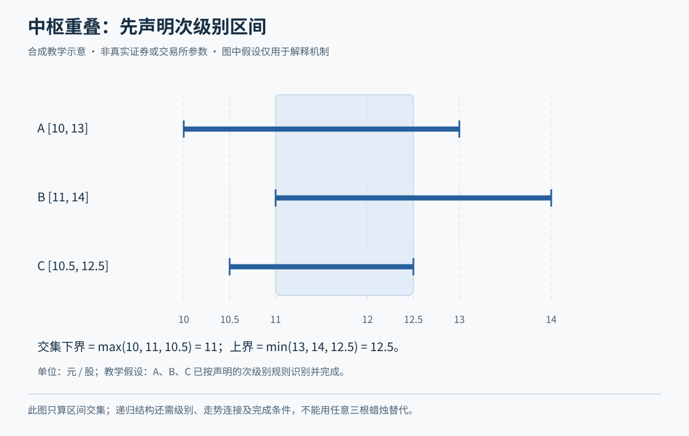
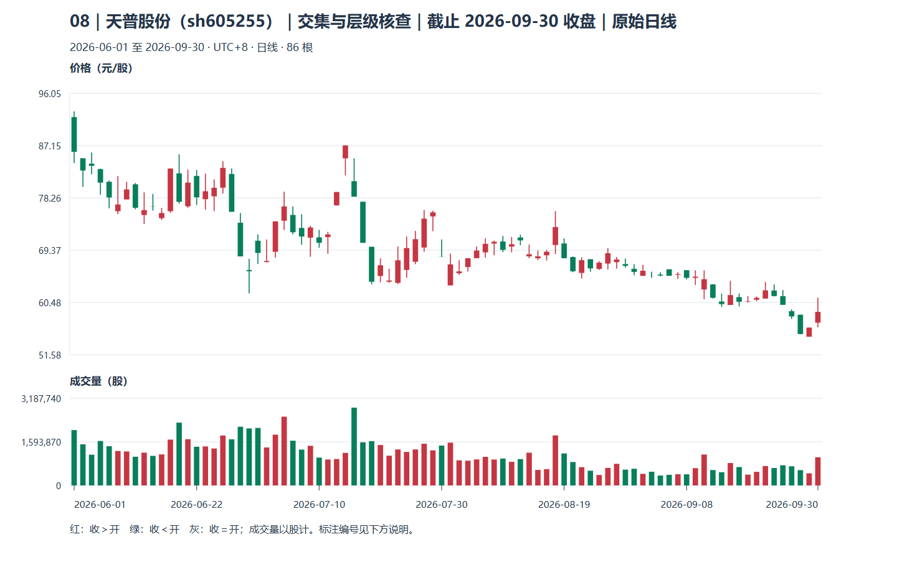

# 模块十二：中枢、级别与买卖点的确认

先备知识是第十一模块的笔、线段及候选状态，第十模块的指标与完整策略。正文中的青禾制造、小林及其价格、指标面积、时间和情境均为虚构教学例，无真实证券代码或历史；末尾链接的真实行情图谱另行标明来源。买卖点在这里是结构分类；能否及时辨认、实际成交并在成本后获利，须另有证据。

口径声明：以原作者第 17、18、20、24、53、61、83 课为依据，采用“已确认线段作最底层构件”的有限教学系统。B0 表示该构件，L1 表示由 B0 建立的最低教学级别，L2 使用已完成 L1 走势类型递归；这些是课程记号，不是作者原有级别命名。笔重叠仅称“笔区间练习”，不直接命名为同级别中枢；分钟周期也不直接等于 L1、L2。相等边界与未完成结构采用各讲注明的保守记录约定。

Tutor: Show the level, convention, cutoff, and confirmation evidence. Do not give structural interpretations as a method that always gives profit.

## 第一单元：走势类型与中枢

<a id="u01-p01"></a>
### 第一讲：中枢是共同区间，不是肉眼画的箱子

中枢表示按同一层级规则选出的连续构件反复经过的共同价格部分。先问每个构件是否成立，再求交集。一般递归定义使用至少三个连续、已完成的次级别走势类型；底层怎样截断须另作约定。原作者[第 17 课（2006-12-18）](https://blog.sina.com.cn/s/blog_486e105c010007p1.html)给出框架，[第 18 课（2006-12-26）](https://blog.sina.com.cn/s/blog_486e105c010007t8.html)强调完成状态与交集计算。

小林已经逐段核过青禾制造的三个 B0，依次为 9→12、12→10、10→13，范围是 [9,12]、[10,12]、[10,13]。交集下界取三个低点中的最大值 10，上界取三个高点中的最小值 12，因此最低教学中枢为 [10,12]。常用 ZD 记下界，ZG 记上界；整个波动覆盖 [9,13]，不能把它误当核心。

下面的图改用另一组已声明合格的次级别走势区间，专门比较三段全范围与共同核心：图中三个区间分别为[10,13]、[11,14]、[10.5,12.5]，交集为[11,12.5]。这是独立合成算例，不能把图中数值混入上面三个B0的[10,12]结果。



区间 [9,10]、[10.5,12]、[11,13] 的最大低点 11 高于最小高点 10，交集为空，不能画中枢。仅算出三个任意区间相交也不够，必须检查连续性和构件资格。本课程对只有一个接触价的交集记“零宽边界，待核”，不拿它作为买卖分类的基础；这不是宣称原文所有版本均排除边界接触。

自然检查：上述核心为什么从 10 开始而不是 9？如果第三段尚未完成，应该写“中枢成立”还是“形成候选”？

<a id="u01-p02"></a>
### 第二讲：一个中枢与多个同向中枢怎样区分

在固定级别，一个已完成走势类型只有一个中枢，称盘整；至少两个依次向上或向下、符合不重叠条件的中枢，分别称上涨或下跌。单纯连续收阳或价格涨很多，不足以判为缠论的上涨类型。完成资格也不能只由“已经够三个构件”自动赋予：可能仍围绕原中枢继续波动。

虚构例甲只在 [10,12] 周围反复，高点从 13 拉到 14，仍不能仅凭新高称为趋势。例乙先有核心 [10,11]，后有 [13,14]，并且两边围绕波动的完整范围分别止于 12 与始于 12.5，才具备同向分离的条件；还要核对所用完成段及连接。若两核心分开，但外围波动互相触及，须先考虑更大中枢，而非草率叫趋势。

这套用语比第九模块一般意义的“高低点抬高”更严格。小林可以同时记录“一般波峰抬高；缠论 L1 类型尚未完成”，不必为了统一词语掩盖证据差别。原文的走势会完成是一种理论框架，不能理解为任何亏损持仓迟早回本；停牌、终止交易等也使无限延续假设失去适用前提。

自然检查：青禾制造又涨了一元，却没有新的合格中枢，为什么“涨价”和“已形成该级别上涨类型”不是同一句话？

## 第二单元：级别、递归与中枢演化

<a id="u02-p01"></a>
### 第一讲：时间周期是取样尺，级别是组合关系

图上的一分钟或三十分钟，是把成交按时间装进 K 线的取样周期；笔、线段是该资料上的结构；递归级别表示怎样由较低层已完成走势类型组合。三者相关，却没有“几根笔必然等于几分钟级别”的固定换算。原作者[第 83 课（2007-09-26）](https://blog.sina.com.cn/s/blog_486e105c01000cqy.html)专门讨论笔作最小中枢构件与线段作构件的区别。

本课程从 B0 起步建立 L1；要形成 L2，需先取得连续、合格且已完成的 L1 构件，再求三个构件的重叠，不能直接数九笔。先把“完成依据”实际做一遍，再讨论怎样把整个构件交给上一层。

#### 先声明怎样封口：C12-F 有限课堂分解约定

原作者[第 17 课](https://blog.sina.com.cn/s/blog_486e105c010007p1.html)对已完成类型区分盘整与趋势，[第 20 课](https://blog.sina.com.cn/s/blog_486e105c010007zw.html)讨论中枢延伸、外围重叠和级别演化；两者都不能简化成“三段重叠，所以整个走势已完成”。[第 53 课（2007-05-23）](https://blog.sina.com.cn/s/blog_486e105c01000aqw.html)说明在较大尺度把已完成次级走势看作整体，并未免除较低层的资格检查。

为让初学者能亲手核查一次边界，本讲另设 **C12-F：单中枢课堂块的延迟封口约定**。这是课程自定的有限分解规则，不是原文的走势完成定理，也不是第十一模块线段结束规则的升级版。这里“已完成 L1”仅指“在 C12-F 分解下合格且已封口的 L1 盘整教学块”；只可作为同样注明 C12-F 的 L2 练习输入，不可冒充已经证明原义走势类型完成。

本例只处理先向上、后反向向下的分支，反方向可按全部不等式镜像检查。封口须依次核查以下条件：

1. 固定资料起点、价格口径和观察截止。输入是连续、交替且已按 M11 独立确认的 B0，保留各自全范围及确认时间。没有 M11 资格记录，便先停在 B0 待核，不能由端点价格反推线段成立。
2. 块内起始三个 B0 给出正宽核心 Z=[ZD,ZG]。后续纳入旧块的 B0 均须触及 Z，块内每组三个连续 B0 的正宽交集也须触及 Z；不把这些移动交集各算一个独立中枢。保留最初 Z，不逐次改窄。本规则只封这种单中枢教学块，遇到独立核心或歧义就保留竞争分解。
3. 设旧块末个向上 B0 的端点为 b。随后三个 B0 依次为向下离开 b→d、向上返回 d→r、再向下 r→e，须有 d<ZD、r<ZD、e<d，且三个全范围的交集为正宽。这给出与旧核心分离的反向重叠证据。边界相等按本约定不通过，不宣称原文所有边界定义都如此。
4. 三个后续 B0 都确认后，才把旧块截在 b，登记“C12-F 已封口”。选择最早满足这些条件的边界；若此前返回已触及旧核心，就不沿用那次封口候选。后续三个 B0 属于下一未封口块，只作旧块的确认见证，不重复计入旧块，也不因充当见证就自动获得完成资格。

这里刻意多等一次再离开，便于检查延迟与截断；它不是所有行情都必须或足以满足的 Chan 完成条件。不符合这套有限规则，只能说“C12-F 尚未封口或不适用”，不能推断原义上永不完成。即使通过，也只固定本次课堂分区；不能据此断言更大趋势已结束、将来不再返回、下一块已完成或任何买卖点成立。

#### 从 B0 到合格 L1：逐包看到什么，才能说到哪里

青禾制造合成包 F12 的起点 q0 价格为 50，左侧起点已按 M11 核过。q0、q1……是顺序资料时刻，不是分钟周期或真实交易时刻。以下 B0 的 M11 核准记录作为本讲底层输入；它们没有内部越过所列范围的极值。末端出现与取得线段确认是两列资料，不能混成一个时间。

| B0 | 端点连接 | 全范围 | 末端出现 | M11 确认资料最早齐备 |
| --- | --- | --- | --- | --- |
| F1 | 50→58 | [50,58] | q2 | q3 |
| F2 | 58→53 | [53,58] | q4 | q5 |
| F3 | 53→59 | [53,59] | q6 | q7 |
| F4 | 59→54 | [54,59] | q8 | q9 |
| F5 | 54→57 | [54,57] | q10 | q11 |
| F6 | 57→49 | [49,57] | q12 | q13 |
| F7 | 49→52 | [49,52] | q14 | q15 |
| F8 | 52→48 | [48,52] | q16 | q17 |

先只给小林截至 q7 的包。F1—F3 的交集为 [max(50,53,53),min(58,58,59)]=[53,58]，所以 L1 核心形成。59 在 q6 已出现，但既没有返回资料，也没有封口见证；此刻只能记“有中枢，L1 块未封口”。不能把 q7 写成完成时间。

给到 q11，F4、F5 都触及 [53,58]。新增移动三段交集 F2—F4 为 [54,58]、F3—F5 为 [54,57]，均落在旧核心内，是本约定允许的延伸。原来 59 之后的 F4 返回核心，所以不能沿用在 59 截断的设想；当前末端 57 也仍只是边界候选。旧核心继续保留 [53,58]。

给到 q13，F6 确认向下离开至 49，49<53；还缺返回。到 q15，F7 确认返回最高 52，52<53；仍缺已确认的再离开。q16 虽看见 48，也不能提前使用尚未确认的 F8。直到 q17，F8 确认，48<49，且 F6—F8 的交集为 [max(49,49,48),min(57,52,52)]=[49,52]，与 [53,58] 分离。四项封口条件此时才齐备。

因此在 **q17** 登记 T=F1—F5 为“C12-F 合格已封口 L1 盘整教学块”：时间边界 q0—q10，端点连接 50→57，原核心 [53,58]，全范围 [50,59]，见证 F6—F8，最早可用于本约定 L2 练习的时刻 q17。最高 59 在块内部，不能把全范围压成端点区间 [50,57]。F6 从 q10 的公共边界接续；共享边界点不等于重复使用整段 F6。

```text
q7  核心形成          → 有 L1 核心，块未封口
q11 围绕旧核心延伸    → b=57 是边界候选
q13 离开确认          → 缺返回和再离开
q15 返回未入核心      → 缺再离开的确认
q16 看到再离开末端    → F8 未确认，仍不可封口
q17 三个见证均已确认  → 依 C12-F 封口于 q10，知识时点为 q17
```

不完成的对照：若包停在 q15，缺的就是 F8 确认，不得把已经具备的核心和离开冒充封口。另一独立分支保持 F1—F6，但 F7 改为 49→54、F8 改为 54→48，即使到 q17 两段均确认，返回 54 已进入 [53,58]，三段见证交集 [49,54] 也触及旧核心；本次封口不通过。旧块仍须重查延伸、重组等读法，不能用“又数够三段”强行完成。

竞争分解也要留下：另一预先声明的口径可以暂把 F1—F8 放在较长的未完成观察中，或重组围绕中枢的边界，不能因本次封口便说它错误。C12-F 的结果必须带规则名；换规则要另存分解和当时可见证据。尤其 F6—F8 虽有新交集，却未取得它们自己的封口见证，不能立刻当作第二个已完成 L1；单个 T 更不能自动生成 L2。这正是“中枢形成”与“整个构件可递归使用”的差别。

回看另一独立的 L2 算术示例：若 T1、T2、T3 已在同一声明的分解下逐个取得资格，且连续衔接，其全范围为 [8,12]、[9,12]、[9,14]，则相交得 [9,12]。这里三组数只是范围输入，不是 F12 的后续，也不替代每个类型的内部核心、边界、封口见证和最早可用时间；少了 T2 的记录，L2 只能待核。采用原义走势类型时，仍须另核其完成依据，不可把 C12-F 封口证明搬作通用定理。

自然检查：q16 已经看到 48，为何 T 还不能进入上一级输入？到 q17，T 的结束位置、确认时刻和全范围分别是什么？先只核对这一步，再继续下一讲。

迁移检查：把界面从五分钟切到三十分钟，哪些原始聚合改变了？能否不核对内部结构就给全部标签升一级？

<a id="u02-p02"></a>
### 第二讲：延伸、扩展与趋势延续

中枢延伸，是后续符合资格的波动仍围绕原核心来回；趋势延续，则是继续生成同向分离的同级中枢；中枢扩展或级别扩张，涉及前后同级中枢的外围波动相交并形成更大结构。本课程用“扩展”表示后一类演化，不把“箱子画宽一点”当作定义。依据原作者[第 20 课（2007-01-05）](https://blog.sina.com.cn/s/blog_486e105c010007zw.html)。

沿用 [10,12]，后面合格的来回范围 [10.5,13]、[10.5,13.5] 都与核心有交集，小林继续观察延伸；不能每加入一段就把原核心偷偷缩为 [10.5,12]，应保留原始 ZD、ZG 与后续外围极值。若后来形成独立核心 [12.5,14]，还不能只看两核心不交就宣布趋势。

具体比较：旧核心 [10,12]、外围 [9,13]；新核心 [12.5,14]、外围 [12,15]。两外围相交 [12,13]，同级简单趋势读法受到挑战，应追踪更大中枢的形成。不能把外围交集 [12,13] 直接冒充新的 L2 核心；应回到完整 L1 类型检查递归资格。若新外围最低为 13.2，与旧外围最高 13 分离，才支持同向分离读法。

需要记的是“何时新增哪段、哪些范围相交、当前在哪一层”，不是用持续天数升级。横盘很久未必升级，价格运行很快也未必低级别。本文的演化案例是说明如何检验边界，省略的底层数据不作为已证实的实盘结构。

自然检查：旧核心与新核心不相交，却有外围交集，你会补查哪一项资料？为什么不能只凭时间更久把 L1 改称 L2？

## 第三单元：背驰与三类买卖点

<a id="u03-p01"></a>
### 第一讲：先指定可比段，再讨论力度减弱

背驰讨论特定结构中同方向走势的力度比较，必须写明级别、比较段和中枢背景。趋势背驰与围绕单个中枢进行的盘整背驰应分开；不能把任何两个价格新低配上指标抬高，都叫同一级别趋势背驰。原作者[第 24 课（2007-01-18）](https://blog.sina.com.cn/s/blog_486e105c0100087y.html)把 MACD 作为辅助方法，[第 27 课](https://blog.sina.com.cn/s/blog_486e105c010008h4.html)另论盘整背驰。

小林选定同一 L1 下跌背景，核对已有两个向下分离的中枢，比较围绕最后中枢的向下 A、C。虚构 A 从 14 到 11，C 从 12 到 10.5；相同图表、参数、柱值符号和积分口径下，对应负柱绝对面积分别为 8 与 5 个教学单位。C 创新低且指标面积较小，提供“力度减弱代理证据”。这里面积是离散柱值绝对值之和，不是价格下跌金额。

必须继续看 C 的完成与内部转折；若 C 还在走，面积后来增长到 9，原来的暂时比较就不成立。若 A、C 属于不同层级、周期或调整口径，比较也不合格。只有一个中枢时，最多先讨论盘整中的同向力度对照，不能硬补两个趋势中枢。

MACD 来自价格的计算，是代理，不是背驰本身；金叉也不是结构完成的替身。课堂只用它解释一种可复查的观察，未证明面积阈值、形态识别或后续反转可预测净收益。

自然检查：C 尚未收尾时面积为 5，为什么不能把“最后一定小于 8”写成事实？你会把这一条放进已知证据还是候选证据？

<a id="u03-p02"></a>
### 第二讲：三类买点与三类卖点各在回答什么

先固定同一级别。第一类关注趋势末段背驰与转折；第二类关注转折后首次次级别反向试探；第三类关注次级别离开中枢后首次次级别返回不重新进入核心。它们不是固定按一、二、三编号顺次出现的交易清单。原作者第 53 课也讨论小级别转大级别时，不能机械要求先有该级别一类点。

下表均为青禾制造的不同虚构情境，各结构完成资格须另有记录；价格只帮助理解边界。

| 类别 | 买方观察示例 | 卖方镜像示例 | 容易误叫的反例 |
| --- | --- | --- | --- |
| 第一类 | 合格下跌趋势末段新低至 10.5，背驰及内部转折得到相应证据 | 合格上涨末段新高至 15，出现相应背驰和转折证据 | 单根底分型或单次金叉不足以成立 |
| 第二类 | 10.5 转折后上到 12，首次次级回落至 11 并完成，未创新低 | 15 转折后下到 13，首次次级回抽至 14 并完成，未创新高 | 任意较高低点、反复第几次回调，不能只凭外形贴二类 |
| 第三类 | 核心 [10,12]；次级向上离开至 14，首次次级回试最低 12.4，返回完成 | 同核心向下离开至 8，首次次级回抽最高 9.6，返回完成 | 突破瞬间、未完成回试或回来进入核心，都不够 |

原文第三类边界使用“不跌破上界”“不升破下界”；本课程保守交易示例要求三买回试低点严格高于 ZG、三卖高点严格低于 ZD。正好等于边界时标“原文边界情形，课程暂不交易”，不可悄悄换口径。第三类要求的离开和返回是次级别走势，不能用两根 K 线冒名；三买之后仍可能扩展为大盘整。

卖点在本课现金多头场景中用于退出或减持，不代表已经具备融券卖空权限。小林错过一类点，可以按预先允许的二、三类继续观察，也可以放弃；不能为了补买而降低确认条件。

自然检查：价格从 14 回到 12.4，还在下跌中，能否立即认定三买？若回到 11.8，哪一项结构前提已不符合？

## 第四单元：区间套与竞争读法

<a id="u04-p01"></a>
### 第一讲：区间套缩小观察范围，不把未知变成已知

区间套，是在较大结构的候选末段内，进入较低层检查同向末段及其转折，逐层收窄观察位置。不是随便打开更短周期，直到找到一个支持自己买入的箭头。原作者[第 61 课（2007-06-21）](https://blog.sina.com.cn/s/blog_486e105c01000b9n.html)展示了这种定位思路；本课只保留条件化检查，不继承精确抄底等保证。

虚构例：L2 的向下候选 C 覆盖 D3—D8，内部 L1 的末段覆盖 D7—D8，再在相同原始资料下检查 B0 反向确认。小林在 D7 看见小底，只能记低层候选；若 D8 大层末段继续创新低且力度增强，低层曾反弹不能证明 L2 已结束。低层的确认帮助定位，大层的前提和失效条件仍需独立保留。

```text
D7 低层出现候选低点 → 不等于大层转折
D8 低层结构确认     → 重查 L1、L2 比较条件
D9 大层所需证据齐备 → 决策截止与可提交时点写明
D10 可交易观察窗口  → 记录实际委托与成交，不回填 D7 低价
```

与第七模块一样，完成一根较长周期 K 线的时间可能晚于内部小周期转折；必须取策略实际使用信息中的最晚可用时点。等待的代价是可能失去好价格；提前的代价是候选可能失败。二者都应有预先规则和独立统计，不能事后挑赢家。

自然检查：小周期转折已经确认，大周期背驰前提却失败了，小林是否还能沿用原来的“大级别买点”理由？

<a id="u04-p02"></a>
### 第二讲：把竞争读法写成决策记录

同一截图的不同结论，可能来自资料不足，也可能来自笔版本、级别或核心边界约定不同。应先把这些前提对齐，再讨论解释；不能简单说“缠论都主观”，也不能在未对齐时宣称软件唯一正确。样本起点不充分、尚未完成的末段，都可能妨碍边界确认。

小林的完整虚构记录如下，可手写完成：

| 字段 | 本次填写 |
| --- | --- |
| 资料与截止 | 青禾制造合成包 C12，D9 收盘；相同价格口径；没有 D10 资料 |
| 结构约定 | 严格笔；第十一模块线段口径；B0 构件、L1 观察；边界相等暂不交易 |
| 已知 | 核心 [10,12]；合格次级离开已经完成；首次返回目前低至 12.4 |
| 未知 | 返回是否完成；低层最后线段尚未确认；成交条件未发生 |
| 读法甲 | 返回完成且不进入核心后，可检查 L1 三买候选的完整证据 |
| 读法乙 | 返回未完成，可能跌回核心，仍是原中枢波动 |
| 当下行动 | 暂不新增仓位；保留既有风险退出；下个既定观察窗重查 |
| 失效与执行 | 若进入 [10,12]，不再沿用本次三买；若确认后价格过高，按策略放弃 |

若下一包行情上涨，小林当时没有买也可能是合规决策；若后来下跌，不能倒过来说他已经预知。另一软件用笔中心给三买，只能作为不同系统的比较记录，须先重建输入、口径与确认时间，才可比较交易结果。

迁移检查：把“首次返回未完成”换成“已完成但低点恰为 12”，按本课程口径该怎样写？能否同时保留原文边界读法与课程不交易的决定？这些是随讲检查，独立阶段考核另列。

来源核对日期：2026-10-20。原作者入口为[缠中说禅博客](https://blog.sina.com.cn/chzhshch)。原第 84 课链接本次仅返回维护提示，不作为本模块已核验依据。没有核验任一开源实现与本课一致；未验证缠论、指标代理或任何买卖点具有稳定获利能力。


## 补充旧图配套：真实图中的资格检查

正文青禾案例用于初次讲解；本节链接的三只真实股票是另一套历史材料，不能混作青禾制造。见[真实图谱](../chan-real-charts.md)，建议本模块配合缠论高阶候选图。特征序列、候选线段和候选中枢逐步核验；缺少同级完成走势资格时不宣布递归中枢或确定买卖点。

教学顺序为原图观察、学员原答、逐层标注、后续验证和另一未见窗口。需要完整讲义时可连贯展开；日常教学仍只讲一个焦点。数据单位、复权、使用条件及尚未核验的公司行动，先读[数据口径](../chart-data.md)。横向行业和指数资料未包含在三只个股样本中，不伪造市场确认。


## 2026主案例实践

按最新学习偏好，优先使用中际旭创、寒武纪、中芯国际与天普股份的2026日线；先读[本期数据与公告](../data-2026.md)，再选[本模块对应主图](../chan-2026-atlas.md)。旧图只用于补充对照。已知权益事件跨日不直接当技术破位或下跌笔；

Tutor: Each time, load only the observation packet for this step. Only after you keep the raw response, open the annotation for the question. During the explanation, show the initial image for this question in the chat. Then, add markings one layer at a time. Do not give only text and links.


### 先看本期原图



本图是观察阶段的真实日线。

Tutor: For this step, select only one question for this stage. Keep the other questions for subsequent steps. After the learner sees an explanation or annotation, do not give the same window an `independent` assessment status. Do not record the window as material without previous access.

## 同一记录贯通：有限规则下的完整练习

前面的分段例帮助分清概念；随后进入[高阶缠论贯通案例](../chan-trace.md)，按同一份合成记录核查各构件的完成见证、全范围与最早可用时刻，再实际构造上一级并判断离开后的首次返回。图中的底层输入和课程有限约定都有明确边界，不能代替真实行情的M11资格审查。每次只读当前观察步骤，保留原答后再打开同一步教师讲解；已看讲解的题不计未见独立掌握。

本节2024补充图统一作有辅助示范，不计独立识别；未见迁移另走[保留回放](../holdout-replay.md)并先核对暴露历史。
