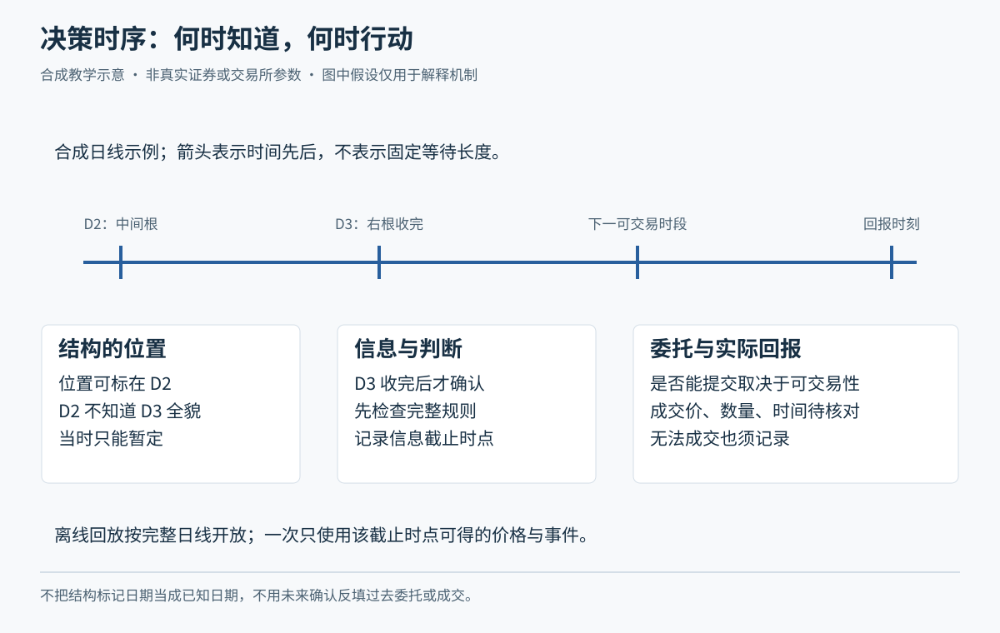
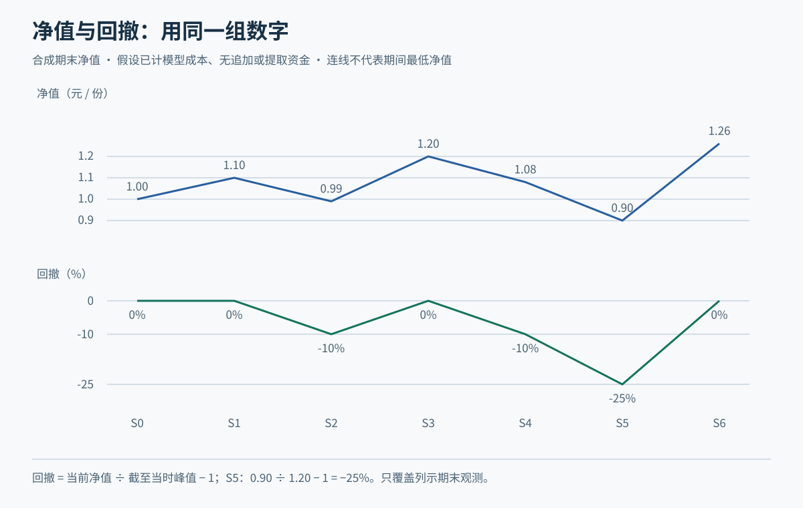

# 模块十四：把学习变成反复可核查的训练

本模块把前面关于市场、选股、价格、结构、风险和执行的知识接成每日循环。小林只使用虚构普通股票青禾制造练习，不设真实代码。全部价格、日期代号、费用、时钟、模拟规模和政策阈值都是教学假设；时钟不代表某交易板块完整交易时段，费用不是现行费率。课程完成不以实盘交易或短期盈利为条件。

Tutor: Show only the observation packet for this step. Keep the initial decisions without change. Use the learning checks on this page. Keep stage tasks without aid different from teacher answers.

## 第一单元：盘前准备与观察名单

### 第一讲：盘前先确定今天能做什么

盘前准备是把观察时间、资料可用性和账户限制先定下来，减少临场凭情绪找理由。先看自己何时能观察、是否有精力和可承受损失，再检查规则状态、公告、已有订单和持仓。不能把“今天一定要交易”作为准备的目标。

小林的虚构日程是只能在教学观察窗 A 与收盘后阅读资料，不能持续盯盘。他因此选择收盘形成信号、下一窗口再决策的模拟方式，而不用需要连续监控的盘中追价方式。若今天连窗口 A 都无法参加，就按预定规则跳过新增；已有风险退出的处理安排仍须单独检查，不能因忙碌而忘记持仓。

小林在纸上写：“D2 开始前，可用现金 20,000 元，无持仓、无未结订单；行情包仅到 D1；公告甲已在 D1 收盘前可用，公告乙尚未发布；今天只观察青禾制造。”公告的标注同时保留发布时间与自己实际可获得的时间，不能用后来读到的公告解释当时决策。

遇到公告缺页、停牌状态未知、价格口径不一致或账户对不上，先标“资料不齐，暂不新增”。这不是把整个课程推给文档，而是明确哪一项事实尚不支持行动。第十三模块已核验的沪市普通 A 股交收前卖出限制仍适用其限定场景；其他产品要在采用前另核，不凭名称类推。

自然检查：如果小林只能收盘后看盘，哪种需要盘中持续盯住的规则不适合他的观察条件？“没时间新增”为什么不等于“可以不管已有风险”？

### 第二讲：名单给观察理由，不给必买结论

观察名单是在事前定义范围内值得继续看资料的对象；合格候选还须通过明确过滤，交易候选才进一步满足策略条件。三者应分开。名单要保留被排除对象和理由，才能知道自己是否只挑了后来上涨的股票来复盘。

青禾制造的虚构条目写成：“公司业务和最近合成公告可读；当前资料覆盖足够；成交活跃度达到本次预设最低资料要求；近期有可能触发观察条件；目前无交易指令。”这里没有用“主力看好”替代证据。成交量只说明已观察到的交易，不能单凭图形断言谁在暗中买入。

另一份同样合格的记录可以是：“青禾制造资料连续，但未来持仓期有尚不能理解的合成事件；按本版事件过滤排除。”即使后面大涨，这条排除仍应保留。若规则并未规定事件过滤，盘后不能补写“早就看出风险”。遇到真实候选，则需真实证券身份、板块、资料出处、截止、复权口径和当时可选范围，本课合成案例不承担这些历史核验。

小林每天还写一句市场和行业背景，但要区分事实与推测：“合成行业指数回落”是输入事实，“所以青禾制造一定下跌”是未证实推断。背景可以触发事前规则规定的过滤，不能成为随时改策略的通行证。

自然检查：青禾制造在名单上，却没触发策略，小林最合适的记录是什么？若一只后来涨得很好的股票原来被排除，为什么仍要保留那行？

## 第二单元：按时间回放与逐单对账

### 第一讲：先写决定，再打开下一包行情

决策回放是把历史或合成资料按当时可用时点逐包展现。每次只处理当前包，先写判断和动作，再看下一包；不允许看完整走势后倒填入口。第十一、十二模块的端点发生与结构确认也遵守同样时序。老师讲过的例子是学习材料，不能随后算成独立考核通过。

为演示，冻结一个不含缠论条件的虚构规则 J1.0：只看青禾制造，资料及事件过滤合格、无持仓时，D1 完整收盘价严格高于此前三个完整日的最高价，才产生候选；下一教学窗口以不高于 10.1 的限价尝试买入最多 600 股，未成交余量在窗口结束申请撤销，不追高。入场前仍核现金、费用和 400 元风险预算。

退出沿用预先价格边界：9.5 触发风险退出，11 触发兑现；可卖限制始终先核。D2、D3、D4 是三个完整持仓日，若至 D4 收盘最高收盘价仍低于 10.5，则 D5 下一可执行窗口检查时间退出。止损和理由失效优先于目标；不加仓。无持仓后只有新的完整收盘突破才重启候选；两次未做风险核对即暂停新增。这些价格和参数未被证明有效。

假定此前三日最高价为 9.9，D1 收盘 10，规则允许进入下一步。小林在看到 D2 前写下“候选成立，最高买价 10.1，最多 600 股，预计 10 元附近时计划风险 340 元；若只能在 10.1 成交，风险需重新计算为 600×0.6+40=400 元”。D2 若直接到 10.4，则放弃，不把买价随走势上调。

自然检查：D1 收盘才成立的信号，能否自动按 D1 收盘价成交？若 D2 价格超出限价，“没买到”是否必然是执行错误？

### 第二讲：对账从每个单号开始

对账是核对意图、委托回报、成交记录、现金和证券数量是否一致。拟买 600 股不等于已买 600 股；点击撤销也不等于撤销成功。回放中若没有订单细节，要标记执行未知或采用事前假设，不能凭收盘价替代所有成交。

在另一条虚构已展开的 J1.0 回放中，小林提交最多 600 股、最高 10.1 元的委托。回报显示先买入 200 股、价格 10，随后买入 300 股、价格 10.02；剩余 100 股申请撤销，最后收到成功回报。实际持仓为 500 股，总成交金额 5,006 元，均价 10.012 元。教学买入费用设为 20 元，则现金从 20,000 变为 14,974 元；费用不能漏在成本外。

虚构后续已满足时间退出条件，到 D5 可卖数量核为 500，假设实际均以 10.3 成交、卖出费用 20 元，到账 5,130 元，最终现金 20,104 元，净赚 104 元。不能用计划的 600 股乘价差算利润，也不能再把 100 股未成交当亏损仓位。若撤销回报尚未到，先保留挂单占用，不能释放额度再下一笔。

若行情只给某日 O=10、H=11.2、L=9.3、C=10.4，目标与止损都被覆盖，OHLC 不能告诉你谁先发生。缺少更细路径时，结果应记区间未知，或采用事前固定的保守假设并单列；不能每次都选先止盈。普通 A 股的可卖限制还可能使“触及止损”无法立即变成卖出。

自然检查：这笔交易的 104 元净利润可否证明下单过程合规？如果有一张成交回报缺失，应先补哪项信息？

## 第三单元：前瞻模拟与日志

### 第一讲：前瞻模拟测执行习惯，也暴露资料问题

前瞻模拟指规则先冻结，未来资料随后到来，参与者按约定时点写决定。它区别于完整图上的回忆，也区别于已经知道答案的教学回放。可以在新发的合成包上训练，也可以使用有许可且来源明确的实时观察资料；两者证据应标明来源，不能混叫实盘。

小林先登记“J1.0，从下一观察日开始；只按已规定窗口查资料；没有条件就不交易”。第一天条件不足写不交易，第二天信号成立但价格超限写放弃，第三天有候选却发现公告时间不清写暂缓。这样连续三个周期仍产生了完整训练记录，不能因没有利润曲线就当作白做。

模拟成交必须有规则。例如只见报价触及限价，并不等于队列中的订单一定轮到小林；可以把填单结果记为未知，或者用统一保守假设，不在涨起来后临时判“早就买到”。缺少深度和队列资料的练习，对确认时序仍有用，对真实成交能力的证明则有限。

重复训练应覆盖顺势、震荡、跳空、未成交、信号失效与资料缺失，选包时不按最终盈亏筛选。每次循环是准备→判断→委托或放弃→核对→日志→定期复核。并不要求每天成交，也不以固定笔数宣告掌握；不同案例难度和是否独立完成更重要。

自然检查：如果小林记得上一包的结局，这包还能作为未知结果下的独立训练吗？“没有交易”和“没有做决定”在日志上怎样区分？

### 第二讲：一条日志要能还原当时的选择

日志不是写“今天赚了，心态不错”，而是让另一人能按相同截止重建你的决定。最少记资料身份、截止、规则版本、已知与未知、行动、失效条件、规模、可执行性、成交与偏差。可用纸笔或表格，学习者不需要写程序。

| 字段 | 小林的一条虚构前瞻记录 |
| --- | --- |
| 资料 | 合成包 J14-B；只到 D6 收盘，价格口径固定；未见 D7 |
| 版本与账户 | J1.0；现金 20,104，无持仓，无未结单 |
| 已知事实 | 突破候选满足；次日最高接受价仍按版内约定；事件资料已检查 |
| 未知 | D7 是否跳空、是否能成交、入场后是否触发退出 |
| 决定 | 下窗口先核现金和风险，再按规则尝试；超价放弃；不扩大数量 |
| 退出与限制 | 触发位 9.5、兑现位 11，持仓日重计；可卖与订单回报逐项核查 |
| 心理与支持 | 自觉想弥补前次错过；已做停顿；本次风险计算曾由老师提示 |
| 后续另填 | 委托号、成交或撤销状态、实际数量费用；当时决定不覆盖 |

“老师提示后算对”有学习价值，但应记为有提示；照着范例抄对，不等于独立完成。回看时若发现日志漏了失效条件，追加纠错说明，不能把新增条件伪装成原先就有。

理解与迁移检查：如果最终赚钱，但入场前风险计算由老师补完，本次能证明哪部分能力，哪部分仍待独立验证？换成主动放弃的一天，哪些日志字段仍然不能省？

## 第四单元：过程、结果与下一步

### 第一讲：把过程质量与交易结果放在两张账上

过程评价检查规则理解、资料时点、规模、执行、记录是否合规；结果评价检查成本后盈亏、权益回撤、暴露、基准及不确定性。两者不能相互替代。正确过程可能亏损，错误过程也可能碰巧赚钱；后者尤其不能因结果好就强化。

小林的两条虚构记录：甲按规则承担 340 元计划风险，后来因明确跳空实际亏 520；乙越过限价追买，碰巧赚 700。甲需复核跳空情景与执行细节，但不能仅因亏钱判为没学会；乙的追价违规须保留，不因盈利改成优秀。若甲的撤改证据缺失，过程结论同样只能写部分未证。

虚构权益从 20,000 到 21,000，再到 19,950，相对前高回撤为 (21,000−19,950)/21,000=5%；不是相对初始资金的 −0.25%。若期间有出入金，应另记并调整比较口径。报告还要说明费用、持有暴露、未平仓估值与基准：同期间空仓或同风险基准可提供参照，单看赚没赚钱不足以判断方法价值。

一组合成十笔样本中，四笔各净赚 200，六笔各净亏 100，合计 200、平均每笔 20。它只描述这十笔，不能证明未来期望值为正；若有两笔成交未知，不能静默删去，再把余八笔当全部机会。过程统计也写分母，例如八次具备完整日志的机会里六次独立完成风险核对，另两次有提示。

自然检查：为何 40% 的胜率既不能直接证明方法差，也不能证明方法有效？一次有提示的正确答案该记在哪种能力证据里？

### 第二讲：按证据选择补课、继续观察或暂停

定期复核先分类问题，再决定下一步。不会解释成交状态，回第三模块；费用或规模常错，回第四模块；信号看了未来才会认，回第七、十一、十二模块的确认时间；频繁违规，回第十三模块的行为控制。补课完成后用新的未见案例再查，不能重复背同一答案充当进步。

若过程能够独立完成但净结果不理想，应保留原版本样本，检查成本、暴露与市场状态，再提出一个可证伪的修改问题。若想给 J1.0 加缠论过滤，写成 J1.1，同时保留原版在同类机会上的影子记录，比较机会减少、确认变慢、未成交及净结果；不能只展示过滤后恰好盈利的案例。多次试规则会增加偶然选中好成绩的机会，见[Bailey 等原始研究](https://www.davidhbailey.com/dhbpapers/backtest-prob.pdf)。

如果主要问题是过度交易，应比较每次新增操作带来的证据与成本。美国监管投教机构的[过度交易提示](https://www.investor.gov/introduction-investing/general-resources/news-alerts/alerts-bulletins/investor-alerts/investor-42)说明费用可以侵蚀结果；这里只采用一般成本逻辑，不借用其美国账户制度解释 A 股。反复记录不等于反复下单。

小林的阶段结论可以具体写：“能独立完成候选筛选与时点记录；部分成交对账还需提示；三类点只在讲解例中做过，未完成独立迁移；模拟净赚 104 不证明策略优势；下一步先做未成交与撤改的新案例。”也可以选择继续纯观察或暂停；无需靠投入真实资金证明认真学习。

迁移检查：若一周全赚钱却出现两次超预算，下一步应先提高规模还是处理执行失控？若长期规则清楚但始终缺少真实队列资料，哪些执行结论应继续保持未知？本模块的讲解、随讲检查与后续无提示阶段练习分别记录，不把课程浏览完成当成交易胜任认证。

来源核对日期：2026-10-20。未验证 J1.0/J1.1 的市场优势、模拟成交与实盘一致性、学习效果或个人适当性；没有真实证券历史与真实委托记录。规则适用范围沿用第十三模块已经限定的沪市普通 A 股示例，不能自动覆盖其他交易场所或品种。
